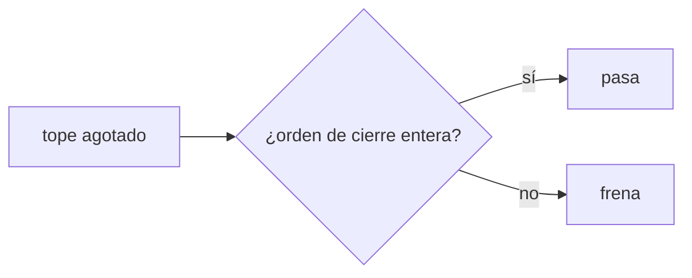
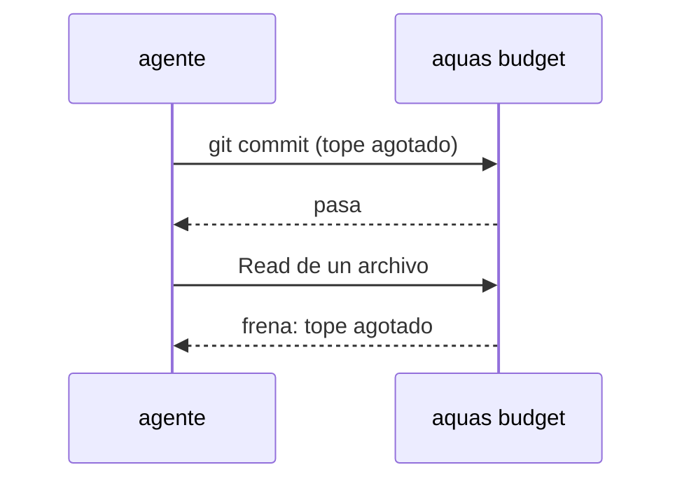

# S003 · Cerrar siempre se puede

[Inicio](../../README.md) › [E001](../README.md) › [F019](README.md) › S003

[Slice](../../glosario.md#slice) que deja pasar las órdenes de cierre aunque el tope de la [feature](../../glosario.md#feature) esté agotado.

## En una frase

Con el tope agotado siguen pasando [commit](../../glosario.md#commit), push, [gate](../../glosario.md#gate), [sello](../../glosario.md#sello), memoria y estado; todo lo demás se frena.

## Para qué existe

**El problema.** Hoy un tope agotado frena cualquier llamada, también el commit del trabajo hecho.

**Por qué importa.** Un trabajo verde sin commit se pierde o exige otro apruebo solo para guardarlo. Eso gasta más, no menos.

**La solución.** Una lista cerrada de órdenes Bash del [agente](../../glosario.md#agente) pasa el freno de la feature. Solo el comando entero, sin nada detrás.

**Contrato.**

| Regla | Valor |
|---|---|
| Pasan | `git add`, `git commit`, `git push`, `aquas verify`, `aquas backlog seal`, `aquas backlog state`, `aquas backlog green`, `aquas memory set` y `aquas memory archive` |
| Forma | comando entero; acepta `cd <raíz> &&` delante, como la exención de hoy |
| `git push` | solo `-q`, `--quiet`, `-u`, `--set-upstream`, `--tags`, `--follow-tags`; luego `origin` y una rama opcional, sin `+`, `:`, llaves ni comodines |
| No pasan | lecturas, ediciones, subagentes y cualquier otra orden |
| Encadenado | `;`, `&&` extra, tuberías o sustitución → frena |
| Tope extremo | estas órdenes no saltan el tope extremo del turno (S004) |
| Alcance | `cmd/aquas/presupuesto*.go`, `cmd/aquas/*_test.go`, `docs/**` |

**Casos borde.**

| Categoría | Aplica | Prueba o motivo |
|---|---|---|
| cada tipo de ficha | no | la lista mira la orden, no la ficha |
| cada estado de origen | sí | con tope agotado pasan; bajo el tope todo pasa: `TestCierreConTopeAgotado` |
| padre e hijo, activo y archivado | no | la exención es igual en hilo y subagente |
| entrada ausente, vacía, mal escrita o duplicada | sí | comando vacío, `git commitx`, orden permitida con `; rm` detrás: `TestCierreConTopeAgotado` |
| choque con otro control | sí | la exención es solo ante el tope agotado: un registro ilegible frena igual; la memoria exenta sigue pasando: `TestCierreConTopeAgotado`. La guardia es otro gancho y no se toca. Que el tope extremo frene igual lo prueba S004 |
| quién habla: humano, agente o herramienta | no | el freno solo mira la llamada del agente |
| fallo a mitad de camino | no | la exención no escribe nada; no hay estado a medias |

## Analogía

Piensa en **un estacionamiento que cierra**: ya no entra nadie, pero quien está adentro puede salir.

## Diagrama

## Ejemplo de punta a punta

continúa: [EJ-E001-F019](README.md#EJ-E001-F019)

1. El tope de la feature se agota con el slice ya en verde.
2. El agente corre `git commit` y `git push`: pasan.
3. Intenta leer otro archivo: se frena.
4. Informa al humano, que decide un tope nuevo o cerrar.

## Paso a paso

1. Definir la lista cerrada de órdenes de cierre.
2. Aceptar solo el comando entero, con `cd <raíz> &&` opcional.
3. Frenar todo lo demás con el tope agotado.

## Cómo se usa

- No hay orden nueva: con el tope agotado, cerrar sigue funcionando.

## Contrato y evidencia

<!-- GENERADO por aquas desde trabajo/: no editar a mano; `aquas compile` lo rehace. -->

| Prueba | Valida | Rojo cuando | Verde cuando | Rojo | Verde |
|---|---|---|---|---|---|
| `TestCierreConTopeAgotado` | valida que cerrar no se frena | commit o push se frenan con el tope agotado | commit, push, verify, seal, memory y state pasan; otra orden se frena | 2026-11-04 | 2026-11-04 |

### Código

| Archivo | Función | Parámetros | Qué hace |
|---|---|---|---|
| [cmd/aquas/presupuesto.go](../../../cmd/aquas/presupuesto.go) | `leerTope` | `(primera string, ap *apruebo)` | leerTope: «tope 25M» o «tope 25 M» → tokens ponderados; «tope 900» solo, o seguido de «con» o «y» → llamadas (el viejo). |
| [cmd/aquas/presupuesto.go](../../../cmd/aquas/presupuesto.go) | `pesoVeinteavos` | `(u usoRespuesta) int64` | pesoVeinteavos: el usage de una respuesta ponderado por precio, en veinteavos de token para no usar decimales. |
| [cmd/aquas/presupuesto.go](../../../cmd/aquas/presupuesto.go) | `millones` | `(n int64) string` | millones: 15000000 → «15M»; 15000001 → «15,0M». |
| [cmd/aquas/presupuesto.go](../../../cmd/aquas/presupuesto.go) | `rutaComparableEn` | `(goos, r string) string` | rutaComparableEn: la ruta limpia con «/»; en Windows la forma Git Bash «/d/…» pasa a «D:/…» (A2.4; sistema dado: E000/F007/S001). |
| [cmd/aquas/presupuesto.go](../../../cmd/aquas/presupuesto.go) | `exentaDelFreno` | `(raiz, herramienta, comando string) bool` | exentaDelFreno: true si el comando Bash entero es `aquas memory set …` o `aquas defect new\\|occur …`. |
| [cmd/aquas/presupuesto.go](../../../cmd/aquas/presupuesto.go) | `rutasIguales` | `(goos, a, b string) bool` | rutasIguales (E000/F007/S001, hallazgos L1 y L2; no confundir con entorno.mismaRuta, que no entiende «/d/…»): misma carpeta según el sistema; mayúsculas iguales solo en Windows. |
| [cmd/aquas/presupuesto.go](../../../cmd/aquas/presupuesto.go) | `exentaDelFrenoEn` | `(goos, raiz, herramienta, comando string) bool` | exentaDelFrenoEn: exentaDelFreno para un sistema dado (E000/F007/S001). |
| [cmd/aquas/presupuesto.go](../../../cmd/aquas/presupuesto.go) | `ordenDeCierre` | `(raiz, herramienta, comando string) bool` | ordenDeCierre (E001/F019/S003): true si el comando Bash entero es una orden de cierre de reCierre. |
| [cmd/aquas/presupuesto.go](../../../cmd/aquas/presupuesto.go) | `ordenEnteraEn` | `(goos, raiz, herramienta, comando string, re *regexp.Regexp) bool` | ordenEnteraEn: el comando Bash entero cumple la lista blanca re; el `cd` solo vale a la raíz y un binario entre |
| [cmd/aquas/presupuesto.go](../../../cmd/aquas/presupuesto.go) | `presupuestoCLI` | `(raiz string, args []string)` | presupuestoCLI: «herramienta» cuenta el gasto en el registro (tokens ponderados o llamadas, E001/F019/S001) y bloquea con exit 2 al pasar un tope. |
| [cmd/aquas/presupuesto.go](../../../cmd/aquas/presupuesto.go) | `marcaDir` | `(raiz string) string` | marcaDir: carpeta de las marcas de aviso; borrarlas repite un aviso, no quita un freno. |
| [cmd/aquas/presupuesto.go](../../../cmd/aquas/presupuesto.go) | `avisarGasto` | `(raiz string, c *cuentaFeature) string` | avisarGasto: aviso al cruzar el 50% o el 80% del tope, una vez por umbral y apruebo. La marca guarda la hora del |
| [cmd/aquas/presupuesto.go](../../../cmd/aquas/presupuesto.go) | `frenar` | `(formato string, a ...any)` | frenar escribe el motivo en stderr y bloquea la llamada. |
| [cmd/aquas/presupuesto.go](../../../cmd/aquas/presupuesto.go) | `avisarContexto` | `(raiz string, e entradaPresupuesto, turno string) string` | avisarContexto pide /compact una vez por turno cuando el contexto medido pasa el umbral; la marca guarda el |
| [cmd/aquas/presupuesto.go](../../../cmd/aquas/presupuesto.go) | `recorrerRegistro` | `(ruta string, f func(pos int64, l lineaLlamadas)) error` | recorrerRegistro abre un registro y entrega cada línea legible con su posición; las rotas se ignoran. |
| [cmd/aquas/presupuesto.go](../../../cmd/aquas/presupuesto.go) | `llamadas` | `(raiz string, l lineaLlamadas) []string` | llamadas: ids de los tool_use de una línea de asistente, sin las llamadas exentas. |
| [cmd/aquas/presupuesto.go](../../../cmd/aquas/presupuesto.go) | `escanear` | `(raiz, ruta string) (escaneo, error)` | escanear lee un registro una vez. D000096: el turno y el apruebo vigente se eligen por hora, no por posición: |
| [cmd/aquas/presupuesto.go](../../../cmd/aquas/presupuesto.go) | `carpetaProyecto` | `(ruta string) string` | carpetaProyecto: la carpeta de las sesiones del proyecto; desde un registro de subagente sube a ella. |
| [cmd/aquas/presupuesto.go](../../../cmd/aquas/presupuesto.go) | `escanearProyecto` | `(raiz, ruta string) (map[string]escaneo, error)` | escanearProyecto lee cada registro de sesión de la carpeta del proyecto; sin registro legible, error. |
| [cmd/aquas/presupuesto.go](../../../cmd/aquas/presupuesto.go) | `featureCerrada` | `(raiz, id string) bool` | featureCerrada (E001/F017/S001, D000091): true solo si la feature y todos sus slices (al menos uno) están en CERRADO. |
| [cmd/aquas/presupuesto.go](../../../cmd/aquas/presupuesto.go) | `frenoFeature` | `(raiz, ruta string, sesiones map[string]escaneo) (msg string, cuenta *cuentaFeature)` | frenoFeature: el último apruebo de feature del humano fija feature, tope y hora; se cuentan los tokens ponderados |
| [cmd/aquas/presupuesto.go](../../../cmd/aquas/presupuesto.go) | `frenoTurno` | `(raiz, ruta string, sesiones map[string]escaneo) string` | frenoTurno (E001/F019/S004): último recurso contra bucles. Suma las llamadas distintas y los tokens ponderados del |
| [cmd/aquas/presupuesto.go](../../../cmd/aquas/presupuesto.go) | `contextoMedido` | `(ruta string) int` | contextoMedido: tokens de entrada de la última llamada del modelo en el transcript; 0 si después |

<!-- /GENERADO -->

Prueba del slice: `TestCierreConTopeAgotado`.

**Evidencia.** Rojo el 2026-11-04 07:33: con el tope agotado, `git add`, `git commit` y `git push` se frenaban. Verde final a las 08:16, tras las auditorías A1 a A3; A3 pidió casos aislados de `--force`, `-f`, `--delete`, `--mirror` y `--prune`.

**Implementación.** `reCierre` reusa los trozos de la lista blanca de memoria (`fragCd`, `fragBinario`, `fragArgumentos`). `ordenEnteraEn` valida el `cd` y el binario entre comillas para las dos listas. Las órdenes de cierre sí cuentan en el gasto; solo pasan el freno.

**Auditoría A1** (CON_HALLAZGOS, arreglados). `git push --receive-pack=…` corría cualquier comando: push ahora acepta solo opciones de una lista corta. Se agregó la prueba del registro ilegible con orden de cierre. La celda con `|` se partía.

**Auditoría A2** (CON_HALLAZGOS, arreglados). Llaves de bash armaban `--receive-pack`; una ruta local corría [hooks](../../glosario.md#hook) ajenos; `+rama` y `:rama` forzaban o borraban. Push quedó en `origin` y una rama simple. Límite aceptado: `git commit -F <archivo>` puede leer un archivo de fuera del repo; no ejecuta nada.

**Detalle.** `git commit -F - <<'FIN'` se frena por el `<`: con el tope agotado, el mensaje va con `-m`.

## Navegación

- ↑ Subir: [F019](README.md)
