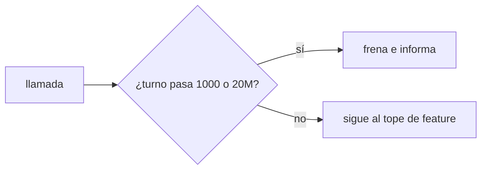
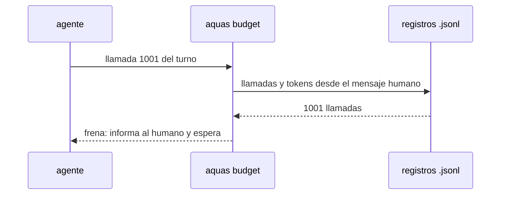

# S004 · Tope extremo por turno

[Inicio](../../README.md) › [E001](../README.md) › [F019](README.md) › S004

[Slice](../../glosario.md#slice) que frena un turno desbocado, haya o no [feature](../../glosario.md#feature) aprobada.

## En una frase

Un turno se frena solo al pasar 1000 llamadas o 20M [tokens](../../glosario.md#token) ponderados; es el último recurso contra bucles.

## Para qué existe

**El problema.** Al quitar el freno de 60 (S002), nada frena un bucle fuera de una feature aprobada.

**Por qué importa.** Un [agente](../../glosario.md#agente) en bucle gasta sin límite hasta que el humano lo ve.

**La solución.** Un tope por turno muy por encima del uso real. El turno más pesado medido gastó 49 respuestas y 1,1M ponderados; 20M deja holgura de 18 veces.

**Contrato.**

| Regla | Valor |
|---|---|
| Turno | desde el mensaje humano más reciente, como hoy |
| Llamadas | más de 1000 llamadas del hilo y sus subagentes del turno → frena |
| Tokens | más de 20M ponderados del hilo y sus subagentes del turno → frena |
| Siempre | rige con o sin feature aprobada; no lo suelta cerrar la feature |
| Exentas | solo `memory set` y `defect new|occur`, como hoy |
| Mensaje | lo gastado y «informa al humano y espera» |
| Alcance | `cmd/aquas/presupuesto*.go`, `cmd/aquas/*_test.go`, `docs/**` |

**Casos borde.**

| Categoría | Aplica | Prueba o motivo |
|---|---|---|
| cada tipo de ficha | no | el tope es del turno, no de una ficha |
| cada estado de origen | sí | con feature abierta, cerrada y sin apruebo frena igual: `TestTopeExtremo` |
| padre e hijo, activo y archivado | sí | llamadas y tokens de subagentes del turno suman: `TestTopeExtremo` |
| entrada ausente, vacía, mal escrita o duplicada | sí | mensaje humano sin hora no abre turno; `message.id` repetido cuenta una vez: `TestTopeExtremo` |
| choque con otro control | sí | las órdenes de cierre de S003 no lo saltan: `TestTopeExtremo` |
| quién habla: humano, agente o herramienta | sí | una notificación o mensaje de agente no abre turno nuevo: `TestTopeExtremo` |
| fallo a mitad de camino | sí | registro ilegible frena con su ruta: `TestTopeExtremo` |

## Analogía

Piensa en **el disyuntor de la casa**: casi nunca salta, y cuando salta es porque algo anda mal.

## Diagrama

## Ejemplo de punta a punta

continúa: [EJ-E001-F019](README.md#EJ-E001-F019)

1. Un agente entra en bucle leyendo el mismo archivo.
2. Sin feature aprobada, nada lo frenaba tras quitar el freno de 60.
3. En la llamada 1001 del turno, el gancho frena.
4. El agente informa al humano; un mensaje humano abre turno nuevo.

## Paso a paso

1. Contar llamadas y tokens del turno, con subagentes.
2. Frenar al pasar 1000 llamadas o 20M ponderados.
3. Aplicarlo siempre, con o sin feature.

## Cómo se usa

- No hay orden: es el último recurso y no se configura.

## Contrato y evidencia

<!-- GENERADO por aquas desde trabajo/: no editar a mano; `aquas compile` lo rehace. -->

| Prueba | Valida | Rojo cuando | Verde cuando | Rojo | Verde |
|---|---|---|---|---|---|
| `TestTopeExtremo` | valida el freno de bucles | el turno pasa de 1000 llamadas o 20M tokens sin freno | la llamada 1001 o el token 20M frenan | 2026-11-04 | 2026-11-04 |

### Código

| Archivo | Función | Parámetros | Qué hace |
|---|---|---|---|
| [cmd/aquas/presupuesto.go](../../../cmd/aquas/presupuesto.go) | `leerTope` | `(primera string, ap *apruebo)` | leerTope: «tope 25M» o «tope 25 M» → tokens ponderados; «tope 900» solo, o seguido de «con» o «y» → llamadas (el viejo). |
| [cmd/aquas/presupuesto.go](../../../cmd/aquas/presupuesto.go) | `pesoVeinteavos` | `(u usoRespuesta) int64` | pesoVeinteavos: el usage de una respuesta ponderado por precio, en veinteavos de token para no usar decimales. |
| [cmd/aquas/presupuesto.go](../../../cmd/aquas/presupuesto.go) | `millones` | `(n int64) string` | millones: 15000000 → «15M»; 15000001 → «15,0M». |
| [cmd/aquas/presupuesto.go](../../../cmd/aquas/presupuesto.go) | `rutaComparableEn` | `(goos, r string) string` | rutaComparableEn: la ruta limpia con «/»; en Windows la forma Git Bash «/d/…» pasa a «D:/…» (A2.4; sistema dado: E000/F007/S001). |
| [cmd/aquas/presupuesto.go](../../../cmd/aquas/presupuesto.go) | `exentaDelFreno` | `(raiz, herramienta, comando string) bool` | exentaDelFreno: true si el comando Bash entero es `aquas memory set …` o `aquas defect new\\|occur …`. |
| [cmd/aquas/presupuesto.go](../../../cmd/aquas/presupuesto.go) | `rutasIguales` | `(goos, a, b string) bool` | rutasIguales (E000/F007/S001, hallazgos L1 y L2; no confundir con entorno.mismaRuta, que no entiende «/d/…»): misma carpeta según el sistema; mayúsculas iguales solo en Windows. |
| [cmd/aquas/presupuesto.go](../../../cmd/aquas/presupuesto.go) | `exentaDelFrenoEn` | `(goos, raiz, herramienta, comando string) bool` | exentaDelFrenoEn: exentaDelFreno para un sistema dado (E000/F007/S001). |
| [cmd/aquas/presupuesto.go](../../../cmd/aquas/presupuesto.go) | `ordenDeCierre` | `(raiz, herramienta, comando string) bool` | ordenDeCierre (E001/F019/S003): true si el comando Bash entero es una orden de cierre de reCierre. |
| [cmd/aquas/presupuesto.go](../../../cmd/aquas/presupuesto.go) | `ordenEnteraEn` | `(goos, raiz, herramienta, comando string, re *regexp.Regexp) bool` | ordenEnteraEn: el comando Bash entero cumple la lista blanca re; el `cd` solo vale a la raíz y un binario entre |
| [cmd/aquas/presupuesto.go](../../../cmd/aquas/presupuesto.go) | `presupuestoCLI` | `(raiz string, args []string)` | presupuestoCLI: «herramienta» cuenta el gasto en el registro (tokens ponderados o llamadas, E001/F019/S001) y bloquea con exit 2 al pasar un tope. |
| [cmd/aquas/presupuesto.go](../../../cmd/aquas/presupuesto.go) | `marcaDir` | `(raiz string) string` | marcaDir: carpeta de las marcas de aviso; borrarlas repite un aviso, no quita un freno. |
| [cmd/aquas/presupuesto.go](../../../cmd/aquas/presupuesto.go) | `avisarGasto` | `(raiz string, c *cuentaFeature) string` | avisarGasto: aviso al cruzar el 50% o el 80% del tope, una vez por umbral y apruebo. La marca guarda la hora del |
| [cmd/aquas/presupuesto.go](../../../cmd/aquas/presupuesto.go) | `frenar` | `(formato string, a ...any)` | frenar escribe el motivo en stderr y bloquea la llamada. |
| [cmd/aquas/presupuesto.go](../../../cmd/aquas/presupuesto.go) | `avisarContexto` | `(raiz string, e entradaPresupuesto, turno string) string` | avisarContexto pide /compact una vez por turno cuando el contexto medido pasa el umbral; la marca guarda el |
| [cmd/aquas/presupuesto.go](../../../cmd/aquas/presupuesto.go) | `recorrerRegistro` | `(ruta string, f func(pos int64, l lineaLlamadas)) error` | recorrerRegistro abre un registro y entrega cada línea legible con su posición; las rotas se ignoran. |
| [cmd/aquas/presupuesto.go](../../../cmd/aquas/presupuesto.go) | `llamadas` | `(raiz string, l lineaLlamadas) []string` | llamadas: ids de los tool_use de una línea de asistente, sin las llamadas exentas. |
| [cmd/aquas/presupuesto.go](../../../cmd/aquas/presupuesto.go) | `escanear` | `(raiz, ruta string) (escaneo, error)` | escanear lee un registro una vez. D000096: el turno y el apruebo vigente se eligen por hora, no por posición: |
| [cmd/aquas/presupuesto.go](../../../cmd/aquas/presupuesto.go) | `carpetaProyecto` | `(ruta string) string` | carpetaProyecto: la carpeta de las sesiones del proyecto; desde un registro de subagente sube a ella. |
| [cmd/aquas/presupuesto.go](../../../cmd/aquas/presupuesto.go) | `escanearProyecto` | `(raiz, ruta string) (map[string]escaneo, error)` | escanearProyecto lee cada registro de sesión de la carpeta del proyecto; sin registro legible, error. |
| [cmd/aquas/presupuesto.go](../../../cmd/aquas/presupuesto.go) | `featureCerrada` | `(raiz, id string) bool` | featureCerrada (E001/F017/S001, D000091): true solo si la feature y todos sus slices (al menos uno) están en CERRADO. |
| [cmd/aquas/presupuesto.go](../../../cmd/aquas/presupuesto.go) | `frenoFeature` | `(raiz, ruta string, sesiones map[string]escaneo) (msg string, cuenta *cuentaFeature)` | frenoFeature: el último apruebo de feature del humano fija feature, tope y hora; se cuentan los tokens ponderados |
| [cmd/aquas/presupuesto.go](../../../cmd/aquas/presupuesto.go) | `frenoTurno` | `(raiz, ruta string, sesiones map[string]escaneo) string` | frenoTurno (E001/F019/S004): último recurso contra bucles. Suma las llamadas distintas y los tokens ponderados del |
| [cmd/aquas/presupuesto.go](../../../cmd/aquas/presupuesto.go) | `contextoMedido` | `(ruta string) int` | contextoMedido: tokens de entrada de la última llamada del modelo en el transcript; 0 si después |
| [gobierno/config/herencia.json](../../../gobierno/config/herencia.json) | — | — | — |

<!-- /GENERADO -->

Prueba del slice: `TestTopeExtremo`.

**Evidencia.** Rojo el 2026-11-04 12:24: la llamada 1001 del turno pasaba sin freno. Verde final tras A1; la suite completa (`go test ./...`) en verde. `TestTopeEnTokens` reparte en dos turnos los topes de feature de 20M y 25M: un solo turno ya no pasa de 20M.

**Implementación.** `frenoTurno` va antes del tope de la feature, así ninguna orden de cierre lo salta. Cuenta desde el mensaje humano más reciente de la sesión. Suma llamadas distintas y peso por `message.id`, del hilo y de sus subagentes. Un registro de subagente que se modificó antes del turno no se lee.

**Auditoría A1** (CON_HALLAZGOS, arreglados). Faltaba juntar el tope de la feature agotado con el del turno y una orden de cierre. Faltaba probar un `transcript_path` dentro de `subagents/`. Sin mensaje humano se usaba la hora cero, cuyo `UnixNano` no define [Go](../../glosario.md#go). Ahora vale 0: toda la sesión es un turno. Dos mutaciones confirmaron las pruebas de A1.1 y A1.2. La de A1.3 fija la conducta, no el arreglo. En Go 1.26 la hora cero ya contaba toda la sesión (A2). Textos viejos del freno de 60 corregidos: F015/S002, F008/S005, F011, F017/S009, herencia y el [orquestador](../../glosario.md#orquestador). A2 y A3 hallaron más textos viejos. F017/S009 lleva una nota «Hoy»; el diagrama de F015/S002 se rehízo. Límite aceptado: un registro de subagente que desaparece a mitad de lectura frena el turno. Es el lado seguro.

## Navegación

- ↑ Subir: [F019](README.md)
