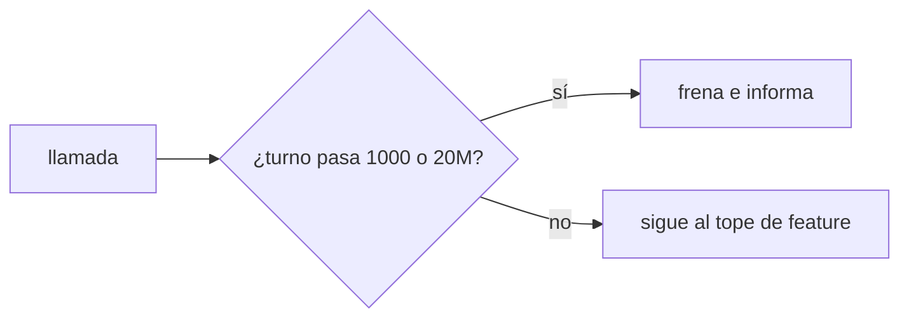
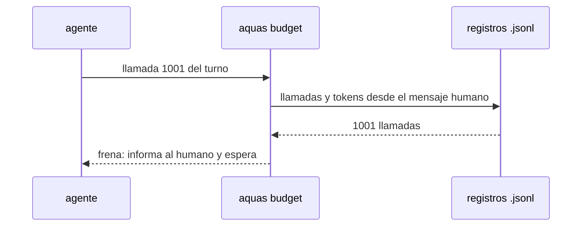

# S004 · Tope extremo por turno

[Inicio](../../README.md) › [E001](../README.md) › [F019](README.md) › S004

[Slice](../../glosario.md#slice) que frena un turno desbocado, haya o no [feature](../../glosario.md#feature) aprobada.

## En una frase

Un turno se frena solo al pasar 1000 llamadas o 20M [tokens](../../glosario.md#token) ponderados; es el último recurso contra bucles.

## Para qué existe

**El problema.** Al quitar el freno de 60 (S002), nada frena un bucle fuera de una feature aprobada.

**Por qué importa.** Un [agente](../../glosario.md#agente) en bucle gasta sin límite hasta que el humano lo ve.

**La solución.** Un tope por turno muy por encima del uso real. El turno más pesado medido gastó 49 respuestas y 1,1M ponderados; 20M deja holgura de 18 veces.

**Contrato.**

| Regla | Valor |
|---|---|
| Turno | desde el mensaje humano más reciente, como hoy |
| Llamadas | más de 1000 llamadas del hilo y sus subagentes del turno → frena |
| Tokens | más de 20M ponderados del hilo y sus subagentes del turno → frena |
| Siempre | rige con o sin feature aprobada; no lo suelta cerrar la feature |
| Exentas | solo `memory set` y `defect new|occur`, como hoy |
| Mensaje | lo gastado y «informa al humano y espera» |
| Alcance | `cmd/aquas/presupuesto*.go`, `cmd/aquas/*_test.go`, `docs/**` |

**Casos borde.**

| Categoría | Aplica | Prueba o motivo |
|---|---|---|
| cada tipo de ficha | no | el tope es del turno, no de una ficha |
| cada estado de origen | sí | con feature abierta, cerrada y sin apruebo frena igual: `TestTopeExtremo` |
| padre e hijo, activo y archivado | sí | llamadas y tokens de subagentes del turno suman: `TestTopeExtremo` |
| entrada ausente, vacía, mal escrita o duplicada | sí | mensaje humano sin hora no abre turno; `message.id` repetido cuenta una vez: `TestTopeExtremo` |
| choque con otro control | sí | las órdenes de cierre de S003 no lo saltan: `TestTopeExtremo` |
| quién habla: humano, agente o herramienta | sí | una notificación o mensaje de agente no abre turno nuevo: `TestTopeExtremo` |
| fallo a mitad de camino | sí | registro ilegible frena con su ruta: `TestTopeExtremo` |

## Analogía

Piensa en **el disyuntor de la casa**: casi nunca salta, y cuando salta es porque algo anda mal.

## Diagrama

## Ejemplo de punta a punta

continúa: [EJ-E001-F019](README.md#EJ-E001-F019)

1. Un agente entra en bucle leyendo el mismo archivo.
2. Sin feature aprobada, nada lo frenaba tras quitar el freno de 60.
3. En la llamada 1001 del turno, el gancho frena.
4. El agente informa al humano; un mensaje humano abre turno nuevo.

## Paso a paso

1. Contar llamadas y tokens del turno, con subagentes.
2. Frenar al pasar 1000 llamadas o 20M ponderados.
3. Aplicarlo siempre, con o sin feature.

## Cómo se usa

- No hay orden: es el último recurso y no se configura.

## Contrato y evidencia

<!-- GENERADO por aquas desde trabajo/: no editar a mano; `aquas compile` lo rehace. -->

| Prueba | Valida | Rojo cuando | Verde cuando | Rojo | Verde |
|---|---|---|---|---|---|
| `TestTopeExtremo` | valida el freno de bucles | el turno pasa de 1000 llamadas o 20M tokens sin freno | la llamada 1001 o el token 20M frenan | — | — |

<!-- /GENERADO -->

Prueba del slice: `TestTopeExtremo`.

## Navegación

- ↑ Subir: [F019](README.md)
