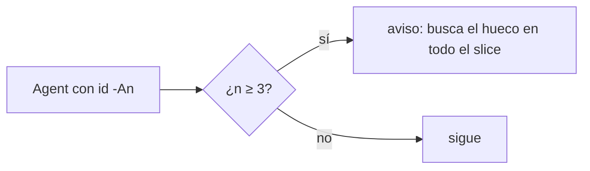
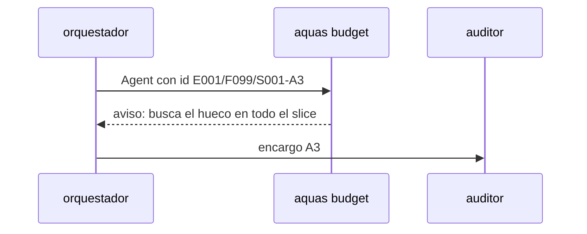

# S005 · Aviso en la tercera vuelta de auditor

[Inicio](../../README.md) › [E001](../README.md) › [F019](README.md) › S005

[Slice](../../glosario.md#slice) que corta la cadena de auditorías que encuentran un hueco por vuelta.

## En una frase

Al lanzar la tercera auditoría de un slice, el gancho avisa. Pide buscar el mismo tipo de hueco en todo el slice.

## Para qué existe

**El problema.** E001/F018/S002 necesitó 4 vueltas de auditor; cada una halló un hueco del mismo tipo que la anterior (D000106).

**Por qué importa.** Cada vuelta cuesta un subagente completo, unos 50k [tokens](../../glosario.md#token) de arranque más su trabajo.

**La solución.** El gancho de presupuesto mira el encargo del subagente. Si el id termina en `-A3` o más, agrega un aviso al [agente](../../glosario.md#agente).

**Contrato.**

| Regla | Valor |
|---|---|
| Disparo | llamada `Agent` cuyo prompt trae `id: E…/S…-An` con n ≥ 3 |
| Aviso | contexto adicional: «tercera vuelta: busca en todo el slice el mismo tipo de hueco de A1 y A2» |
| No frena | la auditoría sigue; es solo aviso |
| A1, A2 | sin aviso |
| Alcance | `cmd/aquas/presupuesto*.go`, `cmd/aquas/*_test.go`, `docs/**` |

**Casos borde.**

| Categoría | Aplica | Prueba o motivo |
|---|---|---|
| cada tipo de ficha | sí | auditoría de slice avisa; `id: —` no: `TestTerceraVueltaAuditor` |
| cada estado de origen | no | el gancho mira el encargo, no el estado de la ficha |
| padre e hijo, activo y archivado | no | el número de vuelta sale del id del encargo |
| entrada ausente, vacía, mal escrita o duplicada | sí | prompt sin id, `-A03`, `-A10`, `-Ax`: `TestTerceraVueltaAuditor` |
| choque con otro control | sí | el tope de feature sigue frenando aunque haya aviso: `TestTerceraVueltaAuditor` |
| quién habla: humano, agente o herramienta | no | solo el agente lanza subagentes |
| fallo a mitad de camino | no | el aviso no escribe estado |

## Analogía

Piensa en **un mecánico que vuelve por tercera vez por el mismo ruido**. Toca revisar todo el sistema, no la siguiente pieza.

## Diagrama

## Ejemplo de punta a punta

continúa: [EJ-E001-F019](README.md#EJ-E001-F019)

1. A1 y A2 hallaron un caso borde del mismo tipo cada una.
2. El [orquestador](../../glosario.md#orquestador) lanza A3; el gancho le agrega el aviso.
3. Antes de auditar, el orquestador revisa todo el slice por ese tipo de hueco.
4. A3 llega con el hueco ya cerrado en todos lados.

## Paso a paso

1. Leer el id del encargo en el prompt del `Agent`.
2. Avisar cuando la vuelta es 3 o más.

## Cómo se usa

- No hay orden: el aviso llega solo al lanzar la tercera auditoría.

## Contrato y evidencia

<!-- GENERADO por aquas desde trabajo/: no editar a mano; `aquas compile` lo rehace. -->

| Prueba | Valida | Rojo cuando | Verde cuando | Rojo | Verde |
|---|---|---|---|---|---|
| `TestTerceraVueltaAuditor` | valida el aviso de vueltas | la tercera vuelta no avisa | A3 avisa y A1 y A2 no | — | — |

<!-- /GENERADO -->

Prueba del slice: `TestTerceraVueltaAuditor`.

## Navegación

- ↑ Subir: [F019](README.md)
