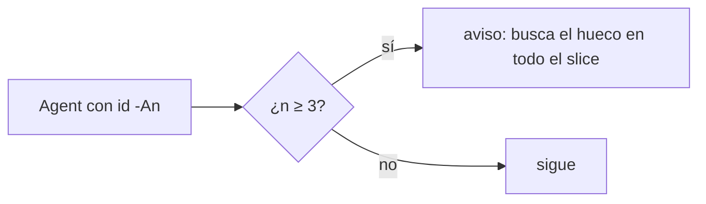
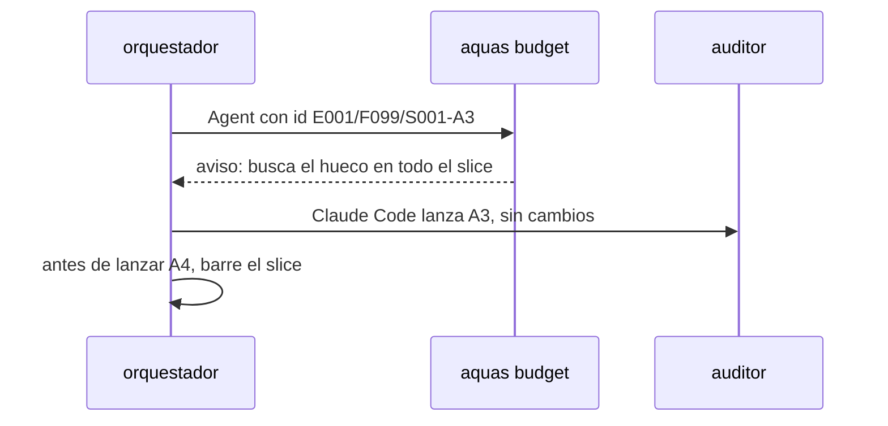

# S005 · Aviso en la tercera vuelta de auditor

[Inicio](../../README.md) › [E001](../README.md) › [F019](README.md) › S005

[Slice](../../glosario.md#slice) que corta la cadena de auditorías que encuentran un hueco por vuelta.

## En una frase

Al lanzar la tercera auditoría de un slice, el gancho avisa. Pide buscar el mismo tipo de hueco en todo el slice.

## Para qué existe

**El problema.** E001/F018/S002 necesitó 4 vueltas de auditor; cada una halló un hueco del mismo tipo que la anterior (D000106).

**Por qué importa.** Cada vuelta cuesta un subagente completo, unos 50k [tokens](../../glosario.md#token) de arranque más su trabajo.

**La solución.** El gancho de presupuesto mira el encargo del subagente. Si el id termina en `-A3` o más, agrega un aviso al [agente](../../glosario.md#agente).

**Contrato.**

| Regla | Valor |
|---|---|
| Disparo | llamada `Agent` cuyo prompt trae `id: E…/S…-An` con n ≥ 3 |
| Aviso | contexto adicional con el id y la vuelta: «Desde la tercera vuelta: busca en todo el slice el mismo tipo de hueco de las vueltas anteriores» |
| No frena | la auditoría sigue; es solo aviso |
| A1, A2 | sin aviso |
| Alcance | `cmd/aquas/presupuesto*.go`, `cmd/aquas/*_test.go`, `docs/**` |

**Casos borde.**

| Categoría | Aplica | Prueba o motivo |
|---|---|---|
| cada tipo de ficha | sí | auditoría de slice avisa; `id: —` no: `TestTerceraVueltaAuditor` |
| cada estado de origen | no | el gancho mira el encargo, no el estado de la ficha |
| padre e hijo, activo y archivado | no | el número de vuelta sale del id del encargo |
| entrada ausente, vacía, mal escrita o duplicada | sí | prompt sin id, `-A03`, `-A10`, `-Ax`: `TestTerceraVueltaAuditor` |
| choque con otro control | sí | el tope de feature sigue frenando aunque haya aviso: `TestTerceraVueltaAuditor` |
| quién habla: humano, agente o herramienta | no | solo el agente lanza subagentes |
| fallo a mitad de camino | no | el aviso no escribe estado |

## Analogía

Piensa en **un mecánico que vuelve por tercera vez por el mismo ruido**. Toca revisar todo el sistema, no la siguiente pieza.

## Diagrama

## Ejemplo de punta a punta

continúa: [EJ-E001-F019](README.md#EJ-E001-F019)

1. A1 y A2 hallaron un caso borde del mismo tipo cada una.
2. El [orquestador](../../glosario.md#orquestador) lanza A3; el gancho le agrega el aviso.
3. A3 arranca igual: el aviso no frena ni cambia su encargo.
4. El aviso llega al orquestador con la respuesta del `Agent`. Si el auditor corre en segundo plano, llega mientras audita; si no, con su veredicto. Visto el 2026-11-04: en segundo plano llegó junto a «agente lanzado».
5. Antes de lanzar A4, el orquestador barre todo el slice por ese tipo de hueco.

## Paso a paso

1. Leer el id del encargo en el prompt del `Agent`.
2. Avisar cuando la vuelta es 3 o más.

## Cómo se usa

- No hay orden: el aviso llega solo al lanzar la tercera auditoría.

## Contrato y evidencia

<!-- GENERADO por aquas desde trabajo/: no editar a mano; `aquas compile` lo rehace. -->

| Prueba | Valida | Rojo cuando | Verde cuando | Rojo | Verde |
|---|---|---|---|---|---|
| `TestTerceraVueltaAuditor` | valida el aviso de vueltas | la tercera vuelta no avisa | A3 avisa y A1 y A2 no | 2026-11-04 | 2026-11-04 |

### Código

| Archivo | Función | Parámetros | Qué hace |
|---|---|---|---|
| [cmd/aquas/presupuesto.go](../../../cmd/aquas/presupuesto.go) | `leerTope` | `(primera string, ap *apruebo)` | leerTope: «tope 25M» o «tope 25 M» → tokens ponderados; «tope 900» solo, o seguido de «con» o «y» → llamadas (el viejo). |
| [cmd/aquas/presupuesto.go](../../../cmd/aquas/presupuesto.go) | `pesoVeinteavos` | `(u usoRespuesta) int64` | pesoVeinteavos: el usage de una respuesta ponderado por precio, en veinteavos de token para no usar decimales. |
| [cmd/aquas/presupuesto.go](../../../cmd/aquas/presupuesto.go) | `millones` | `(n int64) string` | millones: 15000000 → «15M»; 15000001 → «15,0M». |
| [cmd/aquas/presupuesto.go](../../../cmd/aquas/presupuesto.go) | `avisarVuelta` | `(e entradaPresupuesto) string` | avisarVuelta: desde la vuelta 3 de auditoría de un slice, pide barrer el slice por el mismo tipo de hueco (D000106). |
| [cmd/aquas/presupuesto.go](../../../cmd/aquas/presupuesto.go) | `rutaComparableEn` | `(goos, r string) string` | rutaComparableEn: la ruta limpia con «/»; en Windows la forma Git Bash «/d/…» pasa a «D:/…» (A2.4; sistema dado: E000/F007/S001). |
| [cmd/aquas/presupuesto.go](../../../cmd/aquas/presupuesto.go) | `exentaDelFreno` | `(raiz, herramienta, comando string) bool` | exentaDelFreno: true si el comando Bash entero es `aquas memory set …` o `aquas defect new\\|occur …`. |
| [cmd/aquas/presupuesto.go](../../../cmd/aquas/presupuesto.go) | `rutasIguales` | `(goos, a, b string) bool` | rutasIguales (E000/F007/S001, hallazgos L1 y L2; no confundir con entorno.mismaRuta, que no entiende «/d/…»): misma carpeta según el sistema; mayúsculas iguales solo en Windows. |
| [cmd/aquas/presupuesto.go](../../../cmd/aquas/presupuesto.go) | `exentaDelFrenoEn` | `(goos, raiz, herramienta, comando string) bool` | exentaDelFrenoEn: exentaDelFreno para un sistema dado (E000/F007/S001). |
| [cmd/aquas/presupuesto.go](../../../cmd/aquas/presupuesto.go) | `ordenDeCierre` | `(raiz, herramienta, comando string) bool` | ordenDeCierre (E001/F019/S003): true si el comando Bash entero es una orden de cierre de reCierre. |
| [cmd/aquas/presupuesto.go](../../../cmd/aquas/presupuesto.go) | `ordenEnteraEn` | `(goos, raiz, herramienta, comando string, re *regexp.Regexp) bool` | ordenEnteraEn: el comando Bash entero cumple la lista blanca re; el `cd` solo vale a la raíz y un binario entre |
| [cmd/aquas/presupuesto.go](../../../cmd/aquas/presupuesto.go) | `presupuestoCLI` | `(raiz string, args []string)` | presupuestoCLI: «herramienta» cuenta el gasto en el registro (tokens ponderados o llamadas, E001/F019/S001) y bloquea con exit 2 al pasar un tope. |
| [cmd/aquas/presupuesto.go](../../../cmd/aquas/presupuesto.go) | `marcaDir` | `(raiz string) string` | marcaDir: carpeta de las marcas de aviso; borrarlas repite un aviso, no quita un freno. |
| [cmd/aquas/presupuesto.go](../../../cmd/aquas/presupuesto.go) | `avisarGasto` | `(raiz string, c *cuentaFeature) string` | avisarGasto: aviso al cruzar el 50% o el 80% del tope, una vez por umbral y apruebo. La marca guarda la hora del |
| [cmd/aquas/presupuesto.go](../../../cmd/aquas/presupuesto.go) | `frenar` | `(formato string, a ...any)` | frenar escribe el motivo en stderr y bloquea la llamada. |
| [cmd/aquas/presupuesto.go](../../../cmd/aquas/presupuesto.go) | `avisarContexto` | `(raiz string, e entradaPresupuesto, turno string) string` | avisarContexto pide /compact una vez por turno cuando el contexto medido pasa el umbral; la marca guarda el |
| [cmd/aquas/presupuesto.go](../../../cmd/aquas/presupuesto.go) | `recorrerRegistro` | `(ruta string, f func(pos int64, l lineaLlamadas)) error` | recorrerRegistro abre un registro y entrega cada línea legible con su posición; las rotas se ignoran. |
| [cmd/aquas/presupuesto.go](../../../cmd/aquas/presupuesto.go) | `llamadas` | `(raiz string, l lineaLlamadas) []string` | llamadas: ids de los tool_use de una línea de asistente, sin las llamadas exentas. |
| [cmd/aquas/presupuesto.go](../../../cmd/aquas/presupuesto.go) | `escanear` | `(raiz, ruta string) (escaneo, error)` | escanear lee un registro una vez. D000096: el turno y el apruebo vigente se eligen por hora, no por posición: |
| [cmd/aquas/presupuesto.go](../../../cmd/aquas/presupuesto.go) | `carpetaProyecto` | `(ruta string) string` | carpetaProyecto: la carpeta de las sesiones del proyecto; desde un registro de subagente sube a ella. |
| [cmd/aquas/presupuesto.go](../../../cmd/aquas/presupuesto.go) | `escanearProyecto` | `(raiz, ruta string) (map[string]escaneo, error)` | escanearProyecto lee cada registro de sesión de la carpeta del proyecto; sin registro legible, error. |
| [cmd/aquas/presupuesto.go](../../../cmd/aquas/presupuesto.go) | `featureCerrada` | `(raiz, id string) bool` | featureCerrada (E001/F017/S001, D000091): true solo si la feature y todos sus slices (al menos uno) están en CERRADO. |
| [cmd/aquas/presupuesto.go](../../../cmd/aquas/presupuesto.go) | `frenoFeature` | `(raiz, ruta string, sesiones map[string]escaneo) (msg string, cuenta *cuentaFeature)` | frenoFeature: el último apruebo de feature del humano fija feature, tope y hora; se cuentan los tokens ponderados |
| [cmd/aquas/presupuesto.go](../../../cmd/aquas/presupuesto.go) | `frenoTurno` | `(raiz, ruta string, sesiones map[string]escaneo) string` | frenoTurno (E001/F019/S004): último recurso contra bucles. Suma las llamadas distintas y los tokens ponderados del |
| [cmd/aquas/presupuesto.go](../../../cmd/aquas/presupuesto.go) | `contextoMedido` | `(ruta string) int` | contextoMedido: tokens de entrada de la última llamada del modelo en el transcript; 0 si después |

<!-- /GENERADO -->

Prueba del slice: `TestTerceraVueltaAuditor`.

**Evidencia.** Rojo el 2026-11-04 13:17: la vuelta A3 pasaba sin aviso. Verde final tras A1; la suite completa (`go test ./...`) en verde.

**Implementación.** `avisarVuelta` lee el `prompt` de una llamada `Agent` del hilo principal. Busca una línea `id:` con un id de slice terminado en `-An`. Con n ≥ 3 agrega el aviso al contexto adicional, junto a los demás avisos. `-A03` vale 3 y avisa. Los frenos van antes: con el tope agotado, la vuelta se frena igual.

**Auditorías A1 y A2** (CON_HALLAZGOS, arreglados; A3 APROBADO). La página prometía que el [orquestador](../../glosario.md#orquestador) barría el slice antes de A3. El aviso no frena, así que A3 corre igual. A2 corrigió también «mientras A3 audita»: vale solo en segundo plano. La prueba con Write no leía el campo `prompt`; una mutación ahora la pone en rojo. Se probó el aviso junto al de gasto, en un solo JSON. Solo cuenta la primera línea del encargo. El aviso nombra la vuelta real.

## Navegación

- ↑ Subir: [F019](README.md)
