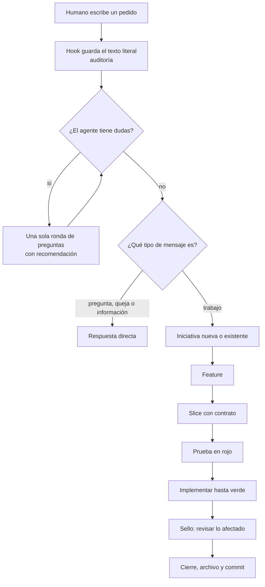
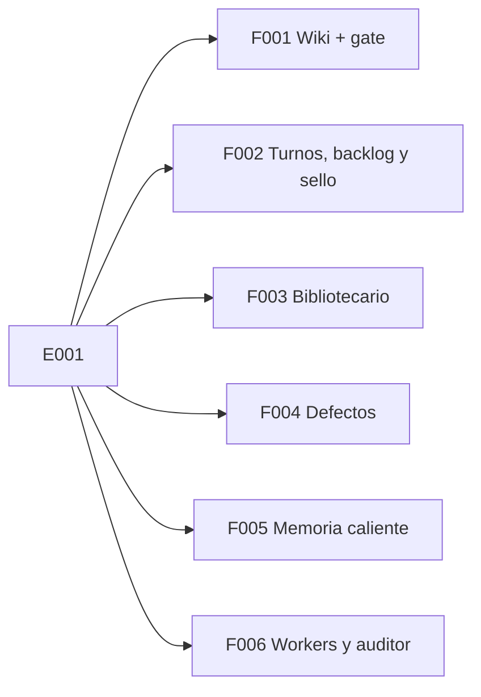

# E001 · Gobierno del trabajo

[Inicio](../README.md) › E001

[Iniciativa](../glosario.md#iniciativa) que ordena **cada pedido** del humano: desde la frase escrita en el chat hasta el [commit](../glosario.md#commit) verificado.

## En una frase

Cada cosa que pides se anota y se parte en pedacitos que se pueden probar. No se da por terminada hasta que una máquina lo comprueba.

## Para qué existe

**El problema.** Sin orden, pasan cuatro cosas malas:

- El [agente](../glosario.md#agente) entiende otra cosa y nadie lo nota hasta el final.
- Un cambio rompe algo en otro lado y nadie revisa los alrededores.
- La documentación queda vieja, porque nadie obliga a actualizarla.
- No queda rastro de qué pediste y qué se acordó.

**La solución.** Un camino fijo para cada pedido, con controles que ejecuta [Go](../glosario.md#go):

- Se guarda tu texto literal y lo que se acordó contigo.
- El trabajo se parte en tres tamaños: iniciativa → [feature](../glosario.md#feature) → [slice](../glosario.md#slice).
- Cada slice nace con una [prueba en rojo](../glosario.md#prueba-en-rojo) y termina con la misma [prueba en verde](../glosario.md#prueba-en-verde).
- Al cerrar, un **[sello](../glosario.md#sello)** obliga a revisar todo lo que el cambio pudo afectar.

Tu puerta humana es la ronda de refinamiento. Antes del rojo escribes «apruebo <id>» sobre el contrato del slice (ver [F010](F010/README.md)). Otra opción es aprobar la feature entera una vez (ver [F015](F015/README.md)). Fuera de eso, solo respondes ante una duda real.

## Analogía

Piensa en **construir una casa**.

- La **iniciativa** es la casa completa: «quiero una casa para mi familia».
- La **feature** es una habitación: «la cocina».
- El **slice** es una tarea que se puede revisar sola: «instalar el fregadero y comprobar que no gotea».
- La **prueba en rojo** es abrir el grifo antes de instalar: no sale agua. La **prueba en verde** es abrirlo después: sale agua y no gotea.
- El **sello** es el inspector. Al cerrar la cocina, revisa si la tubería nueva afectó al baño de al lado.

Límite de la analogía: en software, un cambio pequeño puede tocar lugares muy lejanos. Por eso el sello revisa con una lista generada por programa, no a ojo.

## Diagrama

El camino de un pedido, de punta a punta.

Estado actual de sus features:

| Feature | Qué hace |
|---|---|
| [F001 Wiki + gate](F001/README.md) | Obliga a documentar con esta wiki |
| [F005 Memoria caliente](F005/README.md) | El agente no pierde el foco entre sesiones |
| [F006 Workers y auditor](F006/README.md) | Agentes baratos que ejecutan y un auditor que revisa |
| [F002 Turnos, backlog y sello](F002/README.md) | Auditoría, backlog en JSON, rojo/verde, sello |
| [F004 Defectos y reincidencia](F004/README.md) | Registra fallos y avisa si se repiten |
| [F003 Bibliotecario](F003/README.md) | Lee el repo pidiendo solo lo útil |
| [F008 Documentación verificable](F008/README.md) | Pruebas, código y arreglos escritos en la wiki |
| [F009 Backlog sin fichas repetidas](F009/README.md) | Parecidas y relación antes de crear una ficha |

## Ejemplo de punta a punta

**Situación.** Jesús escribe: «quiero que la [wiki](../glosario.md#wiki) avise si un enlace está roto».

1. **Auditoría.** Se guarda su frase tal cual. *(Pendiente: llega con F002.)*
2. **Refinado.** El agente no tiene dudas: «enlace roto» significa un enlace a un archivo o [ancla](../glosario.md#ancla) que no existe.
3. **Clasificación.** Es trabajo. Pertenece a la iniciativa E001, porque trata de cómo se gobierna el trabajo.
4. **Feature.** Encaja en F001 Wiki + [gate](../glosario.md#gate).
5. **Slice.** Se vuelve E001/F001/S001: «el gate revisa estructura, enlaces, diagramas y ejemplos».
6. **Rojo.** Se escribe una prueba con una página que enlaza a `no-existe.md`. La prueba exige el error «enlace roto». Sin código nuevo, la prueba falla.
7. **Verde.** Se programa el gate. La misma prueba ahora pasa.
8. **Sello.** Se revisa lo afectado: la constitución menciona el gate, el mapa del repositorio y esta wiki.
9. **Cierre.** Commit con el porqué. El [pre-commit](../glosario.md#pre-commit) vuelve a ejecutar el gate.

Las páginas de abajo continúan este mismo ejemplo con más detalle.

## Paso a paso

Lo que hace el agente con cada mensaje tuyo:

1. Lee tu mensaje completo.
2. Busca dudas reales: ambigüedad, contradicción o alcance difuso.
3. Si hay dudas, pregunta todo en una sola ronda numerada, con su recomendación.
4. Clasifica el mensaje: pregunta, queja, información o trabajo.
5. Si es trabajo, lo ubica en iniciativa → feature → slice.
6. Escribe la prueba del slice y comprueba que falla.
7. Implementa hasta que la prueba pase.
8. Revisa todo lo que el cambio pudo afectar.
9. Hace commit y te informa con evidencia.

## Cómo se usa

Hoy funciona así:

- Tú escribes en el chat como siempre. No necesitas aprobar nada.
- Contestas cuando el agente te pregunta algo.
- La especificación completa vive en [E001_GOBIERNO_DEL_TRABAJO.md](../../gobierno/canonico/metodologias/E001_GOBIERNO_DEL_TRABAJO.md).

Desde F002/S002 existe `aquas backlog next`, que dice qué toca. Desde S003, cada ficha nombra sus pruebas con su intención; `aquas backlog red` y `verde` las corren, y cerrar exige los dos.

## Contrato y evidencia

**Resultado esperado.** Cada pedido sigue el mismo camino: texto guardado, slice con prueba en rojo y verde, sello y commit.

**Resultado logrado.** La primera feature, la wiki con su gate, está hecha. La auditoría, el [backlog](../glosario.md#backlog) y el sello todavía no existen.

Decisiones de Jesús (2026-10-20):

- La puerta humana es la ronda de refinamiento más «apruebo <id>» del contrato antes del rojo (F010, 2026-10-23). Antes no había aprobaciones formales. Desde F015 (2026-10-28), un «apruebo» de la feature cubre todos sus slices.
- Un solo slice activo por repositorio, sin agentes en paralelo salvo pedido.
- El backlog se guarda en JSON, un archivo por elemento, versionado en git.
- Un pedido urgente o que protege el repo pausa el slice activo y entra por E000.
- El método se llama Aquas-driven development y evoluciona sin parar.

Prueba integral de la iniciativa: todavía no existe. Llega cuando F002 permita seguir un pedido de punta a punta.

## Navegación

<!-- GENERADO por aquas desde trabajo/: no editar a mano; `aquas compile` lo rehace. -->

| Hijo | Qué es | Estado |
|---|---|---|
| [F001](F001/README.md) | Wiki + gate | Hecho |
| [F002](F002/README.md) | Turnos, backlog y sello | En curso |
| [F003](F003/README.md) | Bibliotecario | Hecho |
| [F004](F004/README.md) | Defectos y reincidencia | Hecho |
| [F005](F005/README.md) | Memoria caliente | Hecho |
| [F006](F006/README.md) | Workers y auditor | Hecho |
| [F007](F007/README.md) | Tabla del backlog en la terminal | Hecho |
| [F008](F008/README.md) | Documentación verificable de pruebas, código y arreglos | Hecho |
| [F009](F009/README.md) | Backlog sin fichas repetidas | Hecho |
| [F010](F010/README.md) | Contrato aprobado antes de construir | Hecho |
| [F011](F011/README.md) | Frenos propios del gobierno | Hecho |
| [F012](F012/README.md) | Prevención activa | Hecho |
| [F013](F013/README.md) | Calidad Go en el gate | Planeado |
| [F014](F014/README.md) | Cierre honesto | Hecho |
| [F015](F015/README.md) | Gate humano por feature | Hecho |
| [F016](F016/README.md) | Shell del humano | Hecho |

<!-- /GENERADO -->

- ↑ Subir: [Inicio de la wiki](../README.md)
- Abajo: [F001 · Wiki + gate](F001/README.md)
- Abajo: [F005 · Memoria caliente](F005/README.md)
- Abajo: [F006 · Workers y auditor](F006/README.md)
- Abajo: [F002 · Turnos, backlog y sello](F002/README.md)
- Abajo: [F004 · Defectos y reincidencia](F004/README.md)
- Abajo: [F003 · Bibliotecario](F003/README.md)
- Abajo: [F008 · Documentación verificable de pruebas, código y arreglos](F008/README.md)
- Abajo: [F009 · Backlog sin fichas repetidas](F009/README.md)
