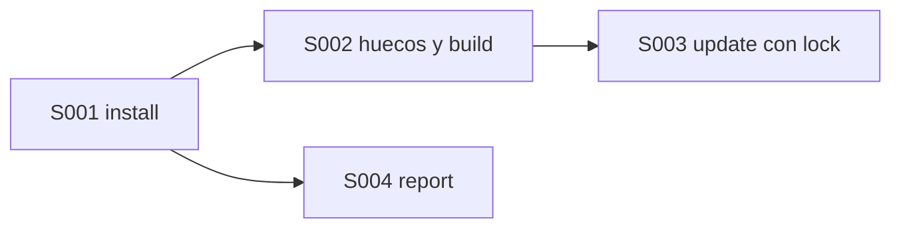
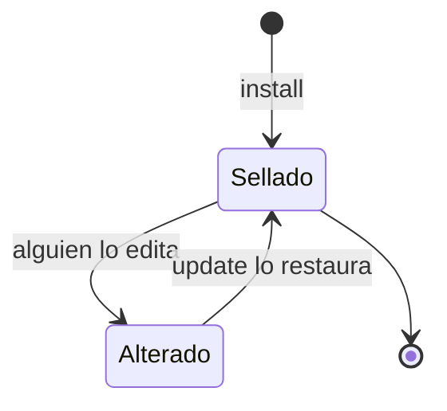

# F001 · Instalar y heredar el núcleo común

[Inicio](../../README.md) › [E002](../README.md) › F001

[Feature](../../glosario.md#feature) que instala el núcleo común del gobierno en un hijo y lo mantiene sellado.

## En una frase

Instalar, heredar, actualizar y reportar, sin editar lo sellado.

## Para qué existe

**El problema.** Un hijo necesita las reglas de la central, pero no puede cambiarlas por su cuenta.

**La solución.** Cuatro [slices](../../glosario.md#slice) en cadena: install, huecos con build, update con lock y report a la central.

## Analogía

Piensa en una **biblioteca de código instalada con un gestor de paquetes**.

- Se instala una versión fija, con su huella.
- Tu proyecto la usa, pero no edita sus archivos.

Límite de la analogía: aquí lo instalado son reglas para [agentes](../../glosario.md#agente), no código.

## Diagrama

Estados de un archivo sellado en el hijo:

| Slice | Qué entrega |
|---|---|
| [S001 aquas install en carpeta vacía](S001.md) | La central sellada en `.aquas/central` con su lock |
| [S002 Huecos, canónico local y aquas build](S002.md) | El `CLAUDE.md` del hijo: central final + huecos locales |
| [S003 aquas update sin pisar lo sellado](S003.md) | Versión nueva de la central sin tocar lo local |
| [S004 aquas report: defecto del hijo a la central](S004.md) | Borrador de issue con versión del lock; lo envía el humano |

## Ejemplo de punta a punta

continúa: [EJ-E002](../README.md#EJ-E002)

1. `aquas install` deja la central y el lock en la landing.
2. Más adelante, build arma su `CLAUDE.md` con sus huecos.
3. Si la central mejora, update la trae sin pisar lo local.

## Paso a paso

1. Install en carpeta vacía (S001).
2. Huecos, [canónico](../../glosario.md#canónico) local y build (S002).
3. Update sin pisar lo sellado (S003).
4. Report de defectos a la central (S004).

## Cómo se usa

- En la carpeta del hijo: `aquas install` (desde E002/F002/S001, sin ruta).

## Contrato y evidencia

**Objetivo.** Un hijo instalado que pasa su propio [gate](../../glosario.md#gate).

Prueba integral: `TestHijoInstaladoPasaSuGate` (pendiente).

## Navegación

<!-- GENERADO por aquas desde trabajo/: no editar a mano; `aquas compile` lo rehace. -->

| Hijo | Qué es | Estado |
|---|---|---|
| [S001](S001.md) | aquas install en carpeta vacía | Hecho |
| [S002](S002.md) | Huecos, canónico local y aquas build | Hecho |
| [S003](S003.md) | aquas update sin pisar lo sellado | Hecho |
| [S004](S004.md) | aquas report: defecto del hijo a la central | Hecho |

<!-- /GENERADO -->

- ↑ Subir: [E002 · Proyectos hijos](../README.md)
- Abajo: [S001 · aquas install en carpeta vacía](S001.md)
- Abajo: [S002 · Huecos, canónico local y aquas build](S002.md)
- Abajo: [S003 · aquas update sin pisar lo sellado](S003.md)
- Abajo: [S004 · aquas report: defecto del hijo a la central](S004.md)
