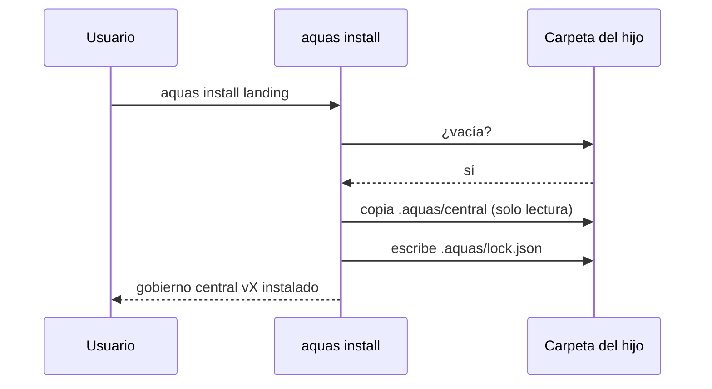

# S001 · aquas install en carpeta vacía

[Inicio](../../README.md) › [E002](../README.md) › [F001](README.md) › S001

`aquas install <carpeta>` copia el gobierno central a `.aquas/central` y escribe `.aquas/lock.json` con la versión y el hash de cada archivo.

## En una frase

El gobierno viaja dentro del binario y llega sellado al hijo.

## Para qué existe

**El problema.** Un hijo no tiene el código de la central. Necesita recibir las reglas de una versión exacta y poder comprobar que nadie las tocó.

**La solución.** El binario embebe `gobierno/canonico` y `gobierno/config`. Install los copia como solo lectura y anota su huella [SHA-256](../../glosario.md#sha-256) en el lock.

Contrato del [slice](../../glosario.md#slice):

| Campo | Valor |
|---|---|
| Objetivo | Instalar la central sellada en una carpeta vacía |
| Incluye | `hijo.Install`, `central.go` con el embebido, comando `aquas install` |
| Excluye | Huecos y build (S002), update (S003), report (S004) |
| Prueba | `go test ./internal/hijo/ -run TestInstallCopiaCentralConLock` |

## Analogía

Piensa en una **caja sellada de fábrica**.

- Trae dentro el manual y una etiqueta con la versión.
- Si alguien la abre, el precinto roto lo delata.

Límite de la analogía: el precinto aquí es un hash que revisa un programa.

## Diagrama

## Ejemplo de punta a punta

continúa: [EJ-E002-F001](README.md#EJ-E002-F001)

1. Se corrió `aquas install` en una carpeta nueva dentro de `.tmp/`.
2. Quedaron 16 archivos de gobierno y el lock con la versión de Git.
3. Una segunda corrida falló: «no está vacía (sobre una instalación previa usa update)».

## Paso a paso

1. Rechazar si falta la versión o la carpeta tiene contenido.
2. Recorrer la central embebida y copiar cada archivo como solo lectura.
3. Calcular el SHA-256 de cada archivo.
4. Escribir el lock con la versión y los hashes.

## Cómo se usa

- `aquas install <carpeta>`.
- La versión sale del binario: con `go install …@v0.1.0`, el lock dice `v0.1.0`.

## Contrato y evidencia

<!-- GENERADO por aquas desde trabajo/: no editar a mano; `aquas compilar` lo rehace. -->

| Prueba | Valida | Rojo cuando | Verde cuando | Rojo | Verde |
|---|---|---|---|---|---|
| `TestInstallCopiaCentralConLock` | install copia la central a .aquas/central con lock | falta la copia, el lock o sus hashes, o instala dos veces | copia la central, escribe lock con versión y hashes; repetir falla | 2026-10-22 | 2026-10-22 |

<!-- /GENERADO -->

Estado: hecho.

## Navegación

- ↑ Subir: [F001 · Instalar y heredar el núcleo común](README.md)
