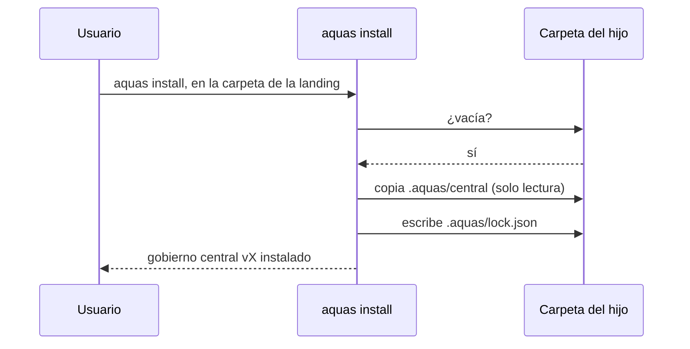

# S001 · aquas install en carpeta vacía

[Inicio](../../README.md) › [E002](../README.md) › [F001](README.md) › S001

`aquas install` copia el gobierno central a `.aquas/central` y escribe `.aquas/lock.json` con la versión y el hash de cada archivo.

## En una frase

El gobierno viaja dentro del binario y llega sellado al hijo.

## Para qué existe

**El problema.** Un hijo no tiene el código de la central. Necesita recibir las reglas de una versión exacta y poder comprobar que nadie las tocó.

**La solución.** El binario embebe `gobierno/canonico` y `gobierno/config`. Install los copia como solo lectura y anota su huella [SHA-256](../../glosario.md#sha-256) en el lock.

Contrato del [slice](../../glosario.md#slice):

| Campo | Valor |
|---|---|
| Objetivo | Instalar la central sellada en una carpeta vacía |
| Incluye | `hijo.Install`, `central.go` con el embebido, comando `aquas install` |
| Excluye | Huecos y build (S002), update (S003), report (S004) |
| Prueba | `go test ./internal/hijo/ -run TestInstallCopiaCentralConLock` |

## Analogía

Piensa en una **caja sellada de fábrica**.

- Trae dentro el manual y una etiqueta con la versión.
- Si alguien la abre, el precinto roto lo delata.

Límite de la analogía: el precinto aquí es un hash que revisa un programa.

## Diagrama

## Ejemplo de punta a punta

continúa: [EJ-E002-F001](README.md#EJ-E002-F001)

1. Se corrió `aquas install` en una carpeta nueva dentro de `.tmp/`.
2. Quedaron 16 archivos de gobierno y el lock con la versión de Git.
3. Una segunda corrida falló: «no está vacía (sobre una instalación previa usa update)».

## Paso a paso

1. Rechazar si falta la versión o la carpeta tiene contenido.
2. Recorrer la central embebida y copiar cada archivo como solo lectura.
3. Calcular el SHA-256 de cada archivo.
4. Escribir el lock con la versión y los hashes.

## Cómo se usa

- En la carpeta del hijo: `aquas install` (desde E002/F002/S001, sin ruta).
- La versión sale del binario: con `go install …@v0.1.0`, el lock dice `v0.1.0`.

## Contrato y evidencia

<!-- GENERADO por aquas desde trabajo/: no editar a mano; `aquas compilar` lo rehace. -->

| Prueba | Valida | Rojo cuando | Verde cuando | Rojo | Verde |
|---|---|---|---|---|---|
| `TestInstallCopiaCentralConLock` | install copia la central a .aquas/central con lock | falta la copia, el lock o sus hashes, o instala dos veces | copia la central, escribe lock con versión y hashes; repetir falla | 2026-10-22 | 2026-10-22 |

### Código

| Archivo | Función | Parámetros | Qué hace |
|---|---|---|---|
| [cmd/aquas/main.go](../../../cmd/aquas/main.go) | `main` | `()` | main despacha el subcomando de aquas (compilar, verificar, backlog, hooks…) y sale con su código. |
| [cmd/aquas/main.go](../../../cmd/aquas/main.go) | `hook` | `(raiz string)` | hook: exit 0 = nada que reportar; exit 2 = stderr se muestra a Claude. |
| [cmd/aquas/main.go](../../../cmd/aquas/main.go) | `compilarSettings` | `(w io.Writer)` | compilarSettings regenera .claude/settings.json; sin entorno declarado no inventa uno. |
| [cmd/aquas/main.go](../../../cmd/aquas/main.go) | `reportar` | `(w io.Writer, inf compilador.Informe)` | reportar imprime qué derivados escribió la compilación, o que todo estaba al día. |
| [cmd/aquas/main.go](../../../cmd/aquas/main.go) | `listar` | `(titulo string, problemas []string)` | listar imprime en stderr un título y cada problema en su viñeta. |
| [cmd/aquas/main.go](../../../cmd/aquas/main.go) | `lista` | `(xs []string) string` | lista une los textos con comas, o «—» si no hay ninguno. |
| [cmd/aquas/main.go](../../../cmd/aquas/main.go) | `fallar` | `(codigo int, err error)` | fallar imprime el error en stderr y termina con el código dado. |
| [cmd/aquas/main.go](../../../cmd/aquas/main.go) | `memoriaCLI` | `(raiz string, args []string)` | memoriaCLI: `ver` imprime la memoria; `fijar campo=valor…` la actualiza y la sella. |
| [cmd/aquas/main.go](../../../cmd/aquas/main.go) | `memoriaArchivada` | `(raiz, id string) error` | memoriaArchivada: CERRADO exige el archivo de memoria del slice, apunte o no la memoria a él (E001/F002/S009, X01). |
| [cmd/aquas/main.go](../../../cmd/aquas/main.go) | `focoEnBacklog` | `(raiz string, f memoria.Foco) error` | focoEnBacklog: la memoria solo fija el slice que el backlog tiene en curso (S003). |
| [cmd/aquas/main.go](../../../cmd/aquas/main.go) | `backlogCLI` | `(raiz string, args []string)` | backlogCLI: nuevo \\| ver [id] \\| prioridad \\| estado \\| siguiente \\| pruebas \\| rojo \\| verde. |
| [cmd/aquas/main.go](../../../cmd/aquas/main.go) | `turnoCLI` | `(raiz string, args []string)` | turnoCLI: auditoría de turnos (E001/F002/S001). Lee el JSON del hook por stdin. No imprime nada |
| [cmd/aquas/main.go](../../../cmd/aquas/main.go) | `defectoCLI` | `(raiz string, args []string) error` | defectoCLI: nuevo \\| ocurre \\| ver (E001/F004/S001). |
| [cmd/aquas/main.go](../../../cmd/aquas/main.go) | `versionBinario` | `() string` | versionBinario: versión del módulo con que se compiló el binario (= versión del gobierno embebido). |
| [cmd/aquas/main.go](../../../cmd/aquas/main.go) | `registrarCierre` | `(raiz, tipo, transcript, primera, resultado string)` | registrarCierre (E001/F004/S005, D000068) anota cada llamada del gancho cierre-agente en .tmp/hooks/cierre-agente.jsonl. |
| [internal/hijo/hijo.go](../../../internal/hijo/hijo.go) | `Install` | `(dest string, central fs.FS, version string) error` | Install copia la central sellada en dest/.aquas/central y escribe dest/.aquas/lock.json. |
| [internal/hijo/hijo.go](../../../internal/hijo/hijo.go) | `copiarCentral` | `(dest string, central fs.FS, version string) error` | copiarCentral escribe la central como solo lectura y su lock con versión y hashes. |
| [internal/hijo/hijo.go](../../../internal/hijo/hijo.go) | `AMedias` | `(err error) error` | AMedias (E002/F002/S002): error de install cuando la central ya quedó copiada y falló lo siguiente. |

<!-- /GENERADO -->

Estado: hecho.

## Navegación

- ↑ Subir: [F001 · Instalar y heredar el núcleo común](README.md)
