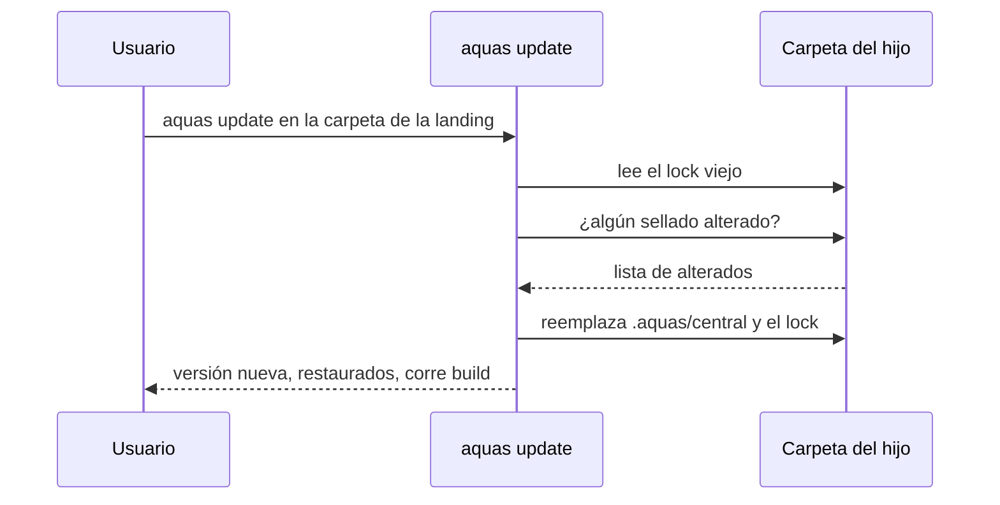

# S003 · aquas update sin pisar lo sellado

[Inicio](../../README.md) › [E002](../README.md) › [F001](README.md) › S003

`aquas update` trae al hijo la central de la versión del binario y reescribe el lock. No toca lo local.

## En una frase

La central mejora y el hijo la recibe sin perder lo suyo.

## Para qué existe

**El problema.** Install solo sirve en una carpeta vacía. Cuando la central saca una versión nueva, el hijo necesita recibirla sin reinstalar ni perder sus huecos.

**La solución.** Update reemplaza `.aquas/central/` completa y reescribe el lock. Antes, compara cada archivo con el lock viejo. Si alguien había alterado lo [sellado](../../glosario.md#sello), update lo restaura y lo nombra para reportarlo.

Contrato del [slice](../../glosario.md#slice):

| Campo | Valor |
|---|---|
| Objetivo | Cambiar de versión de la central sin tocar lo local |
| Incluye | `hijo.Update`, comando `aquas update`, aviso de archivos restaurados |
| Excluye | Build automático tras update, report a la central (S004) |
| Prueba | `go test ./internal/hijo/ -run TestUpdateRespetaLock` |

## Analogía

Piensa en **cambiar el motor de un carro sin tocar la pintura**.

- El taller saca el motor viejo y pone el nuevo, con su número de serie.
- La pintura y los accesorios del dueño quedan igual.

Límite de la analogía: aquí el número de serie es un lock con hashes que un programa revisa.

## Diagrama

## Ejemplo de punta a punta

continúa: [EJ-E002-F001](README.md#EJ-E002-F001)

1. Se instaló la central en `.tmp/`, se llenaron los tres huecos y se corrió build.
2. Update reescribió la central y el lock; los huecos quedaron intactos.
3. Build volvió a armar el `CLAUDE.md` sin errores.
4. Update sobre una carpeta sin instalar falló: «no tiene gobierno instalado (usa install)».

## Paso a paso

1. Rechazar si falta la versión o no hay lock.
2. Listar los sellados que no coinciden con el lock.
3. Borrar la central vieja y copiar la nueva como solo lectura.
4. Escribir el lock nuevo y avisar qué se restauró.

## Cómo se usa

- En la carpeta del hijo: `aquas update`; desde E002/F002/S001 ya arma el `CLAUDE.md`.

## Contrato y evidencia

<!-- GENERADO por aquas desde trabajo/: no editar a mano; `aquas compile` lo rehace. -->

| Prueba | Valida | Rojo cuando | Verde cuando | Rojo | Verde |
|---|---|---|---|---|---|
| `TestUpdateRespetaLock` | editar lo sellado cae el gate; update conserva lo local | update pisa lo local o el gate no detecta lo editado | el gate cae tras editar; update sube versión y deja lo local | 2026-10-22 | 2026-10-22 |

### Código

| Archivo | Función | Parámetros | Qué hace |
|---|---|---|---|
| [cmd/aquas/main.go](../../../cmd/aquas/main.go) | `main` | `()` | main despacha el subcomando de aquas (compilar, verificar, backlog, hooks…) y sale con su código. |
| [cmd/aquas/main.go](../../../cmd/aquas/main.go) | `hook` | `(raiz string)` | hook: exit 0 = nada que reportar; exit 2 = stderr se muestra a Claude. |
| [cmd/aquas/main.go](../../../cmd/aquas/main.go) | `compilarSettings` | `(w io.Writer)` | compilarSettings regenera .claude/settings.json; sin entorno declarado no inventa uno. |
| [cmd/aquas/main.go](../../../cmd/aquas/main.go) | `reportar` | `(w io.Writer, inf compilador.Informe)` | reportar imprime qué derivados escribió la compilación, o que todo estaba al día. |
| [cmd/aquas/main.go](../../../cmd/aquas/main.go) | `listar` | `(titulo string, problemas []string)` | listar imprime en stderr un título y cada problema en su viñeta. |
| [cmd/aquas/main.go](../../../cmd/aquas/main.go) | `lista` | `(xs []string) string` | lista une los textos con comas, o «—» si no hay ninguno. |
| [cmd/aquas/main.go](../../../cmd/aquas/main.go) | `fallar` | `(codigo int, err error)` | fallar imprime el error en stderr y termina con el código dado. |
| [cmd/aquas/main.go](../../../cmd/aquas/main.go) | `memoriaCLI` | `(raiz string, args []string)` | memoriaCLI: `ver` imprime la memoria; `fijar campo=valor…` la actualiza y la sella. |
| [cmd/aquas/main.go](../../../cmd/aquas/main.go) | `memoriaArchivada` | `(raiz, id string) error` | memoriaArchivada: CERRADO exige el archivo de memoria del slice, apunte o no la memoria a él (E001/F002/S009, X01). |
| [cmd/aquas/main.go](../../../cmd/aquas/main.go) | `focoEnBacklog` | `(raiz string, f memoria.Foco) error` | focoEnBacklog: la memoria solo fija el slice que el backlog tiene en curso (S003). |
| [cmd/aquas/main.go](../../../cmd/aquas/main.go) | `backlogCLI` | `(raiz string, args []string)` | backlogCLI: nuevo \\| ver [id] \\| tabla \\| prioridad \\| estado \\| siguiente \\| pruebas \\| rojo \\| verde. |
| [cmd/aquas/main.go](../../../cmd/aquas/main.go) | `turnoCLI` | `(raiz string, args []string)` | turnoCLI: auditoría de turnos (E001/F002/S001). Lee el JSON del hook por stdin. No imprime nada |
| [cmd/aquas/main.go](../../../cmd/aquas/main.go) | `defectoCLI` | `(raiz string, args []string) error` | defectoCLI: nuevo \\| ocurre \\| ver (E001/F004/S001). |
| [cmd/aquas/main.go](../../../cmd/aquas/main.go) | `versionBinario` | `() string` | versionBinario: versión del módulo con que se compiló el binario (= versión del gobierno embebido). |
| [cmd/aquas/main.go](../../../cmd/aquas/main.go) | `registrarCierre` | `(raiz, tipo, transcript, primera, resultado string)` | registrarCierre (E001/F004/S005, D000068) anota cada llamada del gancho cierre-agente en .tmp/hooks/cierre-agente.jsonl. |
| [internal/hijo/hijo.go](../../../internal/hijo/hijo.go) | `Install` | `(dest string, central fs.FS, version string) error` | Install copia la central sellada en dest/.aquas/central y escribe dest/.aquas/lock.json. |
| [internal/hijo/hijo.go](../../../internal/hijo/hijo.go) | `copiarCentral` | `(dest string, central fs.FS, version string) error` | copiarCentral escribe la central como solo lectura y su lock con versión y hashes. |
| [internal/hijo/hijo.go](../../../internal/hijo/hijo.go) | `AMedias` | `(err error) error` | AMedias (E002/F002/S002): error de install cuando la central ya quedó copiada y falló lo siguiente. |
| [internal/hijo/update.go](../../../internal/hijo/update.go) | `Update` | `(dest string, central fs.FS, version string) ([]string, error)` | Update reemplaza la central sellada por otra versión y reescribe el lock. |
| [internal/hijo/update.go](../../../internal/hijo/update.go) | `alterados` | `(dest string) ([]string, error)` | alterados lista los archivos sellados que ya no coinciden con el lock. |

<!-- /GENERADO -->

Estado: hecho.

## Navegación

- ↑ Subir: [F001 · Instalar y heredar el núcleo común](README.md)
