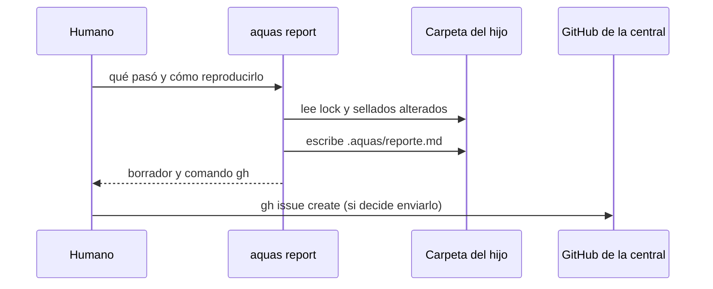

# S004 · aquas report: defecto del hijo a la central

[Inicio](../../README.md) › [E002](../README.md) › [F001](README.md) › S004

`aquas report <carpeta> "<qué pasó>" "<cómo reproducirlo>"` arma el borrador de un issue para la central. No envía nada.

## En una frase

Un defecto de gobierno visto en un hijo vuelve a la central, con lo necesario para arreglarlo.

## Para qué existe

**El problema.** El hijo no puede corregir lo sellado. Si encuentra un defecto de gobierno y nadie lo avisa, el defecto se repite en todos los hijos.

**La solución.** Report arma el texto del issue con la firma del hijo y la versión del lock. También añade qué pasó, cómo reproducirlo y los sellados alterados. Lo guarda en `.aquas/reporte.md` e imprime el comando `gh` para abrirlo. Enviarlo es una acción externa: la decide el humano.

Contrato del [slice](../../glosario.md#slice):

| Campo | Valor |
|---|---|
| Objetivo | Borrador de issue de gobierno, listo para enviar a la central |
| Incluye | `hijo.Report`, comando `aquas report`, `.aquas/reporte.md` |
| Excluye | Enviar el issue sin el humano; analizarlo en la central |
| Prueba | `go test ./internal/hijo/ -run TestReportArmaIssueConVersion` |

## Analogía

Piensa en un **formulario de garantía**.

- El local anota el modelo, la versión y cómo falla.
- El dueño decide si lo manda a fábrica.

Límite de la analogía: aquí la versión sale sola del lock; nadie la copia a mano.

## Diagrama

## Ejemplo de punta a punta

continúa: [EJ-E002-F001](README.md#EJ-E002-F001)

1. En la landing de prueba de `.tmp/` se corrió report con un defecto inventado.
2. El borrador salió con «Reportado desde el hijo «landing-u1»» y la versión del lock.
3. Imprimió el comando `gh issue create` contra el repo central; nada se envió.
4. Sin qué pasó ni reproducción, report falló.

## Paso a paso

1. Rechazar si faltan qué pasó o la reproducción.
2. Leer la versión del lock; sin lock, pedir install.
3. Listar los sellados alterados.
4. Escribir el borrador e imprimir el comando para enviarlo.

## Cómo se usa

- `aquas report <carpeta-del-hijo> "<qué pasó>" "<cómo reproducirlo>"`.
- Revisar `.aquas/reporte.md` y, si vale, correr el comando `gh` que imprime.

## Contrato y evidencia

<!-- GENERADO por aquas desde trabajo/: no editar a mano; `aquas compilar` lo rehace. -->

| Prueba | Qué demuestra | Rojo | Verde |
|---|---|---|---|
| `TestReportArmaIssueConVersion` | arma el issue con firma, qué pasó, reproducción y versión del lock; sin gh confirmado no envía | 2026-10-22 | 2026-10-22 |

<!-- /GENERADO -->

Estado: hecho.

## Navegación

- ↑ Subir: [F001 · Instalar y heredar el núcleo común](README.md)
