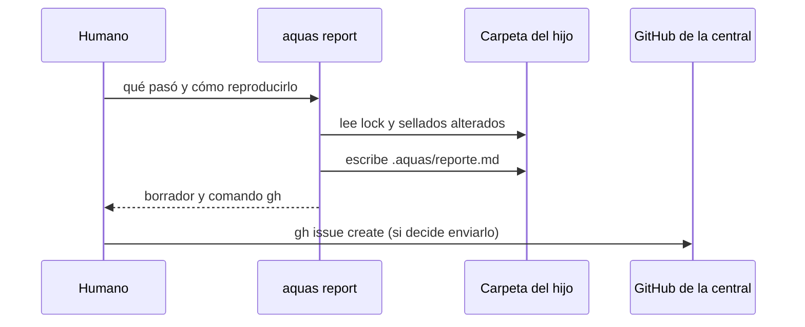

# S004 · aquas report: defecto del hijo a la central

[Inicio](../../README.md) › [E002](../README.md) › [F001](README.md) › S004

`aquas report <carpeta> "<qué pasó>" "<cómo reproducirlo>"` arma el borrador de un issue para la central. No envía nada.

## En una frase

Un defecto de gobierno visto en un hijo vuelve a la central, con lo necesario para arreglarlo.

## Para qué existe

**El problema.** El hijo no puede corregir lo sellado. Si encuentra un defecto de gobierno y nadie lo avisa, el defecto se repite en todos los hijos.

**La solución.** Report arma el texto del issue con la firma del hijo y la versión del lock. También añade qué pasó, cómo reproducirlo y los sellados alterados. Lo guarda en `.aquas/reporte.md` e imprime el comando `gh` para abrirlo. Enviarlo es una acción externa: la decide el humano.

Contrato del [slice](../../glosario.md#slice):

| Campo | Valor |
|---|---|
| Objetivo | Borrador de issue de gobierno, listo para enviar a la central |
| Incluye | `hijo.Report`, comando `aquas report`, `.aquas/reporte.md` |
| Excluye | Enviar el issue sin el humano; analizarlo en la central |
| Prueba | `go test ./internal/hijo/ -run TestReportArmaIssueConVersion` |

## Analogía

Piensa en un **formulario de garantía**.

- El local anota el modelo, la versión y cómo falla.
- El dueño decide si lo manda a fábrica.

Límite de la analogía: aquí la versión sale sola del lock; nadie la copia a mano.

## Diagrama

## Ejemplo de punta a punta

continúa: [EJ-E002-F001](README.md#EJ-E002-F001)

1. En la landing de prueba de `.tmp/` se corrió report con un defecto inventado.
2. El borrador salió con «Reportado desde el hijo «landing-u1»» y la versión del lock.
3. Imprimió el comando `gh issue create` contra el repo central; nada se envió.
4. Sin qué pasó ni reproducción, report falló.

## Paso a paso

1. Rechazar si faltan qué pasó o la reproducción.
2. Leer la versión del lock; sin lock, pedir install.
3. Listar los sellados alterados.
4. Escribir el borrador e imprimir el comando para enviarlo.

## Cómo se usa

- `aquas report <carpeta-del-hijo> "<qué pasó>" "<cómo reproducirlo>"`.
- Revisar `.aquas/reporte.md` y, si vale, correr el comando `gh` que imprime.

## Contrato y evidencia

<!-- GENERADO por aquas desde trabajo/: no editar a mano; `aquas compilar` lo rehace. -->

| Prueba | Valida | Rojo cuando | Verde cuando | Rojo | Verde |
|---|---|---|---|---|---|
| `TestReportArmaIssueConVersion` | report arma el issue con firma y versión del lock | el issue omite firma, reproducción o versión, o envía sin gh | issue con firma, qué pasó, reproducción y versión; sin gh no envía | 2026-10-22 | 2026-10-22 |

### Código

| Archivo | Función | Parámetros | Qué hace |
|---|---|---|---|
| [cmd/aquas/main.go](../../../cmd/aquas/main.go) | `main` | `()` | main despacha el subcomando de aquas (compilar, verificar, backlog, hooks…) y sale con su código. |
| [cmd/aquas/main.go](../../../cmd/aquas/main.go) | `hook` | `(raiz string)` | hook: exit 0 = nada que reportar; exit 2 = stderr se muestra a Claude. |
| [cmd/aquas/main.go](../../../cmd/aquas/main.go) | `compilarSettings` | `(w io.Writer)` | compilarSettings regenera .claude/settings.json; sin entorno declarado no inventa uno. |
| [cmd/aquas/main.go](../../../cmd/aquas/main.go) | `reportar` | `(w io.Writer, inf compilador.Informe)` | reportar imprime qué derivados escribió la compilación, o que todo estaba al día. |
| [cmd/aquas/main.go](../../../cmd/aquas/main.go) | `listar` | `(titulo string, problemas []string)` | listar imprime en stderr un título y cada problema en su viñeta. |
| [cmd/aquas/main.go](../../../cmd/aquas/main.go) | `lista` | `(xs []string) string` | lista une los textos con comas, o «—» si no hay ninguno. |
| [cmd/aquas/main.go](../../../cmd/aquas/main.go) | `fallar` | `(codigo int, err error)` | fallar imprime el error en stderr y termina con el código dado. |
| [cmd/aquas/main.go](../../../cmd/aquas/main.go) | `memoriaCLI` | `(raiz string, args []string)` | memoriaCLI: `ver` imprime la memoria; `fijar campo=valor…` la actualiza y la sella. |
| [cmd/aquas/main.go](../../../cmd/aquas/main.go) | `memoriaArchivada` | `(raiz, id string) error` | memoriaArchivada: CERRADO exige el archivo de memoria del slice, apunte o no la memoria a él (E001/F002/S009, X01). |
| [cmd/aquas/main.go](../../../cmd/aquas/main.go) | `focoEnBacklog` | `(raiz string, f memoria.Foco) error` | focoEnBacklog: la memoria solo fija el slice que el backlog tiene en curso (S003). |
| [cmd/aquas/main.go](../../../cmd/aquas/main.go) | `backlogCLI` | `(raiz string, args []string)` | backlogCLI: nuevo \\| ver [id] \\| prioridad \\| estado \\| siguiente \\| pruebas \\| rojo \\| verde. |
| [cmd/aquas/main.go](../../../cmd/aquas/main.go) | `turnoCLI` | `(raiz string, args []string)` | turnoCLI: auditoría de turnos (E001/F002/S001). Lee el JSON del hook por stdin. No imprime nada |
| [cmd/aquas/main.go](../../../cmd/aquas/main.go) | `defectoCLI` | `(raiz string, args []string) error` | defectoCLI: nuevo \\| ocurre \\| ver (E001/F004/S001). |
| [cmd/aquas/main.go](../../../cmd/aquas/main.go) | `versionBinario` | `() string` | versionBinario: versión del módulo con que se compiló el binario (= versión del gobierno embebido). |
| [internal/hijo/report.go](../../../internal/hijo/report.go) | `Report` | `(dir, quePaso, repro string) (string, error)` | Report arma el borrador de issue para la central: firma del hijo, versión |

<!-- /GENERADO -->

Estado: hecho.

## Navegación

- ↑ Subir: [F001 · Instalar y heredar el núcleo común](README.md)
