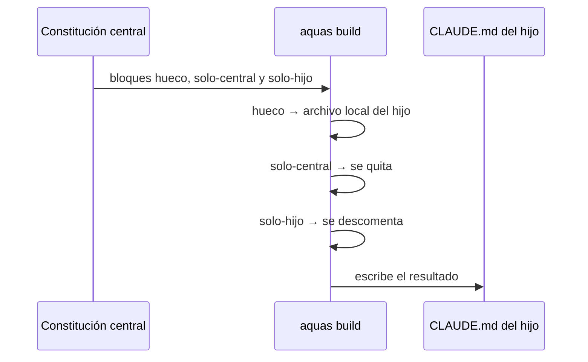

# S005 · Título del hijo y compilación según central o hijo

[Inicio](../../README.md) › [E002](../README.md) › [F001](README.md) › S005

El `CLAUDE.md` del hijo lleva su propio título y las instrucciones de compilación del hijo, no las de la central.

## En una frase

Cada proyecto recibe solo instrucciones que puede cumplir.

## Para qué existe

**El problema.** Tras build, la landing tenía el título de la central. Además mandaba a correr `go run ./cmd/aquas compilar`, que allí no existe.

**La solución.** El título pasa a ser un hueco. Y el [canónico](../../glosario.md#canónico) gana dos marcadores. `<!-- solo-central -->` lo quita build en el hijo. `<!-- solo-hijo … -->` es texto comentado que build descomenta en el hijo.

Contrato del [slice](../../glosario.md#slice):

| Campo | Valor |
|---|---|
| Objetivo | Título propio y compilación correcta en el `CLAUDE.md` del hijo |
| Incluye | Hueco `titulo`, marcadores solo-central y solo-hijo en la constitución y en `hijo.Build` |
| Excluye | Agentes del hijo, update (S003), report (S004) |
| Prueba | `go test ./internal/hijo/ -run TestBuildTituloYCompilacionDelHijo` |

## Analogía

Piensa en un **manual con notas para la oficina central y notas para las sucursales**.

- La imprenta saca una edición para cada lugar.
- Cada edición trae solo las notas de su lugar.

Límite de la analogía: aquí la edición la arma un programa, a partir del mismo texto fuente.

## Diagrama

## Ejemplo de punta a punta

continúa: [EJ-E002-F001](README.md#EJ-E002-F001)

1. Se instaló la central en `.tmp/` y se llenaron los huecos titulo, mision y mapa.
2. Build armó un `CLAUDE.md` con «# CONSTITUCIÓN · landing de Aquas».
3. La sección de compilación dice `aquas build .`, y no queda ninguna mención a `cmd/aquas`.

## Paso a paso

1. Marcar el título como hueco.
2. Envolver las instrucciones de la central en solo-central.
3. Escribir las del hijo en un bloque solo-hijo.
4. Build quita y descomenta esos bloques después de llenar los huecos.

## Cómo se usa

- El hijo escribe `gobierno/canonico/huecos/titulo.md`, además de `mision.md` y `mapa.md`.
- `aquas build <carpeta-del-hijo>`.

## Contrato y evidencia

<!-- GENERADO por aquas desde trabajo/: no editar a mano; `aquas compilar` lo rehace. -->

| Prueba | Qué demuestra | Rojo | Verde |
|---|---|---|---|
| `TestBuildTituloYCompilacionDelHijo` | el hijo pone su título y recibe instrucciones de build, no las de la central | 2026-10-22 | 2026-10-22 |

<!-- /GENERADO -->

Estado: hecho.

## Navegación

- ↑ Subir: [F001 · Instalar y heredar el núcleo común](README.md)
