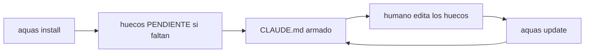
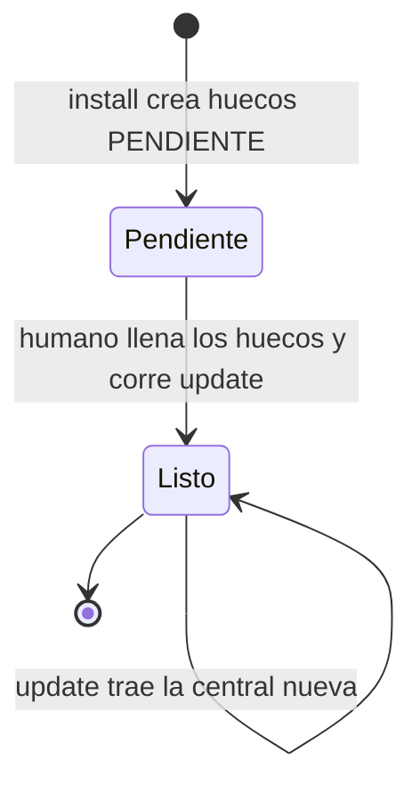

# F002 · Instalar y actualizar un hijo con un comando cada uno

[Inicio](../../README.md) › [E002](../README.md) › F002

[Feature](../../glosario.md#feature) que deja un hijo listo con un solo comando al instalar y uno al actualizar.

## En una frase

`aquas install` deja el `CLAUDE.md` armado; `aquas update` lo rearma sin pisar lo local.

## Para qué existe

**El problema.** Instalar la landing aquas.cl exigió tres pasos: install, escribir tres huecos a mano y build. Además, install rechaza una carpeta que ya tiene código.

**Por qué importa.** Cada paso manual es un paso que alguien olvida. Un hijo sin `CLAUDE.md` trabaja sin reglas.

**La solución.** Install crea los huecos con texto PENDIENTE y arma el `CLAUDE.md`. Acepta carpetas con código sin tocar lo existente. Update rearma el `CLAUDE.md` al final. Ambos dejan un [hook](../../glosario.md#hook) que lo rearma al editar un hueco.

**Límite.** Este repositorio no construye productos. La landing vive en su propio repositorio; aquí solo se cuida su gobierno.

## Analogía

Piensa en **un electrodoméstico que llega enchufado y encendido**.

- Antes llegaba en piezas y con instrucciones.
- Ahora se conecta una vez y funciona.

Límite de la analogía: los huecos PENDIENTE son la etiqueta que el dueño todavía debe llenar.

## Diagrama

Estados de un hijo:

## Ejemplo de punta a punta

continúa: [EJ-E002](../README.md#EJ-E002)

1. El humano corre install sobre la carpeta de la landing.
2. La landing ya tiene `CLAUDE.md`, con título, misión y mapa en PENDIENTE.
3. El humano escribe la misión de la landing y corre update.
4. El `CLAUDE.md` queda con su misión real.

## Paso a paso

1. Install y update corren desde la carpeta del hijo ([S001](S001.md)).
2. Install acepta una carpeta con código ([S002](S002.md)).
3. El hijo avisa si su lock quedó atrás ([S003](S003.md)).
4. El [gate](../../glosario.md#gate) del hijo frena huecos PENDIENTE ([S004](S004.md)).
5. La regla de [Go](../../glosario.md#go) queda solo en la central ([S005](S005.md)).
6. Un [hook](../../glosario.md#hook) recompila el `CLAUDE.md` al editar un hueco ([S006](S006.md)).

## Cómo se usa

- Instalar: en la carpeta del hijo, `aquas install`.
- Actualizar: en la carpeta del hijo, `aquas update`.

## Contrato y evidencia

**Objetivo.** Instalar o actualizar un hijo es un comando, y el hijo queda con `CLAUDE.md`.

Prueba integral: `TestHijoEnUnComando`. Rojo el 2026-10-25 (`install: exit status 1`); verde el 2026-10-29.

Evidencia real: la salida de la instalación en la landing aquas.cl no se copió. El humano decidió cerrar sin ella el 2026-10-28.

## Navegación

<!-- GENERADO por aquas desde trabajo/: no editar a mano; `aquas compile` lo rehace. -->

| Hijo | Qué es | Estado |
|---|---|---|
| [S001](S001.md) | install y update desde la carpeta del hijo crean huecos PENDIENTE y arman CLAUDE.md | Hecho |
| [S002](S002.md) | install sobre una carpeta con código sin tocar lo existente | Hecho |
| [S003](S003.md) | aviso de versión: el hijo pide aquas update cuando su lock es más viejo | Hecho |
| [S004](S004.md) | el gate del hijo falla mientras un hueco diga PENDIENTE | Hecho |
| [S005](S005.md) | el principio de Go como lenguaje único queda solo en la central | Hecho |
| [S006](S006.md) | el hijo recompila su CLAUDE.md al editar un hueco | Hecho |

<!-- /GENERADO -->

- ↑ Subir: [E002](../README.md)
