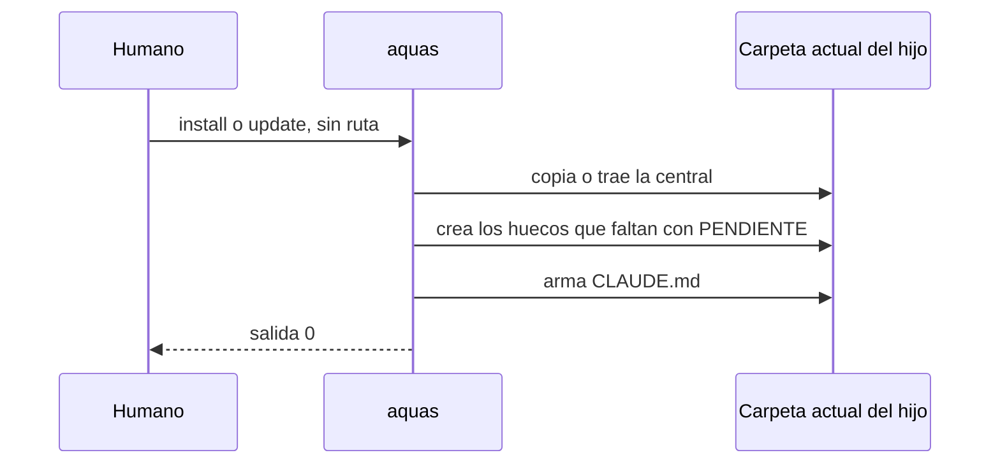

# S001 · install y update desde la carpeta del hijo crean huecos PENDIENTE y arman CLAUDE.md

[Inicio](../../README.md) › [E002](../README.md) › [F002](README.md) › S001

Este [slice](../../glosario.md#slice) hace que un hijo se instale y se actualice desde su propia carpeta, en un comando. Estado: en curso; el humano aprobó el contrato el 2026-10-25.

## En una frase

Parado en la carpeta del hijo, install o update crean los huecos que falten y arman el `CLAUDE.md`.

## Para qué existe

**El problema.** Hoy install se corre desde la central con la ruta del hijo. Además, deja al hijo sin `CLAUDE.md` hasta escribir tres huecos a mano.

**Por qué importa.** La central no entra a cada computadora. Cada hijo debe gobernarse solo, como un paquete de npm.

**La solución.** Aquas viaja como ejecutable con la central adentro. En la carpeta del hijo, install y update no reciben ruta. Crean los huecos que faltan con texto PENDIENTE y arman el `CLAUDE.md`. Un hueco ya escrito no se toca.

Contrato del slice:

| Campo | Valor |
|---|---|
| Historia | Como humano, quiero instalar o actualizar un hijo desde su carpeta con un comando, para no depender de la central |
| Objetivo | En la carpeta del hijo, install y update terminan con el `CLAUDE.md` armado |
| Incluye | Install y update sin ruta, sobre la carpeta actual; crear los huecos faltantes con PENDIENTE; armar el `CLAUDE.md` al final |
| Excluye | Install sobre carpetas con código (S002); aviso de versión vieja (S003); avisar por huecos PENDIENTE; ganchos en el hijo; servidor |
| Límite | Solo toca la carpeta actual |
| Alcance | `internal/hijo/**`, `cmd/aquas/**`, `docs/E002/**`, `registro/defectos/**` |
| Prueba integral | la de E002/F002 |

Criterios de aceptación:

1. En una carpeta vacía, cuando corre install sin ruta, entonces existen los tres huecos con PENDIENTE y el `CLAUDE.md`.
2. En un hijo instalado sin huecos, cuando corre update sin ruta, entonces crea los huecos y arma el `CLAUDE.md`.
3. Dado un hueco ya escrito, cuando corre install o update, entonces su texto queda igual y aparece en el `CLAUDE.md`.
4. Dada una ruta como argumento, cuando corre install o update, entonces sale distinto de 0 con el uso correcto.

Estrategia:

1. Una función del paquete hijo crea solo los huecos que faltan.
2. Install y update usan la carpeta actual, llaman esa función y arman el `CLAUDE.md` con build.
3. La prueba construye aquas y corre los subcomandos con la carpeta temporal como carpeta actual.

Casos borde:

| Categoría | Caso | Qué debe pasar |
|---|---|---|
| Tipo de ficha | no aplica | — |
| Estado de origen | hijo instalado antes de este slice, sin huecos | update crea los huecos y arma |
| Padre e hijo | no aplica | — |
| Entrada | hueco ya escrito | queda igual |
| Entrada | una ruta como argumento | sale distinto de 0 con el uso |
| Choque con otro control | build rechaza un archivo que no es hueco | el error se muestra y el comando sale distinto de 0 |
| Quién habla | humano o agente | el mismo comando |
| Fallo a medias | la central se copió pero build falla | sale distinto de 0 con el error; la central queda instalada |

## Analogía

Piensa en **un paquete de npm**.

- Cada proyecto lo instala en su carpeta.
- Nadie de afuera entra a instalarlo.

Límite de la analogía: aquí aún no hay registro en línea; el ejecutable trae la central.

## Diagrama

## Ejemplo de punta a punta

continúa: [EJ-E002-F002](README.md#EJ-E002-F002)

1. El humano abre una terminal en la carpeta de la landing.
2. Corre update, sin ruta.
3. Aparecen los tres huecos con PENDIENTE y el `CLAUDE.md`.

## Paso a paso

1. Rojo de la prueba, función de huecos, install y update sin ruta, verde.

## Cómo se usa

- En la carpeta del hijo: `aquas install` la primera vez; `aquas update` después.

## Contrato y evidencia

<!-- GENERADO por aquas desde trabajo/: no editar a mano; `aquas compilar` lo rehace. -->

| Prueba | Valida | Rojo cuando | Verde cuando | Rojo | Verde |
|---|---|---|---|---|---|
| `TestInstallYUpdateArmanClaude` | valida que install y update corridos en la carpeta del hijo, sin ruta, dejan CLAUDE.md armado y crean solo los huecos que faltan | rojo cuando piden ruta, terminan sin CLAUDE.md o pisan un hueco escrito | verde cuando sin ruta arman CLAUDE.md, crean los huecos faltantes con PENDIENTE y respetan los escritos | 2026-10-25 | 2026-10-25 |

### Código

| Archivo | Función | Parámetros | Qué hace |
|---|---|---|---|
| [cmd/aquas/main.go](../../../cmd/aquas/main.go) | `main` | `()` | main despacha el subcomando de aquas (compilar, verificar, backlog, hooks…) y sale con su código. |
| [cmd/aquas/main.go](../../../cmd/aquas/main.go) | `hook` | `(raiz string)` | hook: exit 0 = nada que reportar; exit 2 = stderr se muestra a Claude. |
| [cmd/aquas/main.go](../../../cmd/aquas/main.go) | `compilarSettings` | `(w io.Writer)` | compilarSettings regenera .claude/settings.json; sin entorno declarado no inventa uno. |
| [cmd/aquas/main.go](../../../cmd/aquas/main.go) | `reportar` | `(w io.Writer, inf compilador.Informe)` | reportar imprime qué derivados escribió la compilación, o que todo estaba al día. |
| [cmd/aquas/main.go](../../../cmd/aquas/main.go) | `listar` | `(titulo string, problemas []string)` | listar imprime en stderr un título y cada problema en su viñeta. |
| [cmd/aquas/main.go](../../../cmd/aquas/main.go) | `lista` | `(xs []string) string` | lista une los textos con comas, o «—» si no hay ninguno. |
| [cmd/aquas/main.go](../../../cmd/aquas/main.go) | `fallar` | `(codigo int, err error)` | fallar imprime el error en stderr y termina con el código dado. |
| [cmd/aquas/main.go](../../../cmd/aquas/main.go) | `memoriaCLI` | `(raiz string, args []string)` | memoriaCLI: `ver` imprime la memoria; `fijar campo=valor…` la actualiza y la sella. |
| [cmd/aquas/main.go](../../../cmd/aquas/main.go) | `memoriaArchivada` | `(raiz, id string) error` | memoriaArchivada: CERRADO exige el archivo de memoria del slice, apunte o no la memoria a él (E001/F002/S009, X01). |
| [cmd/aquas/main.go](../../../cmd/aquas/main.go) | `focoEnBacklog` | `(raiz string, f memoria.Foco) error` | focoEnBacklog: la memoria solo fija el slice que el backlog tiene en curso (S003). |
| [cmd/aquas/main.go](../../../cmd/aquas/main.go) | `backlogCLI` | `(raiz string, args []string)` | backlogCLI: nuevo \\| ver [id] \\| prioridad \\| estado \\| siguiente \\| pruebas \\| rojo \\| verde. |
| [cmd/aquas/main.go](../../../cmd/aquas/main.go) | `turnoCLI` | `(raiz string, args []string)` | turnoCLI: auditoría de turnos (E001/F002/S001). Lee el JSON del hook por stdin. No imprime nada |
| [cmd/aquas/main.go](../../../cmd/aquas/main.go) | `defectoCLI` | `(raiz string, args []string) error` | defectoCLI: nuevo \\| ocurre \\| ver (E001/F004/S001). |
| [cmd/aquas/main.go](../../../cmd/aquas/main.go) | `versionBinario` | `() string` | versionBinario: versión del módulo con que se compiló el binario (= versión del gobierno embebido). |
| [cmd/aquas/main.go](../../../cmd/aquas/main.go) | `registrarCierre` | `(raiz, tipo, transcript, primera, resultado string)` | registrarCierre (E001/F004/S005, D000068) anota cada llamada del gancho cierre-agente en .tmp/hooks/cierre-agente.jsonl. |
| [internal/hijo/huecos.go](../../../internal/hijo/huecos.go) | `PrepararHuecos` | `(dir string) error` | PrepararHuecos (E002/F002/S001): crea con texto PENDIENTE los huecos de la central |
| [internal/hijo/huecos.go](../../../internal/hijo/huecos.go) | `Listo` | `(dir string) error` | Listo deja al hijo con sus huecos, su hook de build (S006) y su CLAUDE.md armado. |

<!-- /GENERADO -->

## Navegación

- ↑ Subir: [F002](README.md)
