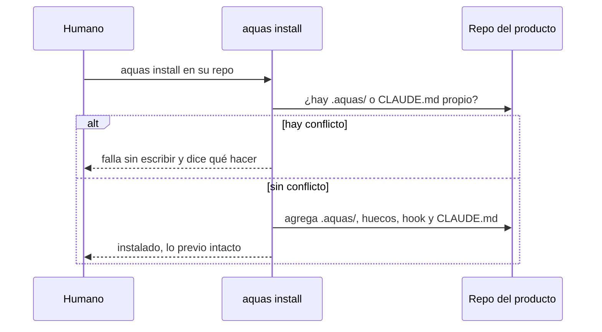

# S002 · install sobre una carpeta con código sin tocar lo existente

[Inicio](../../README.md) › [E002](../README.md) › [F002](README.md) › S002

Este [slice](../../glosario.md#slice) deja instalar el gobierno en un repo de producto que ya tiene `.git` o código. Estado: en curso; el humano aprobó el contrato el 2026-10-28.

## En una frase

`aquas install` acepta una carpeta con archivos, agrega lo suyo y no toca nada de lo que ya estaba.

## Para qué existe

**El problema.** Install exige una carpeta vacía. Un repo recién creado con `git init` ya tiene `.git/`, y install lo rechaza.

**Por qué importa.** Todo producto real llega con `.git` o con código. Hoy el único camino es instalar en otra carpeta y mover archivos a mano.

**La solución.** Install acepta la carpeta si no tiene gobierno previo. Si ya hay `.aquas/`, pide update. Si el producto ya trae su propio `CLAUDE.md`, falla sin tocar nada y explica cómo mover su contenido a los huecos.

Contrato del slice:

| Campo | Valor |
|---|---|
| Historia | Como humano, quiero instalar el gobierno en mi repo existente, para no mover mi código a mano |
| Objetivo | Install funciona en una carpeta con `.git` o código y deja intactos todos los archivos previos |
| Incluye | Aceptar carpetas con archivos; rechazar si ya existe `.aquas/`; rechazar si existe un `CLAUDE.md` propio, sin escribir nada |
| Excluye | Migrar el contenido de un `CLAUDE.md` previo a los huecos; tocar `.gitignore`; hacer commit en el repo del producto |
| Límite | Un `CLAUDE.md` previo lo mueve el humano a los huecos; install solo lo detecta |
| Alcance | `internal/hijo/**`, `cmd/aquas/**`, `docs/E002/**` |
| Prueba integral | la de E002/F002 |

Criterios de aceptación:

1. Dada una carpeta con `.git/` y código, cuando corre install, entonces instala y deja esos archivos idénticos.
2. Dada una carpeta con `.aquas/`, cuando corre install, entonces falla y pide `aquas update`.
3. Dada una carpeta con su propio `CLAUDE.md`, cuando corre install, entonces falla, no escribe nada y nombra los huecos.

Estrategia:

1. Install revisa conflictos antes de escribir: `.aquas/` y `CLAUDE.md`.
2. Sin conflictos, copia la central como hoy; los archivos ajenos no se leen ni se tocan.
3. La prueba compara bytes de los archivos previos antes y después.

Casos borde:

| Categoría | Caso | Qué debe pasar |
|---|---|---|
| Tipo de ficha | no aplica | — |
| Estado de origen | carpeta con solo `.git/` | install funciona |
| Padre e hijo | carpeta que ya es hijo | falla y pide update |
| Entrada | `CLAUDE.md` propio del producto | falla sin escribir nada |
| Choque con otro control | `.claude/settings.json` previo | lo conserva y agrega el hook (S006) |
| Quién habla | humano o agente | el mismo comando |
| Fallo a medias | error al copiar la central | lo reporta; lo previo sigue intacto |

## Analogía

Piensa en **instalar una alarma en una casa habitada**.

- El técnico no saca los muebles: agrega sensores.
- Si ya hay otra alarma, no la arranca: te pregunta primero.

Límite de la analogía: aquí no hay pregunta; install falla y explica qué hacer.

## Diagrama

## Ejemplo de punta a punta

continúa: [EJ-E002-F002](README.md#EJ-E002-F002)

1. El humano crea su repo con `git init` y un `index.html`.
2. Corre `aquas install` dentro y el hijo queda listo.
3. `index.html` y `.git/` siguen idénticos.

## Paso a paso

1. Rojo de la prueba, revisión de conflictos en install, verde.

## Cómo se usa

- `aquas install` dentro del repo del producto, tenga o no código.

## Contrato y evidencia

<!-- GENERADO por aquas desde trabajo/: no editar a mano; `aquas compilar` lo rehace. -->

| Prueba | Valida | Rojo cuando | Verde cuando | Rojo | Verde |
|---|---|---|---|---|---|
| `TestInstallEnCarpetaConCodigo` | valida que install acepta una carpeta con .git y código sin tocarlos, y falla sin escribir si ya hay .aquas o un CLAUDE.md propio | rojo cuando install rechaza la carpeta con código, altera un archivo previo o escribe algo ante un conflicto | verde cuando instala con lo previo idéntico y ante cada conflicto falla sin escribir | 2026-10-28 | 2026-10-28 |

<!-- /GENERADO -->

## Navegación

- ↑ Subir: [F002](README.md)
