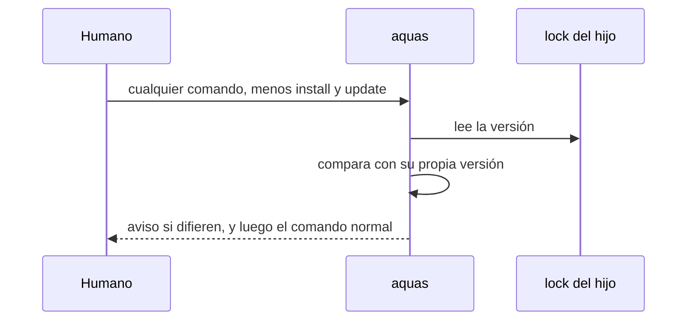

# S003 · aviso de versión: el hijo pide aquas update cuando su lock es más viejo

[Inicio](../../README.md) › [E002](../README.md) › [F002](README.md) › S003

Este [slice](../../glosario.md#slice) hace que el hijo avise solo cuando su gobierno y su ejecutable no van a la par. Estado: en curso; el humano aprobó el contrato el 2026-10-26.

## En una frase

Si el lock del hijo y el ejecutable `aquas` tienen versiones distintas, cada comando lo avisa y dice qué correr.

## Para qué existe

**El problema.** La central cambia y el hijo no se entera. Sigue trabajando con reglas viejas sin que nadie lo note.

**Por qué importa.** El modelo es de paquete, como npm. Nadie de afuera entra al hijo a actualizarlo; el hijo debe enterarse solo.

**La solución.** Antes de cada comando, aquas compara la versión del lock con la suya. Si el lock es más viejo, pide `aquas update`. Si el ejecutable es más viejo, pide actualizarlo con `go install`.

Contrato del slice:

| Campo | Valor |
|---|---|
| Historia | Como humano, quiero que el hijo me avise cuando quedó atrás, para no trabajar con reglas viejas |
| Objetivo | Todo comando dentro de un hijo avisa si su lock y el ejecutable difieren en versión |
| Incluye | Comparar la versión del lock con la del ejecutable; dos avisos distintos según cuál quedó atrás; aviso en la salida de errores |
| Excluye | Install y update; bloquear el comando; versiones con etiqueta como v1.2.0; servidor o registro en línea; install sobre carpetas con código (S002) |
| Límite | Solo avisa: no cambia el código de salida ni escribe archivos |
| Alcance | `internal/hijo/**`, `cmd/aquas/**`, `docs/E002/**`, `registro/defectos/**` |
| Prueba integral | la de E002/F002 |

Criterios de aceptación:

1. Dado un lock más viejo que el ejecutable, cuando corre un comando en el hijo, entonces avisa «corre aquas update».
2. Dado un ejecutable más viejo que el lock, cuando corre un comando, entonces avisa «actualiza aquas con [go](../../glosario.md#go) install».
3. Dadas versiones iguales, o un ejecutable «devel», cuando corre un comando, entonces no avisa.
4. Con o sin aviso, el comando termina con el mismo código de salida que tendría sin él.

Estrategia:

1. Una función del paquete hijo recibe la carpeta y la versión del ejecutable, y devuelve el aviso o nada.
2. Compara las fechas que `go install` pone en la versión, del tipo `v0.0.0-20261026002129-e5f9d7c6e1a0`.
3. Una versión sin esa fecha no se compara y no avisa.
4. El arranque de aquas llama esa función antes de cada comando, menos install y update.

Casos borde:

| Categoría | Caso | Qué debe pasar |
|---|---|---|
| Tipo de ficha | no aplica | — |
| Estado de origen | carpeta sin `.aquas/lock.json` | no avisa: no es un hijo |
| Padre e hijo | la central misma, sin lock | no avisa |
| Entrada | ejecutable «devel», sin datos de git (`-buildvcs=false` o fuera de un repo) | no avisa |
| Entrada | versión con marca `+dirty` | compara solo la fecha |
| Choque con otro control | install o update | no avisan: ellos mismos ponen la versión |
| Quién habla | humano o agente | el mismo aviso |
| Fallo a medias | lock ilegible | no avisa y el comando sigue |

## Analogía

Piensa en **el aviso de npm cuando hay una versión nueva**.

- El proyecto sigue funcionando.
- Pero te dice qué correr para ponerte al día.

Límite de la analogía: aquí no se consulta internet; se compara con el ejecutable instalado.

## Diagrama

## Ejemplo de punta a punta

continúa: [EJ-E002-F002](README.md#EJ-E002-F002)

1. La central sube una versión nueva y el humano corre `go install ./cmd/aquas`.
2. En la landing corre `aquas verify`.
3. Ve «corre aquas update» y el resultado normal de verificar.

## Paso a paso

1. Rojo de la prueba, función de aviso, llamada en el arranque, verde.

## Cómo se usa

- No hace falta hacer nada: el aviso sale solo dentro del hijo.
- `AQUAS_VERSION=<versión>` fija solo la versión que compara el aviso; no cambia lo que update graba en el lock. La usan las pruebas.

## Contrato y evidencia

<!-- GENERADO por aquas desde trabajo/: no editar a mano; `aquas compile` lo rehace. -->

| Prueba | Valida | Rojo cuando | Verde cuando | Rojo | Verde |
|---|---|---|---|---|---|
| `TestAvisoDeVersion` | valida que el aviso compara la versión del lock con la del ejecutable y solo habla cuando difieren y ambas son comparables | rojo cuando calla con versiones distintas, avisa con versiones iguales o con devel, o confunde cuál quedó atrás | verde cuando lock viejo pide aquas update, ejecutable viejo pide go install, y versiones iguales o devel callan | 2026-10-26 | 2026-10-26 |
| `TestAvisoEnElArranque` | valida que el arranque avisa en los comandos del hijo, menos install y update, sin cambiar el código de salida | rojo cuando calla en un comando del hijo, avisa en install o update, o el aviso cambia el código de salida | verde cuando avisa en verificar, calla en install y update, y la salida es la misma con y sin lock | 2026-10-26 | 2026-10-26 |

### Código

| Archivo | Función | Parámetros | Qué hace |
|---|---|---|---|
| [cmd/aquas/aviso.go](../../../cmd/aquas/aviso.go) | `avisarVersion` | `(w io.Writer, comando, raiz, version string)` | avisarVersion (E002/F002/S003) escribe el aviso de versión del hijo en w, salvo en install y update. |
| [cmd/aquas/main.go](../../../cmd/aquas/main.go) | `main` | `()` | main despacha el subcomando de aquas (compilar, verificar, backlog, hooks…) y sale con su código. |
| [cmd/aquas/main.go](../../../cmd/aquas/main.go) | `hook` | `(raiz string)` | hook: exit 0 = nada que reportar; exit 2 = stderr se muestra a Claude. |
| [cmd/aquas/main.go](../../../cmd/aquas/main.go) | `compilarSettings` | `(w io.Writer)` | compilarSettings regenera .claude/settings.json; sin entorno declarado no inventa uno. |
| [cmd/aquas/main.go](../../../cmd/aquas/main.go) | `reportar` | `(w io.Writer, inf compilador.Informe)` | reportar imprime qué derivados escribió la compilación, o que todo estaba al día. |
| [cmd/aquas/main.go](../../../cmd/aquas/main.go) | `listar` | `(titulo string, problemas []string)` | listar imprime en stderr un título y cada problema en su viñeta. |
| [cmd/aquas/main.go](../../../cmd/aquas/main.go) | `lista` | `(xs []string) string` | lista une los textos con comas, o «—» si no hay ninguno. |
| [cmd/aquas/main.go](../../../cmd/aquas/main.go) | `fallar` | `(codigo int, err error)` | fallar imprime el error en stderr y termina con el código dado. |
| [cmd/aquas/main.go](../../../cmd/aquas/main.go) | `memoriaCLI` | `(raiz string, args []string)` | memoriaCLI: `ver` imprime la memoria; `fijar campo=valor…` la actualiza y la sella. |
| [cmd/aquas/main.go](../../../cmd/aquas/main.go) | `memoriaArchivada` | `(raiz, id string) error` | memoriaArchivada: CERRADO exige el archivo de memoria del slice, apunte o no la memoria a él (E001/F002/S009, X01). |
| [cmd/aquas/main.go](../../../cmd/aquas/main.go) | `focoEnBacklog` | `(raiz string, f memoria.Foco) error` | focoEnBacklog: la memoria solo fija el slice que el backlog tiene en curso (S003). |
| [cmd/aquas/main.go](../../../cmd/aquas/main.go) | `backlogCLI` | `(raiz string, args []string)` | backlogCLI: nuevo \\| ver [id] \\| tabla \\| prioridad \\| estado \\| siguiente \\| pruebas \\| rojo \\| verde. |
| [cmd/aquas/main.go](../../../cmd/aquas/main.go) | `turnoCLI` | `(raiz string, args []string)` | turnoCLI: auditoría de turnos (E001/F002/S001). Lee el JSON del hook por stdin. No imprime nada |
| [cmd/aquas/main.go](../../../cmd/aquas/main.go) | `defectoCLI` | `(raiz string, args []string) error` | defectoCLI: nuevo \\| ocurre \\| ver (E001/F004/S001). |
| [cmd/aquas/main.go](../../../cmd/aquas/main.go) | `versionBinario` | `() string` | versionBinario: versión del módulo con que se compiló el binario (= versión del gobierno embebido). |
| [cmd/aquas/main.go](../../../cmd/aquas/main.go) | `registrarCierre` | `(raiz, tipo, transcript, primera, resultado string)` | registrarCierre (E001/F004/S005, D000068) anota cada llamada del gancho cierre-agente en .tmp/hooks/cierre-agente.jsonl. |
| [internal/hijo/aviso.go](../../../internal/hijo/aviso.go) | `AvisoVersion` | `(dir, binario string) string` | AvisoVersion (E002/F002/S003) devuelve el aviso de versión del hijo, o "" si no hay nada que avisar. |

<!-- /GENERADO -->

## Navegación

- ↑ Subir: [F002](README.md)
