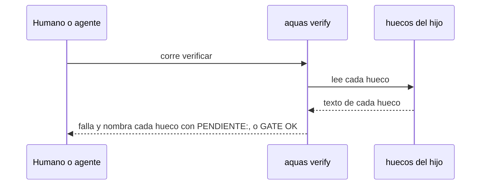

# S004 · el gate del hijo falla mientras un hueco diga PENDIENTE

[Inicio](../../README.md) › [E002](../README.md) › [F002](README.md) › S004

Este [slice](../../glosario.md#slice) impide que un hijo pase su [gate](../../glosario.md#gate) con la constitución a medio llenar. Estado: en curso; el humano aprobó el contrato el 2026-10-28.

## En una frase

Si un hueco del hijo conserva el texto «PENDIENTE», `aquas verify` falla y nombra ese hueco.

## Para qué existe

**El problema.** Install crea los huecos título, misión y mapa con texto PENDIENTE. El gate del hijo hoy pasa igual.

**Por qué importa.** Los [agentes](../../glosario.md#agente) del hijo trabajan con una constitución sin misión ni mapa. Nadie lo nota (defecto D000054).

**La solución.** Verificar revisa cada hueco. Si alguno conserva la marca «PENDIENTE:», falla y dice cuál llenar.

Contrato del slice:

| Campo | Valor |
|---|---|
| Historia | Como humano, quiero que el gate del hijo me frene mientras falten huecos, para no trabajar con una constitución vacía |
| Objetivo | Verificar del hijo falla mientras algún hueco conserve la marca «PENDIENTE:» |
| Incluye | Revisar cada hueco de la central en `gobierno/canonico/huecos/`; un mensaje por hueco pendiente con su ruta |
| Excluye | Juzgar la calidad del texto; recompilar al editar (S006); install y build siguen funcionando con huecos pendientes |
| Límite | Solo detecta la marca que escribe install; un texto pobre pero escrito pasa |
| Alcance | `internal/hijo/**`, `cmd/aquas/**`, `docs/E002/**` |
| Prueba integral | la de E002/F002 |

Criterios de aceptación:

1. Dado un hijo recién instalado, cuando corre verificar, entonces falla y nombra título, misión y mapa.
2. Dado un hijo con un solo hueco pendiente, cuando corre verificar, entonces falla nombrando solo ese.
3. Dado un hijo con todos sus huecos escritos y su `CLAUDE.md` al día, cuando corre verificar, entonces pasa.

Estrategia:

1. `Verificar` lee cada hueco de la central y busca la marca «PENDIENTE:».
2. Cada hueco pendiente agrega un problema con la ruta del archivo a editar.
3. Build no cambia: arma el `CLAUDE.md` aunque haya huecos pendientes.

Casos borde:

| Categoría | Caso | Qué debe pasar |
|---|---|---|
| Tipo de ficha | no aplica | — |
| Estado de origen | archivo de hueco ausente | falla como hoy, al armar el `CLAUDE.md` |
| Padre e hijo | la central misma | no aplica: la central no tiene huecos locales |
| Entrada | texto que menciona «pendiente» en minúscula | pasa: solo cuenta la marca «PENDIENTE:» |
| Choque con otro control | `CLAUDE.md` desfasado y hueco pendiente | reporta los dos problemas |
| Quién habla | humano o agente | el mismo mensaje |
| Fallo a medias | hueco ilegible | falla con el error de lectura |

## Analogía

Piensa en **un formulario con campos obligatorios**.

- Puedes guardarlo a medias.
- Pero no se envía mientras un campo obligatorio esté vacío.

Límite de la analogía: aquí solo se detecta el texto de relleno, no si la respuesta es buena.

## Diagrama

## Ejemplo de punta a punta

continúa: [EJ-E002-F002](README.md#EJ-E002-F002)

1. El humano corre `aquas install` en una carpeta nueva.
2. Corre `aquas verify` y ve tres huecos pendientes con sus rutas.
3. Llena `mision.md`, `mapa.md` y `titulo.md`, corre `aquas build .` y verificar pasa.

## Paso a paso

1. Rojo de la prueba, revisión de huecos en `Verificar`, verde.

## Cómo se usa

- Llena cada archivo de `gobierno/canonico/huecos/` y corre `aquas build .`.

## Contrato y evidencia

<!-- GENERADO por aquas desde trabajo/: no editar a mano; `aquas compile` lo rehace. -->

| Prueba | Valida | Rojo cuando | Verde cuando | Rojo | Verde |
|---|---|---|---|---|---|
| `TestVerificarHuecoPendiente` | valida que verificar del hijo falla mientras un hueco conserve el texto PENDIENTE | rojo cuando verificar pasa con un hueco PENDIENTE o no nombra cuál | verde cuando falla nombrando cada hueco pendiente y pasa con los huecos escritos | 2026-10-28 | 2026-10-28 |

### Código

| Archivo | Función | Parámetros | Qué hace |
|---|---|---|---|
| [internal/hijo/build.go](../../../internal/hijo/build.go) | `Build` | `(dir string) error` | Build arma el CLAUDE.md del hijo: central sellada + huecos locales. |
| [internal/hijo/build.go](../../../internal/hijo/build.go) | `armar` | `(dir string) (string, error)` | armar devuelve el CLAUDE.md que Build escribiría, sin escribirlo. |
| [internal/hijo/build.go](../../../internal/hijo/build.go) | `verificarSello` | `(dir, central string) error` | verificarSello compara cada archivo de la central con su hash del lock. |
| [internal/hijo/build.go](../../../internal/hijo/build.go) | `leerHuecos` | `(dir string) (map[string]string, error)` | leerHuecos devuelve nombre → contenido de cada <nombre>.md local. |
| [internal/hijo/build.go](../../../internal/hijo/build.go) | `Verificar` | `(dir string) []string` | Verificar (X02, E002/F002/S004): gate del hijo; nil si su central sellada, sus huecos sin PENDIENTE y su CLAUDE.md están al día. |
| [internal/hijo/build.go](../../../internal/hijo/build.go) | `EsHijo` | `(dir string) bool` | EsHijo: dir tiene un gobierno central instalado (lock.json de aquas install). |
| [internal/hijo/build.go](../../../internal/hijo/build.go) | `pendientes` | `(dir string) ([]string, error)` | pendientes (E002/F002/S004): un problema por hueco que conserva la marca de relleno, en orden. |
| [internal/hijo/huecos.go](../../../internal/hijo/huecos.go) | `PrepararHuecos` | `(dir string) error` | PrepararHuecos (E002/F002/S001): crea con texto PENDIENTE los huecos de la central |
| [internal/hijo/huecos.go](../../../internal/hijo/huecos.go) | `Listo` | `(dir string) error` | Listo deja al hijo con sus huecos, su hook de build (S006) y su CLAUDE.md armado. |

<!-- /GENERADO -->

## Navegación

- ↑ Subir: [F002](README.md)
