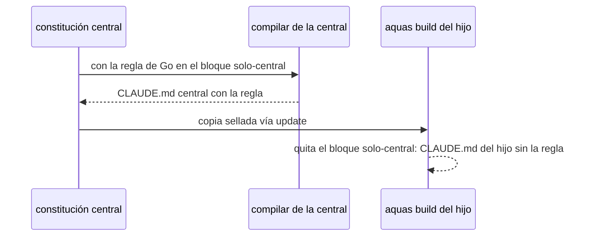

# S005 · el principio de Go como lenguaje único queda solo en la central

[Inicio](../../README.md) › [E002](../README.md) › [F002](README.md) › S005

Este [slice](../../glosario.md#slice) quita del hijo una regla que solo gobierna a la central. Estado: en curso; el humano aprobó el contrato el 2026-10-28.

## En una frase

La regla «[Go](../../glosario.md#go) = lenguaje único… Módulo…» pasa a un bloque solo de la central y los principios quedan del 1 al 8.

## Para qué existe

**El problema.** El principio 4 habla del módulo de la central. Hoy se copia al `CLAUDE.md` de cada hijo.

**Por qué importa.** Un hijo puede escribir su producto en otro lenguaje. La regla lo confunde y gasta contexto (defecto D000054).

**La solución.** En el [canónico](../../glosario.md#canónico) de la constitución, la regla pasa como viñeta al bloque «Canónicos y compilación» solo de la central. Los principios se renumeran.

Contrato del slice:

| Campo | Valor |
|---|---|
| Historia | Como humano, quiero que el hijo herede solo reglas que lo gobiernan, para no confundir a sus agentes |
| Objetivo | El `CLAUDE.md` armado del hijo no trae la regla de Go y la central la conserva |
| Incluye | Mover la regla al bloque solo de la central; renumerar principios 1 a 8; corregir la referencia «(principio 4)» de la metodología E001 |
| Excluye | Cambiar otros principios; reglas de lenguaje para los hijos |
| Límite | Los hijos la pierden al correr `aquas update` con la versión nueva |
| Alcance | `gobierno/canonico/constitucion.md`, `gobierno/canonico/metodologias/**`, `internal/hijo/**`, `docs/E002/**` |
| Prueba integral | la de E002/F002 |

Criterios de aceptación:

1. Dado un hijo armado con la central nueva, cuando se lee su `CLAUDE.md`, entonces no contiene «lenguaje único».
2. Dada la central, cuando se compila, entonces su `CLAUDE.md` conserva la regla y numera los principios del 1 al 8.

Estrategia:

1. Editar el [canónico](../../glosario.md#canónico) de la constitución y la referencia de la metodología.
2. Recompilar la central y probar el armado del hijo con la central embebida.

Casos borde:

| Categoría | Caso | Qué debe pasar |
|---|---|---|
| Tipo de ficha | no aplica | — |
| Estado de origen | hijo con la central vieja | conserva la regla hasta su update |
| Padre e hijo | central | conserva la regla, ahora como viñeta |
| Entrada | otra referencia a «principio N» | se corrige si la numeración cambió |
| Choque con otro control | sello de la central | se resella al compilar |
| Quién habla | humano o agente | — |
| Fallo a medias | no aplica | — |

## Analogía

Piensa en **el reglamento interno de una casa matriz**.

- Las sucursales heredan las reglas de atención.
- No heredan qué proveedor de software usa la matriz.

Límite de la analogía: aquí la separación la hace el [compilador](../../glosario.md#compilador), no una persona.

## Diagrama

## Ejemplo de punta a punta

continúa: [EJ-E002-F002](README.md#EJ-E002-F002)

1. El hijo corre `aquas update` con la versión nueva.
2. Corre `aquas build .` y su `CLAUDE.md` muestra los principios del 1 al 8 sin la regla de Go.

## Paso a paso

1. Rojo de la prueba, edición del canónico y la metodología, recompilar, verde.

## Cómo se usa

- Nada que hacer en el hijo más allá de `aquas update` y `aquas build .`.

## Contrato y evidencia

<!-- GENERADO por aquas desde trabajo/: no editar a mano; `aquas compilar` lo rehace. -->

| Prueba | Valida | Rojo cuando | Verde cuando | Rojo | Verde |
|---|---|---|---|---|---|
| `TestGoSoloEnCentral` | valida que el CLAUDE.md armado del hijo no trae el principio de Go y la constitución central sí | rojo cuando el CLAUDE.md del hijo contiene «lenguaje único» | verde cuando el hijo no lo contiene y la central lo conserva | 2026-10-28 | 2026-10-28 |

<!-- /GENERADO -->

## Navegación

- ↑ Subir: [F002](README.md)
