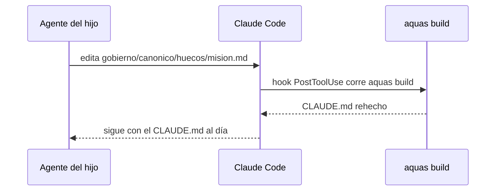

# S006 · el hijo recompila su CLAUDE.md al editar un hueco

[Inicio](../../README.md) › [E002](../README.md) › [F002](README.md) › S006

Este [slice](../../glosario.md#slice) hace que el `CLAUDE.md` del hijo se regenere solo cuando alguien edita un hueco. Estado: en curso; el humano aprobó el contrato el 2026-10-28.

## En una frase

Install y update dejan en el hijo un [hook](../../glosario.md#hook) de Claude Code que corre `aquas build "$CLAUDE_PROJECT_DIR"` después de cada edición.

## Para qué existe

**El problema.** En el hijo nada recompila al editar un hueco. El `CLAUDE.md` queda desfasado hasta que alguien corre `aquas build .` a mano.

**Por qué importa.** Los [agentes](../../glosario.md#agente) del hijo leen un `CLAUDE.md` viejo, y el [gate](../../glosario.md#gate) falla sin que nadie sepa por qué (defecto D000054).

**La solución.** Install y update agregan a `.claude/settings.json` del hijo un hook PostToolUse que corre `aquas build "$CLAUDE_PROJECT_DIR"`. Si el archivo ya existe, conservan todo lo demás.

Contrato del slice:

| Campo | Valor |
|---|---|
| Historia | Como humano o agente del hijo, quiero editar solo el hueco y que el `CLAUDE.md` se rehaga solo, para no olvidar el build |
| Objetivo | Tras install o update, el hijo tiene un hook PostToolUse que corre `aquas build "$CLAUDE_PROJECT_DIR"` sin perder sus settings previos |
| Incluye | Crear `.claude/settings.json` si falta; agregar el hook si falta; no duplicarlo; conservar claves y hooks ajenos |
| Excluye | Hook de git pre-commit; otros hooks de la central en el hijo (TH01); edición a mano sin Claude Code, que sigue cubierta por el gate |
| Límite | Solo recompila ediciones hechas desde Claude Code; quien edita con otro editor corre `aquas build .` o el gate se lo pide |
| Alcance | `internal/hijo/**`, `cmd/aquas/**`, `docs/E002/**` |
| Prueba integral | la de E002/F002 |

Criterios de aceptación:

1. Dado un hijo recién instalado, cuando se lee su `.claude/settings.json`, entonces trae un hook PostToolUse con `aquas build "$CLAUDE_PROJECT_DIR"`.
2. Dado un hijo con settings previos, cuando corre update, entonces conserva lo suyo y agrega el hook una vez.
3. Dado un hueco editado, cuando corre el hook, entonces el `CLAUDE.md` queda al día y el gate pasa.

Estrategia:

1. Una función del paquete hijo lee el settings del hijo, agrega el hook si falta y lo reescribe.
2. Install y update la llaman al final.
3. La prueba corre el comando del hook tras editar un hueco y luego `Verificar`.

Casos borde:

| Categoría | Caso | Qué debe pasar |
|---|---|---|
| Tipo de ficha | no aplica | — |
| Estado de origen | hijo sin `.claude/` | se crea con el hook |
| Padre e hijo | la central | no aplica: la central tiene su propio settings generado |
| Entrada | settings con JSON inválido | install o update fallan sin tocar el archivo |
| Choque con otro control | hook de build ya presente | no se duplica |
| Quién habla | humano o agente | el mismo hook |
| Fallo a medias | build falla dentro del hook | el hook muestra el error a Claude |

## Analogía

Piensa en **el autoguardado de un editor**.

- Escribes y el archivo final se actualiza solo.
- No dependes de acordarte de guardar.

Límite de la analogía: solo funciona dentro de Claude Code; fuera, el gate hace de recordatorio.

## Diagrama

## Ejemplo de punta a punta

continúa: [EJ-E002-F002](README.md#EJ-E002-F002)

1. El humano instala el hijo y le pide al agente llenar la misión.
2. El agente edita `mision.md` y el hook rehace el `CLAUDE.md`.
3. `aquas verify` pasa sin correr el build a mano.

## Paso a paso

1. Rojo de la prueba, función que agrega el hook, llamada en install y update, verde.

## Cómo se usa

- Nada que hacer: tras install o update, editar un hueco basta.

## Contrato y evidencia

<!-- GENERADO por aquas desde trabajo/: no editar a mano; `aquas compile` lo rehace. -->

| Prueba | Valida | Rojo cuando | Verde cuando | Rojo | Verde |
|---|---|---|---|---|---|
| `TestHijoRecompilaAlEditarHueco` | valida que install deja en el hijo un hook PostToolUse que corre aquas build y no pisa settings previos | rojo cuando el hijo queda sin ese hook o pierde su settings previo | verde cuando el hook existe y tras editar un hueco el CLAUDE.md queda al día | 2026-10-28 | 2026-10-28 |
| `TestHookDelHijoCorreBuild` | valida que el comando real del hook, en bash y desde otra carpeta, rearma el CLAUDE.md | rojo cuando el hook no rearma o un build fallido no sale 2 | verde cuando rearma y el fallo sale 2 con el error | 2026-10-28 | 2026-10-28 |

### Código

| Archivo | Función | Parámetros | Qué hace |
|---|---|---|---|
| [internal/hijo/ajustes.go](../../../internal/hijo/ajustes.go) | `AsegurarHook` | `(dir string) error` | AsegurarHook (E002/F002/S006) agrega a .claude/settings.json del hijo un hook PostToolUse |
| [internal/hijo/huecos.go](../../../internal/hijo/huecos.go) | `PrepararHuecos` | `(dir string) error` | PrepararHuecos (E002/F002/S001): crea con texto PENDIENTE los huecos de la central |
| [internal/hijo/huecos.go](../../../internal/hijo/huecos.go) | `Listo` | `(dir string) error` | Listo deja al hijo con sus huecos, su hook de build (S006) y su CLAUDE.md armado. |

<!-- /GENERADO -->

## Navegación

- ↑ Subir: [F002](README.md)
