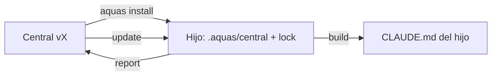
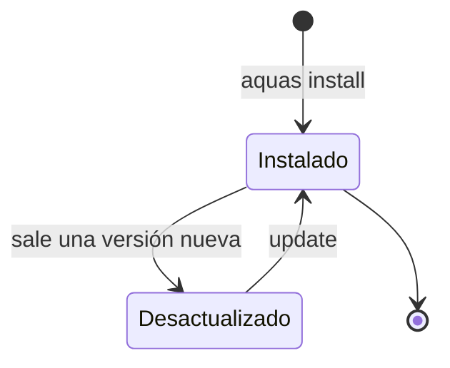

# E002 · Proyectos hijos

[Inicio](../README.md) › E002

[Iniciativa](../glosario.md#iniciativa) que lleva el gobierno central a cada producto de Aquas: una landing, una editorial, un libro o una API.

## En una frase

Un comando instala el gobierno en otra carpeta, y la central lo mantiene al día.

## Para qué existe

**El problema.** Sin esta iniciativa, el gobierno solo vale dentro de este repositorio. Cada producto copiaría las reglas a mano, y se irían desviando.

**La solución.** `aquas install` copia la central sellada al hijo, con un lock de versión y hashes. Después, el hijo hereda por huecos, se actualiza con update y reporta defectos a la central.

## Analogía

Piensa en una **franquicia**.

- La casa matriz escribe el manual y lo entrega sellado a cada local.
- Cada local pone su nombre y su menú local, pero no reescribe el manual.
- Si el manual falla, el local avisa y la matriz saca una edición nueva.

Límite de la analogía: aquí el [sello](../glosario.md#sello) es un hash, y un programa lo revisa.

## Diagrama

Estados de un hijo:

## Ejemplo de punta a punta

continúa: [EJ-INICIO](../README.md#EJ-INICIO)

1. Se quiere la landing de Aquas como primer hijo.
2. `aquas install ./landing` copia la central y su lock.
3. La landing trabaja con las mismas reglas que este repositorio.

## Paso a paso

1. Instalar y heredar el núcleo común (F001).
2. Perfiles por tipo de producto, cuando exista el primer hijo de cada tipo.

## Cómo se usa

- Instalar: `aquas install <carpeta>` en una carpeta vacía.

## Contrato y evidencia

**Objetivo.** Que cualquier producto de Aquas trabaje con el gobierno central, sin copiarlo a mano.

Prueba integral: `TestCicloDeVidaDelHijo` (pendiente).

## Navegación

<!-- GENERADO por aquas desde trabajo/: no editar a mano; `aquas compilar` lo rehace. -->

| Hijo | Qué es | Estado |
|---|---|---|
| [F001](F001/README.md) | Instalar y heredar el núcleo común | En curso |

<!-- /GENERADO -->

- ↑ Subir: [Inicio](../README.md)
- Abajo: [F001 · Instalar y heredar el núcleo común](F001/README.md)
