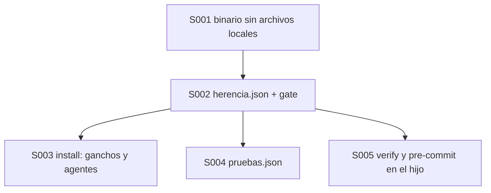
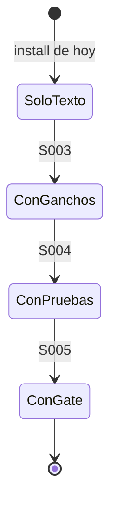

# F001 · Herencia de controles a cada hijo

[Inicio](../../README.md) › [E003](../README.md) › F001

[Feature](../../glosario.md#feature) que declara qué control de la central viaja a los hijos y lo instala en cada uno.

## En una frase

`herencia.json` lista cada control; `aquas install` pone en el hijo los que viajan.

## Para qué existe

**El problema.** Un hijo recibe hoy un solo gancho de diez, y ni `verify` ni el [pre-commit](../../glosario.md#pre-commit). Nadie sabe por escrito qué control debería viajar. Además, el binario lleva dentro `entorno.local.json`, el archivo local de la máquina donde se compiló.

**Por qué importa.** Sin lista, un control nuevo de la central puede quedarse fuera de los hijos sin que nadie lo note.

**La solución.** Cinco [slices](../../glosario.md#slice):

- sacar del binario los archivos locales;
- `herencia.json` con su [gate](../../glosario.md#gate);
- install de ganchos y [agentes](../../glosario.md#agente);
- `pruebas.json` para que rojo y verde funcionen sin [Go](../../glosario.md#go);
- `verify` y pre-commit en el hijo.

**Origen.** Orden aprobado por el humano el 2026-10-31. Corte en cinco slices aceptado el 2026-11-01. Por ahora `herencia.json` acepta solo `todos` o `central`; los perfiles por tipo de hijo entran cuando exista el primero.

## Analogía

Piensa en **la lista de equipos de una franquicia**.

- Cada equipo de la matriz aparece en la lista, con «va a cada local» o «solo en la matriz».
- Un equipo nuevo sin renglón detiene la entrega hasta que alguien decida.

Límite de la analogía: aquí la lista es un JSON y el gate la revisa en cada [commit](../../glosario.md#commit).

## Diagrama

Estados de un hijo:

| Slice | Qué entrega |
|---|---|
| [S001 Binario sin archivos locales](S001.md) | `entorno.local.json` deja de viajar dentro de `aquas` |
| [S002 herencia.json y su gate](S002.md) | Una fila por control; `verify` falla si falta una |
| [S003 Install de ganchos y agentes](S003.md) | El hijo recibe cada gancho y agente que viaja |
| [S004 Pruebas del hijo sin Go](S004.md) | `pruebas.json` dice cómo correr una prueba |
| [S005 Gate y pre-commit en el hijo](S005.md) | `verify` y el pre-commit corren en el hijo |

## Ejemplo de punta a punta

continúa: [EJ-E003](../README.md#EJ-E003)

1. `herencia.json` marca `guard` con `todos`.
2. Un hijo en Python corre `aquas install`; su `.claude/settings.json` trae el gancho `guard`.
3. Su `pruebas.json` dice `pytest {prueba}`; `aquas backlog red` corre esa prueba.
4. Un [commit](../../glosario.md#commit) con un [derivado](../../glosario.md#derivado) desfasado sale bloqueado por el pre-commit del hijo.

## Paso a paso

1. Binario sin archivos locales (S001).
2. `herencia.json` y su gate (S002).
3. Install de ganchos y agentes (S003).
4. Pruebas del hijo sin Go (S004).
5. Gate y pre-commit en el hijo (S005).

## Cómo se usa

- Control nuevo en la central: agregar su fila en `gobierno/config/herencia.json`.
- Hijo nuevo: `aquas install`; hijo existente: `aquas update`.

## Contrato y evidencia

**Objetivo.** Un hijo instalado tiene activo cada control que `herencia.json` marca con `todos`.

Prueba integral: `TestHerenciaDePuntaAPunta` (instala un hijo de prueba y revisa cada control que viaja).

## Navegación

<!-- GENERADO por aquas desde trabajo/: no editar a mano; `aquas compile` lo rehace. -->

| Hijo | Qué es | Estado |
|---|---|---|
| [S001](S001.md) | saca entorno.local.json de lo que el binario aquas lleva dentro | Hecho |
| [S002](S002.md) | declara por control si viaja a los hijos y hace fallar el gate si falta uno | Planeado |
| [S003](S003.md) | install y update ponen en el hijo cada gancho que viaja y los agentes | Planeado |
| [S004](S004.md) | pruebas.json del hijo dice cómo correr una prueba para rojo y verde | Planeado |
| [S005](S005.md) | verify corre en el hijo los chequeos que viajan y install pone el pre-commit | Planeado |

<!-- /GENERADO -->

- ↑ Subir: [E003](../README.md)
