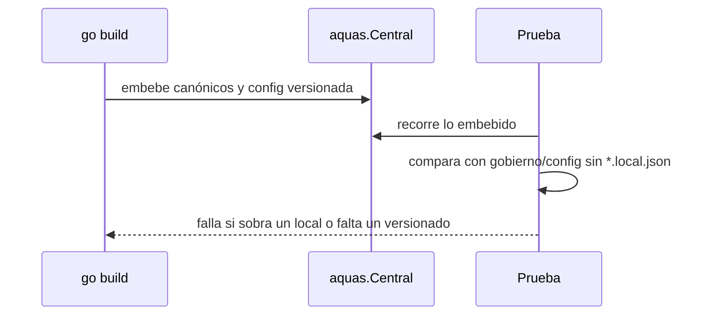

# S001 · Binario sin archivos locales

[Inicio](../../README.md) › [E003](../README.md) › [F001](README.md) › S001

[Slice](../../glosario.md#slice) que saca `entorno.local.json` de lo que el binario `aquas` lleva dentro.

## En una frase

El binario lleva la central versionada, nunca un archivo local de la máquina donde se compiló.

## Para qué existe

**El problema.** `central.go` embebe `gobierno/config` entero. Esa carpeta tiene `entorno.local.json`, que no se versiona y dice el sistema y la raíz de esta máquina. Así, cada hijo recibe en `.aquas/central` la raíz `D:\Agents Factory\…`.

**Por qué importa.** El lock del hijo cambia según la máquina que compiló el binario. Además, se reparte un dato local que no es gobierno.

**La solución.** El embed nombra los archivos de configuración versionados, uno por uno. Una prueba compara lo embebido con la carpeta real: falla si entra un `*.local.json` o si falta un archivo versionado.

**Origen.** Visto el 2026-11-01 al revisar qué recibe un hijo.

**Contrato.**

| Regla | Valor |
|---|---|
| Embebido | `gobierno/canonico` entero y cada archivo versionado de `gobierno/config` |
| Excluido | todo `*.local.json` |
| Prevención | prueba: un archivo de `gobierno/config` sin `.local.json` que falte en el embed → falla |
| Alcance | `central.go`, `cmd/aquas/**`, `docs/**` |

**Casos borde.**

| Categoría | Aplica | Prueba o motivo |
|---|---|---|
| cada tipo de ficha | no | no toca fichas |
| cada estado de origen | no | no cambia estados |
| padre e hijo, activo y archivado | no | no toca fichas |
| entrada ausente, vacía, mal escrita o duplicada | sí | archivo local presente y archivo versionado nuevo sin embeber: `TestBinarioSinEntornoLocal` |
| choque con otro control | sí | el lock del hijo ya no lista el archivo local: `TestBinarioSinEntornoLocal` |
| quién habla: humano, agente o herramienta | no | lo arma `go build`, sin interlocutor |
| fallo a mitad de camino | no | el embed se fija al compilar; no hay estado intermedio |

## Analogía

Piensa en **una caja de envío**.

- Se empaca el manual de la franquicia, no la libreta personal de quien empaca.

Límite de la analogía: aquí la lista de lo empacado la revisa una prueba.

## Diagrama

## Ejemplo de punta a punta

continúa: [EJ-E003-F001](README.md#EJ-E003-F001)

1. Hoy `aquas install` copia `.aquas/central/gobierno/config/entorno.local.json` al hijo.
2. Con el embed por nombre, ese archivo no entra al binario.
3. Si alguien agrega `gobierno/config/nuevo.json` sin embeberlo, la prueba falla.

## Paso a paso

1. Prueba que compara lo embebido con la carpeta.
2. Embed por nombre de archivo en `central.go`.

## Cómo se usa

- No se usa: actúa al compilar `aquas`.
- Archivo nuevo en `gobierno/config`: agregarlo a la lista del embed.

## Contrato y evidencia

<!-- GENERADO por aquas desde trabajo/: no editar a mano; `aquas compile` lo rehace. -->

| Prueba | Valida | Rojo cuando | Verde cuando | Rojo | Verde |
|---|---|---|---|---|---|
| `TestBinarioSinEntornoLocal` | valida que lo embebido es la config versionada sin archivos locales | rojo cuando entra un local.json o falta un archivo versionado | verde cuando lo embebido coincide con la config versionada | — | — |

<!-- /GENERADO -->

## Navegación

- ↑ Subir: [F001](README.md)
