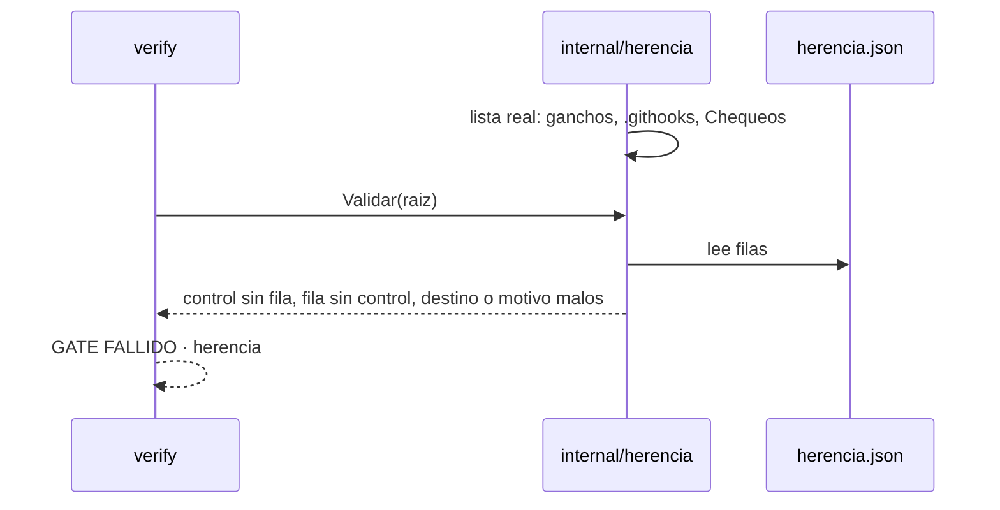

# S002 · herencia.json y su gate

[Inicio](../../README.md) › [E003](../README.md) › [F001](README.md) › S002

[Slice](../../glosario.md#slice) que declara, control por control, si viaja a los hijos, y hace fallar el [gate](../../glosario.md#gate) si falta uno.

## En una frase

Cada control de la central tiene una fila en `herencia.json`, con destino y motivo.

## Para qué existe

**El problema.** Nadie tiene escrito qué control debe cumplirse en un hijo. Un gancho nuevo en la central puede no llegar nunca a los hijos sin que nadie lo note.

**Por qué importa.** Install (S003) y el gate del hijo (S005) necesitan una lista fija de qué instalar. Sin lista, cada decisión queda a juicio del [agente](../../glosario.md#agente).

**La solución.** `gobierno/config/herencia.json` tiene una fila por control. El paquete `internal/herencia` arma la lista real de controles desde tres fuentes:

- cada gancho de `gobierno/config/claude_settings.json`, por su orden;
- cada archivo de `.githooks/`;
- cada chequeo de `verify`, nombrado en la lista `herencia.Chequeos`.

`verify` compara las dos listas.

**Origen.** Idea aprobada por el humano el 2026-10-31. Destinos `todos` y `central` aceptados el 2026-11-01; los perfiles por tipo de hijo esperan al primer perfil real.

**Límite.** Un chequeo nuevo de `verify` que no se agregue a `herencia.Chequeos` escapa hasta S005, que hace correr `verify` desde esa misma lista.

**Contrato.**

| Regla | Valor |
|---|---|
| Archivo | `gobierno/config/herencia.json`: `{"version": 1, "controles": [{"control", "destino", "motivo"}]}` |
| Nombre del control | `gancho:<orden>`, `git:<archivo>` o `gate:<chequeo>` |
| Destino | `todos` (viaja a cada hijo) o `central` (se queda) |
| Gate falla si | control sin fila, fila sin control, destino desconocido, motivo vacío o fila repetida |
| Alcance | `internal/herencia/**`, `cmd/aquas/**`, `gobierno/config/herencia.json`, `docs/**` |

**Casos borde.**

| Categoría | Aplica | Prueba o motivo |
|---|---|---|
| cada tipo de ficha | no | no toca fichas |
| cada estado de origen | no | no cambia estados |
| padre e hijo, activo y archivado | no | no toca fichas |
| entrada ausente, vacía, mal escrita o duplicada | sí | archivo ausente, JSON roto, destino desconocido, motivo vacío y fila repetida: `TestCadaControlTieneFila` |
| choque con otro control | sí | el mismo gancho dos veces en la config cuenta como un control: `TestCadaControlTieneFila` |
| quién habla: humano, agente o herramienta | no | lo corre `verify`, sin interlocutor |
| fallo a mitad de camino | sí | gancho nuevo sin fila y fila de un control que ya no existe: `TestCadaControlTieneFila` |

## Analogía

Piensa en **un inventario con lista de chequeo**.

- Cada equipo en bodega tiene su renglón.
- Un equipo sin renglón, o un renglón sin equipo, para el conteo.

Límite de la analogía: aquí el conteo lo hace `verify` en cada [commit](../../glosario.md#commit).

## Diagrama

## Ejemplo de punta a punta

continúa: [EJ-E003-F001](README.md#EJ-E003-F001)

1. La central agrega el gancho `memory close` sin fila.
2. `verify` dice: `herencia: gancho:memory close sin fila en herencia.json`.
3. Se agrega `{"control": "gancho:memory close", "destino": "todos", "motivo": "la memoria vale en cada hijo"}` y el gate pasa.

## Paso a paso

1. Lista real de controles en `internal/herencia`.
2. Lectura y revisión de `herencia.json`.
3. Chequeo en `verify`.
4. `herencia.json` con las filas de hoy.

## Cómo se usa

- Control nuevo: agregar su fila; `verify` lo exige.

## Contrato y evidencia

<!-- GENERADO por aquas desde trabajo/: no editar a mano; `aquas compile` lo rehace. -->

| Prueba | Valida | Rojo cuando | Verde cuando | Rojo | Verde |
|---|---|---|---|---|---|
| `TestCadaControlTieneFila` | valida que cada control tiene una fila válida en herencia.json | rojo cuando un control no tiene fila o una fila es inválida | verde cuando controles y filas coinciden | 2026-11-01 | 2026-11-01 |

### Código

| Archivo | Función | Parámetros | Qué hace |
|---|---|---|---|
| [cmd/aquas/main.go](../../../cmd/aquas/main.go) | `main` | `()` | main despacha el subcomando de aquas (compilar, verificar, backlog, hooks…) y sale con su código. |
| [cmd/aquas/main.go](../../../cmd/aquas/main.go) | `hook` | `(raiz string)` | hook: exit 0 = nada que reportar; exit 2 = stderr se muestra a Claude. |
| [cmd/aquas/main.go](../../../cmd/aquas/main.go) | `compilarSettings` | `(w io.Writer)` | compilarSettings regenera .claude/settings.json; sin entorno declarado no inventa uno. |
| [cmd/aquas/main.go](../../../cmd/aquas/main.go) | `reportar` | `(w io.Writer, inf compilador.Informe)` | reportar imprime qué derivados escribió la compilación, o que todo estaba al día. |
| [cmd/aquas/main.go](../../../cmd/aquas/main.go) | `listar` | `(titulo string, problemas []string)` | listar imprime en stderr un título y cada problema en su viñeta. |
| [cmd/aquas/main.go](../../../cmd/aquas/main.go) | `lista` | `(xs []string) string` | lista une los textos con comas, o «—» si no hay ninguno. |
| [cmd/aquas/main.go](../../../cmd/aquas/main.go) | `fallar` | `(codigo int, err error)` | fallar imprime el error en stderr y termina con el código dado. |
| [cmd/aquas/main.go](../../../cmd/aquas/main.go) | `revisarAislamiento` | `() (fallo, aviso string)` | revisarAislamiento: fallo para el gate y aviso para el arranque (E000/F008/S003, D000079). |
| [cmd/aquas/main.go](../../../cmd/aquas/main.go) | `memoriaCLI` | `(raiz string, args []string)` | memoriaCLI: `ver` imprime la memoria; `fijar campo=valor…` la actualiza y la sella. |
| [cmd/aquas/main.go](../../../cmd/aquas/main.go) | `memoriaArchivada` | `(raiz, id string) error` | memoriaArchivada: CERRADO exige el archivo de memoria del slice, apunte o no la memoria a él (E001/F002/S009, X01). |
| [cmd/aquas/main.go](../../../cmd/aquas/main.go) | `focoEnBacklog` | `(raiz string, f memoria.Foco) error` | focoEnBacklog: la memoria solo fija el slice que el backlog tiene en curso (S003). |
| [cmd/aquas/main.go](../../../cmd/aquas/main.go) | `backlogCLI` | `(raiz string, args []string)` | backlogCLI: nuevo \\| ver [id] \\| tabla \\| prioridad \\| estado \\| siguiente \\| pruebas \\| rojo \\| verde. |
| [cmd/aquas/main.go](../../../cmd/aquas/main.go) | `turnoCLI` | `(raiz string, args []string)` | turnoCLI: auditoría de turnos (E001/F002/S001). Lee el JSON del hook por stdin. No imprime nada |
| [cmd/aquas/main.go](../../../cmd/aquas/main.go) | `defectoCLI` | `(raiz string, args []string) error` | defectoCLI: nuevo \\| ocurre \\| ver (E001/F004/S001). |
| [cmd/aquas/main.go](../../../cmd/aquas/main.go) | `versionBinario` | `() string` | versionBinario: versión del módulo con que se compiló el binario (= versión del gobierno embebido). |
| [cmd/aquas/main.go](../../../cmd/aquas/main.go) | `registrarCierre` | `(raiz, tipo, transcript, primera, resultado string)` | registrarCierre (E001/F004/S005, D000068) anota cada llamada del gancho cierre-agente en .tmp/hooks/cierre-agente.jsonl. |
| [cmd/aquas/main.go](../../../cmd/aquas/main.go) | `entornoHijo` | `(raiz string)` | entornoHijo (E003/F001/S003) declara el entorno del hijo, como aquas init en la central: |
| [gobierno/config/dependencias.json](../../../gobierno/config/dependencias.json) | — | — | — |
| [gobierno/config/herencia.json](../../../gobierno/config/herencia.json) | — | — | — |
| [internal/herencia/herencia.go](../../../internal/herencia/herencia.go) | `Controles` | `(raiz string) ([]string, error)` | Controles devuelve la lista real de controles de la central: ganchos en su orden, .githooks y Chequeos. |
| [internal/herencia/herencia.go](../../../internal/herencia/herencia.go) | `Leer` | `(raiz string) ([]Fila, error)` | Leer devuelve las filas de herencia.json. |
| [internal/herencia/herencia.go](../../../internal/herencia/herencia.go) | `Validar` | `(raiz string) []string` | Validar devuelve los problemas de herencia.json frente a los controles reales; vacío = al día. |

<!-- /GENERADO -->

## Navegación

- ↑ Subir: [F001](README.md)
