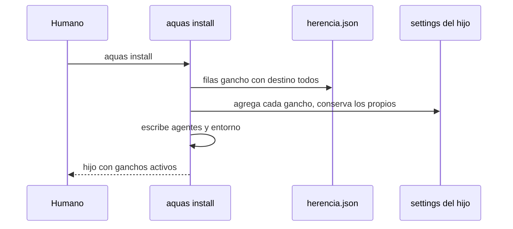

# S003 · Install de ganchos y agentes

[Inicio](../../README.md) › [E003](../README.md) › [F001](README.md) › S003

[Slice](../../glosario.md#slice) que hace que `aquas install` y `aquas update` pongan en el hijo cada gancho que viaja y los [agentes](../../glosario.md#agente) de la central.

## En una frase

El `.claude/settings.json` del hijo trae cada gancho marcado `todos`, y `.claude/agents/` trae los agentes de la central.

## Para qué existe

**El problema.** Hoy el hijo recibe solo el gancho que recompila al editar. La guardia, el presupuesto, los cierres de turno y el cierre de subagentes no corren. Los agentes worker y auditor tampoco llegan.

**Por qué importa.** Sin guardia, el agente del hijo puede escribir fuera de su carpeta. Sin cierre de subagente, un worker puede cerrar sin evidencia.

**La solución.** Install y update leen `herencia.json` desde la central embebida. Por cada fila `gancho:<orden>` con destino `todos`, agregan al settings del hijo el gancho con su evento y su filtro, que corre `aquas <orden>`. También escriben los agentes compilados y el entorno del hijo, como hace `aquas init`.

**Origen.** Corte de F001 aceptado el 2026-11-01.

**Límite.** Si un gancho no funciona fuera de la central, se descubre aquí. Su fila pasa a `central` con el motivo, y el humano lo ve en el informe del slice.

**Contrato.**

| Regla | Valor |
|---|---|
| Ganchos | cada fila `gancho:<orden>` con `todos` → gancho en `.claude/settings.json` del hijo, mismo evento y filtro que en la central |
| Comando | `aquas <orden>` con la raíz del hijo, como `aquas build "$CLAUDE_PROJECT_DIR"` |
| Settings previo | se conserva lo del hijo; no se duplica un gancho; forma inesperada → error sin escribir |
| Agentes | `.claude/agents/*.md` compilados desde la central, como derivados sellados |
| Entorno | install escribe `gobierno/config/entorno.local.json` del hijo |
| Alcance | `internal/hijo/**`, `cmd/aquas/**`, `gobierno/config/herencia.json`, `docs/**` |

**Casos borde.**

| Categoría | Aplica | Prueba o motivo |
|---|---|---|
| cada tipo de ficha | no | no toca fichas |
| cada estado de origen | sí | hijo nuevo (install) e hijo ya instalado (update): `TestInstallPoneControlesQueViajan` |
| padre e hijo, activo y archivado | no | no toca fichas |
| entrada ausente, vacía, mal escrita o duplicada | sí | settings ausente, con ganchos propios, con el gancho ya puesto y con forma rota: `TestInstallPoneControlesQueViajan` |
| choque con otro control | sí | fila `central` no se instala; el gancho de build sigue puesto: `TestInstallPoneControlesQueViajan` |
| quién habla: humano, agente o herramienta | no | lo corre el humano con `aquas install` |
| fallo a mitad de camino | sí | settings roto tras copiar la central: el error pide `aquas update`: `TestInstallPoneControlesQueViajan` |

## Analogía

Piensa en **la instalación eléctrica del local**.

- La matriz no solo manda el manual: conecta la alarma y los sensores.
- Los enchufes que el local ya tenía se quedan.

Límite de la analogía: aquí la conexión es un JSON que Claude Code lee al arrancar.

## Diagrama

## Ejemplo de punta a punta

continúa: [EJ-E003-F001](README.md#EJ-E003-F001)

1. El hijo tiene un `.claude/settings.json` con un gancho propio de formato.
2. `aquas install` agrega `guard`, `budget tool`, `turn close` y los demás marcados `todos`.
3. El gancho de formato sigue ahí; en el hijo, una escritura fuera de su carpeta sale bloqueada.

## Paso a paso

1. Leer filas `gancho:` de `herencia.json`.
2. Agregar los ganchos al settings del hijo sin duplicar.
3. Escribir agentes y entorno.
4. Lo mismo en update.

## Cómo se usa

- Hijo nuevo: `aquas install`; hijo existente: `aquas update`.

## Contrato y evidencia

<!-- GENERADO por aquas desde trabajo/: no editar a mano; `aquas compile` lo rehace. -->

| Prueba | Valida | Rojo cuando | Verde cuando | Rojo | Verde |
|---|---|---|---|---|---|
| `TestInstallPoneControlesQueViajan` | valida que install y update ponen cada gancho todos y los agentes | rojo cuando falta un gancho todos o un agente en el hijo | verde cuando el hijo tiene cada gancho todos sin perder los suyos | — | — |

<!-- /GENERADO -->

## Navegación

- ↑ Subir: [F001](README.md)
