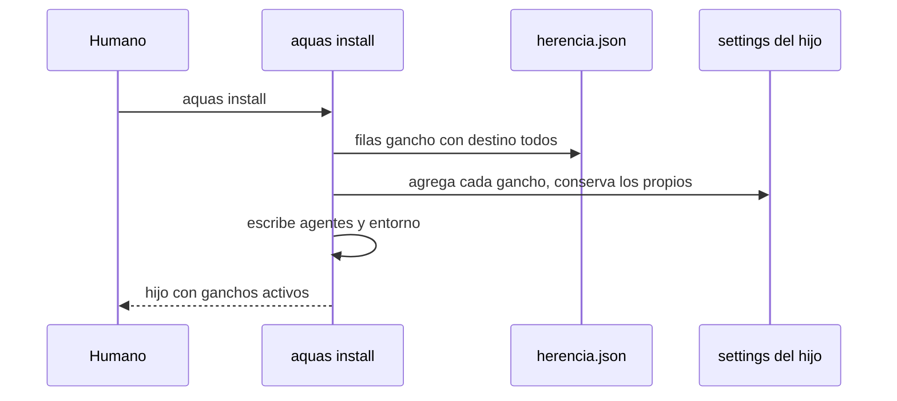

# S003 · Install de ganchos y agentes

[Inicio](../../README.md) › [E003](../README.md) › [F001](README.md) › S003

[Slice](../../glosario.md#slice) que hace que `aquas install` y `aquas update` pongan en el hijo cada gancho que viaja y los [agentes](../../glosario.md#agente) de la central.

## En una frase

El `.claude/settings.json` del hijo trae cada gancho marcado `todos`, y `.claude/agents/` trae los agentes de la central.

## Para qué existe

**El problema.** Hoy el hijo recibe solo el gancho que recompila al editar. La guardia, el presupuesto, los cierres de turno y el cierre de subagentes no corren. Los agentes worker y auditor tampoco llegan.

**Por qué importa.** Sin guardia, el agente del hijo puede escribir fuera de su carpeta. Sin cierre de subagente, un worker puede cerrar sin evidencia.

**La solución.** Install y update leen `herencia.json` desde la central embebida. Por cada fila `gancho:<orden>` con destino `todos`, agregan al settings del hijo el gancho con su evento y su filtro, que corre `aquas <orden>`. También escriben los agentes compilados y el entorno del hijo, como hace `aquas init`.

**Origen.** Corte de F001 aceptado el 2026-11-01.

**Límite.** Si un gancho no funciona fuera de la central, se descubre aquí. Su fila pasa a `central` con el motivo, y el humano lo ve en el informe del slice.

**Contrato.**

| Regla | Valor |
|---|---|
| Ganchos | cada fila `gancho:<orden>` con `todos` → gancho en `.claude/settings.json` del hijo, mismo evento y filtro que en la central |
| Comando | `aquas <orden>` con la raíz del hijo, como `aquas build "$CLAUDE_PROJECT_DIR"`; falla cerrada: sin carpeta o sin `aquas` en el PATH sale 2 y bloquea |
| Settings previo | se conserva lo del hijo; no se duplica un gancho; un gancho de aquas que ya no viaja se quita; forma inesperada → error sin escribir |
| Agentes | `.claude/agents/*.md` compilados desde la central, como derivados sellados |
| Entorno | install escribe `gobierno/config/entorno.local.json` del hijo; update lo repone, porque es el reintento de un install a medias |
| Comprobación real | la prueba integral corre cada gancho en un hijo: ninguno sale con fallo interno, y la guardia bloquea escribir fuera |
| Alcance | `internal/hijo/**`, `cmd/aquas/**`, `gobierno/config/herencia.json`, `docs/**` |

**Casos borde.**

| Categoría | Aplica | Prueba o motivo |
|---|---|---|
| cada tipo de ficha | no | no toca fichas |
| cada estado de origen | sí | hijo nuevo (install), hijo ya instalado (update) e hijo con un gancho de aquas que ya no viaja o con otro filtro, que se quita: `TestInstallPoneControlesQueViajan`; carpeta sin git, que desde E003/F006/S001 inicia git (D000090): `TestHerenciaDePuntaAPunta` |
| padre e hijo, activo y archivado | no | no toca fichas |
| entrada ausente, vacía, mal escrita o duplicada | sí | settings ausente, con ganchos propios, con un grupo propio vacío, con el gancho ya puesto y con forma rota: `TestInstallPoneControlesQueViajan` |
| choque con otro control | sí | fila `central` no se instala; el gancho de build sigue puesto: `TestInstallPoneControlesQueViajan` |
| quién habla: humano, agente o herramienta | no | lo corre el humano con `aquas install` |
| fallo a mitad de camino | sí | settings roto tras copiar la central: el error pide `aquas update`; gancho sin carpeta o sin `aquas` en el PATH: sale 2 y bloquea (falla cerrada): `TestInstallPoneControlesQueViajan` |

## Analogía

Piensa en **la instalación eléctrica del local**.

- La matriz no solo manda el manual: conecta la alarma y los sensores.
- Los enchufes que el local ya tenía se quedan.

Límite de la analogía: aquí la conexión es un JSON que Claude Code lee al arrancar.

## Diagrama

## Ejemplo de punta a punta

continúa: [EJ-E003-F001](README.md#EJ-E003-F001)

1. El hijo tiene un `.claude/settings.json` con un gancho propio de formato.
2. `aquas install` agrega `guard`, `budget tool`, `turn close` y los demás marcados `todos`.
3. El gancho de formato sigue ahí; en el hijo, una escritura fuera de su carpeta sale bloqueada.

## Paso a paso

1. Leer filas `gancho:` de `herencia.json`.
2. Agregar los ganchos al settings del hijo sin duplicar.
3. Escribir agentes y entorno.
4. Lo mismo en update.

## Cómo se usa

- Hijo nuevo: `aquas install`; hijo existente: `aquas update`.

## Contrato y evidencia

<!-- GENERADO por aquas desde trabajo/: no editar a mano; `aquas compile` lo rehace. -->

| Prueba | Valida | Rojo cuando | Verde cuando | Rojo | Verde |
|---|---|---|---|---|---|
| `TestInstallPoneControlesQueViajan` | valida que install y update ponen cada gancho todos y los agentes | rojo cuando falta un gancho todos o un agente en el hijo | verde cuando el hijo tiene cada gancho todos sin perder los suyos | 2026-11-01 | 2026-11-02 |

### Código

| Archivo | Función | Parámetros | Qué hace |
|---|---|---|---|
| [cmd/aquas/main.go](../../../cmd/aquas/main.go) | `main` | `()` | main despacha el subcomando de aquas (compilar, verificar, backlog, hooks…) y sale con su código. |
| [cmd/aquas/main.go](../../../cmd/aquas/main.go) | `hook` | `(raiz string)` | hook: exit 0 = nada que reportar; exit 2 = stderr se muestra a Claude. |
| [cmd/aquas/main.go](../../../cmd/aquas/main.go) | `compilarSettings` | `(w io.Writer)` | compilarSettings regenera .claude/settings.json; sin entorno declarado no inventa uno. |
| [cmd/aquas/main.go](../../../cmd/aquas/main.go) | `reportar` | `(w io.Writer, inf compilador.Informe)` | reportar imprime qué derivados escribió la compilación, o que todo estaba al día. |
| [cmd/aquas/main.go](../../../cmd/aquas/main.go) | `listar` | `(titulo string, problemas []string)` | listar imprime en stderr un título y cada problema en su viñeta. |
| [cmd/aquas/main.go](../../../cmd/aquas/main.go) | `lista` | `(xs []string) string` | lista une los textos con comas, o «—» si no hay ninguno. |
| [cmd/aquas/main.go](../../../cmd/aquas/main.go) | `fallar` | `(codigo int, err error)` | fallar imprime el error en stderr y termina con el código dado. |
| [cmd/aquas/main.go](../../../cmd/aquas/main.go) | `avisarWiki` | `(avisos []string)` | avisarWiki (E000/F013/S001): imprime los avisos de estilo de la wiki; no cambian el resultado del gate. |
| [cmd/aquas/main.go](../../../cmd/aquas/main.go) | `revisarAislamiento` | `() (fallo, aviso string)` | revisarAislamiento: fallo para el gate y aviso para el arranque (E000/F008/S003, D000079). |
| [cmd/aquas/main.go](../../../cmd/aquas/main.go) | `memoriaCLI` | `(raiz string, args []string)` | memoriaCLI: `ver` imprime la memoria; `fijar campo=valor…` la actualiza y la sella. |
| [cmd/aquas/main.go](../../../cmd/aquas/main.go) | `memoriaArchivada` | `(raiz, id string) error` | memoriaArchivada: CERRADO exige el archivo de memoria del slice, apunte o no la memoria a él (E001/F002/S009, X01). |
| [cmd/aquas/main.go](../../../cmd/aquas/main.go) | `focoEnBacklog` | `(raiz string, f memoria.Foco) error` | focoEnBacklog: la memoria solo fija el slice que el backlog tiene en curso (S003). |
| [cmd/aquas/main.go](../../../cmd/aquas/main.go) | `backlogCLI` | `(raiz string, args []string)` | backlogCLI: nuevo \\| ver [id] \\| tabla \\| prioridad \\| estado \\| siguiente \\| pruebas \\| rojo \\| verde. |
| [cmd/aquas/main.go](../../../cmd/aquas/main.go) | `gateDefectos` | `(raiz string) (frena []string, aviso string)` | gateDefectos (E001/F017/S005): lo que el gate dice del registro de defectos. Prueba nombrada que ya no existe |
| [cmd/aquas/main.go](../../../cmd/aquas/main.go) | `turnoCLI` | `(raiz string, args []string)` | turnoCLI: auditoría de turnos (E001/F002/S001). Lee el JSON del hook por stdin. No imprime nada |
| [cmd/aquas/main.go](../../../cmd/aquas/main.go) | `retroCLI` | `(raiz string, args []string) (backlog.Retro, error)` | retroCLI (E001/F018/S002): cerrar fichas=A,B motivo=…; cada clave una vez. |
| [cmd/aquas/main.go](../../../cmd/aquas/main.go) | `defectoCLI` | `(raiz string, args []string) error` | defectoCLI: nuevo \\| ocurre \\| arreglar \\| ver (E001/F004/S001; arreglar: E000/F007/S003). |
| [cmd/aquas/main.go](../../../cmd/aquas/main.go) | `versionBinario` | `() string` | versionBinario: versión del módulo con que se compiló el binario (= versión del gobierno embebido). |
| [cmd/aquas/main.go](../../../cmd/aquas/main.go) | `versionControl` | `() string` | versionControl (E003/F006/S002, hallazgo A2.1): versión con la que deciden los controles del hijo. |
| [cmd/aquas/main.go](../../../cmd/aquas/main.go) | `registrarCierre` | `(raiz, tipo, transcript, primera, resultado string)` | registrarCierre (E001/F004/S005, D000068) anota cada llamada del gancho cierre-agente en .tmp/hooks/cierre-agente.jsonl. |
| [cmd/aquas/main.go](../../../cmd/aquas/main.go) | `esUpdate` | `(datos []byte) bool` | esUpdate (E003/F006/S001): la entrada de la guardia es una orden Bash que es exactamente `aquas update` (PowerShell lo frena la guardia siempre). |
| [cmd/aquas/main.go](../../../cmd/aquas/main.go) | `entornoHijo` | `(raiz string)` | entornoHijo (E003/F001/S003) declara el entorno del hijo, como aquas init en la central: |
| [gobierno/config/dependencias.json](../../../gobierno/config/dependencias.json) | — | — | — |
| [internal/hijo/ajustes.go](../../../internal/hijo/ajustes.go) | `AsegurarHook` | `(dir string) error` | AsegurarHook (E002/F002/S006, E003/F001/S003) agrega a .claude/settings.json del hijo el hook |
| [internal/hijo/ajustes.go](../../../internal/hijo/ajustes.go) | `clave` | `(evento string, grupo, h map[string]any) string` | clave identifica un gancho por evento, filtro, shell y comando. |
| [internal/hijo/ajustes.go](../../../internal/hijo/ajustes.go) | `podar` | `(hooks map[string]any, gs []gancho) bool` | podar quita de hooks cada gancho puesto por aquas (PrefijoGancho) que no está en gs tal cual |
| [internal/hijo/ajustes.go](../../../internal/hijo/ajustes.go) | `tiene` | `(lista []any, g gancho) bool` | tiene dice si algún grupo de la lista ya tiene el gancho g tal cual. |
| [internal/hijo/build.go](../../../internal/hijo/build.go) | `Build` | `(dir string) error` | Build arma el CLAUDE.md del hijo: central sellada + huecos locales. |
| [internal/hijo/build.go](../../../internal/hijo/build.go) | `armar` | `(dir string) (string, error)` | armar devuelve el CLAUDE.md que Build escribiría, sin escribirlo. |
| [internal/hijo/build.go](../../../internal/hijo/build.go) | `verificarSello` | `(dir, central string) error` | verificarSello compara cada archivo de la central con su hash del lock. |
| [internal/hijo/build.go](../../../internal/hijo/build.go) | `leerHuecos` | `(dir string) (map[string]string, error)` | leerHuecos devuelve nombre → contenido de cada <nombre>.md local. |
| [internal/hijo/build.go](../../../internal/hijo/build.go) | `Verificar` | `(dir string) []string` | Verificar (X02, E002/F002/S004): gate del hijo; nil si su central sellada, sus huecos sin PENDIENTE y su CLAUDE.md están al día. |
| [internal/hijo/build.go](../../../internal/hijo/build.go) | `EsHijo` | `(dir string) bool` | EsHijo: dir tiene un gobierno central instalado (lock.json de aquas install). |
| [internal/hijo/build.go](../../../internal/hijo/build.go) | `pendientes` | `(dir string) ([]string, error)` | pendientes (E002/F002/S004): un problema por hueco que conserva la marca de relleno, en orden. |
| [internal/hijo/controles.go](../../../internal/hijo/controles.go) | `ComandoGancho` | `(orden string) string` | ComandoGancho arma el comando del gancho de la central `orden` en el hijo. |
| [internal/hijo/controles.go](../../../internal/hijo/controles.go) | `existe` | `(central, rel string) (bool, error)` | existe dice si la central instalada trae rel; una central sin él (antigua o de prueba) no lo exige. |
| [internal/hijo/controles.go](../../../internal/hijo/controles.go) | `ganchosQueViajan` | `(dir string) ([]gancho, error)` | ganchosQueViajan lee la central instalada y devuelve cada gancho con fila «todos» en herencia.json, |
| [internal/hijo/controles.go](../../../internal/hijo/controles.go) | `agentes` | `(dir string) (map[string][]byte, error)` | agentes devuelve los .claude/agents/*.md compilados desde la central instalada (ruta → contenido). |

<!-- /GENERADO -->

## Navegación

- ↑ Subir: [F001](README.md)
