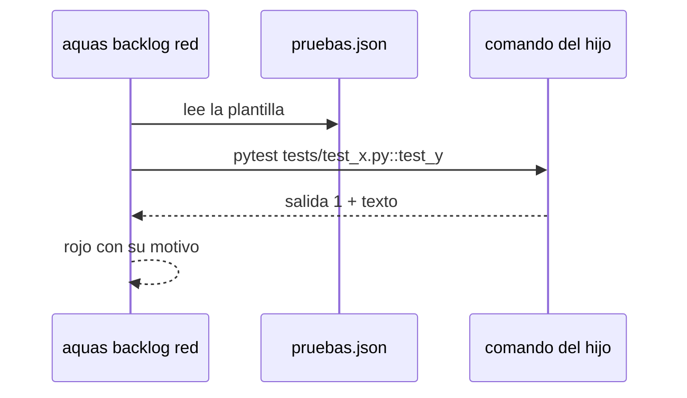

# S004 · Pruebas del hijo sin Go

[Inicio](../../README.md) › [E003](../README.md) › [F001](README.md) › S004

[Slice](../../glosario.md#slice) que deja a un hijo de cualquier lenguaje declarar cómo se corre una prueba. Así rojo y verde funcionan ahí.

## En una frase

`pruebas.json` del hijo trae una plantilla de comando; `aquas backlog red` y `green` la usan en vez de `go test`.

## Para qué existe

**El problema.** `aquas backlog red` y `green` corren siempre `go test`. Un hijo en Python, en Node o un libro no puede pasar por rojo y verde. Sin eso, ningún slice del hijo cierra.

**Por qué importa.** El ciclo rojo → verde es el corazón del gobierno del trabajo. Si no corre en el hijo, la herencia queda a medias.

**La solución.** El hijo escribe `gobierno/config/pruebas.json` con un comando y los huecos `{ruta}` y `{nombre}`. La prueba de una ficha sigue escrita `ruta:Nombre`. Rojo y verde corren el comando una vez por prueba. Salida 0 = pasa; otra salida = falla, y su texto queda como motivo.

**Origen.** Corte de F001 aceptado el 2026-11-01. El humano eligió una sola plantilla, sin corredores por lenguaje hasta que un hijo real los pida.

**Contrato.**

| Regla | Valor |
|---|---|
| Archivo | `gobierno/config/pruebas.json`: `{"version": 1, "comando": "pytest {ruta}::{nombre}"}` |
| Sin archivo | se sigue usando `go test`, como hoy |
| Huecos | `{ruta}` y `{nombre}` de la prueba `ruta:Nombre`; falta `{nombre}` → error claro |
| Resultado | salida 0 = pasa; 126 o 127 = el comando no corrió, no cuenta; otra = falla con las últimas líneas de su salida como motivo |
| Nombre | con plantilla, la prueba es `ruta:nombre` (letras, números, `_ . / - :`); se rechaza una ruta absoluta o con `..`, y una ruta o un nombre que empiece con `-`; sin plantilla, `./paquete:TestNombre` |
| Shell | la plantilla corre con `sh -c` en la raíz del repo |
| Una a una | cada prueba corre sola, así el rojo de cada una es suyo |
| Alcance | `internal/backlog/**`, `cmd/aquas/**`, `docs/**` |

**Casos borde.**

| Categoría | Aplica | Prueba o motivo |
|---|---|---|
| cada tipo de ficha | sí | slice y feature corren su prueba con la plantilla: `TestPruebasDelHijoSinGo` |
| cada estado de origen | no | rojo y verde ya exigen su estado; esto solo cambia cómo se corre |
| padre e hijo, activo y archivado | no | la plantilla es del repo, no de la ficha |
| entrada ausente, vacía, mal escrita o duplicada | sí | sin archivo, JSON roto, versión distinta de 1, comando vacío y sin `{nombre}`: `TestPruebasDelHijoSinGo` |
| choque con otro control | sí | el rojo sigue exigiendo el contrato aprobado, y el gate reporta un `pruebas.json` roto: `TestPruebasDelHijoSinGo` |
| quién habla: humano, agente o herramienta | no | lo corre la herramienta, sin interlocutor |
| fallo a mitad de camino | sí | comando que no existe (salida 126 o 127) no cuenta como rojo ni como verde: `TestPruebasDelHijoSinGo` |

## Analogía

Piensa en **un enchufe universal**.

- La matriz no sabe qué aparato tiene cada local.
- El local dice qué adaptador usa, y la corriente llega igual.

Límite de la analogía: aquí el adaptador es una línea de JSON.

## Diagrama

## Ejemplo de punta a punta

continúa: [EJ-E003-F001](README.md#EJ-E003-F001)

1. Un hijo en Python escribe `{"version": 1, "comando": "pytest {ruta}::{nombre}"}`.
2. Su slice declara `tests/test_x.py:test_y`.
3. `aquas backlog red` corre `pytest tests/test_x.py::test_y`, falla y guarda el motivo.
4. Tras el arreglo, `green` pasa.

## Paso a paso

1. Leer y revisar `pruebas.json`.
2. Correr cada prueba con la plantilla.
3. Mantener `go test` cuando no hay archivo.

## Cómo se usa

- En el hijo: escribir `gobierno/config/pruebas.json` con su comando.

## Contrato y evidencia

<!-- GENERADO por aquas desde trabajo/: no editar a mano; `aquas compile` lo rehace. -->

| Prueba | Valida | Rojo cuando | Verde cuando | Rojo | Verde |
|---|---|---|---|---|---|
| `TestPruebasDelHijoSinGo` | valida que rojo y verde corren la plantilla de pruebas.json | rojo cuando se corre go test pese a pruebas.json | verde cuando la plantilla corre cada prueba y su salida decide | 2026-11-02 | 2026-11-02 |

### Código

| Archivo | Función | Parámetros | Qué hace |
|---|---|---|---|
| [cmd/aquas/main.go](../../../cmd/aquas/main.go) | `main` | `()` | main despacha el subcomando de aquas (compilar, verificar, backlog, hooks…) y sale con su código. |
| [cmd/aquas/main.go](../../../cmd/aquas/main.go) | `hook` | `(raiz string)` | hook: exit 0 = nada que reportar; exit 2 = stderr se muestra a Claude. |
| [cmd/aquas/main.go](../../../cmd/aquas/main.go) | `compilarSettings` | `(w io.Writer)` | compilarSettings regenera .claude/settings.json; sin entorno declarado no inventa uno. |
| [cmd/aquas/main.go](../../../cmd/aquas/main.go) | `reportar` | `(w io.Writer, inf compilador.Informe)` | reportar imprime qué derivados escribió la compilación, o que todo estaba al día. |
| [cmd/aquas/main.go](../../../cmd/aquas/main.go) | `listar` | `(titulo string, problemas []string)` | listar imprime en stderr un título y cada problema en su viñeta. |
| [cmd/aquas/main.go](../../../cmd/aquas/main.go) | `lista` | `(xs []string) string` | lista une los textos con comas, o «—» si no hay ninguno. |
| [cmd/aquas/main.go](../../../cmd/aquas/main.go) | `fallar` | `(codigo int, err error)` | fallar imprime el error en stderr y termina con el código dado. |
| [cmd/aquas/main.go](../../../cmd/aquas/main.go) | `avisarWiki` | `(avisos []string)` | avisarWiki (E000/F013/S001): imprime los avisos de estilo de la wiki; no cambian el resultado del gate. |
| [cmd/aquas/main.go](../../../cmd/aquas/main.go) | `revisarAislamiento` | `() (fallo, aviso string)` | revisarAislamiento: fallo para el gate y aviso para el arranque (E000/F008/S003, D000079). |
| [cmd/aquas/main.go](../../../cmd/aquas/main.go) | `memoriaCLI` | `(raiz string, args []string)` | memoriaCLI: `ver` imprime la memoria; `fijar campo=valor…` la actualiza y la sella. |
| [cmd/aquas/main.go](../../../cmd/aquas/main.go) | `memoriaArchivada` | `(raiz, id string) error` | memoriaArchivada: CERRADO exige el archivo de memoria del slice, apunte o no la memoria a él (E001/F002/S009, X01). |
| [cmd/aquas/main.go](../../../cmd/aquas/main.go) | `focoEnBacklog` | `(raiz string, f memoria.Foco) error` | focoEnBacklog: la memoria solo fija el slice que el backlog tiene en curso (S003). |
| [cmd/aquas/main.go](../../../cmd/aquas/main.go) | `backlogCLI` | `(raiz string, args []string)` | backlogCLI: nuevo \\| ver [id] \\| tabla \\| prioridad \\| estado \\| siguiente \\| pruebas \\| rojo \\| verde. |
| [cmd/aquas/main.go](../../../cmd/aquas/main.go) | `gateDefectos` | `(raiz string) (frena []string, aviso string)` | gateDefectos (E001/F017/S005): lo que el gate dice del registro de defectos. Prueba nombrada que ya no existe |
| [cmd/aquas/main.go](../../../cmd/aquas/main.go) | `turnoCLI` | `(raiz string, args []string)` | turnoCLI: auditoría de turnos (E001/F002/S001). Lee el JSON del hook por stdin. No imprime nada |
| [cmd/aquas/main.go](../../../cmd/aquas/main.go) | `retroCLI` | `(raiz string, args []string) (backlog.Retro, error)` | retroCLI (E001/F018/S002): cerrar fichas=A,B motivo=…; cada clave una vez. |
| [cmd/aquas/main.go](../../../cmd/aquas/main.go) | `defectoCLI` | `(raiz string, args []string) error` | defectoCLI: nuevo \\| ocurre \\| arreglar \\| ver (E001/F004/S001; arreglar: E000/F007/S003). |
| [cmd/aquas/main.go](../../../cmd/aquas/main.go) | `versionBinario` | `() string` | versionBinario: versión del módulo con que se compiló el binario (= versión del gobierno embebido). |
| [cmd/aquas/main.go](../../../cmd/aquas/main.go) | `versionControl` | `() string` | versionControl (E003/F006/S002, hallazgo A2.1): versión con la que deciden los controles del hijo. |
| [cmd/aquas/main.go](../../../cmd/aquas/main.go) | `registrarCierre` | `(raiz, tipo, transcript, primera, resultado string)` | registrarCierre (E001/F004/S005, D000068) anota cada llamada del gancho cierre-agente en .tmp/hooks/cierre-agente.jsonl. |
| [cmd/aquas/main.go](../../../cmd/aquas/main.go) | `esUpdate` | `(datos []byte) bool` | esUpdate (E003/F006/S001): la entrada de la guardia es una orden Bash que es exactamente `aquas update` (PowerShell lo frena la guardia siempre). |
| [cmd/aquas/main.go](../../../cmd/aquas/main.go) | `entornoHijo` | `(raiz string)` | entornoHijo (E003/F001/S003) declara el entorno del hijo, como aquas init en la central: |
| [internal/backlog/arreglo.go](../../../internal/backlog/arreglo.go) | `idArreglo` | `(padre string, n int) string` | idArreglo: ID del n-ésimo arreglo (1, 2…) de padre: padre/X01. |
| [internal/backlog/arreglo.go](../../../internal/backlog/arreglo.go) | `dirDe` | `(archivada bool) string` | dirDe: carpeta de trabajo/ donde vive la ficha, según esté archivada o no. |
| [internal/backlog/arreglo.go](../../../internal/backlog/arreglo.go) | `Arreglar` | `(raiz, padre, titulo, motivo, absorbe string, ahora time.Time) (Arreglo, error)` | Arreglar anota un arreglo en la ficha de su slice o feature, abierta o archivada. |
| [internal/backlog/arreglo.go](../../../internal/backlog/arreglo.go) | `problemasArreglos` | `(rel string, f Ficha, libre bool) []string` | problemasArreglos: chequeo del gate: IDs en secuencia bajo su ficha, con título y motivo. |
| [internal/backlog/backlog.go](../../../internal/backlog/backlog.go) | `terminal` | `(estado string) bool` | terminal: el estado ya no cambia (CERRADO o CANCELADO). |
| [internal/backlog/backlog.go](../../../internal/backlog/backlog.go) | `esta` | `(xs []string, x string) bool` | esta: x figura en la lista. |
| [internal/backlog/backlog.go](../../../internal/backlog/backlog.go) | `tipoYPadre` | `(id string) (tipo, padre string)` | tipoYPadre deriva del id: E001 → iniciativa; E001/F002 → feature de E001; E001/F002/S002 → slice. |
| [internal/backlog/backlog.go](../../../internal/backlog/backlog.go) | `nombre` | `(id string) string` | nombre: archivo JSON de una ficha, con «/» del ID cambiadas por «-». |
| [internal/backlog/backlog.go](../../../internal/backlog/backlog.go) | `todas` | `(raiz string) (act, arc map[string]Ficha, err error)` | todas lee activo y archivo. Una ficha ilegible es error: Validar la detalla. |
| [internal/backlog/backlog.go](../../../internal/backlog/backlog.go) | `Todas` | `(raiz string) ([]Ficha, error)` | Todas: las fichas de activo y archivo, ordenadas por id. Para quien solo lee (wiki, E001/F002/S010). |
| [internal/backlog/backlog.go](../../../internal/backlog/backlog.go) | `leer` | `(ruta string) (Ficha, error)` | leer carga una ficha desde su archivo JSON. |
| [internal/backlog/backlog.go](../../../internal/backlog/backlog.go) | `escribir` | `(raiz, dir string, f Ficha) error` | escribir guarda la ficha como JSON en trabajo/<dir>/, con listas vacías en vez de null. |
| [internal/backlog/backlog.go](../../../internal/backlog/backlog.go) | `Nuevo` | `(raiz string, campos []string) (Ficha, error)` | Nuevo crea una ficha desde campos id=… titulo=… que_hace=… prioridad=… motivo=… relacion=… [bloqueado_por=A,B]. |
| [internal/backlog/backlog.go](../../../internal/backlog/backlog.go) | `Ver` | `(raiz, id string) (Ficha, bool, error)` | Ver busca la ficha en activo y luego en archivo. |
| [internal/backlog/backlog.go](../../../internal/backlog/backlog.go) | `activa` | `(raiz, id string) (Ficha, error)` | activa: la ficha a cambiar; una archivada no cambia. |
| [internal/backlog/backlog.go](../../../internal/backlog/backlog.go) | `Prioridad` | `(raiz, id, prioridad, motivo string) (Ficha, error)` | Prioridad cambia la prioridad; el motivo es obligatorio. |
| [internal/backlog/backlog.go](../../../internal/backlog/backlog.go) | `Estado` | `(raiz, id, estado string) (Ficha, error)` | Estado cambia el estado. CERRADO o CANCELADO mueve la ficha al archivo. |
| [internal/backlog/backlog.go](../../../internal/backlog/backlog.go) | `sinHijosActivos` | `(act map[string]Ficha, f Ficha) error` | sinHijosActivos: cerrar o cancelar una feature o iniciativa exige sus hijos directos ya archivados. |
| [internal/backlog/backlog.go](../../../internal/backlog/backlog.go) | `ordenar` | `(fs []Ficha, arc map[string]Ficha)` | orden de `siguiente`: en curso → desbloqueado → prioridad → secuencia → id. |
| [internal/backlog/backlog.go](../../../internal/backlog/backlog.go) | `Activas` | `(raiz string) ([]Ficha, error)` | Activas: slices en el orden de `siguiente`; después iniciativas y features por secuencia. |
| [internal/backlog/backlog.go](../../../internal/backlog/backlog.go) | `Siguiente` | `(raiz string) (Ficha, bool, error)` | Siguiente: el primer slice del orden fijo que esté en curso o desbloqueado. |
| [internal/backlog/backlog.go](../../../internal/backlog/backlog.go) | `sinDefinir` | `(act map[string]Ficha) (Ficha, bool)` | sinDefinir (E001/F002/S008, regla del humano 2026-10-21): iniciativa o feature activa sin hijos |
| [internal/backlog/backlog.go](../../../internal/backlog/backlog.go) | `Definir` | `(raiz string, f Ficha) string` | Definir: qué hacer con lo que `siguiente` saca sin definir; "" para un slice. |
| [internal/backlog/backlog.go](../../../internal/backlog/backlog.go) | `libre` | `(f Ficha, arc map[string]Ficha) bool` | libre: no está BLOQUEADO y cada bloqueador ya terminó (archivado: CERRADO o CANCELADO). |
| [internal/backlog/backlog.go](../../../internal/backlog/backlog.go) | `Validar` | `(raiz string) []string` | Validar: problemas de las fichas en disco (gate). Sin carpeta trabajo/ no hay problemas. |
| [internal/backlog/backlog.go](../../../internal/backlog/backlog.go) | `Texto` | `(f Ficha) string` | Texto: una línea por ficha, para el agente. |
| [internal/backlog/documentar.go](../../../internal/backlog/documentar.go) | `Documentar` | `(raiz, id string, lista []string) (Ficha, error)` | Documentar reescribe valida, rojo cuando y verde cuando de pruebas ya registradas. |
| [internal/backlog/pruebas.go](../../../internal/backlog/pruebas.go) | `formato` | `(libre bool) string` | formato: cómo se escribe una prueba, según haya plantilla (libre) o go test. |
| [internal/backlog/pruebas.go](../../../internal/backlog/pruebas.go) | `formatoDe` | `(raiz string) string` | formatoDe: formato del repo; con pruebas.json roto muestra el de go test (el error sale al correr). |
| [internal/backlog/pruebas.go](../../../internal/backlog/pruebas.go) | `rutaPeligrosa` | `(prueba string) bool` | rutaPeligrosa (hallazgos A1.6 y A2.2): ruta o nombre que empieza con «-» (sería una opción del corredor), |
| [internal/backlog/pruebas.go](../../../internal/backlog/pruebas.go) | `plantilla` | `(raiz string) (string, error)` | plantilla: el comando de pruebas.json, o "" si el repo no lo tiene (se usa go test). |
| [internal/backlog/pruebas.go](../../../internal/backlog/pruebas.go) | `correrPlantilla` | `(raiz, cmd string, ps []Prueba) (map[string]resultado, error)` | correrPlantilla corre la plantilla con sh, una prueba a la vez, en la raíz del repo. |
| [internal/backlog/pruebas.go](../../../internal/backlog/pruebas.go) | `ultimas` | `(s string, n int) string` | ultimas: las últimas n líneas no vacías, unidas en una. |
| [internal/backlog/rojo.go](../../../internal/backlog/rojo.go) | `EsNombrePrueba` | `(s string) bool` | EsNombrePrueba: s tiene el formato ./paquete:TestNombre de las fichas (E001/F017/S005 lo reusa en los defectos). |
| [internal/backlog/rojo.go](../../../internal/backlog/rojo.go) | `problemaPrueba` | `(p Prueba, libre bool) string` | problemaPrueba: por qué una prueba de la ficha está mal escrita ("" si está bien). |
| [internal/backlog/rojo.go](../../../internal/backlog/rojo.go) | `listaPruebasDe` | `(raiz string, xs []string) ([]Prueba, error)` | listaPruebasDe: listaPruebas con la forma de nombre que pide el repo (pruebas.json o go test). |
| [internal/backlog/rojo.go](../../../internal/backlog/rojo.go) | `listaPruebas` | `(xs []string, libre bool) ([]Prueba, error)` | listaPruebas convierte "./paquete:TestNombre=intención" en pruebas válidas, sin repetidas. |
| [internal/backlog/rojo.go](../../../internal/backlog/rojo.go) | `corriendo` | `(f Ficha) bool` | corriendo: la ficha está EN_CURSO o VERIFICANDO. |
| [internal/backlog/rojo.go](../../../internal/backlog/rojo.go) | `sliceEnCurso` | `(act map[string]Ficha) (string, bool)` | sliceEnCurso: el primer slice EN_CURSO o VERIFICANDO entre las activas, por id. |
| [internal/backlog/rojo.go](../../../internal/backlog/rojo.go) | `SliceEnCurso` | `(raiz string) (string, bool, error)` | SliceEnCurso: el único slice EN_CURSO o VERIFICANDO, si hay. |
| [internal/backlog/rojo.go](../../../internal/backlog/rojo.go) | `Pruebas` | `(raiz, id string, lista []string) (Ficha, error)` | Pruebas fija las pruebas de la ficha; cambiarlas borra rojo y verde. |
| [internal/backlog/rojo.go](../../../internal/backlog/rojo.go) | `corrible` | `(raiz, id string) (Ficha, error)` | corrible: ficha activa con pruebas; un slice además debe estar en curso. |
| [internal/backlog/rojo.go](../../../internal/backlog/rojo.go) | `Rojo` | `(raiz, id string, ahora time.Time) (Ficha, error)` | Rojo corre cada prueba sola con `go test -json`; exige que cada una falle por sí misma. |
| [internal/backlog/rojo.go](../../../internal/backlog/rojo.go) | `rojoHeredado` | `(raiz string, f Ficha) *Registro` | rojoHeredado (X02): rojo que un slice cerrado de la feature registró para todas sus pruebas |
| [internal/backlog/rojo.go](../../../internal/backlog/rojo.go) | `Verde` | `(raiz, id string, ahora time.Time) (Ficha, error)` | Verde corre las pruebas juntas tras el rojo; exige que todas pasen. |
| [internal/backlog/rojo.go](../../../internal/backlog/rojo.go) | `resultado.motivo` | `(siPasa string) string` | motivo: texto que explica el resultado de una prueba; siPasa se usa cuando pasó. |
| [internal/backlog/rojo.go](../../../internal/backlog/rojo.go) | `correr` | `(raiz string, ps []Prueba) (map[string]resultado, error)` | correr: `go test -json -count=1 -run ^(A\\|B)$ ./paquete` por paquete; resultado por prueba. |
| [internal/backlog/rojo.go](../../../internal/backlog/rojo.go) | `motivoDelFallo` | `(ls []string) string` | motivoDelFallo: la última línea «archivo.go:N: …» (la que hizo fallar); si no hay, la primera. |
| [internal/backlog/rojo.go](../../../internal/backlog/rojo.go) | `head` | `(raiz string) string` | head: commit actual del repo, o "" fuera de Git. |
| [internal/backlog/rojo.go](../../../internal/backlog/rojo.go) | `cierre` | `(raiz string, f Ficha) error` | cierre: CERRADO exige pruebas, rojo, verde y, si el verde trae huella, el mismo código Go. |
| [internal/backlog/rojo.go](../../../internal/backlog/rojo.go) | `problemasRojoVerde` | `(rel string, f Ficha, libre bool) []string` | problemasRojoVerde: chequeos del gate sobre pruebas, rojo y verde de una ficha. |
| [internal/backlog/rojo.go](../../../internal/backlog/rojo.go) | `Detalle` | `(f Ficha) string` | Detalle: pruebas con su intención, y rojo y verde, para `ver <id>`, `pruebas`, `rojo` y `verde`. |

<!-- /GENERADO -->

## Navegación

- ↑ Subir: [F001](README.md)
