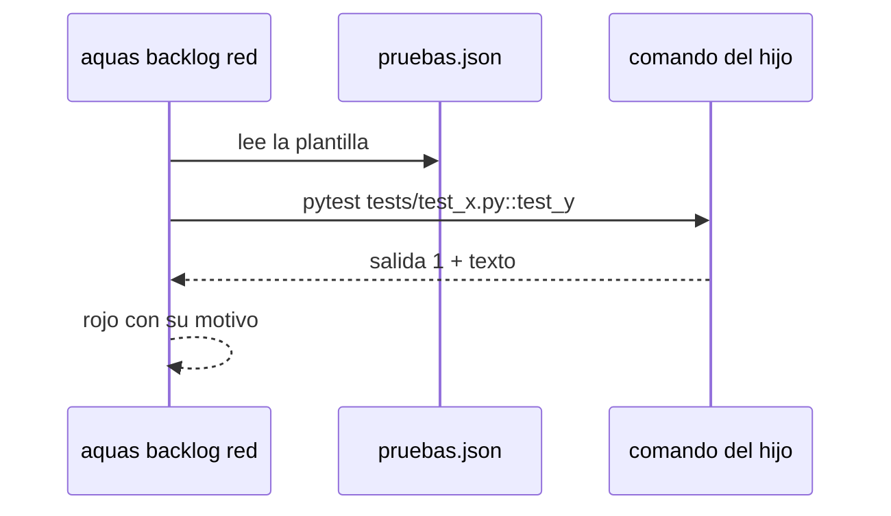

# S004 · Pruebas del hijo sin Go

[Inicio](../../README.md) › [E003](../README.md) › [F001](README.md) › S004

[Slice](../../glosario.md#slice) que deja a un hijo de cualquier lenguaje declarar cómo se corre una prueba. Así rojo y verde funcionan ahí.

## En una frase

`pruebas.json` del hijo trae una plantilla de comando; `aquas backlog red` y `green` la usan en vez de `go test`.

## Para qué existe

**El problema.** `aquas backlog red` y `green` corren siempre `go test`. Un hijo en Python, en Node o un libro no puede pasar por rojo y verde. Sin eso, ningún slice del hijo cierra.

**Por qué importa.** El ciclo rojo → verde es el corazón del gobierno del trabajo. Si no corre en el hijo, la herencia queda a medias.

**La solución.** El hijo escribe `gobierno/config/pruebas.json` con un comando y los huecos `{ruta}` y `{nombre}`. La prueba de una ficha sigue escrita `ruta:Nombre`. Rojo y verde corren el comando una vez por prueba. Salida 0 = pasa; otra salida = falla, y su texto queda como motivo.

**Origen.** Corte de F001 aceptado el 2026-11-01. El humano eligió una sola plantilla, sin corredores por lenguaje hasta que un hijo real los pida.

**Contrato.**

| Regla | Valor |
|---|---|
| Archivo | `gobierno/config/pruebas.json`: `{"version": 1, "comando": "pytest {ruta}::{nombre}"}` |
| Sin archivo | se sigue usando `go test`, como hoy |
| Huecos | `{ruta}` y `{nombre}` de la prueba `ruta:Nombre`; falta `{nombre}` → error claro |
| Resultado | salida 0 = pasa; otra = falla con las últimas líneas de su salida como motivo |
| Una a una | cada prueba corre sola, así el rojo de cada una es suyo |
| Alcance | `internal/backlog/**`, `cmd/aquas/**`, `docs/**` |

**Casos borde.**

| Categoría | Aplica | Prueba o motivo |
|---|---|---|
| cada tipo de ficha | sí | slice y feature corren su prueba con la plantilla: `TestPruebasDelHijoSinGo` |
| cada estado de origen | no | rojo y verde ya exigen su estado; esto solo cambia cómo se corre |
| padre e hijo, activo y archivado | no | la plantilla es del repo, no de la ficha |
| entrada ausente, vacía, mal escrita o duplicada | sí | sin archivo, JSON roto, comando vacío y sin `{nombre}`: `TestPruebasDelHijoSinGo` |
| choque con otro control | sí | la guardia sigue revisando el comando antes de correr: `TestPruebasDelHijoSinGo` |
| quién habla: humano, agente o herramienta | no | lo corre la herramienta, sin interlocutor |
| fallo a mitad de camino | sí | comando que no existe = falla con motivo, no verde: `TestPruebasDelHijoSinGo` |

## Analogía

Piensa en **un enchufe universal**.

- La matriz no sabe qué aparato tiene cada local.
- El local dice qué adaptador usa, y la corriente llega igual.

Límite de la analogía: aquí el adaptador es una línea de JSON.

## Diagrama

## Ejemplo de punta a punta

continúa: [EJ-E003-F001](README.md#EJ-E003-F001)

1. Un hijo en Python escribe `{"version": 1, "comando": "pytest {ruta}::{nombre}"}`.
2. Su slice declara `tests/test_x.py:test_y`.
3. `aquas backlog red` corre `pytest tests/test_x.py::test_y`, falla y guarda el motivo.
4. Tras el arreglo, `green` pasa.

## Paso a paso

1. Leer y revisar `pruebas.json`.
2. Correr cada prueba con la plantilla.
3. Mantener `go test` cuando no hay archivo.

## Cómo se usa

- En el hijo: escribir `gobierno/config/pruebas.json` con su comando.

## Contrato y evidencia

<!-- GENERADO por aquas desde trabajo/: no editar a mano; `aquas compile` lo rehace. -->

| Prueba | Valida | Rojo cuando | Verde cuando | Rojo | Verde |
|---|---|---|---|---|---|
| `TestPruebasDelHijoSinGo` | valida que rojo y verde corren la plantilla de pruebas.json | rojo cuando se corre go test pese a pruebas.json | verde cuando la plantilla corre cada prueba y su salida decide | — | — |

<!-- /GENERADO -->

## Navegación

- ↑ Subir: [F001](README.md)
