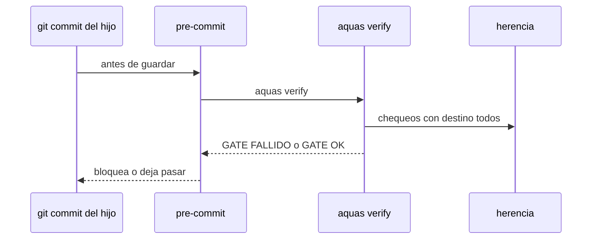

# S005 · Gate y pre-commit en el hijo

[Inicio](../../README.md) › [E003](../README.md) › [F001](README.md) › S005

[Slice](../../glosario.md#slice) que hace correr en el hijo cada chequeo de `verify` que viaja, y le instala el [pre-commit](../../glosario.md#pre-commit).

## En una frase

`aquas verify` en el hijo corre los chequeos marcados `todos`, y su pre-commit lo exige en cada [commit](../../glosario.md#commit).

## Para qué existe

**El problema.** En un hijo, `verify` solo revisa la central sellada, el `CLAUDE.md` y `/backlog`. No revisa sus fichas, su [wiki](../../glosario.md#wiki) ni la guardia. Tampoco hay pre-commit que lo corra.

**Por qué importa.** Un hijo puede guardar fichas rotas o [derivados](../../glosario.md#derivado) desfasados, y nada lo frena.

**La solución.** `verify` arma su lista de chequeos desde `herencia.Chequeos`. En el hijo corre solo los que `herencia.json` marca `todos`. Install y update escriben `.githooks/pre-commit` en el hijo y fijan `core.hooksPath`. Así, un chequeo nuevo que no esté en la lista no corre en ningún lado, y eso se nota.

**Origen.** Corte de F001 aceptado el 2026-11-01. Cierra el límite de S002: un chequeo fuera de `herencia.Chequeos`.

**Contrato.**

| Regla | Valor |
|---|---|
| Lista | `verify` corre los chequeos de `herencia.Chequeos`, en central e hijo |
| En el hijo | solo los marcados `todos`, más los suyos de hoy (central sellada, `CLAUDE.md`, `/backlog`) |
| Pre-commit | install y update escriben `.githooks/pre-commit` con `aquas verify` y fijan `core.hooksPath` |
| Pre-commit previo | uno propio del hijo no se pisa: error que pide unirlo a mano |
| Alcance | `cmd/aquas/**`, `internal/hijo/**`, `internal/herencia/**`, `gobierno/config/herencia.json`, `docs/**` |

**Casos borde.**

| Categoría | Aplica | Prueba o motivo |
|---|---|---|
| cada tipo de ficha | sí | ficha rota del hijo hace fallar su gate: `TestVerifyEnElHijo` |
| cada estado de origen | sí | hijo nuevo e hijo actualizado reciben el pre-commit: `TestVerifyEnElHijo` |
| padre e hijo, activo y archivado | no | el chequeo de fichas ya lo cubre; aquí solo se activa |
| entrada ausente, vacía, mal escrita o duplicada | sí | hijo sin `.git`, pre-commit propio y `core.hooksPath` ya fijado: `TestVerifyEnElHijo` |
| choque con otro control | sí | chequeo marcado `central` no corre en el hijo: `TestVerifyEnElHijo` |
| quién habla: humano, agente o herramienta | no | lo corre git o el humano, sin diferencia |
| fallo a mitad de camino | sí | central copiada y pre-commit propio en conflicto: el error pide `aquas update` tras unirlo: `TestVerifyEnElHijo` |

## Analogía

Piensa en **la inspección del local**.

- El inspector lleva la misma lista que en la matriz, sin los renglones que solo aplican a la matriz.
- Y pasa en cada entrega, no cuando se acuerda.

Límite de la analogía: aquí la entrega es cada [commit](../../glosario.md#commit) del hijo.

## Diagrama

## Ejemplo de punta a punta

continúa: [EJ-E003-F001](README.md#EJ-E003-F001)

1. En el hijo, alguien edita a mano una ficha de `trabajo/` y la rompe.
2. `git commit` corre el pre-commit, que corre `aquas verify`.
3. El [gate](../../glosario.md#gate) dice `GATE FALLIDO · backlog` y el commit no entra.

## Paso a paso

1. `verify` corre desde `herencia.Chequeos`.
2. En el hijo, filtra por destino.
3. Install y update escriben el pre-commit.

## Cómo se usa

- No se usa a mano: corre en cada commit del hijo.

## Contrato y evidencia

<!-- GENERADO por aquas desde trabajo/: no editar a mano; `aquas compile` lo rehace. -->

| Prueba | Valida | Rojo cuando | Verde cuando | Rojo | Verde |
|---|---|---|---|---|---|
| `TestVerifyEnElHijo` | valida que el gate del hijo corre los chequeos todos y el pre-commit lo exige | rojo cuando un chequeo todos no corre en el hijo o falta el pre-commit | verde cuando el gate del hijo falla ante una ficha rota y el pre-commit lo corre | — | — |

<!-- /GENERADO -->

## Navegación

- ↑ Subir: [F001](README.md)
