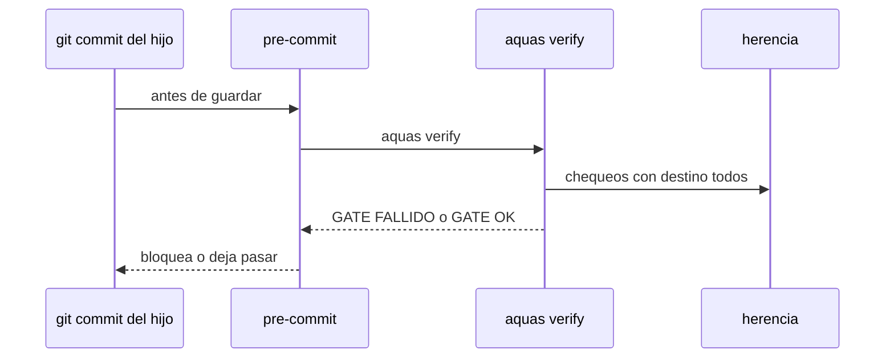

# S005 · Gate y pre-commit en el hijo

[Inicio](../../README.md) › [E003](../README.md) › [F001](README.md) › S005

[Slice](../../glosario.md#slice) que hace correr en el hijo cada chequeo de `verify` que viaja, y le instala el [pre-commit](../../glosario.md#pre-commit).

## En una frase

`aquas verify` en el hijo corre los chequeos marcados `todos`, y su pre-commit lo exige en cada [commit](../../glosario.md#commit).

## Para qué existe

**El problema.** En un hijo, `verify` solo revisa la central sellada, el `CLAUDE.md` y `/backlog`. No revisa sus fichas, su [wiki](../../glosario.md#wiki) ni la guardia. Tampoco hay pre-commit que lo corra.

**Por qué importa.** Un hijo puede guardar fichas rotas o [derivados](../../glosario.md#derivado) desfasados, y nada lo frena.

**La solución.** `verify` arma su lista de chequeos desde `herencia.Chequeos`. En el hijo corre solo los que `herencia.json` marca `todos`. Install y update escriben `.githooks/pre-commit` en el hijo y fijan `core.hooksPath`. Así, un chequeo nuevo que no esté en la lista no corre en ningún lado, y eso se nota.

**Origen.** Corte de F001 aceptado el 2026-11-01. Cierra el límite de S002: un chequeo fuera de `herencia.Chequeos`.

**Contrato.**

| Regla | Valor |
|---|---|
| Lista | `verify` corre los chequeos de `herencia.Chequeos`, en central e hijo |
| En el hijo | solo los marcados `todos`, más los suyos de hoy (central sellada, `CLAUDE.md`, `/backlog`) |
| Pre-commit | install y update escriben `.githooks/pre-commit` con `aquas verify` y fijan `core.hooksPath` |
| Pre-commit previo | uno propio del hijo no se pisa: error que pide unirlo a mano |
| Pre-commit propio válido | `aquas verify` es su último comando; en sh, el hook sale con el código del último |
| Sin saltos | la wiki corre aunque falte `docs/`; un hijo sin repo git propio o sin entorno no pasa (D000098) |
| Límite | la revisión es por texto: un `exit 0` puesto antes de `aquas verify` no se detecta |
| Alcance | `cmd/aquas/**`, `internal/hijo/**`, `internal/herencia/**`, `gobierno/config/herencia.json`, `docs/**` |

**Casos borde.**

| Categoría | Aplica | Prueba o motivo |
|---|---|---|
| cada tipo de ficha | sí | ficha rota del hijo hace fallar su gate: `TestVerifyEnElHijo` |
| cada estado de origen | sí | hijo nuevo e hijo actualizado reciben el pre-commit: `TestVerifyEnElHijo` |
| padre e hijo, activo y archivado | no | el chequeo de fichas ya lo cubre; aquí solo se activa |
| entrada ausente, vacía, mal escrita o duplicada | sí | hijo sin `.git`, pre-commit propio y `core.hooksPath` ya fijado: `TestVerifyEnElHijo` |
| choque con otro control | sí | chequeo marcado `central` no corre en el hijo: `TestVerifyEnElHijo` |
| quién habla: humano, agente o herramienta | no | lo corre git o el humano, sin diferencia |
| fallo a mitad de camino | sí | central copiada y pre-commit propio en conflicto: el error pide `aquas update` tras unirlo: `TestVerifyEnElHijo` |

## Analogía

Piensa en **la inspección del local**.

- El inspector lleva la misma lista que en la matriz, sin los renglones que solo aplican a la matriz.
- Y pasa en cada entrega, no cuando se acuerda.

Límite de la analogía: aquí la entrega es cada [commit](../../glosario.md#commit) del hijo.

## Diagrama

## Ejemplo de punta a punta

continúa: [EJ-E003-F001](README.md#EJ-E003-F001)

1. En el hijo, alguien edita a mano una ficha de `trabajo/` y la rompe.
2. `git commit` corre el pre-commit, que corre `aquas verify`.
3. El [gate](../../glosario.md#gate) dice `GATE FALLIDO · backlog` y el commit no entra.

## Paso a paso

1. `verify` corre desde `herencia.Chequeos`.
2. En el hijo, filtra por destino.
3. Install y update escriben el pre-commit.

## Cómo se usa

- No se usa a mano: corre en cada commit del hijo.

## Contrato y evidencia

<!-- GENERADO por aquas desde trabajo/: no editar a mano; `aquas compile` lo rehace. -->

| Prueba | Valida | Rojo cuando | Verde cuando | Rojo | Verde |
|---|---|---|---|---|---|
| `TestVerifyEnElHijo` | valida que el gate del hijo corre los chequeos todos y el pre-commit lo exige | rojo cuando un chequeo todos no corre en el hijo o falta el pre-commit | verde cuando el gate del hijo falla ante una ficha rota y el pre-commit lo corre | 2026-11-02 | 2026-11-02 |

### Código

| Archivo | Función | Parámetros | Qué hace |
|---|---|---|---|
| [cmd/aquas/main.go](../../../cmd/aquas/main.go) | `main` | `()` | main despacha el subcomando de aquas (compilar, verificar, backlog, hooks…) y sale con su código. |
| [cmd/aquas/main.go](../../../cmd/aquas/main.go) | `hook` | `(raiz string)` | hook: exit 0 = nada que reportar; exit 2 = stderr se muestra a Claude. |
| [cmd/aquas/main.go](../../../cmd/aquas/main.go) | `compilarSettings` | `(w io.Writer)` | compilarSettings regenera .claude/settings.json; sin entorno declarado no inventa uno. |
| [cmd/aquas/main.go](../../../cmd/aquas/main.go) | `reportar` | `(w io.Writer, inf compilador.Informe)` | reportar imprime qué derivados escribió la compilación, o que todo estaba al día. |
| [cmd/aquas/main.go](../../../cmd/aquas/main.go) | `listar` | `(titulo string, problemas []string)` | listar imprime en stderr un título y cada problema en su viñeta. |
| [cmd/aquas/main.go](../../../cmd/aquas/main.go) | `lista` | `(xs []string) string` | lista une los textos con comas, o «—» si no hay ninguno. |
| [cmd/aquas/main.go](../../../cmd/aquas/main.go) | `fallar` | `(codigo int, err error)` | fallar imprime el error en stderr y termina con el código dado. |
| [cmd/aquas/main.go](../../../cmd/aquas/main.go) | `avisarWiki` | `(avisos []string)` | avisarWiki (E000/F013/S001): imprime los avisos de estilo de la wiki; no cambian el resultado del gate. |
| [cmd/aquas/main.go](../../../cmd/aquas/main.go) | `revisarAislamiento` | `() (fallo, aviso string)` | revisarAislamiento: fallo para el gate y aviso para el arranque (E000/F008/S003, D000079). |
| [cmd/aquas/main.go](../../../cmd/aquas/main.go) | `memoriaCLI` | `(raiz string, args []string)` | memoriaCLI: `ver` imprime la memoria; `fijar campo=valor…` la actualiza y la sella. |
| [cmd/aquas/main.go](../../../cmd/aquas/main.go) | `memoriaArchivada` | `(raiz, id string) error` | memoriaArchivada: CERRADO exige el archivo de memoria del slice, apunte o no la memoria a él (E001/F002/S009, X01). |
| [cmd/aquas/main.go](../../../cmd/aquas/main.go) | `focoEnBacklog` | `(raiz string, f memoria.Foco) error` | focoEnBacklog: la memoria solo fija el slice que el backlog tiene en curso (S003). |
| [cmd/aquas/main.go](../../../cmd/aquas/main.go) | `backlogCLI` | `(raiz string, args []string)` | backlogCLI: nuevo \\| ver [id] \\| tabla \\| prioridad \\| estado \\| siguiente \\| pruebas \\| rojo \\| verde. |
| [cmd/aquas/main.go](../../../cmd/aquas/main.go) | `gateDefectos` | `(raiz string) (frena []string, aviso string)` | gateDefectos (E001/F017/S005): lo que el gate dice del registro de defectos. Prueba nombrada que ya no existe |
| [cmd/aquas/main.go](../../../cmd/aquas/main.go) | `turnoCLI` | `(raiz string, args []string)` | turnoCLI: auditoría de turnos (E001/F002/S001). Lee el JSON del hook por stdin. No imprime nada |
| [cmd/aquas/main.go](../../../cmd/aquas/main.go) | `retroCLI` | `(raiz string, args []string) (backlog.Retro, error)` | retroCLI (E001/F018/S002): cerrar fichas=A,B motivo=…; cada clave una vez. |
| [cmd/aquas/main.go](../../../cmd/aquas/main.go) | `defectoCLI` | `(raiz string, args []string) error` | defectoCLI: nuevo \\| ocurre \\| arreglar \\| ver (E001/F004/S001; arreglar: E000/F007/S003). |
| [cmd/aquas/main.go](../../../cmd/aquas/main.go) | `versionBinario` | `() string` | versionBinario: versión del módulo con que se compiló el binario (= versión del gobierno embebido). |
| [cmd/aquas/main.go](../../../cmd/aquas/main.go) | `versionControl` | `() string` | versionControl (E003/F006/S002, hallazgo A2.1): versión con la que deciden los controles del hijo. |
| [cmd/aquas/main.go](../../../cmd/aquas/main.go) | `registrarCierre` | `(raiz, tipo, transcript, primera, resultado string)` | registrarCierre (E001/F004/S005, D000068) anota cada llamada del gancho cierre-agente en .tmp/hooks/cierre-agente.jsonl. |
| [cmd/aquas/main.go](../../../cmd/aquas/main.go) | `esUpdate` | `(datos []byte) bool` | esUpdate (E003/F006/S001): la entrada de la guardia es una orden Bash que es exactamente `aquas update` (PowerShell lo frena la guardia siempre). |
| [cmd/aquas/main.go](../../../cmd/aquas/main.go) | `entornoHijo` | `(raiz string)` | entornoHijo (E003/F001/S003) declara el entorno del hijo, como aquas init en la central: |
| [internal/herencia/herencia.go](../../../internal/herencia/herencia.go) | `Controles` | `(raiz string) ([]string, error)` | Controles devuelve la lista real de controles de la central: ganchos en su orden, .githooks y Chequeos. |
| [internal/herencia/herencia.go](../../../internal/herencia/herencia.go) | `Leer` | `(raiz string) ([]Fila, error)` | Leer devuelve las filas de herencia.json. |
| [internal/herencia/herencia.go](../../../internal/herencia/herencia.go) | `Validar` | `(raiz string) []string` | Validar devuelve los problemas de herencia.json frente a los controles reales; vacío = al día. |
| [internal/herencia/herencia.go](../../../internal/herencia/herencia.go) | `ParaHijo` | `(hijo string) (corren, problemas []string)` | ParaHijo (E003/F001/S005) devuelve los chequeos de verify que corren en un hijo: los que su copia |
| [internal/hijo/huecos.go](../../../internal/hijo/huecos.go) | `PrepararHuecos` | `(dir string) error` | PrepararHuecos (E002/F002/S001): crea con texto PENDIENTE los huecos de la central |
| [internal/hijo/huecos.go](../../../internal/hijo/huecos.go) | `Listo` | `(dir string) error` | Listo deja al hijo con sus huecos, su hook de build (S006) y su CLAUDE.md armado. |
| [internal/hijo/precommit.go](../../../internal/hijo/precommit.go) | `correVerify` | `(contenido string) bool` | correVerify: el último renglón con comando del pre-commit (sin espacios, \r de CRLF ni comentarios) es |
| [internal/hijo/precommit.go](../../../internal/hijo/precommit.go) | `RevisarPreCommit` | `(dir string) string` | RevisarPreCommit (E003/F001/S005, hallazgos A1.2 y A1.3): problema si el hijo no tiene repo git propio, |
| [internal/hijo/precommit.go](../../../internal/hijo/precommit.go) | `AsegurarPreCommit` | `(dir string) error` | AsegurarPreCommit (E003/F001/S005) escribe .githooks/pre-commit con `aquas verify` y fija core.hooksPath. |

<!-- /GENERADO -->

## Navegación

- ↑ Subir: [F001](README.md)
