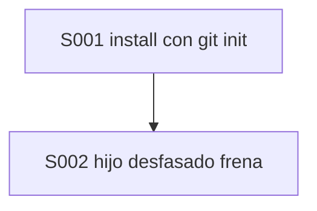
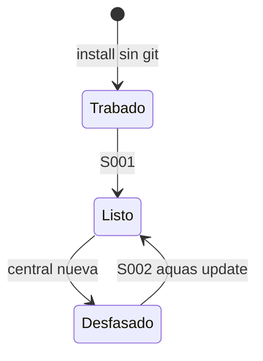

# F006 · Hijo instalable sin trabas

[Inicio](../../README.md) › [E003](../README.md) › F006

[Feature](../../glosario.md#feature) que deja a cada hijo funcionando al instalar y al día con la central.

## En una frase

Install inicia git si falta, y un hijo con la central vieja frena hasta correr `aquas update`.

## Para qué existe

**El problema.** El primer hijo real quedó trabado al instalar sin git (D000090). Y un hijo viejo trabaja con controles viejos.

**La solución.** Dos [slices](../../glosario.md#slice):

| Slice | Qué hace |
|---|---|
| [S001](S001.md) | install hace git init y la guardia del hijo da su arreglo |
| [S002](S002.md) | hijo con la central desfasada frena hasta `aquas update` |

**Origen.** Pedido del humano del 2026-11-04.

## Analogía

Piensa en **abrir un local de franquicia**.

- El local no abre sin cerradura ni con el manual viejo.

Límite de la analogía: aquí la cerradura es git y el manual es la central.

## Diagrama

## Ejemplo de punta a punta

continúa: [EJ-E003](../README.md#EJ-E003)

1. El humano corre `aquas install` en una carpeta sin git: queda un hijo listo.
2. Publica una versión nueva de la central e instala `aquas`.
3. El hijo frena hasta `aquas update` y luego trabaja con la central nueva.

## Paso a paso

1. S001.
2. S002.

## Cómo se usa

- `aquas install` y `aquas update` en el hijo, como hoy.

## Contrato y evidencia

**Objetivo.** Un hijo nuevo queda funcionando al instalar, y uno desfasado no trabaja hasta actualizarse.

Prueba integral: `TestHijoSinGitQuedaFuncionando`.

## Navegación

<!-- GENERADO por aquas desde trabajo/: no editar a mano; `aquas compile` lo rehace. -->

| Hijo | Qué es | Estado |
|---|---|---|
| [S001](S001.md) | install inicia git si falta; la guardia del hijo sugiere aquas update, no el comando de la central. | Planeado |
| [S002](S002.md) | Si la versión del lock del hijo difiere de la del binario, la guardia frena y pide aquas update. | Planeado |

<!-- /GENERADO -->

- ↑ Subir: [E003](../README.md)
