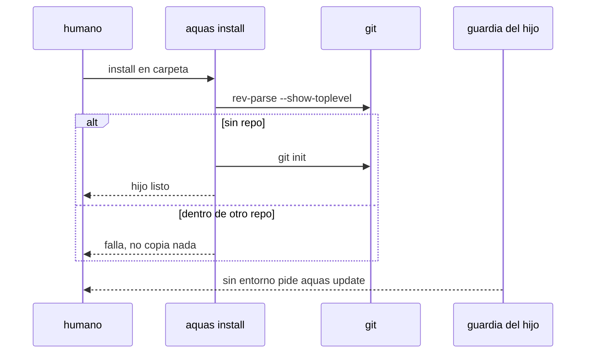

# S001 · install hace git init y la guardia del hijo da su arreglo

[Inicio](../../README.md) › [E003](../README.md) › [F006](README.md) › S001

[Slice](../../glosario.md#slice) que deja funcionando a un hijo instalado en una carpeta sin git.

## En una frase

`aquas install` inicia git si falta, y la guardia del hijo sin entorno pide `aquas update`, no el comando de la central.

## Para qué existe

**El problema.** `silicon-saint-learning-platform` se instaló sin git. Install solo avisó y siguió. Sin entorno, la guardia cerró todo, incluso `aquas defect new`.

**Por qué importa.** El hijo queda trabado, y la guardia sugiere `go run ./cmd/aquas init`, que en el hijo no existe.

**La solución.** Install corre `git init` cuando la carpeta no está en ningún repo. Si está dentro de otro repo, falla sin instalar. La guardia del hijo sin entorno nombra `aquas update` y lo deja pasar.

**Origen.** Defecto D000090, reincidente en el turno T000725. Decisión del humano del 2026-11-04: install inicia git solo.

**Contrato.**

| Regla | Valor |
|---|---|
| Carpeta sin git | install corre `git init` y declara el entorno del hijo |
| Carpeta dentro de otro repo | install falla antes de copiar nada y nombra la raíz de ese repo |
| Carpeta que ya es raíz git | sin cambios respecto de hoy |
| Guardia del hijo sin entorno | el mensaje pide `aquas update`; en la central sigue pidiendo `aquas init` |
| Salida de la guardia cerrada | `aquas update` pasa por la guardia del hijo sin entorno; nada más pasa |
| Alcance | `cmd/aquas/**`, `internal/entorno/**`, `internal/guardia/**`, `internal/hijo/**`, `docs/**` |

**Casos borde.**

| Categoría | Aplica | Prueba o motivo |
|---|---|---|
| cada tipo de ficha | no | no toca fichas del backlog |
| cada estado de origen | sí | carpeta vacía, carpeta con archivos y raíz git previa: `TestInstallIniciaGit` |
| padre e hijo, activo y archivado | sí | hijo dentro del repo de la central u otro repo falla: `TestInstallIniciaGit` |
| entrada ausente, vacía, mal escrita o duplicada | sí | git ausente del PATH: install falla nombrándolo: `TestInstallIniciaGit` |
| choque con otro control | sí | la guardia sin entorno deja pasar solo `aquas update`, no `aquas update; rm x`: `TestInstallIniciaGit` |
| quién habla: humano, agente o herramienta | sí | el agente del hijo puede correr `aquas update` por Bash: `TestInstallIniciaGit` |
| fallo a mitad de camino | sí | `git init` falla: install no copia la central: `TestInstallIniciaGit` |

## Analogía

Piensa en **la llave de un local nuevo**.

- La franquicia no entrega el local sin cerradura instalada.
- Si el local está dentro de otro, no lo abre: avisa.

Límite de la analogía: aquí la cerradura es git.

## Diagrama

## Ejemplo de punta a punta

continúa: [EJ-E003-F006](README.md#EJ-E003-F006)

1. El humano corre `aquas install` en una carpeta vacía.
2. Install corre `git init` y declara el entorno.
3. El [agente](../../glosario.md#agente) del hijo escribe sin que la guardia lo frene.

## Paso a paso

1. Rojo de `TestInstallIniciaGit`.
2. Install con `git init` y fallo anidado.
3. Mensaje y salida de la guardia del hijo; verde.

## Cómo se usa

- `aquas install` en la carpeta del hijo, como hoy.

## Contrato y evidencia

<!-- GENERADO por aquas desde trabajo/: no editar a mano; `aquas compile` lo rehace. -->

| Prueba | Valida | Rojo cuando | Verde cuando | Rojo | Verde |
|---|---|---|---|---|---|
| `TestInstallIniciaGit` | valida git init de install, el fallo dentro de otro repo y el arreglo del hijo | rojo cuando install sin git no crea .git | verde cuando crea .git, falla anidado y la guardia nombra aquas update | — | — |

<!-- /GENERADO -->

## Navegación

- ↑ Subir: [F006](README.md)
