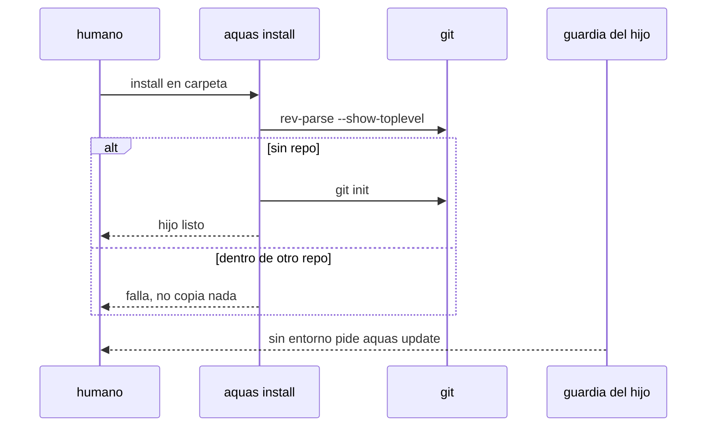

# S001 · install hace git init y la guardia del hijo da su arreglo

[Inicio](../../README.md) › [E003](../README.md) › [F006](README.md) › S001

[Slice](../../glosario.md#slice) que deja funcionando a un hijo instalado en una carpeta sin git.

## En una frase

`aquas install` inicia git si falta, y la guardia del hijo sin entorno pide `aquas update`, no el comando de la central.

## Para qué existe

**El problema.** `silicon-saint-learning-platform` se instaló sin git. Install solo avisó y siguió. Sin entorno, la guardia cerró todo, incluso `aquas defect new`.

**Por qué importa.** El hijo queda trabado, y la guardia sugiere `go run ./cmd/aquas init`, que en el hijo no existe.

**La solución.** Install corre `git init` cuando la carpeta no está en ningún repo. Si está dentro de otro repo, falla sin instalar. La guardia del hijo sin entorno nombra `aquas update` y lo deja pasar.

**Origen.** Defecto D000090, reincidente en el turno T000725. Decisión del humano del 2026-11-04: install inicia git solo.

**Contrato.**

| Regla | Valor |
|---|---|
| Carpeta sin git | install corre `git init` y declara el entorno del hijo |
| Carpeta dentro de otro repo | install falla antes de copiar nada y nombra la raíz de ese repo |
| Carpeta que ya es raíz git | sin cambios respecto de hoy |
| `aquas update` | hace lo mismo que install con git, porque es la salida del hijo trabado |
| Guardia del hijo sin entorno | el mensaje pide `aquas update`; en la central sigue pidiendo `aquas init` |
| Salida de la guardia cerrada | `aquas update` pasa por la guardia del hijo sin entorno; nada más pasa |
| Alcance | `cmd/aquas/**`, `internal/entorno/**`, `internal/guardia/**`, `internal/hijo/**`, `docs/**` |

**Casos borde.**

| Categoría | Aplica | Prueba o motivo |
|---|---|---|
| cada tipo de ficha | no | no toca fichas del backlog |
| cada estado de origen | sí | carpeta vacía, carpeta con archivos y raíz git previa: `TestInstallIniciaGit` |
| padre e hijo, activo y archivado | sí | hijo dentro del repo de la central u otro repo falla: `TestInstallIniciaGit` |
| entrada ausente, vacía, mal escrita o duplicada | sí | git ausente del PATH: install falla nombrándolo: `TestInstallIniciaGit` |
| choque con otro control | sí | la guardia sin entorno deja pasar solo `aquas update`, no `aquas update; rm x`: `TestInstallIniciaGit` |
| quién habla: humano, agente o herramienta | sí | el agente del hijo puede correr `aquas update` por Bash: `TestInstallIniciaGit` |
| fallo a mitad de camino | sí | git falla al leer la carpeta (`.git` roto): install no copia la central: `TestInstallIniciaGit`; un `git init` que falla sale por el mismo retorno de error y no se pudo provocar sin quitar permisos |

## Analogía

Piensa en **la llave de un local nuevo**.

- La franquicia no entrega el local sin cerradura instalada.
- Si el local está dentro de otro, no lo abre: avisa.

Límite de la analogía: aquí la cerradura es git.

## Diagrama

## Ejemplo de punta a punta

continúa: [EJ-E003-F006](README.md#EJ-E003-F006)

1. El humano corre `aquas install` en una carpeta vacía.
2. Install corre `git init` y declara el entorno.
3. El [agente](../../glosario.md#agente) del hijo escribe sin que la guardia lo frene.

## Paso a paso

1. Rojo de `TestInstallIniciaGit`.
2. Install con `git init` y fallo anidado.
3. Mensaje y salida de la guardia del hijo; verde.

## Cómo se usa

- `aquas install` en la carpeta del hijo, como hoy.

## Contrato y evidencia

**Implementación.** `hijo.AsegurarGit` corre antes de copiar la central, en install y en update. La guardia deja pasar solo la orden Bash exacta `aquas update` (PowerShell lo frena siempre), en un hijo sin entorno. `entorno.Validar` da el arreglo del hijo cuando existe `.aquas/lock.json`.

**Pruebas viejas ajustadas.** `TestHerenciaDePuntaAPunta` y `TestVerifyEnElHijo` exigían que install sin git solo avisara; ahora exigen el repo nuevo.

**Evidencia.** `TestInstallIniciaGit`, `TestHijoSinGitQuedaFuncionando` y la suite completa en verde.

<!-- GENERADO por aquas desde trabajo/: no editar a mano; `aquas compile` lo rehace. -->

| Prueba | Valida | Rojo cuando | Verde cuando | Rojo | Verde |
|---|---|---|---|---|---|
| `TestInstallIniciaGit` | valida git init de install, el fallo dentro de otro repo y el arreglo del hijo | rojo cuando install sin git no crea .git | verde cuando crea .git, falla anidado y la guardia nombra aquas update | 2026-11-04 | 2026-11-04 |

### Código

| Archivo | Función | Parámetros | Qué hace |
|---|---|---|---|
| [cmd/aquas/main.go](../../../cmd/aquas/main.go) | `main` | `()` | main despacha el subcomando de aquas (compilar, verificar, backlog, hooks…) y sale con su código. |
| [cmd/aquas/main.go](../../../cmd/aquas/main.go) | `contextoParaClaude` | `(texto string)` | contextoParaClaude (E000/F013/S002): aviso que el gancho PostToolUse entrega a Claude sin frenar (additionalContext, salida 0). |
| [cmd/aquas/main.go](../../../cmd/aquas/main.go) | `hook` | `(raiz string)` | hook: exit 0 = nada que reportar o aviso en additionalContext; exit 2 = stderr se muestra a Claude como freno. |
| [cmd/aquas/main.go](../../../cmd/aquas/main.go) | `compilarSettings` | `(w io.Writer)` | compilarSettings regenera .claude/settings.json; sin entorno declarado no inventa uno. |
| [cmd/aquas/main.go](../../../cmd/aquas/main.go) | `reportar` | `(w io.Writer, inf compilador.Informe)` | reportar imprime qué derivados escribió la compilación, o que todo estaba al día. |
| [cmd/aquas/main.go](../../../cmd/aquas/main.go) | `listar` | `(titulo string, problemas []string)` | listar imprime en stderr un título y cada problema en su viñeta. |
| [cmd/aquas/main.go](../../../cmd/aquas/main.go) | `lista` | `(xs []string) string` | lista une los textos con comas, o «—» si no hay ninguno. |
| [cmd/aquas/main.go](../../../cmd/aquas/main.go) | `fallar` | `(codigo int, err error)` | fallar imprime el error en stderr y termina con el código dado. |
| [cmd/aquas/main.go](../../../cmd/aquas/main.go) | `avisarWiki` | `(avisos []string)` | avisarWiki (E000/F013/S001): imprime los avisos de estilo de la wiki; no cambian el resultado del gate. |
| [cmd/aquas/main.go](../../../cmd/aquas/main.go) | `revisarAislamiento` | `() (fallo, aviso string)` | revisarAislamiento: fallo para el gate y aviso para el arranque (E000/F008/S003, D000079). |
| [cmd/aquas/main.go](../../../cmd/aquas/main.go) | `memoriaCLI` | `(raiz string, args []string)` | memoriaCLI: `ver` imprime la memoria; `fijar campo=valor…` la actualiza y la sella. |
| [cmd/aquas/main.go](../../../cmd/aquas/main.go) | `memoriaArchivada` | `(raiz, id string) error` | memoriaArchivada: CERRADO exige el archivo de memoria del slice, apunte o no la memoria a él (E001/F002/S009, X01). |
| [cmd/aquas/main.go](../../../cmd/aquas/main.go) | `focoEnBacklog` | `(raiz string, f memoria.Foco) error` | focoEnBacklog: la memoria solo fija el slice que el backlog tiene en curso (S003). |
| [cmd/aquas/main.go](../../../cmd/aquas/main.go) | `backlogCLI` | `(raiz string, args []string)` | backlogCLI: nuevo \\| ver [id] \\| tabla \\| prioridad \\| estado \\| siguiente \\| pruebas \\| rojo \\| verde. |
| [cmd/aquas/main.go](../../../cmd/aquas/main.go) | `gateDefectos` | `(raiz string) (frena []string, aviso string)` | gateDefectos (E001/F017/S005): lo que el gate dice del registro de defectos. Prueba nombrada que ya no existe |
| [cmd/aquas/main.go](../../../cmd/aquas/main.go) | `turnoCLI` | `(raiz string, args []string)` | turnoCLI: auditoría de turnos (E001/F002/S001). Lee el JSON del hook por stdin. No imprime nada |
| [cmd/aquas/main.go](../../../cmd/aquas/main.go) | `retroCLI` | `(raiz string, args []string) (backlog.Retro, error)` | retroCLI (E001/F018/S002): cerrar fichas=A,B motivo=…; cada clave una vez. |
| [cmd/aquas/main.go](../../../cmd/aquas/main.go) | `defectoCLI` | `(raiz string, args []string) error` | defectoCLI: nuevo \\| ocurre \\| arreglar \\| ver (E001/F004/S001; arreglar: E000/F007/S003). |
| [cmd/aquas/main.go](../../../cmd/aquas/main.go) | `versionBinario` | `() string` | versionBinario: versión del módulo con que se compiló el binario (= versión del gobierno embebido). |
| [cmd/aquas/main.go](../../../cmd/aquas/main.go) | `versionControl` | `() string` | versionControl (E003/F006/S002, hallazgo A2.1): versión con la que deciden los controles del hijo. |
| [cmd/aquas/main.go](../../../cmd/aquas/main.go) | `registrarCierre` | `(raiz, tipo, transcript, primera, resultado string)` | registrarCierre (E001/F004/S005, D000068) anota cada llamada del gancho cierre-agente en .tmp/hooks/cierre-agente.jsonl. |
| [cmd/aquas/main.go](../../../cmd/aquas/main.go) | `esUpdate` | `(datos []byte) bool` | esUpdate (E003/F006/S001): la entrada de la guardia es una orden Bash que es exactamente `aquas update` (PowerShell lo frena la guardia siempre). |
| [cmd/aquas/main.go](../../../cmd/aquas/main.go) | `entornoHijo` | `(raiz string)` | entornoHijo (E003/F001/S003) declara el entorno del hijo, como aquas init en la central: |
| [internal/entorno/entorno.go](../../../internal/entorno/entorno.go) | `Leer` | `(raiz string) (Entorno, error)` | Leer carga el entorno declarado. |
| [internal/entorno/entorno.go](../../../internal/entorno/entorno.go) | `Validar` | `(raiz string) string` | Validar compara el entorno declarado con el real; "" = coincide, si no, el motivo del bloqueo. |
| [internal/entorno/entorno.go](../../../internal/entorno/entorno.go) | `Iniciar` | `(raiz string) (Entorno, error)` | Iniciar detecta SO y raíz (git) y escribe entorno.local.json; exige correr desde la raíz. |
| [internal/entorno/entorno.go](../../../internal/entorno/entorno.go) | `mismaRuta` | `(a, b string) bool` | mismaRuta compara dos rutas limpias; en Windows sin distinguir mayúsculas. |
| [internal/entorno/entorno.go](../../../internal/entorno/entorno.go) | `generarSettings` | `(fuente []byte, so string) ([]byte, error)` | generarSettings arma settings.json para un SO desde la plantilla canónica. Bytes estables. |
| [internal/entorno/entorno.go](../../../internal/entorno/entorno.go) | `Settings` | `(raiz string) ([]byte, error)` | Settings genera el settings.json esperado para el entorno declarado. |
| [internal/entorno/entorno.go](../../../internal/entorno/entorno.go) | `CompilarSettings` | `(raiz string) (bool, error)` | CompilarSettings escribe .claude/settings.json; devuelve true si cambió. |
| [internal/entorno/entorno.go](../../../internal/entorno/entorno.go) | `VerificarSettings` | `(raiz string) string` | VerificarSettings: "" si .claude/settings.json coincide con lo regenerado. |
| [internal/hijo/git.go](../../../internal/hijo/git.go) | `AsegurarGit` | `(dir string) error` | AsegurarGit (E003/F006/S001) deja dir como raíz de un repo git: lo inicia si no está en ninguno; falla si está dentro de otro. |
| [internal/hijo/git.go](../../../internal/hijo/git.go) | `igualRuta` | `(a, b string) bool` | igualRuta compara dos rutas limpias y absolutas; en Windows sin distinguir mayúsculas. |

<!-- /GENERADO -->

## Navegación

- ↑ Subir: [F006](README.md)
