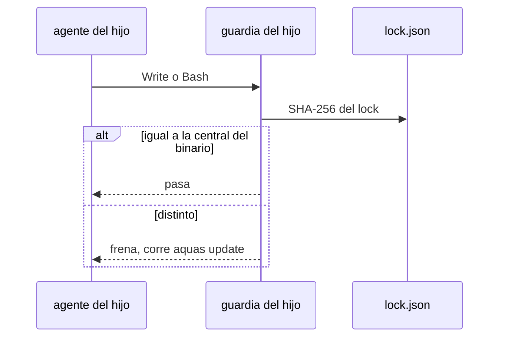

# S002 · Hijo con la central desfasada frena hasta aquas update

[Inicio](../../README.md) › [E003](../README.md) › [F006](README.md) › S002

[Slice](../../glosario.md#slice) que impide trabajar a un hijo con una central más vieja que su binario `aquas`.

## En una frase

Si la central copiada en el hijo no coincide con la que lleva el binario, la guardia frena y pide `aquas update`.

## Para qué existe

**El problema.** Hoy un hijo con la central vieja solo recibe un aviso de versión (`internal/hijo/aviso.go`). El aviso se puede ignorar.

**Por qué importa.** El humano pidió que cada cambio de la central llegue al hijo. Un hijo viejo trabaja con controles viejos sin saberlo.

**La solución.** La guardia del hijo compara los [SHA-256](../../glosario.md#sha-256) del lock con los de la central que lleva el binario. Si difieren, frena todo salvo `aquas update`.

**Origen.** Decisión del humano del 2026-11-04: el hijo desfasado frena, no solo avisa.

**Contrato.**

| Regla | Valor |
|---|---|
| Comparación | SHA-256 de cada archivo del lock contra la central del binario; no la cadena de versión |
| Iguales | la guardia sigue igual que hoy |
| Distintos | la guardia frena con «corre aquas update» y deja pasar solo `aquas update` por Bash |
| Binario más viejo que el hijo | frena pidiendo `go install` de la versión del lock; `aquas update` se niega a bajar la central, lo corra el agente o el humano |
| Orden de versiones | etiquetas `vX.Y.Z` y pseudo-versiones con fecha; `devel` u otro formato = orden desconocido, pide `aquas update` |
| Lock ilegible | frena pidiendo `aquas update`; `update` lo reescribe y lo informa como restaurado |
| Central | no aplica: la central no tiene lock |
| Alcance | `cmd/aquas/**`, `internal/guardia/**`, `internal/hijo/**`, `docs/**` |

**Casos borde.**

| Categoría | Aplica | Prueba o motivo |
|---|---|---|
| cada tipo de ficha | no | no toca fichas del backlog |
| cada estado de origen | sí | hijo al día, hijo viejo y binario viejo: `TestHijoDesfasadoFrena` |
| padre e hijo, activo y archivado | sí | en la central la guardia no compara nada: `TestHijoDesfasadoFrena` |
| entrada ausente, vacía, mal escrita o duplicada | sí | lock ilegible frena pidiendo `aquas update` y update lo repara: `TestHijoDesfasadoFrena` |
| choque con otro control | sí | entorno ausente y central desfasada a la vez: un solo `aquas update` arregla los dos: `TestHijoDesfasadoFrena` |
| quién habla: humano, agente o herramienta | sí | el agente pasa `aquas update` por la guardia; el binario viejo no baja la central, lo lance quien lo lance: `TestHijoDesfasadoFrena` |
| fallo a mitad de camino | sí | update que falla antes de copiar (git roto) deja el lock viejo y sigue frenando: `TestHijoDesfasadoFrena` |

## Analogía

Piensa en **el manual de un local de franquicia**.

- Si la matriz cambia el manual, el local no abre con el viejo.
- Abre en cuanto cambia sus hojas por las nuevas.

Límite de la analogía: aquí el cambio de hojas es `aquas update`.

## Diagrama

## Ejemplo de punta a punta

continúa: [EJ-E003-F006](README.md#EJ-E003-F006)

1. El humano instala `aquas` nuevo con `go install`.
2. En el hijo, el [agente](../../glosario.md#agente) intenta escribir y la guardia frena pidiendo `aquas update`.
3. Tras `aquas update`, el agente escribe.

## Paso a paso

1. Rojo de `TestHijoDesfasadoFrena`; mostró además que `aquas update` fallaba con un lock ilegible.
2. `hijo.Desfase` ([internal/hijo/desfase.go](../../../internal/hijo/desfase.go)) compara los SHA-256 del lock con la central del binario.
3. La guardia del hijo ([cmd/aquas/main.go](../../../cmd/aquas/main.go)) frena con ese motivo; deja pasar solo `aquas update` por Bash.
4. `update` trata un lock ilegible como alterado y lo reescribe ([internal/hijo/update.go](../../../internal/hijo/update.go)); verde.

## Cómo se usa

- No se usa a mano: corre en la guardia de cada hijo.

## Contrato y evidencia

<!-- GENERADO por aquas desde trabajo/: no editar a mano; `aquas compile` lo rehace. -->

| Prueba | Valida | Rojo cuando | Verde cuando | Rojo | Verde |
|---|---|---|---|---|---|
| `TestHijoDesfasadoFrena` | valida que un hijo con lock distinto al binario frena y aquas update lo destraba | rojo cuando el hijo desfasado escribe sin freno | verde cuando frena nombrando aquas update y tras update pasa | 2026-11-04 | 2026-11-04 |

### Código

| Archivo | Función | Parámetros | Qué hace |
|---|---|---|---|
| [cmd/aquas/main.go](../../../cmd/aquas/main.go) | `main` | `()` | main despacha el subcomando de aquas (compilar, verificar, backlog, hooks…) y sale con su código. |
| [cmd/aquas/main.go](../../../cmd/aquas/main.go) | `hook` | `(raiz string)` | hook: exit 0 = nada que reportar; exit 2 = stderr se muestra a Claude. |
| [cmd/aquas/main.go](../../../cmd/aquas/main.go) | `compilarSettings` | `(w io.Writer)` | compilarSettings regenera .claude/settings.json; sin entorno declarado no inventa uno. |
| [cmd/aquas/main.go](../../../cmd/aquas/main.go) | `reportar` | `(w io.Writer, inf compilador.Informe)` | reportar imprime qué derivados escribió la compilación, o que todo estaba al día. |
| [cmd/aquas/main.go](../../../cmd/aquas/main.go) | `listar` | `(titulo string, problemas []string)` | listar imprime en stderr un título y cada problema en su viñeta. |
| [cmd/aquas/main.go](../../../cmd/aquas/main.go) | `lista` | `(xs []string) string` | lista une los textos con comas, o «—» si no hay ninguno. |
| [cmd/aquas/main.go](../../../cmd/aquas/main.go) | `fallar` | `(codigo int, err error)` | fallar imprime el error en stderr y termina con el código dado. |
| [cmd/aquas/main.go](../../../cmd/aquas/main.go) | `revisarAislamiento` | `() (fallo, aviso string)` | revisarAislamiento: fallo para el gate y aviso para el arranque (E000/F008/S003, D000079). |
| [cmd/aquas/main.go](../../../cmd/aquas/main.go) | `memoriaCLI` | `(raiz string, args []string)` | memoriaCLI: `ver` imprime la memoria; `fijar campo=valor…` la actualiza y la sella. |
| [cmd/aquas/main.go](../../../cmd/aquas/main.go) | `memoriaArchivada` | `(raiz, id string) error` | memoriaArchivada: CERRADO exige el archivo de memoria del slice, apunte o no la memoria a él (E001/F002/S009, X01). |
| [cmd/aquas/main.go](../../../cmd/aquas/main.go) | `focoEnBacklog` | `(raiz string, f memoria.Foco) error` | focoEnBacklog: la memoria solo fija el slice que el backlog tiene en curso (S003). |
| [cmd/aquas/main.go](../../../cmd/aquas/main.go) | `backlogCLI` | `(raiz string, args []string)` | backlogCLI: nuevo \\| ver [id] \\| tabla \\| prioridad \\| estado \\| siguiente \\| pruebas \\| rojo \\| verde. |
| [cmd/aquas/main.go](../../../cmd/aquas/main.go) | `gateDefectos` | `(raiz string) (frena []string, aviso string)` | gateDefectos (E001/F017/S005): lo que el gate dice del registro de defectos. Prueba nombrada que ya no existe |
| [cmd/aquas/main.go](../../../cmd/aquas/main.go) | `turnoCLI` | `(raiz string, args []string)` | turnoCLI: auditoría de turnos (E001/F002/S001). Lee el JSON del hook por stdin. No imprime nada |
| [cmd/aquas/main.go](../../../cmd/aquas/main.go) | `retroCLI` | `(raiz string, args []string) (backlog.Retro, error)` | retroCLI (E001/F018/S002): cerrar fichas=A,B motivo=…; cada clave una vez. |
| [cmd/aquas/main.go](../../../cmd/aquas/main.go) | `defectoCLI` | `(raiz string, args []string) error` | defectoCLI: nuevo \\| ocurre \\| arreglar \\| ver (E001/F004/S001; arreglar: E000/F007/S003). |
| [cmd/aquas/main.go](../../../cmd/aquas/main.go) | `versionBinario` | `() string` | versionBinario: versión del módulo con que se compiló el binario (= versión del gobierno embebido). |
| [cmd/aquas/main.go](../../../cmd/aquas/main.go) | `versionControl` | `() string` | versionControl (E003/F006/S002, hallazgo A2.1): versión con la que deciden los controles del hijo. |
| [cmd/aquas/main.go](../../../cmd/aquas/main.go) | `registrarCierre` | `(raiz, tipo, transcript, primera, resultado string)` | registrarCierre (E001/F004/S005, D000068) anota cada llamada del gancho cierre-agente en .tmp/hooks/cierre-agente.jsonl. |
| [cmd/aquas/main.go](../../../cmd/aquas/main.go) | `esUpdate` | `(datos []byte) bool` | esUpdate (E003/F006/S001): la entrada de la guardia es una orden Bash que es exactamente `aquas update` (PowerShell lo frena la guardia siempre). |
| [cmd/aquas/main.go](../../../cmd/aquas/main.go) | `entornoHijo` | `(raiz string)` | entornoHijo (E003/F001/S003) declara el entorno del hijo, como aquas init en la central: |
| [internal/hijo/desfase.go](../../../internal/hijo/desfase.go) | `Desfase` | `(dir string, central fs.FS, binario string) string` | Desfase (E003/F006/S002): "" si la central copiada en dir es la que lleva el binario; si no, el motivo del freno. |
| [internal/hijo/desfase.go](../../../internal/hijo/desfase.go) | `BajaCentral` | `(dir, binario string) string` | BajaCentral (E003/F006/S002, hallazgo A1.1): motivo para que aquas update no corra si el binario es más viejo |
| [internal/hijo/desfase.go](../../../internal/hijo/desfase.go) | `bajaria` | `(binario, lock string) string` | bajaria: motivo común cuando el binario es más viejo que el lock. |
| [internal/hijo/desfase.go](../../../internal/hijo/desfase.go) | `hashes` | `(central fs.FS) (map[string]string, error)` | hashes: SHA-256 de cada archivo de central, por ruta. |
| [internal/hijo/desfase.go](../../../internal/hijo/desfase.go) | `masViejo` | `(a, b string) bool` | masViejo: true solo si a es con certeza anterior a b. Una pseudo-versión vX.Y.Z-0.fecha va antes de la etiqueta vX.Y.Z. |
| [internal/hijo/update.go](../../../internal/hijo/update.go) | `Update` | `(dest string, central fs.FS, version string) ([]string, error)` | Update reemplaza la central sellada por otra versión y reescribe el lock. |
| [internal/hijo/update.go](../../../internal/hijo/update.go) | `alterados` | `(dest string) ([]string, error)` | alterados lista los archivos sellados que ya no coinciden con el lock. |

<!-- /GENERADO -->

## Navegación

- ↑ Subir: [F006](README.md)
