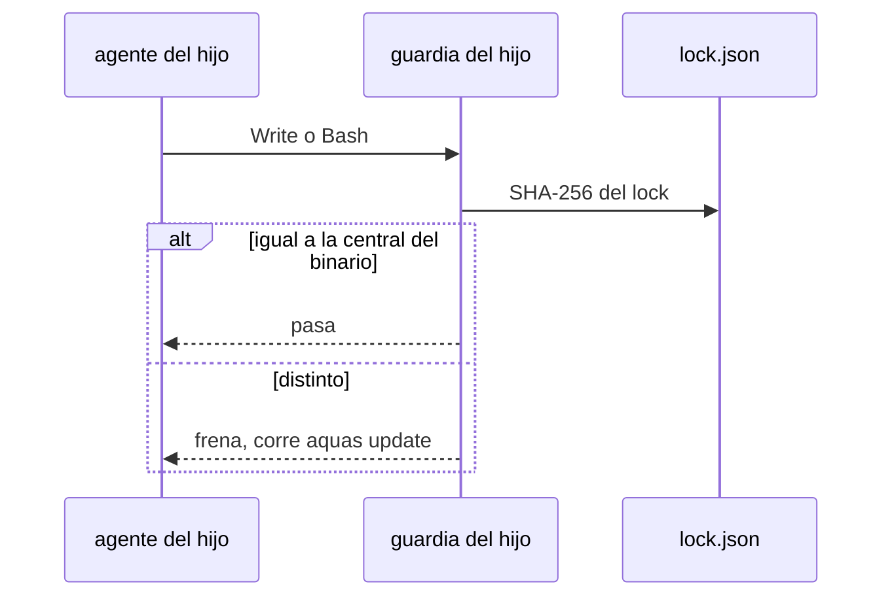

# S002 · Hijo con la central desfasada frena hasta aquas update

[Inicio](../../README.md) › [E003](../README.md) › [F006](README.md) › S002

[Slice](../../glosario.md#slice) que impide trabajar a un hijo con una central más vieja que su binario `aquas`.

## En una frase

Si la central copiada en el hijo no coincide con la que lleva el binario, la guardia frena y pide `aquas update`.

## Para qué existe

**El problema.** Hoy un hijo con la central vieja solo recibe un aviso de versión (`internal/hijo/aviso.go`). El aviso se puede ignorar.

**Por qué importa.** El humano pidió que cada cambio de la central llegue al hijo. Un hijo viejo trabaja con controles viejos sin saberlo.

**La solución.** La guardia del hijo compara los [SHA-256](../../glosario.md#sha-256) del lock con los de la central que lleva el binario. Si difieren, frena todo salvo `aquas update`.

**Origen.** Decisión del humano del 2026-11-04: el hijo desfasado frena, no solo avisa.

**Contrato.**

| Regla | Valor |
|---|---|
| Comparación | SHA-256 de cada archivo del lock contra la central del binario; no la cadena de versión |
| Iguales | la guardia sigue igual que hoy |
| Distintos | la guardia frena con «corre aquas update» y deja pasar solo `aquas update` |
| Binario más viejo que el hijo | frena pidiendo `go install` de la versión del lock |
| Central | no aplica: la central no tiene lock |
| Alcance | `cmd/aquas/**`, `internal/guardia/**`, `internal/hijo/**`, `docs/**` |

**Casos borde.**

| Categoría | Aplica | Prueba o motivo |
|---|---|---|
| cada tipo de ficha | no | no toca fichas del backlog |
| cada estado de origen | sí | hijo al día, hijo viejo y binario viejo: `TestHijoDesfasadoFrena` |
| padre e hijo, activo y archivado | sí | en la central la guardia no compara nada: `TestHijoDesfasadoFrena` |
| entrada ausente, vacía, mal escrita o duplicada | sí | lock ausente o ilegible frena pidiendo `aquas update`: `TestHijoDesfasadoFrena` |
| choque con otro control | sí | el aviso de versión actual queda, sin duplicar mensaje: `TestHijoDesfasadoFrena` |
| quién habla: humano, agente o herramienta | sí | el agente del hijo puede correr `aquas update`: `TestHijoDesfasadoFrena` |
| fallo a mitad de camino | sí | update a medias deja el lock viejo y sigue frenando: `TestHijoDesfasadoFrena` |

## Analogía

Piensa en **el manual de un local de franquicia**.

- Si la matriz cambia el manual, el local no abre con el viejo.
- Abre en cuanto cambia sus hojas por las nuevas.

Límite de la analogía: aquí el cambio de hojas es `aquas update`.

## Diagrama

## Ejemplo de punta a punta

continúa: [EJ-E003-F006](README.md#EJ-E003-F006)

1. El humano instala `aquas` nuevo con `go install`.
2. En el hijo, el [agente](../../glosario.md#agente) intenta escribir y la guardia frena pidiendo `aquas update`.
3. Tras `aquas update`, el agente escribe.

## Paso a paso

1. Rojo de `TestHijoDesfasadoFrena`.
2. Comparación de SHA-256 en la guardia del hijo.
3. Salida por `aquas update`; verde.

## Cómo se usa

- No se usa a mano: corre en la guardia de cada hijo.

## Contrato y evidencia

<!-- GENERADO por aquas desde trabajo/: no editar a mano; `aquas compile` lo rehace. -->

| Prueba | Valida | Rojo cuando | Verde cuando | Rojo | Verde |
|---|---|---|---|---|---|
| `TestHijoDesfasadoFrena` | valida que un hijo con lock distinto al binario frena y aquas update lo destraba | rojo cuando el hijo desfasado escribe sin freno | verde cuando frena nombrando aquas update y tras update pasa | — | — |

<!-- /GENERADO -->

## Navegación

- ↑ Subir: [F006](README.md)
