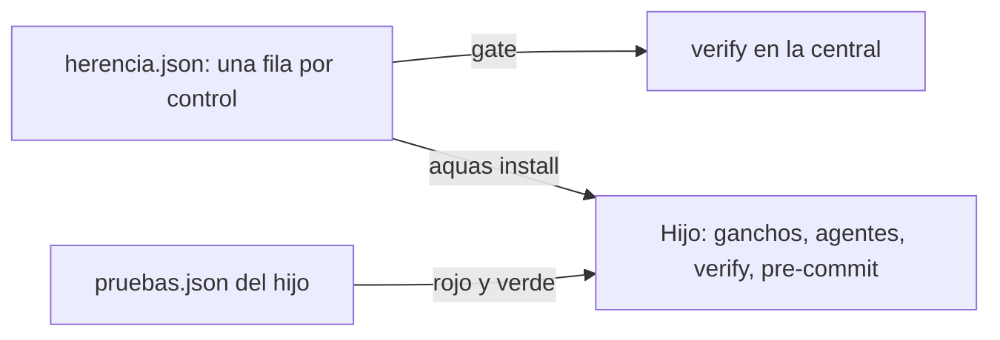
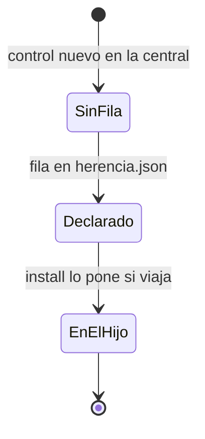

# E003 · Herencia obligatoria

[Inicio](../README.md) › E003

[Iniciativa](../glosario.md#iniciativa) que hace cumplir en cada hijo, por programa, todo control de la central.

## En una frase

Lo que la central exige, el hijo lo cumple igual, sin poder quitarlo.

## Para qué existe

**El problema.** Hoy un hijo recibe una copia sellada de la central, su `CLAUDE.md`, el comando `/backlog` y un solo gancho. La central tiene diez ganchos, el [gate](../glosario.md#gate) `verify` y el [pre-commit](../glosario.md#pre-commit). En el hijo, casi todas las reglas quedan como texto que nadie hace cumplir.

**Por qué importa.** El principio 11 de la constitución dice que la herencia es por programa, no por texto. Un hijo sin guardia puede escribir fuera de su carpeta; uno sin pre-commit puede guardar [derivados](../glosario.md#derivado) desfasados.

**La solución.** Un archivo, `gobierno/config/herencia.json`, dice qué control viaja a cada hijo. Un gate falla si un control no tiene fila. `aquas install` pone en el hijo los ganchos, [agentes](../glosario.md#agente) y gates que viajan. Cada hijo dice cómo correr una prueba, sea cual sea su lenguaje.

**Origen.** Decisión humana del 2026-10-31: tercera en el orden recomendado. Proyectos hijos (E002) quedó cerrada, por eso esta es una iniciativa nueva.

## Analogía

Piensa en **una franquicia con inspección**.

- La casa matriz no solo entrega el manual: instala en cada local la misma alarma y la misma caja registradora.
- El local elige su menú, pero no puede desconectar la alarma.

Límite de la analogía: aquí la inspección es un programa que corre en cada [commit](../glosario.md#commit), no una visita.

## Diagrama

Estados de un control:

## Ejemplo de punta a punta

continúa: [EJ-INICIO](../README.md#EJ-INICIO)

1. La central agrega un gancho nuevo; `verify` falla hasta que tenga fila en `herencia.json`.
2. La fila dice `todos`; un hijo nuevo corre `aquas install` y recibe el gancho.
3. En el hijo, una escritura fuera de su carpeta sale bloqueada, igual que en la central.

## Paso a paso

1. Herencia de controles a cada hijo (F001).

## Cómo se usa

- En la central: cada control nuevo lleva su fila en `herencia.json`.
- En un hijo: `aquas install`, y cada control que viaja queda activo.

## Contrato y evidencia

**Objetivo.** Ningún control central se queda sin cumplir en un hijo. La excepción son los que `herencia.json` deja solo en la central, con su motivo.

Prueba integral: `TestHijoCumpleLaCentral` (un hijo instalado tiene activo cada control que viaja).

## Navegación

<!-- GENERADO por aquas desde trabajo/: no editar a mano; `aquas compile` lo rehace. -->

| Hijo | Qué es | Estado |
|---|---|---|
| [F001](F001/README.md) | declara qué control viaja a los hijos y lo instala en cada uno | Hecho |
| F002 | El hijo enlaza su glosario y avisa oraciones largas al editar docs, como la central. | Planeado |
| F003 | Plantilla de ganchos única, aviso al pisar un agente propio y auditor útil en el hijo. | Planeado |
| F004 | la wiki acepta y distingue pruebas ruta:nombre de un hijo sin Go | Planeado |
| F005 | Excluye por máquina las reglas globales viejas en central e hijos. | Planeado |
| [F006](F006/README.md) | Un hijo nuevo queda funcionando al instalar, aunque la carpeta no tenga git. | En curso |

<!-- /GENERADO -->

- ↑ Subir: [Inicio](../README.md)
- Abajo: [F001 · Herencia de controles a cada hijo](F001/README.md)
