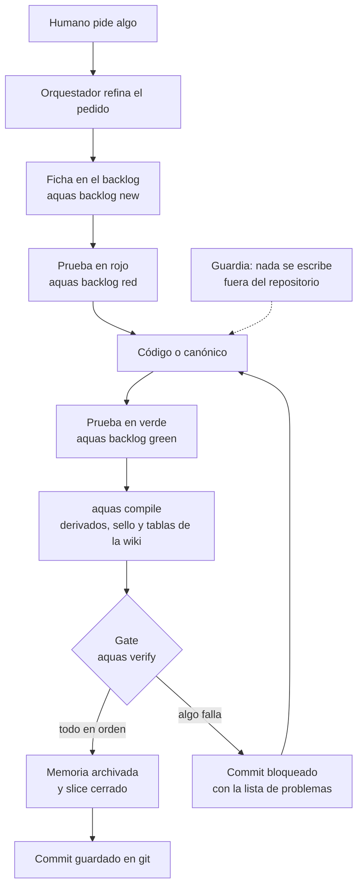

# Wiki de aquas-harness-governance

Esta es la puerta de entrada. Desde aquí bajas a cada [iniciativa](glosario.md#iniciativa). Cada iniciativa te lleva a sus [features](glosario.md#feature), y cada feature a sus [slices](glosario.md#slice).
Ábrela en VS Code con la vista previa de [Markdown](glosario.md#markdown) (Ctrl+Shift+V) para ver los diagramas dibujados.

## En una frase

Aquas es el arnés central de gobierno de todos los productos de Aquas hechos con Claude Code. Define cómo se trabaja, lo hace cumplir con programas y lo instala en cada proyecto.

## Para qué existe

**El problema.** Cada producto tendría sus propias reglas, copiadas a mano. Una landing, una editorial, un libro o una API se irían desviando y contradiciendo.

Además, un [agente](glosario.md#agente) de IA es rápido pero poco confiable sin controles. Olvida, se sale del alcance, inventa o declara «hecho» sin prueba.

**La solución.** Un solo repositorio central con cinco piezas:

1. **Gobierno escrito una vez.** Constitución, metodología y agentes viven en archivos [canónicos](glosario.md#canónico) sellados.
2. **Cumplimiento por programa.** Lo que se puede comprobar lo comprueba un programa en [Go](glosario.md#go): un *[gate](glosario.md#gate)* o un [hook](glosario.md#hook).
3. **Trabajo ordenado.** Iniciativa, feature y slice; la [prueba en rojo](glosario.md#prueba-en-rojo) va antes que el código.
4. **Distribución a los proyectos hijos.** aquas install, update y report (en construcción, iniciativa E002).
5. **Explicado para humanos.** Esta [wiki](glosario.md#wiki) cuenta cada pieza con ejemplos y dibujos.

El método de trabajo se llama **Aquas-driven development**. Cada slice tiene un contrato mínimo y un gate lo vigila. Está en evolución constante.

## Analogía

Piensa en una **cocina de restaurante**.

- El **recetario** son los archivos canónicos: la única versión oficial de cada receta.
- El **cocinero** es el agente: cocina rápido, pero sigue el recetario.
- El **inspector** es el gate en Go: revisa cada plato antes de que salga. Si falta un ingrediente, el plato no sale.
- El **menú impreso** es `CLAUDE.md`: se imprime desde el recetario. Nadie lo corrige a mano.

Límite de la analogía: un inspector humano puede tener un mal día. El gate no; revisa siempre lo mismo, de la misma forma.

## Diagrama

Así viaja un pedido hoy, desde que lo haces hasta que queda guardado en git.

Cada paso lo hace o lo revisa un programa. El agente no tiene que acordarse.

## Ejemplo de punta a punta

**Situación.** Jesús quiere que el [orquestador](glosario.md#orquestador) no paralelice trabajo sin permiso.

1. Jesús lo dice en el chat: «yo nunca te dije que paralelizaras».
2. El orquestador entiende el pedido. Edita el canónico `gobierno/canonico/agentes/orquestador.md` y agrega la regla «serie por defecto».
3. Apenas guarda el archivo, un *[hook](glosario.md#hook)* de Claude Code ejecuta el [compilador](glosario.md#compilador). El compilador regenera `.claude/agents/orchestrator.md`.
4. El compilador actualiza el [sello](glosario.md#sello): guarda la huella [SHA-256](glosario.md#sha-256) del canónico y del archivo generado.
5. El orquestador hace [commit](glosario.md#commit). Antes de guardar, git ejecuta el gate `aquas verify`.
6. El gate compara huellas, revisa el tamaño máximo y revisa esta wiki. Todo cuadra, así que el commit entra.

**¿Y si alguien edita a mano el archivo generado?** El hook revierte la edición y avisa: «es GENERADO; edita el canónico». La regla vive en un solo lugar.

## Paso a paso

Para entender el repositorio, léelo en este orden:

1. Lee esta página completa.
2. Lee la [constitución explicada](ref/constitucion.md). Son diez principios cortos.
3. Baja a la iniciativa [E001 Gobierno del trabajo](E001/README.md). Ahí está cómo se organiza cada pedido.
4. Sigue bajando por las features y los slices. Cada página continúa el ejemplo de su página de arriba.

## Cómo se usa

Comandos principales, desde la raíz del repositorio:

| Quiero… | Comando |
|---|---|
| Regenerar archivos derivados y sello | `go run ./cmd/aquas compile` |
| Revisar que todo esté en orden | `go build -o .tmp/aquas.exe ./cmd/aquas && ./.tmp/aquas.exe verify` |
| Activar el gate en un clon nuevo | `git config core.hooksPath .githooks` |
| Declarar sistema y carpeta en un clon nuevo | `go run ./cmd/aquas init` |

Mapa rápido del repositorio:

| Carpeta | Qué guarda |
|---|---|
| `gobierno/canonico/` | Las reglas oficiales. Lo único que se edita a mano. |
| `gobierno/config/` | Qué se compila, con qué tamaño máximo, y los sellos. |
| `cmd/aquas/` | La herramienta de línea de comandos. |
| `internal/compilador/` | El compilador y el sellado. |
| `internal/wiki/` | El gate de esta wiki. |
| `internal/guardia/` | La guardia: nada se escribe fuera del repo. |
| `internal/entorno/` | Sistema y carpeta declarados; ajustes generados. |
| `docs/` | Esta wiki. |

## Las iniciativas

Hoy el repositorio tiene tres iniciativas. Cada una tiene su página, con sus features, diagramas y pruebas.

- **[E000 · Mantenimiento del gobierno](E000/README.md).** Arregla y vigila este mismo repositorio. Aquí están la guardia, el compilador y la calidad de las pruebas.
- **[E001 · Gobierno del trabajo](E001/README.md).** Define el camino fijo de cada pedido. Aquí están esta wiki, el [backlog](glosario.md#backlog), la memoria del agente y los workers.
- **E002 · Proyectos hijos.** Instala y mantiene el gobierno en cada producto de Aquas. Planeada; arranca con la landing de Aquas.

El estado de cada iniciativa está en la tabla de Navegación. La genera `aquas compile` desde las fichas; nadie la escribe a mano. Si una ficha cambia y la tabla no, el [gate](glosario.md#gate) bloquea el commit.

El orden de ejecución lo dice `aquas backlog next`.

## Navegación

<!-- GENERADO por aquas desde trabajo/: no editar a mano; `aquas compile` lo rehace. -->

| Hijo | Qué es | Estado |
|---|---|---|
| [E000](E000/README.md) | Mantenimiento del gobierno | En curso |
| [E001](E001/README.md) | Gobierno del trabajo | En curso |
| [E002](E002/README.md) | Proyectos hijos | Hecho |

<!-- /GENERADO -->

- Glosario: [palabras técnicas](glosario.md)
- Referencia: [Constitución](ref/constitucion.md)
- Referencia: [Compilador](ref/compilador.md)
- Referencia: [Comunicación agente → humano](ref/comunicacion.md)
- Referencia: [Guardia: nada se escribe fuera del repo](ref/guardia.md)
- Referencia: [Código: cada función y qué hace](ref/codigo.md)
