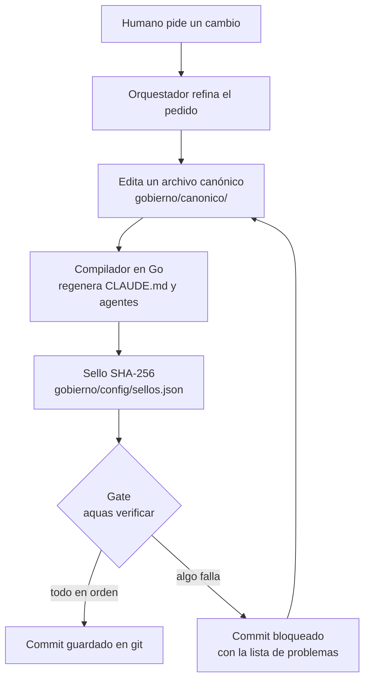
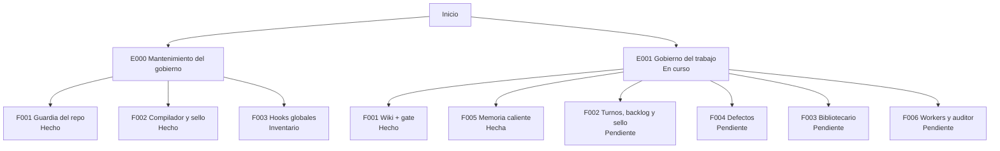

# Wiki de aquas-harness-governance

Esta es la puerta de entrada. Desde aquí bajas a cada [iniciativa](glosario.md#iniciativa), [feature](glosario.md#feature) y [slice](glosario.md#slice).
Ábrela en VS Code con la vista previa de [Markdown](glosario.md#markdown) (Ctrl+Shift+V) para ver los diagramas dibujados.

## En una frase

Este repositorio es el **libro de reglas** que siguen los [agentes](glosario.md#agente) de Claude Code. También es una máquina que revisa que nadie se salte esas reglas.

## Para qué existe

**El problema.** Un agente de IA trabaja rápido, pero olvida. Si una regla solo vive en el chat, se pierde cuando el chat se compacta. Si una regla depende de que el agente «se acuerde», a veces no se acuerda.

**La solución.** Las reglas se escriben en archivos. Un programa en [Go](glosario.md#go) las junta, las sella y revisa que todo esté en orden. Si algo está mal, el programa bloquea el [commit](glosario.md#commit). No depende de la buena memoria del agente.

Tres ideas sostienen todo:

1. **Lo escrito manda.** Una regla que no está en un archivo [canónico](glosario.md#canónico) no existe.
2. **La máquina revisa.** Lo que se puede comprobar con un programa, lo comprueba un programa (un *[gate](glosario.md#gate)*).
3. **Se explica para humanos.** Esta [wiki](glosario.md#wiki) cuenta cada pieza con ejemplos y dibujos.

El método de trabajo se llama **Aquas-driven development**. No depende de un comité ni de documentos largos. Cada slice tiene un contrato mínimo y un gate lo vigila. Está en evolución constante.

## Analogía

Piensa en una **cocina de restaurante**.

- El **recetario** son los archivos canónicos: la única versión oficial de cada receta.
- El **cocinero** es el agente: cocina rápido, pero sigue el recetario.
- El **inspector** es el gate en Go: revisa cada plato antes de que salga. Si falta un ingrediente, el plato no sale.
- El **menú impreso** es `CLAUDE.md`: se imprime desde el recetario. Nadie lo corrige a mano.

Límite de la analogía: un inspector humano puede tener un mal día. El gate no; revisa siempre lo mismo, de la misma forma.

## Diagrama

Así viaja una regla desde que se escribe hasta que queda guardada en git.

## Ejemplo de punta a punta

**Situación.** Jesús quiere que el [orquestador](glosario.md#orquestador) no paralelice trabajo sin permiso.

1. Jesús lo dice en el chat: «yo nunca te dije que paralelizaras».
2. El orquestador entiende el pedido. Edita el canónico `gobierno/canonico/agentes/orquestador.md` y agrega la regla «serie por defecto».
3. Apenas guarda el archivo, un *[hook](glosario.md#hook)* de Claude Code ejecuta el [compilador](glosario.md#compilador). El compilador regenera `.claude/agents/orchestrator.md`.
4. El compilador actualiza el [sello](glosario.md#sello): guarda la huella [SHA-256](glosario.md#sha-256) del canónico y del archivo generado.
5. El orquestador hace commit. Antes de guardar, git ejecuta el gate `aquas verificar`.
6. El gate compara huellas, revisa el tamaño máximo y revisa esta wiki. Todo cuadra, así que el commit entra.

**¿Y si alguien edita a mano el archivo generado?** El hook revierte la edición y avisa: «es GENERADO; edita el canónico». La regla vive en un solo lugar.

## Paso a paso

Para entender el repositorio, léelo en este orden:

1. Lee esta página completa.
2. Lee la [constitución explicada](ref/constitucion.md). Son nueve principios cortos.
3. Baja a la iniciativa [E001 Gobierno del trabajo](E001/README.md). Ahí está cómo se organiza cada pedido.
4. Sigue bajando por las features y los slices. Cada página continúa el ejemplo de su página de arriba.

## Cómo se usa

Comandos principales, desde la raíz del repositorio:

| Quiero… | Comando |
|---|---|
| Regenerar archivos derivados y sello | `go run ./cmd/aquas compilar` |
| Revisar que todo esté en orden | `go run ./cmd/aquas verificar` |
| Activar el gate en un clon nuevo | `git config core.hooksPath .githooks` |
| Declarar sistema y carpeta en un clon nuevo | `go run ./cmd/aquas iniciar` |

Mapa rápido del repositorio:

| Carpeta | Qué guarda |
|---|---|
| `gobierno/canonico/` | Las reglas oficiales. Lo único que se edita a mano. |
| `gobierno/config/` | Qué se compila, con qué tamaño máximo, y los sellos. |
| `cmd/aquas/` | La herramienta de línea de comandos. |
| `internal/compilador/` | El compilador y el sellado. |
| `internal/wiki/` | El gate de esta wiki. |
| `internal/guardia/` | La guardia: nada se escribe fuera del repo. |
| `internal/entorno/` | Sistema y carpeta declarados; ajustes generados. |
| `docs/` | Esta wiki. |

## Mapa del trabajo

Todo lo hecho y lo planeado, con su estado. Hoy se escribe a mano. Cuando llegue el [backlog](glosario.md#backlog) en JSON, lo generará `aquas`.

| Elemento | Qué entrega | Estado |
|---|---|---|
| [E000](E000/README.md) Mantenimiento del gobierno | Arreglos y controles de este repositorio | Permanente |
| ↳ [F001](E000/F001/README.md) Guardia del repo | Nada se escribe fuera del repositorio | Hecho |
| ↳↳ [S001](E000/F001/S001.md) · [S002](E000/F001/S002.md) · [S003](E000/F001/S003.md) · [S004](E000/F001/S004.md) | Guardia, permitidos, hooks en Windows, entorno declarado | Hecho |
| ↳ [F002](E000/F002/README.md) Compilador y sello | Archivos generados, sellados y con tope | Hecho |
| ↳↳ [S001](E000/F002/S001.md) · [S002](E000/F002/S002.md) | Compilar y sellar, tope de caracteres | Hecho |
| ↳ F003 Hooks globales | Ganchos en `~/.claude/hooks/` que rigen todo proyecto; solo registrados, no gobernados aquí | Inventario |
| [E001](E001/README.md) Gobierno del trabajo | Camino fijo para cada pedido | En curso |
| ↳ [F001](E001/F001/README.md) Wiki + gate | Esta wiki y el gate que la exige | Hecho |
| ↳↳ [S001](E001/F001/S001.md) · [S002](E001/F001/S002.md) · [S003](E001/F001/S003.md) | Esqueleto, legibilidad y glosario, referencia | Hecho |
| ↳↳ [S004](E001/F001/S004.md) | Contrato, evidencia y migas | Hecho |
| ↳ [F005](E001/F005/README.md) Memoria caliente | El agente no pierde el foco entre sesiones | Hecha |
| ↳↳ [S001](E001/F005/S001.md) · [S002](E001/F005/S002.md) · [S003](E001/F005/S003.md) | Archivo, sello y guardia; hooks; archivo y arranque en frío | Hecho |
| ↳ F002 Turnos, backlog y sello | Auditoría, backlog en JSON, rojo y verde, sello | Pendiente |
| ↳ F004 Defectos y reincidencia | Registro de fallos y alerta si se repiten | Pendiente |
| ↳ F003 Bibliotecario | Herramienta propia: lee rutas o busca y entrega solo lo útil | Pendiente |
| ↳ F006 Workers y auditor | Agentes baratos que ejecutan y un auditor que revisa | Pendiente |

El orden de las pendientes es el orden de ejecución.

## Navegación

- Abajo: [E000 · Mantenimiento del gobierno](E000/README.md)
- Abajo: [E001 · Gobierno del trabajo](E001/README.md)
- Glosario: [palabras técnicas](glosario.md)
- Referencia: [Constitución](ref/constitucion.md)
- Referencia: [Compilador](ref/compilador.md)
- Referencia: [Comunicación agente → humano](ref/comunicacion.md)
- Referencia: [Guardia: nada se escribe fuera del repo](ref/guardia.md)
