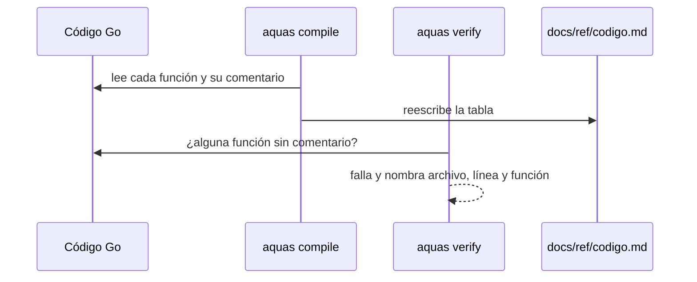

# Código

Índice de cada función del harness, con lo que dice su comentario. Lo genera `aquas compile` desde el código en `cmd/` e `internal/`.

## En una frase

Quien quiere saber qué hay en el repo lo lee aquí, sin abrir el código.

## Para qué existe

**El problema.** Para saber qué hace una pieza había que abrir el archivo y leer [Go](../glosario.md#go). Un tercio de las funciones no tenía comentario.

**La solución.** El [gate](../glosario.md#gate) falla si una función no lleva comentario y nombra archivo y línea. Este índice se rehace desde el código; si se desfasa, el gate también falla.

## Analogía

Piensa en el **índice de un manual de taller**.

- Cada pieza aparece con su ubicación y una línea de para qué sirve.
- Una pieza sin descripción no entra al manual.

Límite de la analogía: aquí el índice lo escribe un programa a partir del comentario de cada función.

## Diagrama



## Ejemplo de punta a punta

<a id="EJ-REF-codigo"></a>

1. Al activar el gate, `aquas verify` nombró 69 funciones sin comentario, por ejemplo `internal/wiki/hijos.go:43: función celda sin comentario`.
2. Cada una recibió una línea que dice qué hace.
3. `aquas compile` llenó la tabla de abajo y el gate volvió a pasar.

## Paso a paso

1. Recorrer los `.go` de `cmd/` e `internal/`, sin los de prueba.
2. Tomar cada función y método con la primera línea de su comentario.
3. Avisar cada función sin comentario.
4. Escribir la tabla, ordenada por archivo y línea.

## Cómo se usa

Busca el archivo o la función; la última columna dice qué hace.

<!-- GENERADO por aquas desde trabajo/: no editar a mano; `aquas compile` lo rehace. -->

| Archivo | Función | Parámetros | Qué hace |
|---|---|---|---|
| [cmd/aquas/aprobacion.go](../../cmd/aquas/aprobacion.go) | `aprobacionCLI` | `(raiz string)` | aprobacionCLI: solo un evento UserPromptSubmit cuenta como mensaje del humano. PreToolUse, PostToolUse, |
| [cmd/aquas/apruebo_cubierto.go](../../cmd/aquas/apruebo_cubierto.go) | `pedidoCubierto` | `(raiz, msg string) string` | pedidoCubierto (E001/F017/S002, D000069, D000084, D000099): freno del cierre si el agente pide un apruebo que la |
| [cmd/aquas/apruebo_cubierto.go](../../cmd/aquas/apruebo_cubierto.go) | `pruebasIntactas` | `(slice backlog.Ficha, aprobadas []backlog.Prueba) bool` | pruebasIntactas: cada prueba aprobada en la foto sigue en el slice; si cambió, el arnés pide el apruebo otra vez. |
| [cmd/aquas/apruebo_cubierto.go](../../cmd/aquas/apruebo_cubierto.go) | `todosEnFoto` | `(fs []backlog.Ficha, feature backlog.Ficha) bool` | todosEnFoto: true si cada slice activo de la feature está en la foto de su aprobación. |
| [cmd/aquas/aviso.go](../../cmd/aquas/aviso.go) | `avisarVersion` | `(w io.Writer, comando, raiz, version string)` | avisarVersion (E002/F002/S003) escribe el aviso de versión del hijo en w, salvo en install y update. |
| [cmd/aquas/calidad.go](../../cmd/aquas/calidad.go) | `revisarGo` | `(raiz string) []string` | revisarGo (E001/F013/S001) corre la calidad Go de la central para el gate. |
| [cmd/aquas/gancho_mudo.go](../../cmd/aquas/gancho_mudo.go) | `claveGancho` | `(args []string) string` | claveGancho: la orden de gancho que nombran los argumentos internos, o "". |
| [cmd/aquas/gancho_mudo.go](../../cmd/aquas/gancho_mudo.go) | `eventoGancho` | `(args []string) (string, bool)` | eventoGancho: evento de Claude Code de la orden; false si no es un gancho. |
| [cmd/aquas/gancho_mudo.go](../../cmd/aquas/gancho_mudo.go) | `nuncaMudo` | `(args, originales []string)` | nuncaMudo: si args es una orden de gancho, la corre como proceso hijo, traduce su salida y termina el proceso. |
| [cmd/aquas/gancho_mudo.go](../../cmd/aquas/gancho_mudo.go) | `conAviso` | `(clave string, out []byte, stderr string) []byte` | conAviso: con exit 0 el stderr no lo ve nadie; si trae algo, viaja como systemMessage junto a la salida del hijo. |
| [cmd/aquas/gancho_mudo.go](../../cmd/aquas/gancho_mudo.go) | `causa` | `(stderr string, codigo int) string` | causa: líneas de stderr del hijo sin el prefijo «aquas:» ni el aviso de nombre viejo. |
| [cmd/aquas/gancho_mudo.go](../../cmd/aquas/gancho_mudo.go) | `avisarGancho` | `(clave string, err error)` | avisarGancho: el fallo llega a quien corresponde y el proceso termina con 0 (aviso) o 2 (freno). |
| [cmd/aquas/gancho_mudo.go](../../cmd/aquas/gancho_mudo.go) | `fallaGancho` | `(clave string, err error) (int, string, string)` | fallaGancho: código, stdout y stderr del fallo de un gancho; 2 con la causa si frena, 0 con aviso si no. |
| [cmd/aquas/ingles.go](../../cmd/aquas/ingles.go) | `traducir` | `(args []string) ([]string, []string)` | traducir devuelve los argumentos con los nombres internos y un aviso por cada nombre viejo usado. |
| [cmd/aquas/ingles.go](../../cmd/aquas/ingles.go) | `traducirUna` | `(palabra string, tabla map[string]string, avisos *[]string) string` | traducirUna pasa una palabra a su nombre interno; si ya era el nombre viejo, anota el aviso. |
| [cmd/aquas/limpiar.go](../../cmd/aquas/limpiar.go) | `limpiar` | `(raiz string, args []string) (string, error)` | limpiar (E000/F006/S009): borra .tmp/<id>/ de un encargo y nada más. |
| [cmd/aquas/main.go](../../cmd/aquas/main.go) | `main` | `()` | main despacha el subcomando de aquas (compilar, verificar, backlog, hooks…) y sale con su código. |
| [cmd/aquas/main.go](../../cmd/aquas/main.go) | `contextoParaClaude` | `(texto string)` | contextoParaClaude (E000/F013/S002): aviso que el gancho PostToolUse entrega a Claude sin frenar (additionalContext, salida 0). |
| [cmd/aquas/main.go](../../cmd/aquas/main.go) | `hook` | `(raiz string)` | hook: exit 0 = nada que reportar o aviso en additionalContext; exit 2 = stderr se muestra a Claude como freno. |
| [cmd/aquas/main.go](../../cmd/aquas/main.go) | `compilarSettings` | `(w io.Writer)` | compilarSettings regenera .claude/settings.json; sin entorno declarado no inventa uno. |
| [cmd/aquas/main.go](../../cmd/aquas/main.go) | `reportar` | `(w io.Writer, inf compilador.Informe)` | reportar imprime qué derivados escribió la compilación, o que todo estaba al día. |
| [cmd/aquas/main.go](../../cmd/aquas/main.go) | `listar` | `(titulo string, problemas []string)` | listar imprime en stderr un título y cada problema en su viñeta. |
| [cmd/aquas/main.go](../../cmd/aquas/main.go) | `lista` | `(xs []string) string` | lista une los textos con comas, o «—» si no hay ninguno. |
| [cmd/aquas/main.go](../../cmd/aquas/main.go) | `fallar` | `(codigo int, err error)` | fallar imprime el error en stderr y termina con el código dado. |
| [cmd/aquas/main.go](../../cmd/aquas/main.go) | `avisarWiki` | `(avisos []string)` | avisarWiki (E000/F013/S001): imprime los avisos de estilo de la wiki; no cambian el resultado del gate. |
| [cmd/aquas/main.go](../../cmd/aquas/main.go) | `revisarAislamiento` | `() (fallo, aviso string)` | revisarAislamiento: fallo para el gate y aviso para el arranque (E000/F008/S003, D000079). |
| [cmd/aquas/main.go](../../cmd/aquas/main.go) | `memoriaCLI` | `(raiz string, args []string)` | memoriaCLI: `ver` imprime la memoria; `fijar campo=valor…` la actualiza y la sella. |
| [cmd/aquas/main.go](../../cmd/aquas/main.go) | `memoriaArchivada` | `(raiz, id string) error` | memoriaArchivada: CERRADO exige el archivo de memoria del slice, apunte o no la memoria a él (E001/F002/S009, X01). |
| [cmd/aquas/main.go](../../cmd/aquas/main.go) | `focoEnBacklog` | `(raiz string, f memoria.Foco) error` | focoEnBacklog: la memoria solo fija el slice que el backlog tiene en curso (S003). |
| [cmd/aquas/main.go](../../cmd/aquas/main.go) | `backlogCLI` | `(raiz string, args []string)` | backlogCLI: nuevo \\| ver [id] \\| tabla \\| prioridad \\| estado \\| siguiente \\| pruebas \\| rojo \\| verde. |
| [cmd/aquas/main.go](../../cmd/aquas/main.go) | `gateDefectos` | `(raiz string) (frena []string, aviso string)` | gateDefectos (E001/F017/S005): lo que el gate dice del registro de defectos. Prueba nombrada que ya no existe |
| [cmd/aquas/main.go](../../cmd/aquas/main.go) | `turnoCLI` | `(raiz string, args []string)` | turnoCLI: auditoría de turnos (E001/F002/S001). Lee el JSON del hook por stdin. No imprime nada |
| [cmd/aquas/main.go](../../cmd/aquas/main.go) | `retroCLI` | `(raiz string, args []string) (backlog.Retro, error)` | retroCLI (E001/F018/S002): cerrar fichas=A,B motivo=…; cada clave una vez. |
| [cmd/aquas/main.go](../../cmd/aquas/main.go) | `defectoCLI` | `(raiz string, args []string) error` | defectoCLI: nuevo \\| ocurre \\| arreglar \\| ver (E001/F004/S001; arreglar: E000/F007/S003). |
| [cmd/aquas/main.go](../../cmd/aquas/main.go) | `versionBinario` | `() string` | versionBinario: versión del módulo con que se compiló el binario (= versión del gobierno embebido). |
| [cmd/aquas/main.go](../../cmd/aquas/main.go) | `versionControl` | `() string` | versionControl (E003/F006/S002, hallazgo A2.1): versión con la que deciden los controles del hijo. |
| [cmd/aquas/main.go](../../cmd/aquas/main.go) | `registrarCierre` | `(raiz, tipo, transcript, primera, resultado string)` | registrarCierre (E001/F004/S005, D000068) anota cada llamada del gancho cierre-agente en .tmp/hooks/cierre-agente.jsonl. |
| [cmd/aquas/main.go](../../cmd/aquas/main.go) | `esUpdate` | `(datos []byte) bool` | esUpdate (E003/F006/S001): la entrada de la guardia es una orden Bash que es exactamente `aquas update` (PowerShell lo frena la guardia siempre). |
| [cmd/aquas/main.go](../../cmd/aquas/main.go) | `entornoHijo` | `(raiz string)` | entornoHijo (E003/F001/S003) declara el entorno del hijo, como aquas init en la central: |
| [cmd/aquas/presupuesto.go](../../cmd/aquas/presupuesto.go) | `leerTope` | `(primera string, ap *apruebo)` | leerTope: «tope 25M» o «tope 25 M» → tokens ponderados; «tope 900» solo, o seguido de «con» o «y» → llamadas (el viejo). |
| [cmd/aquas/presupuesto.go](../../cmd/aquas/presupuesto.go) | `pesoVeinteavos` | `(u usoRespuesta) int64` | pesoVeinteavos: el usage de una respuesta ponderado por precio, en veinteavos de token para no usar decimales. |
| [cmd/aquas/presupuesto.go](../../cmd/aquas/presupuesto.go) | `millones` | `(n int64) string` | millones: 15000000 → «15M»; 15000001 → «15,0M». |
| [cmd/aquas/presupuesto.go](../../cmd/aquas/presupuesto.go) | `avisarVuelta` | `(e entradaPresupuesto) string` | avisarVuelta: desde la vuelta 3 de auditoría de un slice, pide barrer el slice por el mismo tipo de hueco (D000106). |
| [cmd/aquas/presupuesto.go](../../cmd/aquas/presupuesto.go) | `rutaComparableEn` | `(goos, r string) string` | rutaComparableEn: la ruta limpia con «/»; en Windows la forma Git Bash «/d/…» pasa a «D:/…» (A2.4; sistema dado: E000/F007/S001). |
| [cmd/aquas/presupuesto.go](../../cmd/aquas/presupuesto.go) | `exentaDelFreno` | `(raiz, herramienta, comando string) bool` | exentaDelFreno: true si el comando Bash entero es `aquas memory set …` o `aquas defect new\\|occur …`. |
| [cmd/aquas/presupuesto.go](../../cmd/aquas/presupuesto.go) | `rutasIguales` | `(goos, a, b string) bool` | rutasIguales (E000/F007/S001, hallazgos L1 y L2; no confundir con entorno.mismaRuta, que no entiende «/d/…»): misma carpeta según el sistema; mayúsculas iguales solo en Windows. |
| [cmd/aquas/presupuesto.go](../../cmd/aquas/presupuesto.go) | `exentaDelFrenoEn` | `(goos, raiz, herramienta, comando string) bool` | exentaDelFrenoEn: exentaDelFreno para un sistema dado (E000/F007/S001). |
| [cmd/aquas/presupuesto.go](../../cmd/aquas/presupuesto.go) | `ordenDeCierre` | `(raiz, herramienta, comando string) bool` | ordenDeCierre (E001/F019/S003): true si el comando Bash entero es una orden de cierre de reCierre. |
| [cmd/aquas/presupuesto.go](../../cmd/aquas/presupuesto.go) | `ordenEnteraEn` | `(goos, raiz, herramienta, comando string, re *regexp.Regexp) bool` | ordenEnteraEn: el comando Bash entero cumple la lista blanca re; el `cd` solo vale a la raíz y un binario entre |
| [cmd/aquas/presupuesto.go](../../cmd/aquas/presupuesto.go) | `presupuestoCLI` | `(raiz string, args []string)` | presupuestoCLI: «herramienta» cuenta el gasto en el registro (tokens ponderados o llamadas, E001/F019/S001) y bloquea con exit 2 al pasar un tope. |
| [cmd/aquas/presupuesto.go](../../cmd/aquas/presupuesto.go) | `marcaDir` | `(raiz string) string` | marcaDir: carpeta de las marcas de aviso; borrarlas repite un aviso, no quita un freno. |
| [cmd/aquas/presupuesto.go](../../cmd/aquas/presupuesto.go) | `avisarGasto` | `(raiz string, c *cuentaFeature) string` | avisarGasto: aviso al cruzar el 50% o el 80% del tope, una vez por umbral y apruebo. La marca guarda la hora del |
| [cmd/aquas/presupuesto.go](../../cmd/aquas/presupuesto.go) | `frenar` | `(formato string, a ...any)` | frenar escribe el motivo en stderr y bloquea la llamada. |
| [cmd/aquas/presupuesto.go](../../cmd/aquas/presupuesto.go) | `avisarContexto` | `(raiz string, e entradaPresupuesto, turno string) string` | avisarContexto pide /compact una vez por turno cuando el contexto medido pasa el umbral; la marca guarda el |
| [cmd/aquas/presupuesto.go](../../cmd/aquas/presupuesto.go) | `recorrerRegistro` | `(ruta string, f func(pos int64, l lineaLlamadas)) error` | recorrerRegistro abre un registro y entrega cada línea legible con su posición; las rotas se ignoran. |
| [cmd/aquas/presupuesto.go](../../cmd/aquas/presupuesto.go) | `llamadas` | `(raiz string, l lineaLlamadas) []string` | llamadas: ids de los tool_use de una línea de asistente, sin las llamadas exentas. |
| [cmd/aquas/presupuesto.go](../../cmd/aquas/presupuesto.go) | `escanear` | `(raiz, ruta string) (escaneo, error)` | escanear lee un registro una vez. D000096: el turno y el apruebo vigente se eligen por hora, no por posición: |
| [cmd/aquas/presupuesto.go](../../cmd/aquas/presupuesto.go) | `carpetaProyecto` | `(ruta string) string` | carpetaProyecto: la carpeta de las sesiones del proyecto; desde un registro de subagente sube a ella. |
| [cmd/aquas/presupuesto.go](../../cmd/aquas/presupuesto.go) | `escanearProyecto` | `(raiz, ruta string) (map[string]escaneo, error)` | escanearProyecto lee cada registro de sesión de la carpeta del proyecto; sin registro legible, error. |
| [cmd/aquas/presupuesto.go](../../cmd/aquas/presupuesto.go) | `featureCerrada` | `(raiz, id string) bool` | featureCerrada (E001/F017/S001, D000091): true solo si la feature y todos sus slices (al menos uno) están en CERRADO. |
| [cmd/aquas/presupuesto.go](../../cmd/aquas/presupuesto.go) | `frenoFeature` | `(raiz, ruta string, sesiones map[string]escaneo) (msg string, cuenta *cuentaFeature)` | frenoFeature: el último apruebo de feature del humano fija feature, tope y hora; se cuentan los tokens ponderados |
| [cmd/aquas/presupuesto.go](../../cmd/aquas/presupuesto.go) | `frenoTurno` | `(raiz, ruta string, sesiones map[string]escaneo) string` | frenoTurno (E001/F019/S004): último recurso contra bucles. Suma las llamadas distintas y los tokens ponderados del |
| [cmd/aquas/presupuesto.go](../../cmd/aquas/presupuesto.go) | `contextoMedido` | `(ruta string) int` | contextoMedido: tokens de entrada de la última llamada del modelo en el transcript; 0 si después |
| [cmd/aquas/transcript.go](../../cmd/aquas/transcript.go) | `ultimoMensaje` | `(ruta string) string` | ultimoMensaje (D000053): SubagentStop no trae last_assistant_message en esta versión de Claude Code |
| [internal/backlog/alcance.go](../../internal/backlog/alcance.go) | `limpia` | `(r string) string` | limpia normaliza una ruta: barras «/», sin «./» inicial ni segmentos redundantes. |
| [internal/backlog/alcance.go](../../internal/backlog/alcance.go) | `Alcance` | `(raiz, id string, rutas []string) (Ficha, error)` | Alcance declara (reemplaza) las rutas del slice. |
| [internal/backlog/alcance.go](../../internal/backlog/alcance.go) | `Ampliar` | `(raiz, id, ruta, motivo string) (Ficha, error)` | Ampliar agrega una ruta al alcance; el motivo es obligatorio y de una línea. |
| [internal/backlog/alcance.go](../../internal/backlog/alcance.go) | `cubre` | `(patron, rel string) bool` | cubre: «dir/**» cubre todo lo de dentro; si no, patrón de path.Match o ruta exacta. |
| [internal/backlog/alcance.go](../../internal/backlog/alcance.go) | `sliceQueAplica` | `(raiz, rel string) (Ficha, bool)` | sliceQueAplica (E001/F017/S008): ficha del slice EN_CURSO cuyo alcance rige rel; false sin slice en curso, con |
| [internal/backlog/alcance.go](../../internal/backlog/alcance.go) | `cubreFicha` | `(f Ficha, rel string) bool` | cubreFicha: rel cae en el alcance declarado o en una ampliación de f. |
| [internal/backlog/alcance.go](../../internal/backlog/alcance.go) | `FueraDeAlcance` | `(raiz, rel string) string` | FueraDeAlcance: "" si rel (relativa a la raíz) se puede tocar; si no, el motivo y cómo seguir. |
| [internal/backlog/alcance.go](../../internal/backlog/alcance.go) | `EnAlcance` | `(raiz, rel string) (string, bool)` | EnAlcance (E001/F017/S008): id del slice EN_CURSO cuyo alcance cubre rel; false sin slice en curso, con rel |
| [internal/backlog/aprobacion.go](../../internal/backlog/aprobacion.go) | `seccionContrato` | `(texto string) (string, bool)` | seccionContrato: texto de «## Para qué existe» de la página, sin los bloques GENERADO de aquas. |
| [internal/backlog/aprobacion.go](../../internal/backlog/aprobacion.go) | `Huella` | `(raiz string, f Ficha) (string, error)` | Huella: SHA-256 de las pruebas, el alcance (con sus ampliaciones) y la sección «Para qué existe» de la página. |
| [internal/backlog/aprobacion.go](../../internal/backlog/aprobacion.go) | `contratoCompleto` | `(raiz, id string) error` | contratoCompleto (E000/F014/S001, hallazgo A1): la página del slice existe y su «Para qué existe» no trae |
| [internal/backlog/aprobacion.go](../../internal/backlog/aprobacion.go) | `Aprobar` | `(raiz, id, mensaje, registro string, ahora time.Time) (Ficha, error)` | Aprobar registra la aprobación del contrato de un slice o de una feature (con la foto de sus slices) con la huella |
| [internal/backlog/aprobacion.go](../../internal/backlog/aprobacion.go) | `aprobada` | `(raiz string, f Ficha) error` | aprobada: nil si el slice puede avanzar (EN_CURSO, rojo, verde, cierre); si no, el paso que falta. |
| [internal/backlog/aprobacion.go](../../internal/backlog/aprobacion.go) | `abiertos` | `(raiz, feature string) int` | abiertos (E001/F015/X01): slices activos (ni CERRADO ni CANCELADO) de la feature; error de lectura = 0. |
| [internal/backlog/aprobacion.go](../../internal/backlog/aprobacion.go) | `cubiertaPorFeature` | `(raiz string, p, f Ficha, aprobadas []Prueba) error` | cubiertaPorFeature (E001/F015/S001): el slice avanza si el contrato de su feature no cambió y cada prueba |
| [internal/backlog/aprobacion.go](../../internal/backlog/aprobacion.go) | `AvisoFeatureAprobada` | `(raiz string, f Ficha) string` | AvisoFeatureAprobada: aviso al crear un slice cuya feature ya está aprobada; "" si no aplica. |
| [internal/backlog/aprobacion.go](../../internal/backlog/aprobacion.go) | `pideFeature` | `(p Ficha) string` | pideFeature: el apruebo de la feature que hay que pedir, con «con push» si la aprobación anterior lo tenía. |
| [internal/backlog/arreglo.go](../../internal/backlog/arreglo.go) | `idArreglo` | `(padre string, n int) string` | idArreglo: ID del n-ésimo arreglo (1, 2…) de padre: padre/X01. |
| [internal/backlog/arreglo.go](../../internal/backlog/arreglo.go) | `dirDe` | `(archivada bool) string` | dirDe: carpeta de trabajo/ donde vive la ficha, según esté archivada o no. |
| [internal/backlog/arreglo.go](../../internal/backlog/arreglo.go) | `Arreglar` | `(raiz, padre, titulo, motivo, absorbe string, ahora time.Time) (Arreglo, error)` | Arreglar anota un arreglo en la ficha de su slice o feature, abierta o archivada. |
| [internal/backlog/arreglo.go](../../internal/backlog/arreglo.go) | `problemasArreglos` | `(rel string, f Ficha, libre bool) []string` | problemasArreglos: chequeo del gate: IDs en secuencia bajo su ficha, con título y motivo. |
| [internal/backlog/arreglo_pruebas.go](../../internal/backlog/arreglo_pruebas.go) | `padreDeArreglo` | `(id string) (string, bool)` | padreDeArreglo: el ID del slice o feature dueño, si id es de un arreglo (padre/Xnn). |
| [internal/backlog/arreglo_pruebas.go](../../internal/backlog/arreglo_pruebas.go) | `cambiarArreglo` | `(raiz, id string, cambio func(a *Arreglo) error) (Ficha, error)` | cambiarArreglo carga la ficha dueña, aplica cambio al arreglo id y la guarda donde vive (activa o archivada). |
| [internal/backlog/arreglo_pruebas.go](../../internal/backlog/arreglo_pruebas.go) | `rojoDe` | `(raiz string, ps []Prueba, ahora time.Time) (*Registro, error)` | rojoDe corre cada prueba sola; exige que cada una falle por sí misma. |
| [internal/backlog/arreglo_pruebas.go](../../internal/backlog/arreglo_pruebas.go) | `verdeDe` | `(raiz, id string, ps []Prueba, rojo *Registro, ahora time.Time) (*Registro, error)` | verdeDe corre las pruebas juntas tras el rojo; exige que todas pasen. |
| [internal/backlog/arreglo_pruebas.go](../../internal/backlog/arreglo_pruebas.go) | `pruebasArreglo` | `(raiz, id string, ps []Prueba) (Ficha, error)` | pruebasArreglo fija las pruebas del arreglo; cambiarlas borra su rojo y su verde. |
| [internal/backlog/arreglo_pruebas.go](../../internal/backlog/arreglo_pruebas.go) | `rojoArreglo` | `(raiz, id string, ahora time.Time) (Ficha, error)` | rojoArreglo registra el rojo del arreglo. |
| [internal/backlog/arreglo_pruebas.go](../../internal/backlog/arreglo_pruebas.go) | `verdeArreglo` | `(raiz, id string, ahora time.Time) (Ficha, error)` | verdeArreglo registra el verde del arreglo. |
| [internal/backlog/auditoria.go](../../internal/backlog/auditoria.go) | `AnotarAuditoria` | `(raiz, id, veredicto, registro string, ahora time.Time) error` | AnotarAuditoria anota el veredicto del auditor y su registro en la ficha de un slice EN_CURSO; gana el último. |
| [internal/backlog/auditoria.go](../../internal/backlog/auditoria.go) | `veredictoVigente` | `(raiz string, f Ficha) error` | veredictoVigente: CERRADO de un slice exige el último veredicto APROBADO, posterior al verde y sobre el mismo código. |
| [internal/backlog/auditoria.go](../../internal/backlog/auditoria.go) | `derefHuella` | `(h *map[string]string) map[string]string` | derefHuella: la huella apuntada, o nil si no hay. |
| [internal/backlog/auditoria.go](../../internal/backlog/auditoria.go) | `veredictoRespaldado` | `(raiz, id, registro string, verde time.Time) error` | veredictoRespaldado (E000/F008/S004, D000077): el último cierre de ese slice que el auditor escribió en su |
| [internal/backlog/auditoria.go](../../internal/backlog/auditoria.go) | `ultimoVeredicto` | `(ruta, id string) (string, time.Time, error)` | ultimoVeredicto: veredicto y hora del último cierre de ese id en las líneas de asistente del auditor |
| [internal/backlog/backlog.go](../../internal/backlog/backlog.go) | `terminal` | `(estado string) bool` | terminal: el estado ya no cambia (CERRADO o CANCELADO). |
| [internal/backlog/backlog.go](../../internal/backlog/backlog.go) | `esta` | `(xs []string, x string) bool` | esta: x figura en la lista. |
| [internal/backlog/backlog.go](../../internal/backlog/backlog.go) | `tipoYPadre` | `(id string) (tipo, padre string)` | tipoYPadre deriva del id: E001 → iniciativa; E001/F002 → feature de E001; E001/F002/S002 → slice. |
| [internal/backlog/backlog.go](../../internal/backlog/backlog.go) | `nombre` | `(id string) string` | nombre: archivo JSON de una ficha, con «/» del ID cambiadas por «-». |
| [internal/backlog/backlog.go](../../internal/backlog/backlog.go) | `todas` | `(raiz string) (act, arc map[string]Ficha, err error)` | todas lee activo y archivo. Una ficha ilegible es error: Validar la detalla. |
| [internal/backlog/backlog.go](../../internal/backlog/backlog.go) | `Todas` | `(raiz string) ([]Ficha, error)` | Todas: las fichas de activo y archivo, ordenadas por id. Para quien solo lee (wiki, E001/F002/S010). |
| [internal/backlog/backlog.go](../../internal/backlog/backlog.go) | `leer` | `(ruta string) (Ficha, error)` | leer carga una ficha desde su archivo JSON. |
| [internal/backlog/backlog.go](../../internal/backlog/backlog.go) | `escribir` | `(raiz, dir string, f Ficha) error` | escribir guarda la ficha como JSON en trabajo/<dir>/, con listas vacías en vez de null. |
| [internal/backlog/backlog.go](../../internal/backlog/backlog.go) | `Nuevo` | `(raiz string, campos []string) (Ficha, error)` | Nuevo crea una ficha desde campos id=… titulo=… que_hace=… prioridad=… motivo=… relacion=… [bloqueado_por=A,B]. |
| [internal/backlog/backlog.go](../../internal/backlog/backlog.go) | `Ver` | `(raiz, id string) (Ficha, bool, error)` | Ver busca la ficha en activo y luego en archivo. |
| [internal/backlog/backlog.go](../../internal/backlog/backlog.go) | `activa` | `(raiz, id string) (Ficha, error)` | activa: la ficha a cambiar; una archivada no cambia. |
| [internal/backlog/backlog.go](../../internal/backlog/backlog.go) | `Prioridad` | `(raiz, id, prioridad, motivo string) (Ficha, error)` | Prioridad cambia la prioridad; el motivo es obligatorio. |
| [internal/backlog/backlog.go](../../internal/backlog/backlog.go) | `Estado` | `(raiz, id, estado string) (Ficha, error)` | Estado cambia el estado. CERRADO o CANCELADO mueve la ficha al archivo. |
| [internal/backlog/backlog.go](../../internal/backlog/backlog.go) | `sinHijosActivos` | `(act map[string]Ficha, f Ficha) error` | sinHijosActivos: cerrar o cancelar una feature o iniciativa exige sus hijos directos ya archivados. |
| [internal/backlog/backlog.go](../../internal/backlog/backlog.go) | `ordenar` | `(fs []Ficha, arc map[string]Ficha)` | orden de `siguiente`: en curso → desbloqueado → prioridad → secuencia → id. |
| [internal/backlog/backlog.go](../../internal/backlog/backlog.go) | `Activas` | `(raiz string) ([]Ficha, error)` | Activas: slices en el orden de `siguiente`; después iniciativas y features por secuencia. |
| [internal/backlog/backlog.go](../../internal/backlog/backlog.go) | `Siguiente` | `(raiz string) (Ficha, bool, error)` | Siguiente: el primer slice del orden fijo que esté en curso o desbloqueado. |
| [internal/backlog/backlog.go](../../internal/backlog/backlog.go) | `sinDefinir` | `(act map[string]Ficha) (Ficha, bool)` | sinDefinir (E001/F002/S008, regla del humano 2026-10-21): iniciativa o feature activa sin hijos |
| [internal/backlog/backlog.go](../../internal/backlog/backlog.go) | `Definir` | `(raiz string, f Ficha) string` | Definir: qué hacer con lo que `siguiente` saca sin definir; "" para un slice. |
| [internal/backlog/backlog.go](../../internal/backlog/backlog.go) | `libre` | `(f Ficha, arc map[string]Ficha) bool` | libre: no está BLOQUEADO y cada bloqueador ya terminó (archivado: CERRADO o CANCELADO). |
| [internal/backlog/backlog.go](../../internal/backlog/backlog.go) | `Validar` | `(raiz string) []string` | Validar: problemas de las fichas en disco (gate). Sin carpeta trabajo/ no hay problemas. |
| [internal/backlog/backlog.go](../../internal/backlog/backlog.go) | `Texto` | `(f Ficha) string` | Texto: una línea por ficha, para el agente. |
| [internal/backlog/codigo.go](../../internal/backlog/codigo.go) | `codigoTocado` | `(raiz, id string, sinCommit bool) ([]string, error)` | codigoTocado: .go de producción en cmd/ e internal/ que tocaron los commits del slice y, si sinCommit, los cambios pendientes (E001/F008/S005). |
| [internal/backlog/codigo.go](../../internal/backlog/codigo.go) | `soloProduccion` | `(log []string) []string` | soloProduccion: .go de cmd/ e internal/ sin pruebas y archivos de configuración (settings, .githooks, gobierno/config sin sellos), sin repetir y ordenados. |
| [internal/backlog/codigo.go](../../internal/backlog/codigo.go) | `Codigo` | `(raiz, id string, commits []string) (Ficha, error)` | Codigo recalcula y guarda el código tocado de un slice desde los commits que nombran su ID y los commits dados. |
| [internal/backlog/codigo.go](../../internal/backlog/codigo.go) | `CodigoVivo` | `(raiz, id string) ([]string, error)` | CodigoVivo (E001/F017/S006): código del slice ahora: commits que nombran su ID y cambios sin commit. |
| [internal/backlog/commit_alcance.go](../../internal/backlog/commit_alcance.go) | `esGobierno` | `(raiz, rel string) bool` | esGobierno: rel es de gobierno (o CLAUDE.md, o un derivado que escribe aquas). |
| [internal/backlog/commit_alcance.go](../../internal/backlog/commit_alcance.go) | `enHEAD` | `(raiz, rel string) (Ficha, bool, error)` | enHEAD: la ficha tal como está en el último commit; false si no estaba (entra nueva en este commit). |
| [internal/backlog/commit_alcance.go](../../internal/backlog/commit_alcance.go) | `arregloProbado` | `(f Ficha, previos int) bool` | arregloProbado: el último arreglo nuevo tiene rojo y verde propios (A3.1): un `backlog fix` sin prueba no abre el paso. |
| [internal/backlog/commit_alcance.go](../../internal/backlog/commit_alcance.go) | `CommitSinSlice` | `(raiz string) []string` | CommitSinSlice: problemas de los archivos preparados para commit; nada sin repo git o sin archivos preparados. |
| [internal/backlog/corta.go](../../internal/backlog/corta.go) | `lineaPropuesta` | `(l string) string` | lineaPropuesta: la línea como propuesta, sola en su línea o sola en el campo de pedido del cierre, con comillas, |
| [internal/backlog/corta.go](../../internal/backlog/corta.go) | `PropuestaAprobada` | `(respuesta, agente string) string` | PropuestaAprobada: si respuesta es corta, la única propuesta distinta del texto del agente; si no, "". |
| [internal/backlog/corta.go](../../internal/backlog/corta.go) | `Turno.Linea` | `(tipo, origen string, contenido json.RawMessage, adj Adjunto) string` | Linea: el texto que vale como mensaje del humano en esta línea, o "" si no es del humano. Una línea de usuario |
| [internal/backlog/corta.go](../../internal/backlog/corta.go) | `recorrer` | `(ruta string, f func(vale string)) (*Turno, error)` | recorrer pasa por Turno cada línea humana o del agente con «apruebo»; del resto del agente solo se cuenta la línea. |
| [internal/backlog/corta.go](../../internal/backlog/corta.go) | `Resolver` | `(ruta, prompt string) string` | Resolver: lo que vale el prompt con que el humano abre el turno (hook UserPromptSubmit): la propuesta del agente |
| [internal/backlog/documentar.go](../../internal/backlog/documentar.go) | `Documentar` | `(raiz, id string, lista []string) (Ficha, error)` | Documentar reescribe valida, rojo cuando y verde cuando de pruebas ya registradas. |
| [internal/backlog/editar.go](../../internal/backlog/editar.go) | `Editar` | `(raiz, id string, campos []string, ahora time.Time) (Ficha, error)` | Editar cambia título o bloqueado_por (solo en BORRADOR o LISTO) o que_hace (en cualquier estado) y guarda el cambio con su motivo. |
| [internal/backlog/huella_codigo.go](../../internal/backlog/huella_codigo.go) | `huellaVerde` | `(raiz string, f Ficha) (*map[string]string, error)` | huellaVerde: huella para el registro del verde. Nunca nil: sin archivos Go queda vacía, |
| [internal/backlog/huella_codigo.go](../../internal/backlog/huella_codigo.go) | `baseFija` | `(p string) string` | baseFija: carpeta del patrón antes del primer tramo con comodín («internal/*/x.go» → «internal»). |
| [internal/backlog/huella_codigo.go](../../internal/backlog/huella_codigo.go) | `fueraDelRepo` | `(p string) bool` | fueraDelRepo: patrón absoluto, con unidad («C:») o con un tramo «..»; la huella no lee fuera de la raíz. |
| [internal/backlog/huella_codigo.go](../../internal/backlog/huella_codigo.go) | `huellaCodigo` | `(raiz string, f Ficha) (map[string]string, error)` | huellaCodigo: ruta relativa con «/» → SHA-256 de cada .go cubierto por el alcance (con ampliaciones). |
| [internal/backlog/huella_codigo.go](../../internal/backlog/huella_codigo.go) | `codigoCambio` | `(raiz string, f Ficha) ([]string, error)` | codigoCambio: rutas (ordenadas) que difieren entre la huella del verde y el código de ahora. |
| [internal/backlog/pagina_nace.go](../../internal/backlog/pagina_nace.go) | `paginaNace` | `(raiz string, f Ficha) error` | paginaNace escribe docs/<E>/<F>/<S>.md de un slice nuevo si no existe; feature e iniciativa no cambian. |
| [internal/backlog/pagina_nace.go](../../internal/backlog/pagina_nace.go) | `paginaInicial` | `(f Ficha) string` | paginaInicial: esqueleto que pasa el gate wiki; el agente completa el contrato y los casos borde antes del rojo. |
| [internal/backlog/pruebas.go](../../internal/backlog/pruebas.go) | `formato` | `(libre bool) string` | formato: cómo se escribe una prueba, según haya plantilla (libre) o go test. |
| [internal/backlog/pruebas.go](../../internal/backlog/pruebas.go) | `formatoDe` | `(raiz string) string` | formatoDe: formato del repo; con pruebas.json roto muestra el de go test (el error sale al correr). |
| [internal/backlog/pruebas.go](../../internal/backlog/pruebas.go) | `rutaPeligrosa` | `(prueba string) bool` | rutaPeligrosa (hallazgos A1.6 y A2.2): ruta o nombre que empieza con «-» (sería una opción del corredor), |
| [internal/backlog/pruebas.go](../../internal/backlog/pruebas.go) | `plantilla` | `(raiz string) (string, error)` | plantilla: el comando de pruebas.json, o "" si el repo no lo tiene (se usa go test). |
| [internal/backlog/pruebas.go](../../internal/backlog/pruebas.go) | `correrPlantilla` | `(raiz, cmd string, ps []Prueba) (map[string]resultado, error)` | correrPlantilla corre la plantilla con sh, una prueba a la vez, en la raíz del repo. |
| [internal/backlog/pruebas.go](../../internal/backlog/pruebas.go) | `ultimas` | `(s string, n int) string` | ultimas: las últimas n líneas no vacías, unidas en una. |
| [internal/backlog/relacion.go](../../internal/backlog/relacion.go) | `palabras` | `(s string) map[string]bool` | palabras: conjunto de palabras de tres o más letras, en minúscula. |
| [internal/backlog/relacion.go](../../internal/backlog/relacion.go) | `parecidas` | `(raiz, titulo string, fichas ...map[string]Ficha) []parecida` | parecidas: hasta maxParecidas fichas (activas y archivadas) o defectos con más palabras en común con titulo. |
| [internal/backlog/relacion.go](../../internal/backlog/relacion.go) | `revisarRelacion` | `(raiz, rel, titulo string, act, arc map[string]Ficha) error` | revisarRelacion valida el campo relacion contra las fichas existentes; sin él, lista las parecidas. |
| [internal/backlog/relacion.go](../../internal/backlog/relacion.go) | `Parecidas` | `(raiz, texto string) ([]string, error)` | Parecidas: líneas «id · texto» de las fichas y defectos con más palabras en común con texto (E001/F009/S002). |
| [internal/backlog/respaldo.go](../../internal/backlog/respaldo.go) | `carpetaRegistros` | `() (string, error)` | carpetaRegistros: <CLAUDE_CONFIG_DIR o ~/.claude>/projects, donde Claude Code guarda los registros de sesión. |
| [internal/backlog/respaldo.go](../../internal/backlog/respaldo.go) | `bajo` | `(padre, hija string) bool` | bajo: la ruta real hija queda dentro de la ruta real padre. |
| [internal/backlog/respaldo.go](../../internal/backlog/respaldo.go) | `real` | `(p string) (string, error)` | real: ruta absoluta sin enlaces; si no existe, error. |
| [internal/backlog/respaldo.go](../../internal/backlog/respaldo.go) | `respaldada` | `(raiz, id string, a *Aprobacion) error` | respaldada: nil si a.Mensaje aprueba justo ese id (con «con push» solo si a.Push) y está como mensaje humano |
| [internal/backlog/respaldo.go](../../internal/backlog/respaldo.go) | `registroValido` | `(raiz, ruta string) (string, error)` | registroValido: la ruta real de un registro de Claude Code, si es un .jsonl de la carpeta de registros y queda |
| [internal/backlog/respaldo.go](../../internal/backlog/respaldo.go) | `UltimoMensajeHumano` | `(ruta string) (string, error)` | UltimoMensajeHumano (E000/F010/S001): texto del mensaje que abrió el turno, si lo escribió el humano; "" si no. |
| [internal/backlog/respaldo.go](../../internal/backlog/respaldo.go) | `TextoHumano` | `(tipo, origen string, contenido json.RawMessage) string` | TextoHumano (E000/F010/X01): texto de una línea de usuario con origen humano, sin marcas de agente; "" si no lo |
| [internal/backlog/respaldo.go](../../internal/backlog/respaldo.go) | `deAgente` | `(t string) bool` | deAgente: el texto trae alguna marca de mensaje de agente. |
| [internal/backlog/respaldo.go](../../internal/backlog/respaldo.go) | `mensajeHumano` | `(ruta, mensaje string) (bool, error)` | mensajeHumano: algún mensaje del humano vale ese texto exacto (Turno: línea de usuario de origen humano, mensaje |
| [internal/backlog/respaldo.go](../../internal/backlog/respaldo.go) | `textoUsuario` | `(c json.RawMessage) string` | textoUsuario: contenido como texto, o la unión de sus bloques «text»; otros bloques (tool_result) no cuentan. |
| [internal/backlog/respaldo.go](../../internal/backlog/respaldo.go) | `IDAprobado` | `(prompt string) (string, bool)` | IDAprobado: id de la PRIMERA línea no vacía si es «apruebo <id>»; una línea que termina en «?» es pregunta. |
| [internal/backlog/retro.go](../../internal/backlog/retro.go) | `EsAprobacionRetro` | `(prompt string) bool` | EsAprobacionRetro: la primera línea no vacía del humano es «apruebo retro …» y no es pregunta. |
| [internal/backlog/retro.go](../../internal/backlog/retro.go) | `AprobarRetro` | `(raiz, mensaje, registro string, ahora time.Time) error` | AprobarRetro guarda la aprobación; la llama solo el hook del mensaje del humano. Una nueva reemplaza la anterior. |
| [internal/backlog/retro.go](../../internal/backlog/retro.go) | `CerrarRetro` | `(raiz string, fichas []string, motivo, commit string) (Retro, error)` | CerrarRetro registra la retro en R000N.json: fichas que salieron de ella (deben existir, sin repetir), motivo y la |
| [internal/backlog/retro.go](../../internal/backlog/retro.go) | `aprobacionRetroValida` | `(raiz string, ap AprobacionRetro) error` | aprobacionRetroValida (hallazgo A2.1, D000077): el mensaje es «apruebo retro» y está como mensaje humano en un |
| [internal/backlog/retro.go](../../internal/backlog/retro.go) | `cuentaEnCommit` | `(raiz, commit string) (hash, fecha string, slicesCerrados, defectos int, err error)` | cuentaEnCommit: commit completo, su fecha y la cuenta de slices CERRADO y defectos que tenía el repo en él. |
| [internal/backlog/retro.go](../../internal/backlog/retro.go) | `retros` | `(raiz string) ([]string, error)` | retros: registros R0000.json de la carpeta, ordenados por número. |
| [internal/backlog/retro.go](../../internal/backlog/retro.go) | `cuentaRetro` | `(raiz string) (slicesCerrados, defectos int, err error)` | cuentaRetro: slices CERRADO (activos y archivados) y archivos de defecto, hoy. |
| [internal/backlog/retro.go](../../internal/backlog/retro.go) | `AvisoRetro` | `(raiz string) string` | AvisoRetro: «toca retrospectiva: …» si desde la última retro hay UmbralRetro slices CERRADO o defectos nuevos; |
| [internal/backlog/rojo.go](../../internal/backlog/rojo.go) | `EsNombrePrueba` | `(s string) bool` | EsNombrePrueba: s tiene el formato ./paquete:TestNombre de las fichas (E001/F017/S005 lo reusa en los defectos). |
| [internal/backlog/rojo.go](../../internal/backlog/rojo.go) | `problemaPrueba` | `(p Prueba, libre bool) string` | problemaPrueba: por qué una prueba de la ficha está mal escrita ("" si está bien). |
| [internal/backlog/rojo.go](../../internal/backlog/rojo.go) | `listaPruebasDe` | `(raiz string, xs []string) ([]Prueba, error)` | listaPruebasDe: listaPruebas con la forma de nombre que pide el repo (pruebas.json o go test). |
| [internal/backlog/rojo.go](../../internal/backlog/rojo.go) | `listaPruebas` | `(xs []string, libre bool) ([]Prueba, error)` | listaPruebas convierte "./paquete:TestNombre=intención" en pruebas válidas, sin repetidas. |
| [internal/backlog/rojo.go](../../internal/backlog/rojo.go) | `corriendo` | `(f Ficha) bool` | corriendo: la ficha está EN_CURSO o VERIFICANDO. |
| [internal/backlog/rojo.go](../../internal/backlog/rojo.go) | `sliceEnCurso` | `(act map[string]Ficha) (string, bool)` | sliceEnCurso: el primer slice EN_CURSO o VERIFICANDO entre las activas, por id. |
| [internal/backlog/rojo.go](../../internal/backlog/rojo.go) | `SliceEnCurso` | `(raiz string) (string, bool, error)` | SliceEnCurso: el único slice EN_CURSO o VERIFICANDO, si hay. |
| [internal/backlog/rojo.go](../../internal/backlog/rojo.go) | `Pruebas` | `(raiz, id string, lista []string) (Ficha, error)` | Pruebas fija las pruebas de la ficha; cambiarlas borra rojo y verde. |
| [internal/backlog/rojo.go](../../internal/backlog/rojo.go) | `corrible` | `(raiz, id string) (Ficha, error)` | corrible: ficha activa con pruebas; un slice además debe estar en curso. |
| [internal/backlog/rojo.go](../../internal/backlog/rojo.go) | `Rojo` | `(raiz, id string, ahora time.Time) (Ficha, error)` | Rojo corre cada prueba sola con `go test -json`; exige que cada una falle por sí misma. |
| [internal/backlog/rojo.go](../../internal/backlog/rojo.go) | `rojoHeredado` | `(raiz string, f Ficha) *Registro` | rojoHeredado (X02): rojo que un slice cerrado de la feature registró para todas sus pruebas |
| [internal/backlog/rojo.go](../../internal/backlog/rojo.go) | `Verde` | `(raiz, id string, ahora time.Time) (Ficha, error)` | Verde corre las pruebas juntas tras el rojo; exige que todas pasen. |
| [internal/backlog/rojo.go](../../internal/backlog/rojo.go) | `resultado.motivo` | `(siPasa string) string` | motivo: texto que explica el resultado de una prueba; siPasa se usa cuando pasó. |
| [internal/backlog/rojo.go](../../internal/backlog/rojo.go) | `correr` | `(raiz string, ps []Prueba) (map[string]resultado, error)` | correr: `go test -json -count=1 -run ^(A\\|B)$ ./paquete` por paquete; resultado por prueba. |
| [internal/backlog/rojo.go](../../internal/backlog/rojo.go) | `motivoDelFallo` | `(ls []string) string` | motivoDelFallo: la última línea «archivo.go:N: …» (la que hizo fallar); si no hay, la primera. |
| [internal/backlog/rojo.go](../../internal/backlog/rojo.go) | `head` | `(raiz string) string` | head: commit actual del repo, o "" fuera de Git. |
| [internal/backlog/rojo.go](../../internal/backlog/rojo.go) | `cierre` | `(raiz string, f Ficha) error` | cierre: CERRADO exige pruebas, rojo, verde y, si el verde trae huella, el mismo código Go. |
| [internal/backlog/rojo.go](../../internal/backlog/rojo.go) | `problemasRojoVerde` | `(rel string, f Ficha, libre bool) []string` | problemasRojoVerde: chequeos del gate sobre pruebas, rojo y verde de una ficha. |
| [internal/backlog/rojo.go](../../internal/backlog/rojo.go) | `Detalle` | `(f Ficha) string` | Detalle: pruebas con su intención, y rojo y verde, para `ver <id>`, `pruebas`, `rojo` y `verde`. |
| [internal/backlog/sello.go](../../internal/backlog/sello.go) | `excluida` | `(p string) bool` | excluida: la ruta cae bajo una carpeta que el sello no revisa. |
| [internal/backlog/sello.go](../../internal/backlog/sello.go) | `gitLineas` | `(raiz string, args ...string) ([]string, error)` | gitLineas corre git en la raíz y devuelve su salida línea por línea. |
| [internal/backlog/sello.go](../../internal/backlog/sello.go) | `pagina` | `(id string) string` | pagina: ruta de la página wiki de una ficha según su nivel en el ID. |
| [internal/backlog/sello.go](../../internal/backlog/sello.go) | `arbol` | `(raiz string, f Ficha) ([]Item, error)` | arbol: padre, abuelo, dependientes abiertos y páginas. |
| [internal/backlog/sello.go](../../internal/backlog/sello.go) | `moduloGo` | `(raiz string) string` | moduloGo: ruta del módulo declarada en go.mod, o vacío si no hay. |
| [internal/backlog/sello.go](../../internal/backlog/sello.go) | `lineaCon` | `(c, s string) string` | lineaCon: primera línea de c que contiene s, recortada; sirve de evidencia en el sello. |
| [internal/backlog/sello.go](../../internal/backlog/sello.go) | `derivados` | `(raiz string) map[string]bool` | derivados: salidas del compilador según su archivo de sellos, más ese archivo (S014). Ya los vigila |
| [internal/backlog/sello.go](../../internal/backlog/sello.go) | `archivos` | `(raiz, head string) ([]Item, error)` | archivos: quién nombra o importa lo tocado desde el HEAD del rojo. |
| [internal/backlog/sello.go](../../internal/backlog/sello.go) | `Sello` | `(raiz, id string) ([]Item, error)` | Sello arma la lista del slice y le pega las marcas guardadas en su ficha. |
| [internal/backlog/sello.go](../../internal/backlog/sello.go) | `sello` | `(raiz string, f Ficha) ([]Item, error)` | sello arma la lista de piezas que el cambio de un slice obliga a revisar. |
| [internal/backlog/sello.go](../../internal/backlog/sello.go) | `selloCompleto` | `(raiz string, f Ficha) error` | selloCompleto: CERRADO exige marca en cada ítem, haya o no commit base (S013). |
| [internal/backlog/sello.go](../../internal/backlog/sello.go) | `Marcar` | `(raiz, id, clave, marca, motivo string) (Ficha, error)` | Marcar guarda la revisión de un ítem del sello de un slice activo. |
| [internal/backlog/sello.go](../../internal/backlog/sello.go) | `TextoSello` | `(xs []Item) string` | TextoSello: una línea por ítem; [ ] pendiente, [x] marcado con su marca y motivo. |
| [internal/backlog/tabla.go](../../internal/backlog/tabla.go) | `Tabla` | `(fs []Ficha) string` | Tabla (E001/F007/S002): las fichas en columnas alineadas, en el orden recibido (el de Activas). |
| [internal/biblioteca/biblioteca.go](../../internal/biblioteca/biblioteca.go) | `Leer` | `(raiz string, p Pedido) (texto string, devueltos, completos int)` | Leer devuelve el texto para el agente y cuántos caracteres devolvió de cuántos tiene |
| [internal/biblioteca/biblioteca.go](../../internal/biblioteca/biblioteca.go) | `bloque` | `(rel string, lineas []string, desde, hasta int) string` | bloque: lo que Leer devuelve de las líneas desde-hasta de un archivo, cabecera incluida. |
| [internal/calidad/calidad.go](../../internal/calidad/calidad.go) | `Revisar` | `(dir, config string) ([]string, error)` | Revisar corre golangci-lint con config sobre dir y devuelve un hallazgo por línea. |
| [internal/calidad/calidad.go](../../internal/calidad/calidad.go) | `chequearVersion` | `(salida string) error` | chequearVersion falla si la salida de `golangci-lint version` no es la versión fija. |
| [internal/calidad/calidad.go](../../internal/calidad/calidad.go) | `RevisarCentral` | `(raiz string) []string` | RevisarCentral corre la calidad Go de raiz con la config del gate; sin go.mod no hay código que revisar. |
| [internal/calidad/dependencias.go](../../internal/calidad/dependencias.go) | `RevisarDependencias` | `(dir, tabla string) ([]string, error)` | RevisarDependencias (E001/F013/S002) compara los imports internos de dir, de código y de prueba, |
| [internal/calidad/dependencias.go](../../internal/calidad/dependencias.go) | `rel` | `(imp, mod string) string` | rel devuelve la ruta de import relativa al módulo ("." para la raíz). |
| [internal/compilador/compilador.go](../../internal/compilador/compilador.go) | `marca` | `(config string) string` | marca: comentario «GENERADO» que encabeza cada derivado y nombra su config. |
| [internal/compilador/compilador.go](../../internal/compilador/compilador.go) | `Planificar` | `(raiz string) ([]Salida, error)` | Planificar lee la config y calcula todas las salidas sin tocar el disco. |
| [internal/compilador/compilador.go](../../internal/compilador/compilador.go) | `compilarAgente` | `(raiz string, a Agente) (Salida, error)` | compilarAgente arma el .md de un agente desde su config y sus canónicos, y valida campos y tope. |
| [internal/compilador/compilador.go](../../internal/compilador/compilador.go) | `Compilar` | `(raiz string) (Informe, error)` | Compilar escribe las salidas que cambiaron y actualiza el sello. |
| [internal/compilador/compilador.go](../../internal/compilador/compilador.go) | `Verificar` | `(raiz string) ([]string, error)` | Verificar es el gate: devuelve un problema por cada salida o sello desfasado. |
| [internal/compilador/compilador.go](../../internal/compilador/compilador.go) | `EsGobernado` | `(rel string) bool` | EsGobernado indica si una ruta relativa (con /) afecta la compilación. |
| [internal/compilador/compilador.go](../../internal/compilador/compilador.go) | `EsSalida` | `(raiz, rel string) bool` | EsSalida indica si una ruta relativa es un archivo compilado. |
| [internal/compilador/compilador.go](../../internal/compilador/compilador.go) | `sellar` | `(raiz string, salidas []Salida) (Sello, error)` | sellar calcula la huella SHA-256 de cada salida y de sus fuentes. |
| [internal/compilador/compilador.go](../../internal/compilador/compilador.go) | `diferencias` | `(anterior, nuevo Sello) []string` | diferencias: rutas cuya huella cambió o que aparecen o desaparecen entre dos sellos. |
| [internal/compilador/compilador.go](../../internal/compilador/compilador.go) | `leerCanonicos` | `(raiz string, rutas []string) ([]string, error)` | leerCanonicos lee las fuentes pedidas; rechaza las que no están bajo gobierno/canonico/. |
| [internal/compilador/compilador.go](../../internal/compilador/compilador.go) | `leerJSON` | `(raiz, rel string, v any) error` | leerJSON lee y decodifica un JSON relativo a la raíz. |
| [internal/compilador/compilador.go](../../internal/compilador/compilador.go) | `leerSello` | `(raiz string) (Sello, error)` | leerSello carga gobierno/config/sellos.json. |
| [internal/compilador/compilador.go](../../internal/compilador/compilador.go) | `codificarSello` | `(s Sello) ([]byte, error)` | codificarSello serializa el sello como JSON indentado con salto final. |
| [internal/compilador/compilador.go](../../internal/compilador/compilador.go) | `citarYAML` | `(s string) string` | citarYAML produce un escalar YAML entre comillas dobles (JSON es YAML válido). |
| [internal/compilador/compilador.go](../../internal/compilador/compilador.go) | `normalizar` | `(b []byte) []byte` | normalizar cambia CRLF por LF para que la huella no dependa del sistema. |
| [internal/compilador/compilador.go](../../internal/compilador/compilador.go) | `huella` | `(b []byte) string` | huella: SHA-256 en hexadecimal. |
| [internal/compilador/compilador.go](../../internal/compilador/compilador.go) | `escribir` | `(raiz, rel string, datos []byte) error` | escribir guarda datos en la ruta relativa, creando sus carpetas. |
| [internal/defecto/defecto.go](../../internal/defecto/defecto.go) | `TituloFamilia` | `(familia string) string` | TituloFamilia: título del tramo de reincidencia de una familia en Feature. |
| [internal/defecto/defecto.go](../../internal/defecto/defecto.go) | `Nuevo` | `(raiz string, c map[string]string) (Defecto, error)` | Nuevo crea el siguiente D000NNN. Todos los campos son obligatorios; la firma es kebab-case y única. |
| [internal/defecto/defecto.go](../../internal/defecto/defecto.go) | `Ocurre` | `(raiz, id, turno string) (Defecto, error)` | Ocurre suma un turno T000NNN al defecto; el mismo turno no se cuenta dos veces. |
| [internal/defecto/defecto.go](../../internal/defecto/defecto.go) | `sliceReincidencia` | `(raiz string, d Defecto) (string, error)` | sliceReincidencia devuelve el slice del defecto: el que ya lleve su título o uno nuevo P1 en Feature. |
| [internal/defecto/defecto.go](../../internal/defecto/defecto.go) | `revisarFamilia` | `(raiz string, d Defecto) (Defecto, error)` | revisarFamilia (E001/F018/S003): si la familia de d junta Umbral apariciones entre defectos sin tramo propio ni de |
| [internal/defecto/defecto.go](../../internal/defecto/defecto.go) | `tramoFamilia` | `(raiz, familia string, n int) (string, error)` | tramoFamilia devuelve el tramo abierto de la familia o crea uno nuevo P1 en Feature; uno archivado no se reutiliza. |
| [internal/defecto/defecto.go](../../internal/defecto/defecto.go) | `hijosVivos` | `(raiz string) ([]backlog.Ficha, error)` | hijosVivos: los slices de Feature, activos o archivados; Feature archivada se niega (hallazgo A1.1 de E001/F004/S003). |
| [internal/defecto/defecto.go](../../internal/defecto/defecto.go) | `siguienteSlice` | `(fs []backlog.Ficha) string` | siguienteSlice: el SNNN siguiente al mayor de Feature, no el primer hueco (hallazgo A1.4 de E001/F004/S003). |
| [internal/defecto/defecto.go](../../internal/defecto/defecto.go) | `Leer` | `(raiz string) ([]Defecto, error)` | Leer devuelve todos los defectos, ordenados por ID. Sin carpeta = registro vacío. |
| [internal/defecto/defecto.go](../../internal/defecto/defecto.go) | `leerUno` | `(raiz, id string) (Defecto, error)` | leerUno carga el defecto con ese ID; valida el formato D000001. |
| [internal/defecto/defecto.go](../../internal/defecto/defecto.go) | `escribir` | `(raiz string, d Defecto) error` | escribir guarda el defecto como JSON en su carpeta. |
| [internal/defecto/defecto.go](../../internal/defecto/defecto.go) | `Texto` | `(d Defecto) string` | Texto: una línea por defecto para `aquas defect show`. |
| [internal/defecto/defecto.go](../../internal/defecto/defecto.go) | `revisarRelacion` | `(raiz, rel, que string, todos []Defecto) error` | revisarRelacion (E001/F009/S002): relacion=nuevo o el id de una ficha; sin ella, lista defectos y fichas parecidos. |
| [internal/defecto/defecto.go](../../internal/defecto/defecto.go) | `Arreglar` | `(raiz, id, arreglo, prueba string) (Defecto, error)` | Arreglar (E000/F007/S003, D000109): marca el defecto como arreglado. Reemplaza arreglo y prueba; la prueba debe ser |
| [internal/defecto/fallo.go](../../internal/defecto/fallo.go) | `RevisarFallo` | `(raiz, msg string) string` | RevisarFallo (E001/F004/S002) devuelve "" si pasa; si no, el motivo del freno. El campo «¿Salió algo mal?» |
| [internal/defecto/fallo.go](../../internal/defecto/fallo.go) | `RevisarCorreccion` | `(raiz, tipo, msg string) string` | RevisarCorreccion (E001/F017/S007): en un turno humano de tipo corrección, el campo «¿Salió algo mal?» nombra |
| [internal/defecto/fallo.go](../../internal/defecto/fallo.go) | `registrados` | `(raiz string) map[string]bool` | registrados: números con archivo en el registro. Registro ausente o ilegible = ninguno (hallazgo A1.2). |
| [internal/defecto/prueba.go](../../internal/defecto/prueba.go) | `RevisarPrueba` | `(raiz, v string) error` | RevisarPrueba (E001/F017/S005): prueba=./paquete:TestNombre debe existir como func en un _test.go del paquete; |
| [internal/defecto/prueba.go](../../internal/defecto/prueba.go) | `existePrueba` | `(dir, nombre string) bool` | existePrueba: algún _test.go de la carpeta declara func nombre(. |
| [internal/defecto/prueba.go](../../internal/defecto/prueba.go) | `SinFamilia` | `(raiz string) int` | SinFamilia (E001/F018/S003): defectos anteriores a la familia obligatoria; el gate solo avisa. |
| [internal/defecto/prueba.go](../../internal/defecto/prueba.go) | `Revisar` | `(raiz string) (problemas []string, sinPrueba int)` | Revisar (E001/F017/S005, gate): un problema por defecto cuya prueba nombrada ya no vale; los defectos viejos sin |
| [internal/encargo/encargo.go](../../internal/encargo/encargo.go) | `Revisar` | `(tipo, mensaje string, stopHookActive bool) string` | Revisar decide el hook SubagentStop: "" deja cerrar; si no, qué falta en el cierre. |
| [internal/encargo/encargo.go](../../internal/encargo/encargo.go) | `Veredicto` | `(mensaje string) (id, veredicto string, ok bool)` | Veredicto extrae del cierre de un auditor ya válido el id del tramo («E001/F014/S002») y su veredicto. |
| [internal/encargo/encargo.go](../../internal/encargo/encargo.go) | `falla` | `(motivo string) string` | falla: mensaje de cierre inválido que pide reescribirlo según el canónico. |
| [internal/entorno/aislamiento.go](../../internal/entorno/aislamiento.go) | `ArchivosReales` | `(goos string) ArchivosAjustes` | ArchivosReales: las rutas de esta máquina según el sistema operativo. |
| [internal/entorno/aislamiento.go](../../internal/entorno/aislamiento.go) | `sandbox` | `(ruta string) (map[string]any, error)` | sandbox: el objeto `sandbox` de un archivo de ajustes; archivo ausente = vacío. |
| [internal/entorno/aislamiento.go](../../internal/entorno/aislamiento.go) | `Aislamiento` | `(goos string, a ArchivosAjustes) (fallo, aviso string)` | Aislamiento: fallo para el gate y aviso para el arranque; "" = nada que decir. En Windows nativo no hay |
| [internal/entorno/binario.go](../../internal/entorno/binario.go) | `BinarioViejo` | `(raiz, exe string) string` | BinarioViejo (D000026): aviso si algún .go de producción es más nuevo que el binario exe; "" si está al día. |
| [internal/entorno/entorno.go](../../internal/entorno/entorno.go) | `Leer` | `(raiz string) (Entorno, error)` | Leer carga el entorno declarado. |
| [internal/entorno/entorno.go](../../internal/entorno/entorno.go) | `Validar` | `(raiz string) string` | Validar compara el entorno declarado con el real; "" = coincide, si no, el motivo del bloqueo. |
| [internal/entorno/entorno.go](../../internal/entorno/entorno.go) | `Iniciar` | `(raiz string) (Entorno, error)` | Iniciar detecta SO y raíz (git) y escribe entorno.local.json; exige correr desde la raíz. |
| [internal/entorno/entorno.go](../../internal/entorno/entorno.go) | `mismaRuta` | `(a, b string) bool` | mismaRuta compara dos rutas limpias; en Windows sin distinguir mayúsculas. |
| [internal/entorno/entorno.go](../../internal/entorno/entorno.go) | `generarSettings` | `(fuente []byte, so string) ([]byte, error)` | generarSettings arma settings.json para un SO desde la plantilla canónica. Bytes estables. |
| [internal/entorno/entorno.go](../../internal/entorno/entorno.go) | `Settings` | `(raiz string) ([]byte, error)` | Settings genera el settings.json esperado para el entorno declarado. |
| [internal/entorno/entorno.go](../../internal/entorno/entorno.go) | `CompilarSettings` | `(raiz string) (bool, error)` | CompilarSettings escribe .claude/settings.json; devuelve true si cambió. |
| [internal/entorno/entorno.go](../../internal/entorno/entorno.go) | `VerificarSettings` | `(raiz string) string` | VerificarSettings: "" si .claude/settings.json coincide con lo regenerado. |
| [internal/guardia/contrato.go](../../internal/guardia/contrato.go) | `bashLee` | `(comando, rel string) bool` | bashLee: algún tramo del comando lee la página: el lector y la ruta van en el mismo tramo. |
| [internal/guardia/contrato.go](../../internal/guardia/contrato.go) | `registroDe` | `(transcript, agente string) string` | registroDe: el registro de quien llama; un subagente usa el suyo, <sesión>/subagents/agent-<id>.jsonl. |
| [internal/guardia/contrato.go](../../internal/guardia/contrato.go) | `exigirLectura` | `(raiz, registro string) func(string) string` | exigirLectura arma la revisión: para rel dentro del alcance del slice EN_CURSO (que no sea su propia página), |
| [internal/guardia/contrato.go](../../internal/guardia/contrato.go) | `leyoPagina` | `(registro, abs, rel string) (bool, error)` | leyoPagina recorre el registro: un compact borra lo leído; un Read de abs o un Bash lector que nombra rel cuenta. |
| [internal/guardia/contrato.go](../../internal/guardia/contrato.go) | `lineaLee` | `(b []byte, abs, rel string) bool` | lineaLee: la línea del registro trae una llamada Read a la página o un Bash lector con su ruta. |
| [internal/guardia/gancho.go](../../internal/guardia/gancho.go) | `RevisarHook` | `(comando string) string` | RevisarHook: motivo de bloqueo si el comando lanza una orden de hook; «» si no. |
| [internal/guardia/guardia.go](../../internal/guardia/guardia.go) | `Revisar` | `(raiz string, entrada []byte) string` | Revisar recibe el JSON del hook PreToolUse; "" = permitido, si no, el motivo del bloqueo. |
| [internal/guardia/guardia.go](../../internal/guardia/guardia.go) | `RevisarArchivo` | `(raiz, p string) string` | RevisarArchivo valida una ruta de Write/Edit (absoluta o relativa a la raíz). |
| [internal/guardia/guardia.go](../../internal/guardia/guardia.go) | `protegida` | `(raiz, abs, p string) string` | protegida: carpetas que solo escribe `aquas` (E001/F005, E001/F002). Las rutas salen de los |
| [internal/guardia/guardia.go](../../internal/guardia/guardia.go) | `resolver` | `(base, p string) (string, bool)` | resolver lleva p a ruta absoluta del sistema. Entiende ~, /c/… (Git Bash) y relativas a base. |
| [internal/guardia/guardia.go](../../internal/guardia/guardia.go) | `dentro` | `(raiz, abs string) bool` | dentro: la ruta absoluta queda dentro de la raíz del repo. |
| [internal/guardia/guardia.go](../../internal/guardia/guardia.go) | `lectorDeTexto` | `(antes, despues string) bool` | lectorDeTexto: el cuerpo va a `cat`, `tee` o `git commit` y su salida no sigue por una tubería. |
| [internal/guardia/guardia.go](../../internal/guardia/guardia.go) | `sinHeredocs` | `(c string) string` | sinHeredocs quita el cuerpo de cada heredoc que entiende: su contenido es texto, no comandos. |
| [internal/guardia/guardia.go](../../internal/guardia/guardia.go) | `lexear` | `(c string) []palabra` | lexear parte un comando de shell en palabras, respetando comillas y operadores. |
| [internal/guardia/guardia.go](../../internal/guardia/guardia.go) | `variable` | `(r []rune, i int) (string, int)` | variable reconoce $NOMBRE, ${NOMBRE}, $(…), `…` y %NOMBRE%; devuelve nombre ("?" = desconocida) y largo. |
| [internal/guardia/guardia.go](../../internal/guardia/guardia.go) | `esNombre` | `(c rune) bool` | esNombre: el carácter vale en un nombre de variable de shell. |
| [internal/guardia/guardia.go](../../internal/guardia/guardia.go) | `RevisarBash` | `(raiz, cwd, comando string) string` | RevisarBash analiza un comando de Bash; cwd es el directorio donde arranca. |
| [internal/guardia/guardia.go](../../internal/guardia/guardia.go) | `segmento` | `(raiz string, cwd *string, cwdOK *bool, vars map[string]string, ps []palabra) string` | segmento revisa un comando simple: sigue cd y variables y devuelve el primer destino fuera del repo. |
| [internal/guardia/guardia.go](../../internal/guardia/guardia.go) | `destinoPorOpcion` | `(cmd string, args []string) (dirs, resto []string)` | destinoPorOpcion (E000/F001/S001/X02): carpetas destino dadas por -t DIR, -tDIR, -rtDIR, --target-directory DIR, |
| [internal/guardia/guardia.go](../../internal/guardia/guardia.go) | `posicionales` | `(args []string) []string` | posicionales: argumentos que no son opciones (los que empiezan con «-», salvo «-» solo). |
| [internal/guardia/guardia.go](../../internal/guardia/guardia.go) | `revisarDestino` | `(raiz, cwd string, cwdOK bool, vars map[string]string, d string) string` | revisarDestino: motivo de bloqueo si la ruta no se resuelve o cae fuera del repo; vacío si vale. |
| [internal/guardia/guardia.go](../../internal/guardia/guardia.go) | `expandir` | `(s string, vars map[string]string, cwd string) (string, bool)` | expandir sustituye variables conocidas; HOME/USERPROFILE/TEMP/TMP salen del entorno real. |
| [internal/guardia/guardia.go](../../internal/guardia/guardia.go) | `legible` | `(s string) string` | legible muestra las variables internas como $NOMBRE en los mensajes. |
| [internal/guardia/permitidos.go](../../internal/guardia/permitidos.go) | `cargar` | `(raiz string) ([]string, []string)` | cargar devuelve las carpetas permitidas ya resueltas y los problemas de la config. |
| [internal/guardia/permitidos.go](../../internal/guardia/permitidos.go) | `expandirConfig` | `(s string) (string, bool)` | expandirConfig sustituye variables de entorno ${X} de la config; ok falso si falta alguna. |
| [internal/guardia/permitidos.go](../../internal/guardia/permitidos.go) | `permitido` | `(raiz, abs string) bool` | permitido: abs cae dentro de alguna carpeta de la lista. |
| [internal/guardia/permitidos.go](../../internal/guardia/permitidos.go) | `ValidarConfig` | `(raiz string) []string` | ValidarConfig es el gate de la lista de permitidos (lo llama `aquas verify`). |
| [internal/guardia/permitidos.go](../../internal/guardia/permitidos.go) | `itoa` | `(i int) string` | itoa convierte un entero a texto. |
| [internal/herencia/herencia.go](../../internal/herencia/herencia.go) | `Controles` | `(raiz string) ([]string, error)` | Controles devuelve la lista real de controles de la central: ganchos en su orden, .githooks y Chequeos. |
| [internal/herencia/herencia.go](../../internal/herencia/herencia.go) | `Leer` | `(raiz string) ([]Fila, error)` | Leer devuelve las filas de herencia.json. |
| [internal/herencia/herencia.go](../../internal/herencia/herencia.go) | `Validar` | `(raiz string) []string` | Validar devuelve los problemas de herencia.json frente a los controles reales; vacío = al día. |
| [internal/herencia/herencia.go](../../internal/herencia/herencia.go) | `ParaHijo` | `(hijo string) (corren, problemas []string)` | ParaHijo (E003/F001/S005) devuelve los chequeos de verify que corren en un hijo: los que su copia |
| [internal/hijo/ajustes.go](../../internal/hijo/ajustes.go) | `AsegurarHook` | `(dir string) error` | AsegurarHook (E002/F002/S006, E003/F001/S003) agrega a .claude/settings.json del hijo el hook |
| [internal/hijo/ajustes.go](../../internal/hijo/ajustes.go) | `clave` | `(evento string, grupo, h map[string]any) string` | clave identifica un gancho por evento, filtro, shell y comando. |
| [internal/hijo/ajustes.go](../../internal/hijo/ajustes.go) | `podar` | `(hooks map[string]any, gs []gancho) bool` | podar quita de hooks cada gancho puesto por aquas (PrefijoGancho) que no está en gs tal cual |
| [internal/hijo/ajustes.go](../../internal/hijo/ajustes.go) | `tiene` | `(lista []any, g gancho) bool` | tiene dice si algún grupo de la lista ya tiene el gancho g tal cual. |
| [internal/hijo/aviso.go](../../internal/hijo/aviso.go) | `AvisoVersion` | `(dir, binario string) string` | AvisoVersion (E002/F002/S003) devuelve el aviso de versión del hijo, o "" si no hay nada que avisar. |
| [internal/hijo/build.go](../../internal/hijo/build.go) | `Build` | `(dir string) error` | Build arma el CLAUDE.md del hijo: central sellada + huecos locales. |
| [internal/hijo/build.go](../../internal/hijo/build.go) | `armar` | `(dir string) (string, error)` | armar devuelve el CLAUDE.md que Build escribiría, sin escribirlo. |
| [internal/hijo/build.go](../../internal/hijo/build.go) | `verificarSello` | `(dir, central string) error` | verificarSello compara cada archivo de la central con su hash del lock. |
| [internal/hijo/build.go](../../internal/hijo/build.go) | `leerHuecos` | `(dir string) (map[string]string, error)` | leerHuecos devuelve nombre → contenido de cada <nombre>.md local. |
| [internal/hijo/build.go](../../internal/hijo/build.go) | `Verificar` | `(dir string) []string` | Verificar (X02, E002/F002/S004): gate del hijo; nil si su central sellada, sus huecos sin PENDIENTE y su CLAUDE.md están al día. |
| [internal/hijo/build.go](../../internal/hijo/build.go) | `EsHijo` | `(dir string) bool` | EsHijo: dir tiene un gobierno central instalado (lock.json de aquas install). |
| [internal/hijo/build.go](../../internal/hijo/build.go) | `pendientes` | `(dir string) ([]string, error)` | pendientes (E002/F002/S004): un problema por hueco que conserva la marca de relleno, en orden. |
| [internal/hijo/controles.go](../../internal/hijo/controles.go) | `ComandoGancho` | `(orden string) string` | ComandoGancho arma el comando del gancho de la central `orden` en el hijo. |
| [internal/hijo/controles.go](../../internal/hijo/controles.go) | `existe` | `(central, rel string) (bool, error)` | existe dice si la central instalada trae rel; una central sin él (antigua o de prueba) no lo exige. |
| [internal/hijo/controles.go](../../internal/hijo/controles.go) | `ganchosQueViajan` | `(dir string) ([]gancho, error)` | ganchosQueViajan lee la central instalada y devuelve cada gancho con fila «todos» en herencia.json, |
| [internal/hijo/controles.go](../../internal/hijo/controles.go) | `agentes` | `(dir string) (map[string][]byte, error)` | agentes devuelve los .claude/agents/*.md compilados desde la central instalada (ruta → contenido). |
| [internal/hijo/desfase.go](../../internal/hijo/desfase.go) | `Desfase` | `(dir string, central fs.FS, binario string) string` | Desfase (E003/F006/S002): "" si la central copiada en dir es la que lleva el binario; si no, el motivo del freno. |
| [internal/hijo/desfase.go](../../internal/hijo/desfase.go) | `BajaCentral` | `(dir, binario string) string` | BajaCentral (E003/F006/S002, hallazgo A1.1): motivo para que aquas update no corra si el binario es más viejo |
| [internal/hijo/desfase.go](../../internal/hijo/desfase.go) | `bajaria` | `(binario, lock string) string` | bajaria: motivo común cuando el binario es más viejo que el lock. |
| [internal/hijo/desfase.go](../../internal/hijo/desfase.go) | `hashes` | `(central fs.FS) (map[string]string, error)` | hashes: SHA-256 de cada archivo de central, por ruta. |
| [internal/hijo/desfase.go](../../internal/hijo/desfase.go) | `masViejo` | `(a, b string) bool` | masViejo: true solo si a es con certeza anterior a b. Una pseudo-versión vX.Y.Z-0.fecha va antes de la etiqueta vX.Y.Z. |
| [internal/hijo/git.go](../../internal/hijo/git.go) | `AsegurarGit` | `(dir string) error` | AsegurarGit (E003/F006/S001) deja dir como raíz de un repo git: lo inicia si no está en ninguno; falla si está dentro de otro. |
| [internal/hijo/git.go](../../internal/hijo/git.go) | `igualRuta` | `(a, b string) bool` | igualRuta compara dos rutas limpias y absolutas; en Windows sin distinguir mayúsculas. |
| [internal/hijo/hijo.go](../../internal/hijo/hijo.go) | `Install` | `(dest string, central fs.FS, version string) error` | Install copia la central sellada en dest/.aquas/central y escribe dest/.aquas/lock.json. |
| [internal/hijo/hijo.go](../../internal/hijo/hijo.go) | `copiarCentral` | `(dest string, central fs.FS, version string) error` | copiarCentral escribe la central como solo lectura y su lock con versión y hashes. |
| [internal/hijo/hijo.go](../../internal/hijo/hijo.go) | `AMedias` | `(err error) error` | AMedias (E002/F002/S002): error de install cuando la central ya quedó copiada y falló lo siguiente. |
| [internal/hijo/huecos.go](../../internal/hijo/huecos.go) | `PrepararHuecos` | `(dir string) error` | PrepararHuecos (E002/F002/S001): crea con texto PENDIENTE los huecos de la central |
| [internal/hijo/huecos.go](../../internal/hijo/huecos.go) | `Listo` | `(dir string) error` | Listo deja al hijo con sus huecos, su hook de build (S006) y su CLAUDE.md armado. |
| [internal/hijo/precommit.go](../../internal/hijo/precommit.go) | `correVerify` | `(contenido string) bool` | correVerify: el último renglón con comando del pre-commit (sin espacios, \r de CRLF ni comentarios) es |
| [internal/hijo/precommit.go](../../internal/hijo/precommit.go) | `RevisarPreCommit` | `(dir string) string` | RevisarPreCommit (E003/F001/S005, hallazgos A1.2 y A1.3): problema si el hijo no tiene repo git propio, |
| [internal/hijo/precommit.go](../../internal/hijo/precommit.go) | `AsegurarPreCommit` | `(dir string) error` | AsegurarPreCommit (E003/F001/S005) escribe .githooks/pre-commit con `aquas verify` y fija core.hooksPath. |
| [internal/hijo/report.go](../../internal/hijo/report.go) | `Report` | `(dir, quePaso, repro string) (string, error)` | Report arma el borrador de issue para la central: firma del hijo, versión |
| [internal/hijo/skill.go](../../internal/hijo/skill.go) | `fuentesSkill` | `(central fs.FS) []string` | fuentesSkill: canónicos de skills que trae la central, ordenados. |
| [internal/hijo/skill.go](../../internal/hijo/skill.go) | `rutaSkill` | `(fuente string) string` | rutaSkill: dónde queda en el hijo el skill de esa fuente. |
| [internal/hijo/skill.go](../../internal/hijo/skill.go) | `nombreSkill` | `(fuente string) string` | nombreSkill: nombre del comando del chat, sacado del archivo canónico (retro.md → retro). |
| [internal/hijo/skill.go](../../internal/hijo/skill.go) | `skillPropio` | `(dir, ruta string) error` | skillPropio (hallazgo A1.1): error si el hijo ya tiene en ruta un SKILL.md que no generó aquas; build no lo pisa. |
| [internal/hijo/skill.go](../../internal/hijo/skill.go) | `armarSkills` | `(dir string) (map[string]string, error)` | armarSkills devuelve ruta → SKILL.md del hijo por cada skill de la central sellada; vacío si no trae ninguno |
| [internal/hijo/skill.go](../../internal/hijo/skill.go) | `rutasOrdenadas` | `(skills map[string]string) []string` | rutasOrdenadas: claves de skills en orden, para escribir y avisar siempre igual. |
| [internal/hijo/update.go](../../internal/hijo/update.go) | `Update` | `(dest string, central fs.FS, version string) ([]string, error)` | Update reemplaza la central sellada por otra versión y reescribe el lock. |
| [internal/hijo/update.go](../../internal/hijo/update.go) | `alterados` | `(dest string) ([]string, error)` | alterados lista los archivos sellados que ya no coinciden con el lock. |
| [internal/memoria/archivar.go](../../internal/memoria/archivar.go) | `RutaArchivo` | `(f Foco) string` | RutaArchivo: registro/memoria/<E>-<F>-<S>.json; "" si el foco no llega a slice. |
| [internal/memoria/archivar.go](../../internal/memoria/archivar.go) | `Archivar` | `(raiz string, ahora time.Time) (string, error)` | Archivar copia los bytes sellados de la memoria a registro/memoria/<E>-<F>-<S>.json y deja |
| [internal/memoria/archivar.go](../../internal/memoria/archivar.go) | `LeerArchivo` | `(ruta string) (Memoria, error)` | LeerArchivo carga una memoria archivada y comprueba su sello. |
| [internal/memoria/memoria.go](../../internal/memoria/memoria.go) | `Fijar` | `(raiz string, pares []string, ahora time.Time) (Memoria, error)` | Fijar aplica pares campo=valor sobre la memoria actual y la sella. |
| [internal/memoria/memoria.go](../../internal/memoria/memoria.go) | `FijarCon` | `(raiz string, pares []string, ahora time.Time, validar func(Foco) error) (Memoria, error)` | FijarCon: como Fijar, pero validar (si no es nil) revisa el foco resultante antes de escribir. |
| [internal/memoria/memoria.go](../../internal/memoria/memoria.go) | `Leer` | `(raiz string) (Memoria, error)` | Leer carga la memoria y comprueba su sello. |
| [internal/memoria/memoria.go](../../internal/memoria/memoria.go) | `decodificar` | `(b []byte) (Memoria, error)` | decodificar: campos fijos y sello sobre los bytes tal como se escribieron. |
| [internal/memoria/memoria.go](../../internal/memoria/memoria.go) | `Rutas` | `(f Foco) Mapa` | Rutas: páginas wiki de la iniciativa, feature y slice del foco, más el backlog. |
| [internal/memoria/memoria.go](../../internal/memoria/memoria.go) | `Texto` | `(m Memoria) string` | Texto: lo que imprime `aquas memory show` (y, en S002, el hook de inicio de sesión). |
| [internal/memoria/memoria.go](../../internal/memoria/memoria.go) | `guion` | `(s string) string` | guion devuelve «—» si el texto está vacío. |
| [internal/memoria/memoria.go](../../internal/memoria/memoria.go) | `lista` | `(b *strings.Builder, titulo string, xs []string)` | lista escribe un título y sus viñetas, o «—» si no hay ninguna. |
| [internal/memoria/memoria.go](../../internal/memoria/memoria.go) | `codificar` | `(m Memoria) []byte` | codificar serializa la memoria como JSON indentado con salto final. |
| [internal/memoria/memoria.go](../../internal/memoria/memoria.go) | `huella` | `(m Memoria) string` | huella: SHA-256 de la memoria codificada; detecta cambios. |
| [internal/memoria/memoria.go](../../internal/memoria/memoria.go) | `escribir` | `(raiz string, m Memoria) error` | escribir: archivo temporal + rename, para no dejar una memoria a medias. |
| [internal/memoria/memoria.go](../../internal/memoria/memoria.go) | `HuellaGit` | `(raiz string) string` | HuellaGit resume el estado del repo: HEAD + cada ruta de `git status` con el contenido de su |
| [internal/memoria/memoria.go](../../internal/memoria/memoria.go) | `mismaCarpeta` | `(a, b string) bool` | mismaCarpeta: las dos rutas apuntan a la misma carpeta en disco. |
| [internal/memoria/memoria.go](../../internal/memoria/memoria.go) | `Cierre` | `(raiz string, stopHookActive bool) string` | Cierre decide el hook Stop: "" deja cerrar el turno; si no, el motivo para seguir. |
| [internal/memoria/memoria.go](../../internal/memoria/memoria.go) | `Inicio` | `(raiz string) string` | Inicio: texto que el hook SessionStart agrega al contexto. Nunca bloquea. |
| [internal/propuesta/desafio.go](../../internal/propuesta/desafio.go) | `Operativo` | `(msg string) bool` | Operativo: «apruebo …», o 6 palabras o menos con alguna palabra operativa. Heurística: control probabilístico. |
| [internal/propuesta/desafio.go](../../internal/propuesta/desafio.go) | `RevisarDesafio` | `(registro, respuesta string, activo bool) string` | RevisarDesafio (E000/F010/S001): si el último mensaje humano del registro es un pedido nuevo, la respuesta debe |
| [internal/propuesta/insight.go](../../internal/propuesta/insight.go) | `RevisarInsight` | `(msg string) string` | RevisarInsight devuelve "" si pasa; si no, el motivo del freno: insight PROPUESTO sin defecto registrado (E001/F002/S016). |
| [internal/propuesta/pedido.go](../../internal/propuesta/pedido.go) | `camposDePedido` | `(msg string) []string` | camposDePedido: el texto de cada campo «Decisión» y «¿Qué necesito de ti?», con las viñetas que lo siguen. |
| [internal/propuesta/pedido.go](../../internal/propuesta/pedido.go) | `PedidosDeApruebo` | `(msg string) (pedidos []Pedido)` | PedidosDeApruebo devuelve cada «apruebo <id>» pedido en los campos de pedido (id en mayúsculas), sin los de |
| [internal/propuesta/propuesta.go](../../internal/propuesta/propuesta.go) | `marca` | `(l string) (string, bool)` | marca: texto de la propuesta si la línea empieza con PROPUESTA: (admite viñeta, título, cita o negrita). |
| [internal/propuesta/propuesta.go](../../internal/propuesta/propuesta.go) | `diagrama` | `(c string) bool` | diagrama: el texto trae algún trazo de diagrama (flechas o cajas). |
| [internal/propuesta/propuesta.go](../../internal/propuesta/propuesta.go) | `cercaDe` | `(t string) (byte, int)` | cercaDe: el carácter y el largo de una cerca de bloque (``` o ~~~), o largo 0 si no es cerca. |
| [internal/propuesta/propuesta.go](../../internal/propuesta/propuesta.go) | `Revisar` | `(msg string) string` | Revisar devuelve "" si pasa; si no, el motivo del freno con las propuestas sin diagrama. |
| [internal/propuesta/shell.go](../../internal/propuesta/shell.go) | `RevisarShell` | `(msg, shell string) string` | RevisarShell (E001/F016/S001): "" si ningún bloque de código marcado es de un shell ajeno al declarado; |
| [internal/turno/turno.go](../../internal/turno/turno.go) | `siguiente` | `(raiz string) (int, error)` | siguiente: el mayor número existente + 1; un hueco no se rellena (los ID no se reutilizan). |
| [internal/turno/turno.go](../../internal/turno/turno.go) | `leerEstado` | `(raiz string) (map[string]abierto, error)` | leerEstado carga los turnos abiertos; vacío si el archivo no existe. |
| [internal/turno/turno.go](../../internal/turno/turno.go) | `escribir` | `(raiz, rel string, b []byte) error` | escribir guarda bytes en la ruta relativa, creando sus carpetas. |
| [internal/turno/turno.go](../../internal/turno/turno.go) | `cerca` | `(s string) string` | cerca: bloque de código cuya cerca es más larga que cualquier racha de backticks del texto, |
| [internal/turno/turno.go](../../internal/turno/turno.go) | `Origen` | `(literal string) string` | Origen (E001/F017/S003): "agente" si el texto llega como informe de subagente o notificación de tarea; si no, "humano". |
| [internal/turno/turno.go](../../internal/turno/turno.go) | `Refinado` | `(respuesta string) (tipo, refinado string)` | Refinado (E001/F017/S004): el tipo (en minúsculas, de la lista) y el pedido refinado que declara la respuesta. |
| [internal/turno/turno.go](../../internal/turno/turno.go) | `RevisarRefinado` | `(raiz, sesion, respuesta string) string` | RevisarRefinado (E001/F017/S004): si el turno abierto de la sesión es de origen humano y ni la respuesta ni un |
| [internal/turno/turno.go](../../internal/turno/turno.go) | `TipoHumano` | `(raiz, sesion, respuesta string) string` | TipoHumano (E001/F017/S007): tipo del turno humano abierto de la sesión, el de la respuesta o, si falta, el |
| [internal/turno/turno.go](../../internal/turno/turno.go) | `guion` | `(s string) string` | guion: «—» si el valor está vacío. |
| [internal/turno/turno.go](../../internal/turno/turno.go) | `render` | `(a abierto, respuesta, cerrado string) []byte` | render arma el Markdown del registro de un turno: literal recibido (del humano o de un agente) y respuesta. |
| [internal/turno/turno.go](../../internal/turno/turno.go) | `Abrir` | `(raiz, sesion, literal string, ahora time.Time) (string, error)` | Abrir crea el turno siguiente con el literal y lo deja como el abierto de la sesión. |
| [internal/turno/turno.go](../../internal/turno/turno.go) | `Cerrar` | `(raiz, sesion, respuesta string, ahora time.Time) (string, error)` | Cerrar guarda la respuesta en el último turno de la sesión; sin turno abierto, no escribe. |
| [internal/vueltas/vueltas.go](../../internal/vueltas/vueltas.go) | `motivos` | `(tipo, salida string) []string` | motivos de una salida para un tipo; vacío = sin señal propia de fallo. |
| [internal/vueltas/vueltas.go](../../internal/vueltas/vueltas.go) | `regla` | `(txt string) string` | regla: el mensaje del gate sin lo que cambia de página a página (citas, paréntesis, números). |
| [internal/vueltas/vueltas.go](../../internal/vueltas/vueltas.go) | `Contar` | `(r io.Reader) (map[string]Conteo, error)` | Contar lee un historial .jsonl y agrupa por tipo ("go test", "verificar"). |
| [internal/vueltas/vueltas.go](../../internal/vueltas/vueltas.go) | `texto` | `(raw json.RawMessage) string` | texto: el contenido de un resultado viene como cadena o como lista de bloques {type,text}. |
| [internal/vueltas/vueltas.go](../../internal/vueltas/vueltas.go) | `Carpeta` | `(home, raiz string) string` | Carpeta del historial de Claude Code para este repo: ~/.claude/projects/<raíz con :\/ y espacios → ->. |
| [internal/vueltas/vueltas.go](../../internal/vueltas/vueltas.go) | `Medir` | `(w io.Writer, home, raiz string, archivos []string) error` | Medir imprime una línea por historial y el total. Sin archivos: todos los .jsonl de Carpeta. |
| [internal/vueltas/vueltas.go](../../internal/vueltas/vueltas.go) | `Linea` | `(nombre string, c map[string]Conteo) string` | Linea: «nombre · go test 92/47 (TestA 3, compilación 2) · verificar 102/37 (wiki 20)»; motivos de más a menos. |
| [internal/wiki/al_dia.go](../../internal/wiki/al_dia.go) | `RevisarAlDia` | `(raiz string) []string` | RevisarAlDia: un problema si la hora del código vivo del slice EN_CURSO es más nueva que la última edición del |
| [internal/wiki/al_dia.go](../../internal/wiki/al_dia.go) | `horaCodigo` | `(raiz, id string, codigo []string) (int64, string)` | horaCodigo: «ahora» si algún archivo tiene cambios sin commit; si no, el último commit que nombra el ID y lo toca. |
| [internal/wiki/al_dia.go](../../internal/wiki/al_dia.go) | `horaPagina` | `(raiz, pagina string) int64` | horaPagina: «ahora» si su texto propio cambió sin commit; si no, el commit más nuevo que cambió ese texto; 0 si nunca. |
| [internal/wiki/al_dia.go](../../internal/wiki/al_dia.go) | `textoPropio` | `(c string) string` | textoPropio: la página sin los bloques GENERADO y con fin de línea LF. |
| [internal/wiki/al_dia.go](../../internal/wiki/al_dia.go) | `gitAlDia` | `(raiz string, args ...string) (string, error)` | gitAlDia corre git en la raíz y devuelve su salida. |
| [internal/wiki/casos_borde.go](../../internal/wiki/casos_borde.go) | `revisarCasosBorde` | `(raiz, rel string, enCodigo map[string]string) []string` | revisarCasosBorde: problemas de la tabla «Casos borde» de la página rel; nada si no es un slice con ficha activa. |
| [internal/wiki/casos_borde.go](../../internal/wiki/casos_borde.go) | `filasCasosBorde` | `(contenido string) (string, [][3]string, bool)` | filasCasosBorde: encabezado y celdas [categoría, aplica, texto] de la tabla que sigue a la marca; false si no hay marca. |
| [internal/wiki/casos_borde.go](../../internal/wiki/casos_borde.go) | `celdasTabla` | `(linea string) []string` | celdasTabla parte una fila Markdown por «\\|» sin escapar y recorta cada celda. |
| [internal/wiki/casos_borde.go](../../internal/wiki/casos_borde.go) | `lineaDeMarca` | `(lineas []string) int` | lineaDeMarca: índice de la marca fuera de bloques de código y comentarios HTML; -1 si no está. |
| [internal/wiki/codigo.go](../../internal/wiki/codigo.go) | `funcionesGo` | `(raiz string) ([]funcion, error)` | funcionesGo recorre cmd/ e internal/ (sin _test.go ni testdata) y devuelve sus funciones en orden de archivo y línea. |
| [internal/wiki/codigo.go](../../internal/wiki/codigo.go) | `revisarCodigo` | `(raiz string) ([]string, error)` | revisarCodigo: avisos por cada función sin comentario. |
| [internal/wiki/codigo.go](../../internal/wiki/codigo.go) | `indiceCodigo` | `(raiz string) (string, error)` | indiceCodigo: tabla archivo → función → parámetros → primera línea de su comentario. |
| [internal/wiki/codigo.go](../../internal/wiki/codigo.go) | `tablaCodigo` | `(raiz string, f backlog.Ficha) (string, error)` | tablaCodigo: sección «Código» de un slice: cada archivo tocado con sus funciones, parámetros y qué hacen. |
| [internal/wiki/comandos.go](../../internal/wiki/comandos.go) | `RevisarComandos` | `(raiz string) ([]string, error)` | RevisarComandos: todo `aquas X [Y]` citado entre comillas invertidas en docs/ y en |
| [internal/wiki/contrato.go](../../internal/wiki/contrato.go) | `seccionesDe` | `(n nivel) []string` | seccionesDe: orden fijo de secciones según el nivel de la página. |
| [internal/wiki/contrato.go](../../internal/wiki/contrato.go) | `migasEsperadas` | `(pg *pagina) string` | migasEsperadas: migas «Inicio › E001 › F001», cada nivel con enlace relativo a la página. |
| [internal/wiki/contrato.go](../../internal/wiki/contrato.go) | `revisarMigas` | `(pg *pagina) []string` | revisarMigas: aviso si las migas de pan no coinciden con la ruta de la página. |
| [internal/wiki/contrato.go](../../internal/wiki/contrato.go) | `revisarTrazabilidad` | `(raiz string, paginas map[string]*pagina, orden []string) ([]string, error)` | revisarTrazabilidad cruza las pruebas nombradas en los slices con las func Test del repo. |
| [internal/wiki/contrato.go](../../internal/wiki/contrato.go) | `prevista` | `(raiz, rel, n string) bool` | prevista (E001/F010/S001): la prueba n aún no existe en el código pero la ficha del slice de la página rel |
| [internal/wiki/contrato.go](../../internal/wiki/contrato.go) | `integralesDe` | `(raiz, rel string) []string` | integralesDe: nombres de las func Test que declara la ficha de la feature o iniciativa de la página rel; ninguno si no hay ficha. |
| [internal/wiki/contrato.go](../../internal/wiki/contrato.go) | `pruebasDelRepo` | `(raiz string) (map[string]string, error)` | pruebasDelRepo: nombre de cada func Test → archivo; salta carpetas ocultas (.git, .tmp) y testdata. |
| [internal/wiki/enlazar.go](../../internal/wiki/enlazar.go) | `Enlazar` | `(raiz, rel string) (int, error)` | Enlazar pone el enlace al glosario en la primera aparición en prosa de cada término (E000/F004/S003). |
| [internal/wiki/enlazar.go](../../internal/wiki/enlazar.go) | `envolver` | `(raiz, rel string, f falta) (bool, error)` | envolver enlaza la primera aparición en prosa del término en el archivo. |
| [internal/wiki/glosario.go](../../internal/wiki/glosario.go) | `terminos` | `(pg *pagina) []termino` | terminos extrae las entradas del glosario con sus formas (nombre + variantes). |
| [internal/wiki/glosario.go](../../internal/wiki/glosario.go) | `revisarGlosario` | `(pg *pagina) []string` | revisarGlosario: cada término del glosario lleva definición y ejemplo. |
| [internal/wiki/glosario.go](../../internal/wiki/glosario.go) | `revisarTerminos` | `(pg *pagina, ts []termino) []string` | revisarTerminos exige que la primera aparición en prosa de cada término enlace a su entrada. |
| [internal/wiki/glosario.go](../../internal/wiki/glosario.go) | `faltantes` | `(pg *pagina, ts []termino) []falta` | faltantes: la detección que comparten el gate (revisarTerminos) y el arreglo (Enlazar). |
| [internal/wiki/glosario.go](../../internal/wiki/glosario.go) | `relDesde` | `(desde, destino string) string` | relDesde da la ruta relativa de destino vista desde la carpeta de la página. |
| [internal/wiki/hijos.go](../../internal/wiki/hijos.go) | `paginaDe` | `(id string) string` | paginaDe: la página de la wiki que corresponde a un id de ficha. |
| [internal/wiki/hijos.go](../../internal/wiki/hijos.go) | `celda` | `(s string) string` | celda escapa saltos de línea y «\\|» para una celda de tabla Markdown. |
| [internal/wiki/hijos.go](../../internal/wiki/hijos.go) | `existe` | `(raiz, rel string) bool` | existe: la ruta relativa existe en disco. |
| [internal/wiki/hijos.go](../../internal/wiki/hijos.go) | `tablaHijos` | `(raiz, padreRel string, hijos []backlog.Ficha) string` | tablaHijos: una fila por hijo directo; enlace solo si su página existe. |
| [internal/wiki/hijos.go](../../internal/wiki/hijos.go) | `fecha` | `(r *backlog.Registro) string` | fecha: día AAAA-MM-DD de un registro, o «—» si no hay. |
| [internal/wiki/hijos.go](../../internal/wiki/hijos.go) | `oGuion` | `(s string) string` | oGuion: el texto como celda, o «—» si está vacío (pruebas anteriores a E001/F008/S001). |
| [internal/wiki/hijos.go](../../internal/wiki/hijos.go) | `tablaPruebas` | `(f backlog.Ficha) string` | tablaPruebas: las pruebas del slice: qué validan, cuándo quedan en rojo y en verde, y si se vieron en rojo y en verde. |
| [internal/wiki/hijos.go](../../internal/wiki/hijos.go) | `esperados` | `(raiz string) (map[string]esperado, []backlog.Ficha, error)` | esperados: página existente → bloque que debe llevar. Vacío si no hay fichas. |
| [internal/wiki/hijos.go](../../internal/wiki/hijos.go) | `bloqueActual` | `(c string) (ini, fin int)` | bloqueActual: posición del bloque en c; ini < 0 = no hay; fin < 0 = sin cierre. |
| [internal/wiki/hijos.go](../../internal/wiki/hijos.go) | `Generar` | `(raiz string) ([]string, error)` | Generar reescribe el bloque GENERADO de cada página desde las fichas; devuelve lo escrito. |
| [internal/wiki/hijos.go](../../internal/wiki/hijos.go) | `revisarHijos` | `(raiz string, paginas map[string]*pagina, orden []string) ([]string, error)` | revisarHijos: bloque presente y al día, enlaces sin saltar niveles, ficha arrancada con página. |
| [internal/wiki/hijos.go](../../internal/wiki/hijos.go) | `tablaArreglos` | `(f backlog.Ficha) string` | tablaArreglos: sección «Arreglos» de la ficha; vacía si no tiene. |
| [internal/wiki/legibilidad.go](../../internal/wiki/legibilidad.go) | `Silabas` | `(palabra string) int` | Silabas cuenta las sílabas de una palabra en español por núcleos vocálicos, |
| [internal/wiki/legibilidad.go](../../internal/wiki/legibilidad.go) | `esVocalLetra` | `(r rune) bool` | esVocalLetra: la runa es vocal castellana, con o sin tilde. |
| [internal/wiki/legibilidad.go](../../internal/wiki/legibilidad.go) | `hiato` | `(a, b rune) bool` | hiato: las dos vocales seguidas se cuentan como sílabas separadas. |
| [internal/wiki/legibilidad.go](../../internal/wiki/legibilidad.go) | `oraciones` | `(lineas []string) [][]string` | oraciones parte la prosa en oraciones de palabras. Línea vacía o ítem de lista |
| [internal/wiki/legibilidad.go](../../internal/wiki/legibilidad.go) | `palabrasDe` | `(texto string) []string` | palabrasDe: palabras de un texto de prosa, sin enlaces ni HTML. |
| [internal/wiki/legibilidad.go](../../internal/wiki/legibilidad.go) | `sinAbierto` | `(s, siguiente string) string` | sinAbierto quita del final de s una etiqueta HTML o un enlace que cierra en la línea siguiente: |
| [internal/wiki/legibilidad.go](../../internal/wiki/legibilidad.go) | `oracionesConLinea` | `(lineas []string, nums []int) ([][]string, []int)` | oracionesConLinea (E000/F006/S004): como oraciones, y además la línea donde empieza cada una, |
| [internal/wiki/legibilidad.go](../../internal/wiki/legibilidad.go) | `Perspicuidad` | `(ors [][]string) float64` | Perspicuidad calcula el índice Szigriszt-Pazos; 0 si no hay palabras. |
| [internal/wiki/legibilidad.go](../../internal/wiki/legibilidad.go) | `revisarLegibilidad` | `(pg *pagina) []string` | revisarLegibilidad: problema si la prosa es difícil de leer (INFLESZ). Las oraciones largas solo avisan (E000/F013/S001). |
| [internal/wiki/legibilidad.go](../../internal/wiki/legibilidad.go) | `largas` | `(pg *pagina) []string` | largas: un aviso por oración de más de MaxPalabrasOracion, con la línea donde empieza. |
| [internal/wiki/legibilidad.go](../../internal/wiki/legibilidad.go) | `OracionesLargas` | `(raiz, rel string) ([]string, error)` | OracionesLargas (E000/F006/S004): avisos de oración larga de una página de docs/, para el hook al guardar. |
| [internal/wiki/legibilidad.go](../../internal/wiki/legibilidad.go) | `coma` | `(x float64) string` | coma formatea un número con un decimal y coma decimal. |
| [internal/wiki/mermaid.go](../../internal/wiki/mermaid.go) | `revisarMermaid` | `(rel, c string) []string` | revisarMermaid: avisa cada «;» dentro de un bloque mermaid; Mermaid lo toma como fin de sentencia (D000021). |
| [internal/wiki/portadas.go](../../internal/wiki/portadas.go) | `faltanIniciativas` | `(ids []string, readme, inicioWiki string) []string` | faltanIniciativas: problemas del gate si alguna iniciativa no está enlazada en una portada. |
| [internal/wiki/portadas.go](../../internal/wiki/portadas.go) | `revisarPortadas` | `(raiz string) ([]string, error)` | revisarPortadas: lee las iniciativas del backlog y las dos portadas; solo exige las iniciativas que ya tienen página. |
| [internal/wiki/wiki.go](../../internal/wiki/wiki.go) | `Verificar` | `(raiz string) ([]string, error)` | Verificar devuelve los problemas de la wiki bajo raiz/docs; vacío = gate OK. Sin los avisos de estilo. |
| [internal/wiki/wiki.go](../../internal/wiki/wiki.go) | `VerificarConAvisos` | `(raiz string) (problemas, avisos []string, err error)` | VerificarConAvisos (E000/F013/S001): problemas frenan; avisos de estilo (oración larga, término sin enlace) no. |
| [internal/wiki/wiki.go](../../internal/wiki/wiki.go) | `relativa` | `(raiz, p string) string` | relativa: ruta de p respecto de la raíz, con barras «/». |
| [internal/wiki/wiki.go](../../internal/wiki/wiki.go) | `clasificar` | `(rel string) *pagina` | clasificar asigna nivel, padre e id de ejemplo según la ruta; nil = fuera del árbol. |
| [internal/wiki/wiki.go](../../internal/wiki/wiki.go) | `pagina.agregarProsa` | `(texto string, linea int)` | agregarProsa suma una entrada de prosa con su línea en el archivo (E000/F006/S004). |
| [internal/wiki/wiki.go](../../internal/wiki/wiki.go) | `analizar` | `(raiz string, pg *pagina) error` | analizar lee la página: secciones H2, diagramas, anclas (id HTML y títulos) y enlaces fuera de código. |
| [internal/wiki/wiki.go](../../internal/wiki/wiki.go) | `slug` | `(s string) string` | slug al estilo GitHub/VS Code: minúsculas, letras/dígitos/-/_ se conservan, espacio → guion. |
| [internal/wiki/wiki.go](../../internal/wiki/wiki.go) | `pagina.seccion` | `(titulo string) *seccion` | seccion busca una sección de la página por su título; nil si no está. |
| [internal/wiki/wiki.go](../../internal/wiki/wiki.go) | `revisarSecciones` | `(pg *pagina) []string` | revisarSecciones: faltan secciones fijas o están fuera de orden. |
| [internal/wiki/wiki.go](../../internal/wiki/wiki.go) | `revisarDiagramas` | `(pg *pagina) []string` | revisarDiagramas: la sección Diagrama trae el Mermaid que pide su nivel. |
| [internal/wiki/wiki.go](../../internal/wiki/wiki.go) | `revisarEjemplo` | `(pg *pagina, paginas map[string]*pagina) []string` | revisarEjemplo: el ejemplo lleva su ancla EJ- y encadena con el del padre. |
| [internal/wiki/wiki.go](../../internal/wiki/wiki.go) | `revisarNavegacion` | `(pg *pagina, hijos []string) []string` | revisarNavegacion: hay ↑ Subir y un enlace Abajo a cada hija. |
| [internal/wiki/wiki.go](../../internal/wiki/wiki.go) | `revisarEnlaces` | `(raiz string, pg *pagina, anclas map[string]map[string]bool) []string` | revisarEnlaces: cada enlace interno apunta a un archivo y ancla que existen. |
| [internal/wiki/wiki.go](../../internal/wiki/wiki.go) | `revisarAlcance` | `(paginas map[string]*pagina, orden []string) []string` | revisarAlcance: toda página del árbol debe alcanzarse desde docs/README.md siguiendo enlaces. |
| [internal/wiki/wiki.go](../../internal/wiki/wiki.go) | `resolver` | `(desde, destino string) (string, string)` | resolver convierte un destino relativo a la página en ruta relativa a la raíz + fragmento. |

<!-- /GENERADO -->

## Navegación

- ↑ Subir: [Inicio](../README.md)
