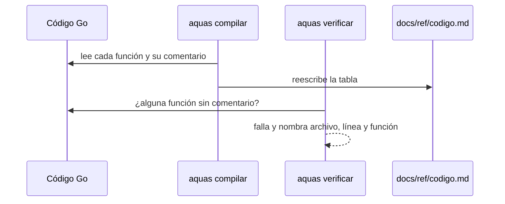

# Código

Índice de cada función del harness, con lo que dice su comentario. Lo genera `aquas compilar` desde el código en `cmd/` e `internal/`.

## En una frase

Quien quiere saber qué hay en el repo lo lee aquí, sin abrir el código.

## Para qué existe

**El problema.** Para saber qué hace una pieza había que abrir el archivo y leer [Go](../glosario.md#go). Un tercio de las funciones no tenía comentario.

**La solución.** El [gate](../glosario.md#gate) falla si una función no lleva comentario y nombra archivo y línea. Este índice se rehace desde el código; si se desfasa, el gate también falla.

## Analogía

Piensa en el **índice de un manual de taller**.

- Cada pieza aparece con su ubicación y una línea de para qué sirve.
- Una pieza sin descripción no entra al manual.

Límite de la analogía: aquí el índice lo escribe un programa a partir del comentario de cada función.

## Diagrama



## Ejemplo de punta a punta

<a id="EJ-REF-codigo"></a>

1. Al activar el gate, `aquas verificar` nombró 69 funciones sin comentario, por ejemplo `internal/wiki/hijos.go:43: función celda sin comentario`.
2. Cada una recibió una línea que dice qué hace.
3. `aquas compilar` llenó la tabla de abajo y el gate volvió a pasar.

## Paso a paso

1. Recorrer los `.go` de `cmd/` e `internal/`, sin los de prueba.
2. Tomar cada función y método con la primera línea de su comentario.
3. Avisar cada función sin comentario.
4. Escribir la tabla, ordenada por archivo y línea.

## Cómo se usa

Busca el archivo o la función; la última columna dice qué hace.

<!-- GENERADO por aquas desde trabajo/: no editar a mano; `aquas compilar` lo rehace. -->

| Archivo | Función | Qué hace |
|---|---|---|
| [cmd/aquas/main.go](../../cmd/aquas/main.go) | `main` | main despacha el subcomando de aquas (compilar, verificar, backlog, hooks…) y sale con su código. |
| [cmd/aquas/main.go](../../cmd/aquas/main.go) | `hook` | hook: exit 0 = nada que reportar; exit 2 = stderr se muestra a Claude. |
| [cmd/aquas/main.go](../../cmd/aquas/main.go) | `compilarSettings` | compilarSettings regenera .claude/settings.json; sin entorno declarado no inventa uno. |
| [cmd/aquas/main.go](../../cmd/aquas/main.go) | `reportar` | reportar imprime qué derivados escribió la compilación, o que todo estaba al día. |
| [cmd/aquas/main.go](../../cmd/aquas/main.go) | `listar` | listar imprime en stderr un título y cada problema en su viñeta. |
| [cmd/aquas/main.go](../../cmd/aquas/main.go) | `lista` | lista une los textos con comas, o «—» si no hay ninguno. |
| [cmd/aquas/main.go](../../cmd/aquas/main.go) | `fallar` | fallar imprime el error en stderr y termina con el código dado. |
| [cmd/aquas/main.go](../../cmd/aquas/main.go) | `memoriaCLI` | memoriaCLI: `ver` imprime la memoria; `fijar campo=valor…` la actualiza y la sella. |
| [cmd/aquas/main.go](../../cmd/aquas/main.go) | `memoriaArchivada` | memoriaArchivada: CERRADO exige que la memoria que apunta al slice ya esté archivada (E001/F002/S009). |
| [cmd/aquas/main.go](../../cmd/aquas/main.go) | `focoEnBacklog` | focoEnBacklog: la memoria solo fija el slice que el backlog tiene en curso (S003). |
| [cmd/aquas/main.go](../../cmd/aquas/main.go) | `backlogCLI` | backlogCLI: nuevo \\| ver [id] \\| prioridad \\| estado \\| siguiente \\| pruebas \\| rojo \\| verde. |
| [cmd/aquas/main.go](../../cmd/aquas/main.go) | `turnoCLI` | turnoCLI: auditoría de turnos (E001/F002/S001). Lee el JSON del hook por stdin. No imprime nada |
| [cmd/aquas/main.go](../../cmd/aquas/main.go) | `defectoCLI` | defectoCLI: nuevo \\| ocurre \\| ver (E001/F004/S001). |
| [cmd/aquas/main.go](../../cmd/aquas/main.go) | `versionBinario` | versionBinario: versión del módulo con que se compiló el binario (= versión del gobierno embebido). |
| [internal/backlog/alcance.go](../../internal/backlog/alcance.go) | `limpia` | limpia normaliza una ruta: barras «/», sin «./» inicial ni segmentos redundantes. |
| [internal/backlog/alcance.go](../../internal/backlog/alcance.go) | `Alcance` | Alcance declara (reemplaza) las rutas del slice. |
| [internal/backlog/alcance.go](../../internal/backlog/alcance.go) | `Ampliar` | Ampliar agrega una ruta al alcance; el motivo es obligatorio y de una línea. |
| [internal/backlog/alcance.go](../../internal/backlog/alcance.go) | `cubre` | cubre: «dir/**» cubre todo lo de dentro; si no, patrón de path.Match o ruta exacta. |
| [internal/backlog/alcance.go](../../internal/backlog/alcance.go) | `FueraDeAlcance` | FueraDeAlcance: "" si rel (relativa a la raíz) se puede tocar; si no, el motivo y cómo seguir. |
| [internal/backlog/arreglo.go](../../internal/backlog/arreglo.go) | `idArreglo` | idArreglo: ID del n-ésimo arreglo (1, 2…) de padre: padre/X01. |
| [internal/backlog/arreglo.go](../../internal/backlog/arreglo.go) | `dirDe` | dirDe: carpeta de trabajo/ donde vive la ficha, según esté archivada o no. |
| [internal/backlog/arreglo.go](../../internal/backlog/arreglo.go) | `Arreglar` | Arreglar anota un arreglo en la ficha de su slice o feature, abierta o archivada. |
| [internal/backlog/arreglo.go](../../internal/backlog/arreglo.go) | `problemasArreglos` | problemasArreglos: chequeo del gate: IDs en secuencia bajo su ficha, con título y motivo. |
| [internal/backlog/backlog.go](../../internal/backlog/backlog.go) | `terminal` | terminal: el estado ya no cambia (CERRADO o CANCELADO). |
| [internal/backlog/backlog.go](../../internal/backlog/backlog.go) | `esta` | esta: x figura en la lista. |
| [internal/backlog/backlog.go](../../internal/backlog/backlog.go) | `tipoYPadre` | tipoYPadre deriva del id: E001 → iniciativa; E001/F002 → feature de E001; E001/F002/S002 → slice. |
| [internal/backlog/backlog.go](../../internal/backlog/backlog.go) | `nombre` | nombre: archivo JSON de una ficha, con «/» del ID cambiadas por «-». |
| [internal/backlog/backlog.go](../../internal/backlog/backlog.go) | `todas` | todas lee activo y archivo. Una ficha ilegible es error: Validar la detalla. |
| [internal/backlog/backlog.go](../../internal/backlog/backlog.go) | `Todas` | Todas: las fichas de activo y archivo, ordenadas por id. Para quien solo lee (wiki, E001/F002/S010). |
| [internal/backlog/backlog.go](../../internal/backlog/backlog.go) | `leer` | leer carga una ficha desde su archivo JSON. |
| [internal/backlog/backlog.go](../../internal/backlog/backlog.go) | `escribir` | escribir guarda la ficha como JSON en trabajo/<dir>/, con listas vacías en vez de null. |
| [internal/backlog/backlog.go](../../internal/backlog/backlog.go) | `Nuevo` | Nuevo crea una ficha desde campos id=… titulo=… prioridad=… motivo=… [bloqueado_por=A,B]. |
| [internal/backlog/backlog.go](../../internal/backlog/backlog.go) | `Ver` | Ver busca la ficha en activo y luego en archivo. |
| [internal/backlog/backlog.go](../../internal/backlog/backlog.go) | `activa` | activa: la ficha a cambiar; una archivada no cambia. |
| [internal/backlog/backlog.go](../../internal/backlog/backlog.go) | `Prioridad` | Prioridad cambia la prioridad; el motivo es obligatorio. |
| [internal/backlog/backlog.go](../../internal/backlog/backlog.go) | `Estado` | Estado cambia el estado. CERRADO o CANCELADO mueve la ficha al archivo. |
| [internal/backlog/backlog.go](../../internal/backlog/backlog.go) | `ordenar` | orden de `siguiente`: en curso → desbloqueado → prioridad → secuencia → id. |
| [internal/backlog/backlog.go](../../internal/backlog/backlog.go) | `Activas` | Activas: slices en el orden de `siguiente`; después iniciativas y features por secuencia. |
| [internal/backlog/backlog.go](../../internal/backlog/backlog.go) | `Siguiente` | Siguiente: el primer slice del orden fijo que esté en curso o desbloqueado. |
| [internal/backlog/backlog.go](../../internal/backlog/backlog.go) | `sinDefinir` | sinDefinir (E001/F002/S008, regla del humano 2026-10-21): iniciativa o feature activa sin hijos |
| [internal/backlog/backlog.go](../../internal/backlog/backlog.go) | `Definir` | Definir: qué hacer con lo que `siguiente` saca sin definir; "" para un slice. |
| [internal/backlog/backlog.go](../../internal/backlog/backlog.go) | `libre` | libre: no está BLOQUEADO y cada bloqueador ya terminó (archivado: CERRADO o CANCELADO). |
| [internal/backlog/backlog.go](../../internal/backlog/backlog.go) | `Validar` | Validar: problemas de las fichas en disco (gate). Sin carpeta trabajo/ no hay problemas. |
| [internal/backlog/backlog.go](../../internal/backlog/backlog.go) | `Texto` | Texto: una línea por ficha, para el agente. |
| [internal/backlog/documentar.go](../../internal/backlog/documentar.go) | `Documentar` | Documentar reescribe valida, rojo cuando y verde cuando de pruebas ya registradas. |
| [internal/backlog/rojo.go](../../internal/backlog/rojo.go) | `problemaPrueba` | problemaPrueba: por qué una prueba de la ficha está mal escrita ("" si está bien). |
| [internal/backlog/rojo.go](../../internal/backlog/rojo.go) | `listaPruebas` | listaPruebas convierte "./paquete:TestNombre=intención" en pruebas válidas, sin repetidas. |
| [internal/backlog/rojo.go](../../internal/backlog/rojo.go) | `corriendo` | corriendo: la ficha está EN_CURSO o VERIFICANDO. |
| [internal/backlog/rojo.go](../../internal/backlog/rojo.go) | `sliceEnCurso` | sliceEnCurso: el primer slice EN_CURSO o VERIFICANDO entre las activas, por id. |
| [internal/backlog/rojo.go](../../internal/backlog/rojo.go) | `SliceEnCurso` | SliceEnCurso: el único slice EN_CURSO o VERIFICANDO, si hay. |
| [internal/backlog/rojo.go](../../internal/backlog/rojo.go) | `Pruebas` | Pruebas fija las pruebas de la ficha; cambiarlas borra rojo y verde. |
| [internal/backlog/rojo.go](../../internal/backlog/rojo.go) | `corrible` | corrible: ficha activa con pruebas; un slice además debe estar en curso. |
| [internal/backlog/rojo.go](../../internal/backlog/rojo.go) | `Rojo` | Rojo corre cada prueba sola con `go test -json`; exige que cada una falle por sí misma. |
| [internal/backlog/rojo.go](../../internal/backlog/rojo.go) | `Verde` | Verde corre las pruebas juntas tras el rojo; exige que todas pasen. |
| [internal/backlog/rojo.go](../../internal/backlog/rojo.go) | `resultado.motivo` | motivo: texto que explica el resultado de una prueba; siPasa se usa cuando pasó. |
| [internal/backlog/rojo.go](../../internal/backlog/rojo.go) | `correr` | correr: `go test -json -count=1 -run ^(A\\|B)$ ./paquete` por paquete; resultado por prueba. |
| [internal/backlog/rojo.go](../../internal/backlog/rojo.go) | `motivoDelFallo` | motivoDelFallo: la última línea «archivo.go:N: …» (la que hizo fallar); si no hay, la primera. |
| [internal/backlog/rojo.go](../../internal/backlog/rojo.go) | `head` | head: commit actual del repo, o "" fuera de Git. |
| [internal/backlog/rojo.go](../../internal/backlog/rojo.go) | `cierre` | cierre: CERRADO exige pruebas, rojo y verde. |
| [internal/backlog/rojo.go](../../internal/backlog/rojo.go) | `problemasRojoVerde` | problemasRojoVerde: chequeos del gate sobre pruebas, rojo y verde de una ficha. |
| [internal/backlog/rojo.go](../../internal/backlog/rojo.go) | `Detalle` | Detalle: pruebas con su intención, y rojo y verde, para `ver <id>`, `pruebas`, `rojo` y `verde`. |
| [internal/backlog/sello.go](../../internal/backlog/sello.go) | `excluida` | excluida: la ruta cae bajo una carpeta que el sello no revisa. |
| [internal/backlog/sello.go](../../internal/backlog/sello.go) | `gitLineas` | gitLineas corre git en la raíz y devuelve su salida línea por línea. |
| [internal/backlog/sello.go](../../internal/backlog/sello.go) | `pagina` | pagina: ruta de la página wiki de una ficha según su nivel en el ID. |
| [internal/backlog/sello.go](../../internal/backlog/sello.go) | `arbol` | arbol: padre, abuelo, dependientes abiertos y páginas. |
| [internal/backlog/sello.go](../../internal/backlog/sello.go) | `moduloGo` | moduloGo: ruta del módulo declarada en go.mod, o vacío si no hay. |
| [internal/backlog/sello.go](../../internal/backlog/sello.go) | `lineaCon` | lineaCon: primera línea de c que contiene s, recortada; sirve de evidencia en el sello. |
| [internal/backlog/sello.go](../../internal/backlog/sello.go) | `derivados` | derivados: salidas del compilador según su archivo de sellos, más ese archivo (S014). Ya los vigila |
| [internal/backlog/sello.go](../../internal/backlog/sello.go) | `archivos` | archivos: quién nombra o importa lo tocado desde el HEAD del rojo. |
| [internal/backlog/sello.go](../../internal/backlog/sello.go) | `Sello` | Sello arma la lista del slice y le pega las marcas guardadas en su ficha. |
| [internal/backlog/sello.go](../../internal/backlog/sello.go) | `sello` | sello arma la lista de piezas que el cambio de un slice obliga a revisar. |
| [internal/backlog/sello.go](../../internal/backlog/sello.go) | `selloCompleto` | selloCompleto: CERRADO exige marca en cada ítem, haya o no commit base (S013). |
| [internal/backlog/sello.go](../../internal/backlog/sello.go) | `Marcar` | Marcar guarda la revisión de un ítem del sello de un slice activo. |
| [internal/backlog/sello.go](../../internal/backlog/sello.go) | `TextoSello` | TextoSello: una línea por ítem; [ ] pendiente, [x] marcado con su marca y motivo. |
| [internal/biblioteca/biblioteca.go](../../internal/biblioteca/biblioteca.go) | `Leer` | Leer devuelve el texto para el agente y cuántos caracteres devolvió de cuántos tiene |
| [internal/compilador/compilador.go](../../internal/compilador/compilador.go) | `marca` | marca: comentario «GENERADO» que encabeza cada derivado y nombra su config. |
| [internal/compilador/compilador.go](../../internal/compilador/compilador.go) | `Planificar` | Planificar lee la config y calcula todas las salidas sin tocar el disco. |
| [internal/compilador/compilador.go](../../internal/compilador/compilador.go) | `compilarAgente` | compilarAgente arma el .md de un agente desde su config y sus canónicos, y valida campos y tope. |
| [internal/compilador/compilador.go](../../internal/compilador/compilador.go) | `Compilar` | Compilar escribe las salidas que cambiaron y actualiza el sello. |
| [internal/compilador/compilador.go](../../internal/compilador/compilador.go) | `Verificar` | Verificar es el gate: devuelve un problema por cada salida o sello desfasado. |
| [internal/compilador/compilador.go](../../internal/compilador/compilador.go) | `EsGobernado` | EsGobernado indica si una ruta relativa (con /) afecta la compilación. |
| [internal/compilador/compilador.go](../../internal/compilador/compilador.go) | `EsSalida` | EsSalida indica si una ruta relativa es un archivo compilado. |
| [internal/compilador/compilador.go](../../internal/compilador/compilador.go) | `sellar` | sellar calcula la huella SHA-256 de cada salida y de sus fuentes. |
| [internal/compilador/compilador.go](../../internal/compilador/compilador.go) | `diferencias` | diferencias: rutas cuya huella cambió o que aparecen o desaparecen entre dos sellos. |
| [internal/compilador/compilador.go](../../internal/compilador/compilador.go) | `leerCanonicos` | leerCanonicos lee las fuentes pedidas; rechaza las que no están bajo gobierno/canonico/. |
| [internal/compilador/compilador.go](../../internal/compilador/compilador.go) | `leerJSON` | leerJSON lee y decodifica un JSON relativo a la raíz. |
| [internal/compilador/compilador.go](../../internal/compilador/compilador.go) | `leerSello` | leerSello carga gobierno/config/sellos.json. |
| [internal/compilador/compilador.go](../../internal/compilador/compilador.go) | `codificarSello` | codificarSello serializa el sello como JSON indentado con salto final. |
| [internal/compilador/compilador.go](../../internal/compilador/compilador.go) | `citarYAML` | citarYAML produce un escalar YAML entre comillas dobles (JSON es YAML válido). |
| [internal/compilador/compilador.go](../../internal/compilador/compilador.go) | `normalizar` | normalizar cambia CRLF por LF para que la huella no dependa del sistema. |
| [internal/compilador/compilador.go](../../internal/compilador/compilador.go) | `huella` | huella: SHA-256 en hexadecimal. |
| [internal/compilador/compilador.go](../../internal/compilador/compilador.go) | `escribir` | escribir guarda datos en la ruta relativa, creando sus carpetas. |
| [internal/defecto/defecto.go](../../internal/defecto/defecto.go) | `Nuevo` | Nuevo crea el siguiente D000NNN. Todos los campos son obligatorios; la firma es kebab-case y única. |
| [internal/defecto/defecto.go](../../internal/defecto/defecto.go) | `Ocurre` | Ocurre suma un turno T000NNN al defecto; el mismo turno no se cuenta dos veces. |
| [internal/defecto/defecto.go](../../internal/defecto/defecto.go) | `Leer` | Leer devuelve todos los defectos, ordenados por ID. Sin carpeta = registro vacío. |
| [internal/defecto/defecto.go](../../internal/defecto/defecto.go) | `leerUno` | leerUno carga el defecto con ese ID; valida el formato D000001. |
| [internal/defecto/defecto.go](../../internal/defecto/defecto.go) | `escribir` | escribir guarda el defecto como JSON en su carpeta. |
| [internal/defecto/defecto.go](../../internal/defecto/defecto.go) | `Texto` | Texto: una línea por defecto para `aquas defecto ver`. |
| [internal/encargo/encargo.go](../../internal/encargo/encargo.go) | `Revisar` | Revisar decide el hook SubagentStop: "" deja cerrar; si no, qué falta en el cierre. |
| [internal/encargo/encargo.go](../../internal/encargo/encargo.go) | `falla` | falla: mensaje de cierre inválido que pide reescribirlo según el canónico. |
| [internal/entorno/entorno.go](../../internal/entorno/entorno.go) | `Leer` | Leer carga el entorno declarado. |
| [internal/entorno/entorno.go](../../internal/entorno/entorno.go) | `Validar` | Validar compara el entorno declarado con el real; "" = coincide, si no, el motivo del bloqueo. |
| [internal/entorno/entorno.go](../../internal/entorno/entorno.go) | `Iniciar` | Iniciar detecta SO y raíz (git) y escribe entorno.local.json; exige correr desde la raíz. |
| [internal/entorno/entorno.go](../../internal/entorno/entorno.go) | `mismaRuta` | mismaRuta compara dos rutas limpias; en Windows sin distinguir mayúsculas. |
| [internal/entorno/entorno.go](../../internal/entorno/entorno.go) | `generarSettings` | generarSettings arma settings.json para un SO desde la plantilla canónica. Bytes estables. |
| [internal/entorno/entorno.go](../../internal/entorno/entorno.go) | `Settings` | Settings genera el settings.json esperado para el entorno declarado. |
| [internal/entorno/entorno.go](../../internal/entorno/entorno.go) | `CompilarSettings` | CompilarSettings escribe .claude/settings.json; devuelve true si cambió. |
| [internal/entorno/entorno.go](../../internal/entorno/entorno.go) | `VerificarSettings` | VerificarSettings: "" si .claude/settings.json coincide con lo regenerado. |
| [internal/guardia/guardia.go](../../internal/guardia/guardia.go) | `Revisar` | Revisar recibe el JSON del hook PreToolUse; "" = permitido, si no, el motivo del bloqueo. |
| [internal/guardia/guardia.go](../../internal/guardia/guardia.go) | `RevisarArchivo` | RevisarArchivo valida una ruta de Write/Edit (absoluta o relativa a la raíz). |
| [internal/guardia/guardia.go](../../internal/guardia/guardia.go) | `protegida` | protegida: carpetas que solo escribe `aquas` (E001/F005, E001/F002). Las rutas salen de los |
| [internal/guardia/guardia.go](../../internal/guardia/guardia.go) | `resolver` | resolver lleva p a ruta absoluta del sistema. Entiende ~, /c/… (Git Bash) y relativas a base. |
| [internal/guardia/guardia.go](../../internal/guardia/guardia.go) | `dentro` | dentro: la ruta absoluta queda dentro de la raíz del repo. |
| [internal/guardia/guardia.go](../../internal/guardia/guardia.go) | `sinHeredocs` | sinHeredocs quita el cuerpo de cada heredoc: su contenido es texto, no comandos. |
| [internal/guardia/guardia.go](../../internal/guardia/guardia.go) | `lexear` | lexear parte un comando de shell en palabras, respetando comillas y operadores. |
| [internal/guardia/guardia.go](../../internal/guardia/guardia.go) | `variable` | variable reconoce $NOMBRE, ${NOMBRE}, $(…), `…` y %NOMBRE%; devuelve nombre ("?" = desconocida) y largo. |
| [internal/guardia/guardia.go](../../internal/guardia/guardia.go) | `esNombre` | esNombre: el carácter vale en un nombre de variable de shell. |
| [internal/guardia/guardia.go](../../internal/guardia/guardia.go) | `RevisarBash` | RevisarBash analiza un comando de Bash; cwd es el directorio donde arranca. |
| [internal/guardia/guardia.go](../../internal/guardia/guardia.go) | `segmento` | segmento revisa un comando simple: sigue cd y variables y devuelve el primer destino fuera del repo. |
| [internal/guardia/guardia.go](../../internal/guardia/guardia.go) | `posicionales` | posicionales: argumentos que no son opciones (los que empiezan con «-», salvo «-» solo). |
| [internal/guardia/guardia.go](../../internal/guardia/guardia.go) | `revisarDestino` | revisarDestino: motivo de bloqueo si la ruta no se resuelve o cae fuera del repo; vacío si vale. |
| [internal/guardia/guardia.go](../../internal/guardia/guardia.go) | `expandir` | expandir sustituye variables conocidas; HOME/USERPROFILE/TEMP/TMP salen del entorno real. |
| [internal/guardia/guardia.go](../../internal/guardia/guardia.go) | `legible` | legible muestra las variables internas como $NOMBRE en los mensajes. |
| [internal/guardia/permitidos.go](../../internal/guardia/permitidos.go) | `cargar` | cargar devuelve las carpetas permitidas ya resueltas y los problemas de la config. |
| [internal/guardia/permitidos.go](../../internal/guardia/permitidos.go) | `expandirConfig` | expandirConfig sustituye variables de entorno ${X} de la config; ok falso si falta alguna. |
| [internal/guardia/permitidos.go](../../internal/guardia/permitidos.go) | `permitido` | permitido: abs cae dentro de alguna carpeta de la lista. |
| [internal/guardia/permitidos.go](../../internal/guardia/permitidos.go) | `ValidarConfig` | ValidarConfig es el gate de la lista de permitidos (lo llama `aquas verificar`). |
| [internal/guardia/permitidos.go](../../internal/guardia/permitidos.go) | `itoa` | itoa convierte un entero a texto. |
| [internal/hijo/build.go](../../internal/hijo/build.go) | `Build` | Build arma el CLAUDE.md del hijo: central sellada + huecos locales. |
| [internal/hijo/build.go](../../internal/hijo/build.go) | `verificarSello` | verificarSello compara cada archivo de la central con su hash del lock. |
| [internal/hijo/build.go](../../internal/hijo/build.go) | `leerHuecos` | leerHuecos devuelve nombre → contenido de cada <nombre>.md local. |
| [internal/hijo/hijo.go](../../internal/hijo/hijo.go) | `Install` | Install copia la central sellada en dest/.aquas/central y escribe dest/.aquas/lock.json. |
| [internal/hijo/hijo.go](../../internal/hijo/hijo.go) | `copiarCentral` | copiarCentral escribe la central como solo lectura y su lock con versión y hashes. |
| [internal/hijo/report.go](../../internal/hijo/report.go) | `Report` | Report arma el borrador de issue para la central: firma del hijo, versión |
| [internal/hijo/update.go](../../internal/hijo/update.go) | `Update` | Update reemplaza la central sellada por otra versión y reescribe el lock. |
| [internal/hijo/update.go](../../internal/hijo/update.go) | `alterados` | alterados lista los archivos sellados que ya no coinciden con el lock. |
| [internal/memoria/archivar.go](../../internal/memoria/archivar.go) | `RutaArchivo` | RutaArchivo: registro/memoria/<E>-<F>-<S>.json; "" si el foco no llega a slice. |
| [internal/memoria/archivar.go](../../internal/memoria/archivar.go) | `Archivar` | Archivar copia los bytes sellados de la memoria a registro/memoria/<E>-<F>-<S>.json y deja |
| [internal/memoria/archivar.go](../../internal/memoria/archivar.go) | `LeerArchivo` | LeerArchivo carga una memoria archivada y comprueba su sello. |
| [internal/memoria/memoria.go](../../internal/memoria/memoria.go) | `Fijar` | Fijar aplica pares campo=valor sobre la memoria actual y la sella. |
| [internal/memoria/memoria.go](../../internal/memoria/memoria.go) | `FijarCon` | FijarCon: como Fijar, pero validar (si no es nil) revisa el foco resultante antes de escribir. |
| [internal/memoria/memoria.go](../../internal/memoria/memoria.go) | `Leer` | Leer carga la memoria y comprueba su sello. |
| [internal/memoria/memoria.go](../../internal/memoria/memoria.go) | `decodificar` | decodificar: campos fijos y sello sobre los bytes tal como se escribieron. |
| [internal/memoria/memoria.go](../../internal/memoria/memoria.go) | `Rutas` | Rutas: páginas wiki de la iniciativa, feature y slice del foco, más el backlog. |
| [internal/memoria/memoria.go](../../internal/memoria/memoria.go) | `Texto` | Texto: lo que imprime `aquas memoria ver` (y, en S002, el hook de inicio de sesión). |
| [internal/memoria/memoria.go](../../internal/memoria/memoria.go) | `guion` | guion devuelve «—» si el texto está vacío. |
| [internal/memoria/memoria.go](../../internal/memoria/memoria.go) | `lista` | lista escribe un título y sus viñetas, o «—» si no hay ninguna. |
| [internal/memoria/memoria.go](../../internal/memoria/memoria.go) | `codificar` | codificar serializa la memoria como JSON indentado con salto final. |
| [internal/memoria/memoria.go](../../internal/memoria/memoria.go) | `huella` | huella: SHA-256 de la memoria codificada; detecta cambios. |
| [internal/memoria/memoria.go](../../internal/memoria/memoria.go) | `escribir` | escribir: archivo temporal + rename, para no dejar una memoria a medias. |
| [internal/memoria/memoria.go](../../internal/memoria/memoria.go) | `HuellaGit` | HuellaGit resume el estado del repo: HEAD + cada ruta de `git status` con el contenido de su |
| [internal/memoria/memoria.go](../../internal/memoria/memoria.go) | `mismaCarpeta` | mismaCarpeta: las dos rutas apuntan a la misma carpeta en disco. |
| [internal/memoria/memoria.go](../../internal/memoria/memoria.go) | `Cierre` | Cierre decide el hook Stop: "" deja cerrar el turno; si no, el motivo para seguir. |
| [internal/memoria/memoria.go](../../internal/memoria/memoria.go) | `Inicio` | Inicio: texto que el hook SessionStart agrega al contexto. Nunca bloquea. |
| [internal/propuesta/propuesta.go](../../internal/propuesta/propuesta.go) | `marca` | marca: texto de la propuesta si la línea empieza con PROPUESTA: (admite viñeta, título, cita o negrita). |
| [internal/propuesta/propuesta.go](../../internal/propuesta/propuesta.go) | `diagrama` | diagrama: el texto trae algún trazo de diagrama (flechas o cajas). |
| [internal/propuesta/propuesta.go](../../internal/propuesta/propuesta.go) | `cercaDe` | cercaDe: el carácter y el largo de una cerca de bloque (``` o ~~~), o largo 0 si no es cerca. |
| [internal/propuesta/propuesta.go](../../internal/propuesta/propuesta.go) | `Revisar` | Revisar devuelve "" si pasa; si no, el motivo del freno con las propuestas sin diagrama. |
| [internal/turno/turno.go](../../internal/turno/turno.go) | `siguiente` | siguiente: el mayor número existente + 1; un hueco no se rellena (los ID no se reutilizan). |
| [internal/turno/turno.go](../../internal/turno/turno.go) | `leerEstado` | leerEstado carga los turnos abiertos; vacío si el archivo no existe. |
| [internal/turno/turno.go](../../internal/turno/turno.go) | `escribir` | escribir guarda bytes en la ruta relativa, creando sus carpetas. |
| [internal/turno/turno.go](../../internal/turno/turno.go) | `cerca` | cerca: bloque de código cuya cerca es más larga que cualquier racha de backticks del texto, |
| [internal/turno/turno.go](../../internal/turno/turno.go) | `render` | render arma el Markdown del registro de un turno: literal del humano y respuesta. |
| [internal/turno/turno.go](../../internal/turno/turno.go) | `Abrir` | Abrir crea el turno siguiente con el literal y lo deja como el abierto de la sesión. |
| [internal/turno/turno.go](../../internal/turno/turno.go) | `Cerrar` | Cerrar guarda la respuesta en el último turno de la sesión; sin turno abierto, no escribe. |
| [internal/vueltas/vueltas.go](../../internal/vueltas/vueltas.go) | `motivos` | motivos de una salida para un tipo; vacío = sin señal propia de fallo. |
| [internal/vueltas/vueltas.go](../../internal/vueltas/vueltas.go) | `regla` | regla: el mensaje del gate sin lo que cambia de página a página (citas, paréntesis, números). |
| [internal/vueltas/vueltas.go](../../internal/vueltas/vueltas.go) | `Contar` | Contar lee un historial .jsonl y agrupa por tipo ("go test", "verificar"). |
| [internal/vueltas/vueltas.go](../../internal/vueltas/vueltas.go) | `texto` | texto: el contenido de un resultado viene como cadena o como lista de bloques {type,text}. |
| [internal/vueltas/vueltas.go](../../internal/vueltas/vueltas.go) | `Carpeta` | Carpeta del historial de Claude Code para este repo: ~/.claude/projects/<raíz con :\/ y espacios → ->. |
| [internal/vueltas/vueltas.go](../../internal/vueltas/vueltas.go) | `Medir` | Medir imprime una línea por historial y el total. Sin archivos: todos los .jsonl de Carpeta. |
| [internal/vueltas/vueltas.go](../../internal/vueltas/vueltas.go) | `Linea` | Linea: «nombre · go test 92/47 (TestA 3, compilación 2) · verificar 102/37 (wiki 20)»; motivos de más a menos. |
| [internal/wiki/codigo.go](../../internal/wiki/codigo.go) | `funcionesGo` | funcionesGo recorre cmd/ e internal/ (sin _test.go) y devuelve sus funciones en orden de archivo y línea. |
| [internal/wiki/codigo.go](../../internal/wiki/codigo.go) | `revisarCodigo` | revisarCodigo: avisos por cada función sin comentario. |
| [internal/wiki/codigo.go](../../internal/wiki/codigo.go) | `indiceCodigo` | indiceCodigo: tabla archivo → función → primera línea de su comentario. |
| [internal/wiki/comandos.go](../../internal/wiki/comandos.go) | `RevisarComandos` | RevisarComandos: todo `aquas X [Y]` citado entre comillas invertidas en docs/ y en |
| [internal/wiki/contrato.go](../../internal/wiki/contrato.go) | `seccionesDe` | seccionesDe: orden fijo de secciones según el nivel de la página. |
| [internal/wiki/contrato.go](../../internal/wiki/contrato.go) | `migasEsperadas` | migasEsperadas: migas «Inicio › E001 › F001», cada nivel con enlace relativo a la página. |
| [internal/wiki/contrato.go](../../internal/wiki/contrato.go) | `revisarMigas` | revisarMigas: aviso si las migas de pan no coinciden con la ruta de la página. |
| [internal/wiki/contrato.go](../../internal/wiki/contrato.go) | `revisarTrazabilidad` | revisarTrazabilidad cruza las pruebas nombradas en los slices con las func Test del repo. |
| [internal/wiki/contrato.go](../../internal/wiki/contrato.go) | `pruebasDelRepo` | pruebasDelRepo: nombre de cada func Test → archivo; salta carpetas ocultas (.git, .tmp). |
| [internal/wiki/enlazar.go](../../internal/wiki/enlazar.go) | `Enlazar` | Enlazar pone el enlace al glosario en la primera aparición en prosa de cada término (E000/F004/S003). |
| [internal/wiki/enlazar.go](../../internal/wiki/enlazar.go) | `envolver` | envolver enlaza la primera aparición en prosa del término en el archivo. |
| [internal/wiki/glosario.go](../../internal/wiki/glosario.go) | `terminos` | terminos extrae las entradas del glosario con sus formas (nombre + variantes). |
| [internal/wiki/glosario.go](../../internal/wiki/glosario.go) | `revisarGlosario` | revisarGlosario: cada término del glosario lleva definición y ejemplo. |
| [internal/wiki/glosario.go](../../internal/wiki/glosario.go) | `revisarTerminos` | revisarTerminos exige que la primera aparición en prosa de cada término enlace a su entrada. |
| [internal/wiki/glosario.go](../../internal/wiki/glosario.go) | `faltantes` | faltantes: la detección que comparten el gate (revisarTerminos) y el arreglo (Enlazar). |
| [internal/wiki/glosario.go](../../internal/wiki/glosario.go) | `relDesde` | relDesde da la ruta relativa de destino vista desde la carpeta de la página. |
| [internal/wiki/hijos.go](../../internal/wiki/hijos.go) | `paginaDe` | paginaDe: la página de la wiki que corresponde a un id de ficha. |
| [internal/wiki/hijos.go](../../internal/wiki/hijos.go) | `celda` | celda escapa saltos de línea y «\\|» para una celda de tabla Markdown. |
| [internal/wiki/hijos.go](../../internal/wiki/hijos.go) | `existe` | existe: la ruta relativa existe en disco. |
| [internal/wiki/hijos.go](../../internal/wiki/hijos.go) | `tablaHijos` | tablaHijos: una fila por hijo directo; enlace solo si su página existe. |
| [internal/wiki/hijos.go](../../internal/wiki/hijos.go) | `fecha` | fecha: día AAAA-MM-DD de un registro, o «—» si no hay. |
| [internal/wiki/hijos.go](../../internal/wiki/hijos.go) | `oGuion` | oGuion: el texto como celda, o «—» si está vacío (pruebas anteriores a E001/F008/S001). |
| [internal/wiki/hijos.go](../../internal/wiki/hijos.go) | `tablaPruebas` | tablaPruebas: las pruebas del slice: qué validan, cuándo quedan en rojo y en verde, y si se vieron en rojo y en verde. |
| [internal/wiki/hijos.go](../../internal/wiki/hijos.go) | `esperados` | esperados: página existente → bloque que debe llevar. Vacío si no hay fichas. |
| [internal/wiki/hijos.go](../../internal/wiki/hijos.go) | `bloqueActual` | bloqueActual: posición del bloque en c; ini < 0 = no hay; fin < 0 = sin cierre. |
| [internal/wiki/hijos.go](../../internal/wiki/hijos.go) | `Generar` | Generar reescribe el bloque GENERADO de cada página desde las fichas; devuelve lo escrito. |
| [internal/wiki/hijos.go](../../internal/wiki/hijos.go) | `revisarHijos` | revisarHijos: bloque presente y al día, enlaces sin saltar niveles, ficha arrancada con página. |
| [internal/wiki/hijos.go](../../internal/wiki/hijos.go) | `tablaArreglos` | tablaArreglos: sección «Arreglos» de la ficha; vacía si no tiene. |
| [internal/wiki/legibilidad.go](../../internal/wiki/legibilidad.go) | `Silabas` | Silabas cuenta las sílabas de una palabra en español por núcleos vocálicos, |
| [internal/wiki/legibilidad.go](../../internal/wiki/legibilidad.go) | `esVocalLetra` | esVocalLetra: la runa es vocal castellana, con o sin tilde. |
| [internal/wiki/legibilidad.go](../../internal/wiki/legibilidad.go) | `hiato` | hiato: las dos vocales seguidas se cuentan como sílabas separadas. |
| [internal/wiki/legibilidad.go](../../internal/wiki/legibilidad.go) | `oraciones` | oraciones parte la prosa en oraciones de palabras. Línea vacía o ítem de lista |
| [internal/wiki/legibilidad.go](../../internal/wiki/legibilidad.go) | `Perspicuidad` | Perspicuidad calcula el índice Szigriszt-Pazos; 0 si no hay palabras. |
| [internal/wiki/legibilidad.go](../../internal/wiki/legibilidad.go) | `revisarLegibilidad` | revisarLegibilidad: avisos por oraciones largas o prosa difícil de leer. |
| [internal/wiki/legibilidad.go](../../internal/wiki/legibilidad.go) | `coma` | coma formatea un número con un decimal y coma decimal. |
| [internal/wiki/portadas.go](../../internal/wiki/portadas.go) | `faltanIniciativas` | faltanIniciativas: problemas del gate si alguna iniciativa no está enlazada en una portada. |
| [internal/wiki/portadas.go](../../internal/wiki/portadas.go) | `revisarPortadas` | revisarPortadas: lee las iniciativas del backlog y las dos portadas; solo exige las iniciativas que ya tienen página. |
| [internal/wiki/wiki.go](../../internal/wiki/wiki.go) | `Verificar` | Verificar devuelve los problemas de la wiki bajo raiz/docs; vacío = gate OK. |
| [internal/wiki/wiki.go](../../internal/wiki/wiki.go) | `relativa` | relativa: ruta de p respecto de la raíz, con barras «/». |
| [internal/wiki/wiki.go](../../internal/wiki/wiki.go) | `clasificar` | clasificar asigna nivel, padre e id de ejemplo según la ruta; nil = fuera del árbol. |
| [internal/wiki/wiki.go](../../internal/wiki/wiki.go) | `analizar` | analizar lee la página: secciones H2, diagramas, anclas (id HTML y títulos) y enlaces fuera de código. |
| [internal/wiki/wiki.go](../../internal/wiki/wiki.go) | `slug` | slug al estilo GitHub/VS Code: minúsculas, letras/dígitos/-/_ se conservan, espacio → guion. |
| [internal/wiki/wiki.go](../../internal/wiki/wiki.go) | `pagina.seccion` | seccion busca una sección de la página por su título; nil si no está. |
| [internal/wiki/wiki.go](../../internal/wiki/wiki.go) | `revisarSecciones` | revisarSecciones: faltan secciones fijas o están fuera de orden. |
| [internal/wiki/wiki.go](../../internal/wiki/wiki.go) | `revisarDiagramas` | revisarDiagramas: la sección Diagrama trae el Mermaid que pide su nivel. |
| [internal/wiki/wiki.go](../../internal/wiki/wiki.go) | `revisarEjemplo` | revisarEjemplo: el ejemplo lleva su ancla EJ- y encadena con el del padre. |
| [internal/wiki/wiki.go](../../internal/wiki/wiki.go) | `revisarNavegacion` | revisarNavegacion: hay ↑ Subir y un enlace Abajo a cada hija. |
| [internal/wiki/wiki.go](../../internal/wiki/wiki.go) | `revisarEnlaces` | revisarEnlaces: cada enlace interno apunta a un archivo y ancla que existen. |
| [internal/wiki/wiki.go](../../internal/wiki/wiki.go) | `revisarAlcance` | revisarAlcance: toda página del árbol debe alcanzarse desde docs/README.md siguiendo enlaces. |
| [internal/wiki/wiki.go](../../internal/wiki/wiki.go) | `resolver` | resolver convierte un destino relativo a la página en ruta relativa a la raíz + fragmento. |

<!-- /GENERADO -->

## Navegación

- ↑ Subir: [Inicio](../README.md)
