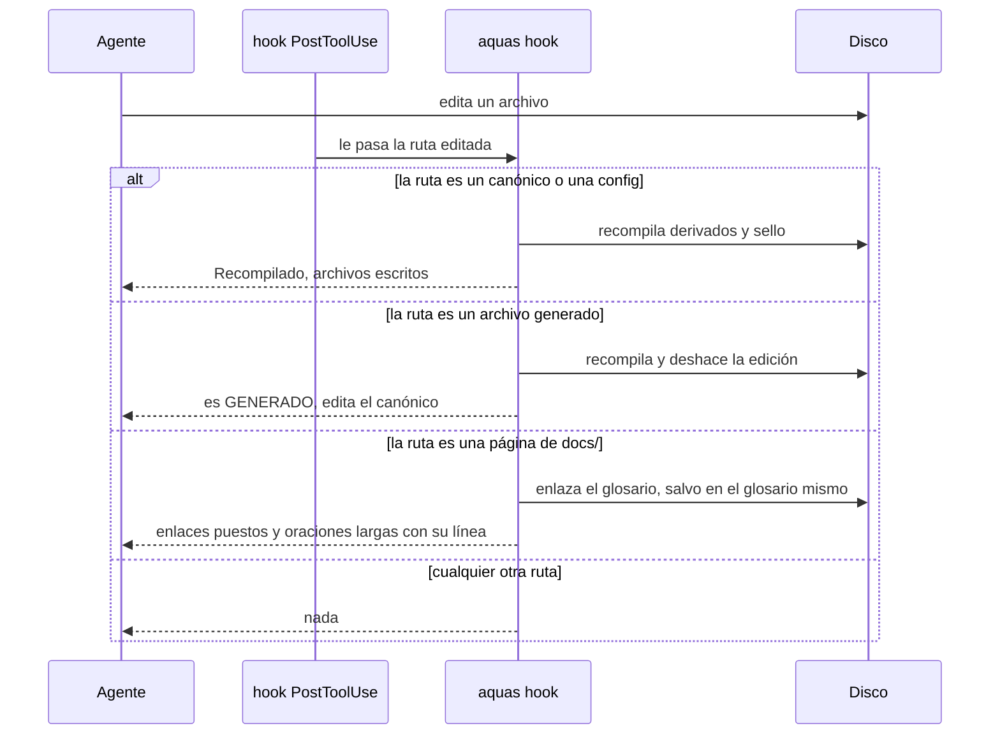

# Compilador

Referencia del programa que convierte los archivos [canónicos](../glosario.md#canónico) en archivos generados. Vive en `internal/compilador/` y se usa con `cmd/aquas/`.

## En una frase

El [compilador](../glosario.md#compilador) lee las reglas oficiales, arma los archivos que usa Claude Code y les pone un [sello](../glosario.md#sello).

## Para qué existe

**El problema.** Una misma regla puede servir a varios archivos. Si cada copia se edita a mano, tarde o temprano dicen cosas distintas.

**La solución.** La regla se escribe una sola vez, en un [canónico](../glosario.md#canónico). El compilador genera cada copia. Luego guarda la huella [SHA-256](../glosario.md#sha-256) de cada archivo para saber si alguien los tocó.

Qué genera hoy:

| Archivo derivado | Sale de | Tope |
|---|---|---|
| `CLAUDE.md` | `gobierno/canonico/constitucion.md` | 5.000 caracteres |
| `.claude/agents/orchestrator.md` | cuerpo del orquestador, reglas de vigencia y de comunicación entre agentes, y tres reglas de comunicación con el humano | 20.000 caracteres |

Tres órdenes:

| Orden | Qué hace |
|---|---|
| `aquas compilar` | Escribe los archivos que cambiaron y actualiza el sello |
| `aquas verificar` | No escribe nada. Avisa si algo está desfasado, pasa el tope o falla la wiki |
| `aquas hook` | Corre solo cuando Claude Code edita un archivo |

## Analogía

Piensa en una **imprenta**.

- El original es el canónico. Se corrige solo el original.
- La imprenta saca las copias: `CLAUDE.md` y los archivos de cada [agente](../glosario.md#agente).
- Cada copia lleva un sello de agua. Si alguien la retoca, el sello ya no cuadra.

Límite de la analogía: una imprenta no sabe si el texto es bueno. El compilador tampoco. Solo garantiza que la copia es fiel y no pasa del tope.

## Diagrama

Qué pasa cuando un agente edita un archivo.

## Ejemplo de punta a punta

**Situación.** El [orquestador](../glosario.md#orquestador) necesita una regla nueva: «serie por defecto».

1. Edita el canónico `gobierno/canonico/agentes/orquestador.md`.
2. El [hook](../glosario.md#hook) de Claude Code llama a `aquas hook` con esa ruta.
3. La ruta está en `gobierno/canonico/`, así que el compilador regenera `.claude/agents/orchestrator.md`.
4. El sello cambia en `gobierno/config/sellos.json`. Guarda la huella nueva del canónico y del archivo generado.
5. El agente recibe el aviso: «Recompilado · fuentes cambiadas».
6. Al hacer [commit](../glosario.md#commit), el [pre-commit](../glosario.md#pre-commit) corre `aquas verificar`. Todo cuadra y el commit entra.

**¿Y si edita a mano el archivo generado?** El compilador lo reescribe al instante. El aviso dice: «es GENERADO; tu edición se revirtió».

## Paso a paso

Así trabaja `aquas compilar`:

1. Lee `gobierno/config/documentos.json` y `gobierno/config/agentes.json`.
2. Para cada salida, junta sus canónicos en orden.
3. Le pone arriba la marca «GENERADO… NO EDITAR».
4. Si es un agente, le agrega su cabecera: nombre, descripción y modelo.
5. Escribe solo los archivos que cambiaron.
6. Calcula la huella de cada fuente y cada salida. Las guarda en el sello.

Así revisa `aquas verificar`:

1. Arma todo en memoria, sin escribir.
2. Compara cada archivo del disco con lo que debería ser.
3. Cuenta los caracteres de cada salida contra su tope.
4. Compara el sello guardado con el sello calculado.
5. Revisa la [wiki](../glosario.md#wiki). Si algo falla, termina con error y el commit no entra.

## Cómo se usa

- Después de editar un canónico a mano fuera de Claude Code: `go run ./cmd/aquas compilar`.
- Antes de guardar: `go build -o .tmp/aquas.exe ./cmd/aquas && ./.tmp/aquas.exe verificar`.
- Si sale «desfasado o editado a mano», ejecuta `compilar` y revisa el cambio.
- Si sale «excede presupuesto», recorta el canónico.
- Si sale «sello desfasado», ejecuta `compilar`.
- Código: [compilador.go](../../internal/compilador/compilador.go) y [main.go](../../cmd/aquas/main.go).

## Navegación

- ↑ Subir: [Inicio](../README.md)
