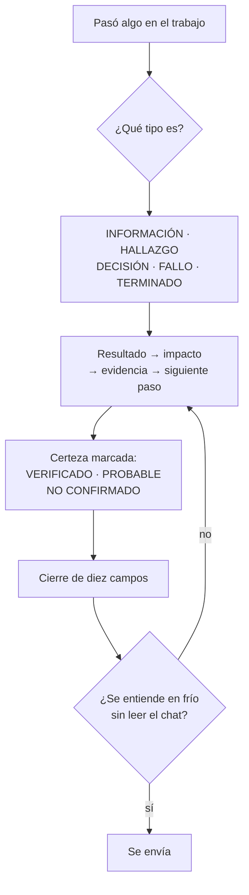

# Comunicación agente → humano

Referencia de las reglas que dicen cómo el [orquestador](../glosario.md#orquestador) le escribe a la persona. Viven en `gobierno/canonico/comunicacion/`.

## En una frase

Cada mensaje dice primero qué pasó y qué significa para ti; el detalle viene después.

## Para qué existe

**El problema.** Un [agente](../glosario.md#agente) puede escribir mucho y decir poco. La persona tiene poco tiempo y no recuerda todo el chat. Si la pregunta importante queda al final, se pierde.

**La solución.** Tres reglas fijan la forma de cada mensaje. Solo las carga el orquestador, porque es el único agente que habla con la persona.

| Archivo | Qué fija |
|---|---|
| `01_COMUNICACION_HUMANO.md` | Orden del mensaje, tipo en la primera línea, plantillas y cierre de diez campos |
| `02_PEDAGOGIA_CHAT.md` | Explicar con el problema primero y la palabra técnica después |
| `03_INSIGHTS_ANTI_REINCIDENCIA.md` | Cómo contar lo aprendido y qué control evita repetir un error |

Los cinco tipos de mensaje:

| Tipo | Cuándo |
|---|---|
| INFORMACIÓN | No pide respuesta; se lee por encima |
| HALLAZGO | Apareció un dato nuevo que importa |
| DECISIÓN | Hace falta que la persona elija |
| FALLO | El resultado no fue el esperado |
| TERMINADO | El pedido quedó hecho, con su prueba |

## Analogía

Piensa en el **parte de un médico** en la sala de espera.

- Primero dice cómo está el paciente. Después explica el porqué.
- Si necesita una firma, lo dice claro y al principio.
- No usa palabras raras sin explicarlas.

Límite de la analogía: el médico habla una vez. Aquí cada mensaje termina con el mismo tablero de diez campos, para leerlo rápido.

## Diagrama

Cómo se arma un mensaje.

## Ejemplo de punta a punta

**Situación.** Al activar el [glosario](../glosario.md), el [gate](../glosario.md#gate) marcó «[Go](../glosario.md#go)» dentro de `legibilidad.go`. Era un falso aviso.

1. **Tipo.** El mensaje abrió como FALLO, porque el resultado no fue el esperado.
2. **Esperado contra observado.** Se esperaba ningún aviso. Salió uno por un nombre de archivo.
3. **Causa verificada.** El programa no veía el punto antes de «go». Ese punto marca una extensión.
4. **Corrección probada.** Primero una prueba que fallaba. Luego el arreglo, y la prueba pasó.
5. **Insight.** Hecho, causa, lección, control y estado: «implementado y probado». El control quedó en `TestExtensionDeArchivoNoEsTermino`.
6. **Cierre.** El tablero de diez campos dijo qué falta: abrir un enlace del glosario y confirmar que salta.

## Paso a paso

Antes de enviar un mensaje, el orquestador revisa:

1. ¿La primera línea dice el tipo?
2. ¿El resultado se ve en cinco segundos?
3. ¿Cada palabra técnica está explicada o enlazada?
4. ¿Lo probado está separado de lo que se supone?
5. ¿Las preguntas van juntas, numeradas y con una recomendación?
6. ¿Sobra alguna frase? Si sobra, se quita.

## Cómo se usa

- Leer las reglas completas: [comunicación](../../gobierno/canonico/comunicacion/01_COMUNICACION_HUMANO.md), [pedagogía](../../gobierno/canonico/comunicacion/02_PEDAGOGIA_CHAT.md) e [insights](../../gobierno/canonico/comunicacion/03_INSIGHTS_ANTI_REINCIDENCIA.md).
- Cambiarlas: edita el [canónico](../glosario.md#canónico). El [compilador](../glosario.md#compilador) las copia al archivo del orquestador.
- Límite: el [hook](../glosario.md#hook) de cierre revisa poco del mensaje. Frena propuestas sin diagrama e insights propuestos sin defecto. También frena comandos en un shell que no es el tuyo. Hay un [hook](../glosario.md#hook) de tu usuario, fuera del repo, que frena algunas fallas. Lo demás es criterio humano: si un mensaje no se entiende, dilo.

## Navegación

- ↑ Subir: [Inicio](../README.md)
