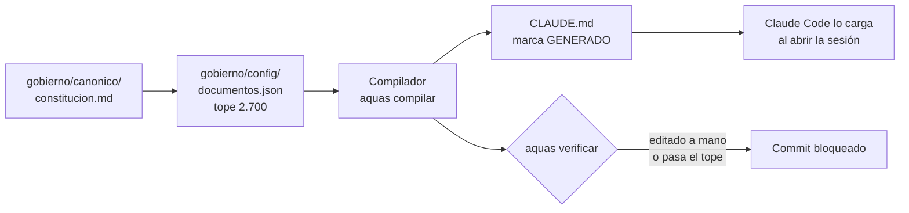

# Constitución

Referencia de la ley principal del repositorio. Vive en `gobierno/canonico/constitucion.md` y se copia a `CLAUDE.md`.

## En una frase

La constitución son las nueve reglas que todo [agente](../glosario.md#agente) lee al empezar a trabajar aquí.

## Para qué existe

**El problema.** Claude Code empieza cada sesión sin memoria. Si las reglas base no están a mano, el agente improvisa.

**La solución.** Claude Code carga `CLAUDE.md` al inicio de cada sesión. Ese archivo es [derivado](../glosario.md#derivado): sale del [canónico](../glosario.md#canónico) de la constitución. Así las reglas llegan siempre, sin que nadie las pegue en el chat.

Qué contiene:

| Parte | Qué dice |
|---|---|
| Misión | Este repo gobierna y genera la base de todo proyecto con Claude Code |
| Principios | Nueve reglas: lo escrito manda, la máquina revisa, Go como único lenguaje, un cambio por commit… |
| Canónicos y compilación | Qué archivos se editan, cuáles se generan y cómo se sellan |
| Mapa del repo | Qué guarda cada carpeta |

Tiene un tope: 2.700 caracteres. Es texto que el agente carga siempre, y cada carácter cuesta.

## Analogía

Piensa en el **reglamento pegado en la puerta** de un taller.

- Todo el que entra lo ve, aunque sea su primer día.
- Es corto a propósito: nadie lee diez páginas en la puerta.
- Los detalles están en manuales dentro del taller.

Límite de la analogía: un reglamento de papel se puede tachar a mano. Aquí no: si alguien edita `CLAUDE.md` directo, el [gate](../glosario.md#gate) lo detecta.

## Diagrama

Cómo llega la constitución a cada sesión.

## Ejemplo de punta a punta

**Situación.** Alguien quiere agregar una regla nueva a la constitución.

1. Hoy `CLAUDE.md` mide 2.696 caracteres. El tope es 2.700. Quedan solo cuatro.
2. Si la regla se agrega tal cual, el gate falla: «excede presupuesto».
3. La salida correcta es recortar otra frase o mover el detalle a un archivo aparte.
4. Otro caso: alguien corrige `CLAUDE.md` a mano para ir rápido.
5. El gate responde: `CLAUDE.md: desfasado o editado a mano`. Lo probamos de verdad al escribir esta página.
6. Se deshace la edición, se cambia el canónico y se ejecuta el [compilador](../glosario.md#compilador). El [commit](../glosario.md#commit) entra.

## Paso a paso

Para cambiar la constitución:

1. Edita `gobierno/canonico/constitucion.md`. Nunca `CLAUDE.md`.
2. Escribe en formato corto: una idea por línea, sin relleno.
3. Ejecuta `go run ./cmd/aquas compilar`.
4. Ejecuta `go run ./cmd/aquas verificar` y busca «GATE OK».

## Cómo se usa

- Leer la ley: abre la [constitución](../../gobierno/canonico/constitucion.md).
- Cambiar el tope: edita `max_caracteres` en `gobierno/config/documentos.json`. Subirlo cuesta [tokens](../glosario.md#token) en cada sesión.
- Si sale «excede presupuesto», recorta el canónico antes de subir el tope.

## Navegación

- ↑ Subir: [Inicio](../README.md)
