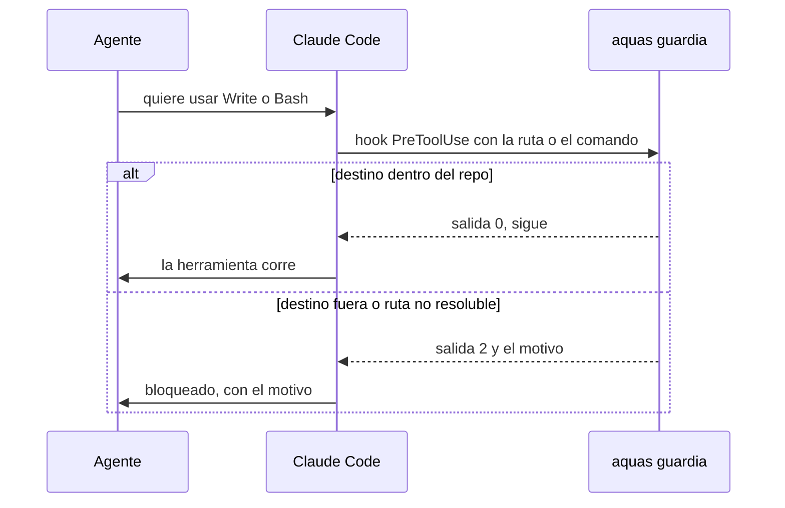

# Guardia: nada se escribe fuera del repo

Referencia de la regla de oro número 5 del [orquestador](../glosario.md#orquestador). Vive en `internal/guardia/` y corre como [hook](../glosario.md#hook) antes de cada herramienta.

## En una frase

Antes de que el [agente](../glosario.md#agente) escriba un archivo o corra un comando, un programa revisa el destino. Si queda fuera del repositorio, lo bloquea.

## Para qué existe

**El problema.** Un agente puede escribir en cualquier carpeta de tu computadora. Una prueba mal hecha puede dejar archivos en tu perfil o pisar tu configuración personal.

**La solución.** Una regla escrita no basta, porque depende de que el agente se acuerde. Por eso es un [gate](../glosario.md#gate): un programa en [Go](../glosario.md#go) que mira cada escritura antes de que ocurra.

Qué revisa:

| Herramienta | Qué mira |
|---|---|
| Write, Edit, NotebookEdit | La ruta del archivo |
| Bash | Redirecciones `>` y `>>`, `cd`, y los destinos de `rm`, `mv`, `cp`, `mkdir`, `touch`, `tee`, `sed -i`, `git clone`, `curl -o` y otros |

Qué deja pasar: leer fuera del repo, `/dev/null` y `2>&1`.

## Analogía

Piensa en el **portero de un edificio**.

- Puedes mirar por la ventana todo lo que quieras.
- Pero si intentas sacar algo por la puerta, el portero revisa a dónde va.
- Si no puede leer la dirección del paquete, no lo deja salir.

Límite de la analogía: el portero solo ve lo que pasa por la puerta. Si un programa escribe por su cuenta, por ejemplo un script de Python, la guardia no lo ve.

## Diagrama

Qué pasa con cada herramienta.

## Ejemplo de punta a punta

**Situación.** Jesús pidió: «que no puedas escribir nada fuera de este repositorio».

1. Primero se escribieron las pruebas. Hay 18 comandos que deben fallar, como `echo x > ~/nota.txt`.
2. También hay 11 comandos que deben pasar, como `cat ~/.claude/settings.json`, que solo lee.
3. Para confirmar que las pruebas vigilan, se rompió el programa a propósito. Fallaron 9 casos.
4. Al conectar el hook apareció un error escondido. `go run` cambia la salida 2 por 1, y la salida 1 no bloquea.
5. La solución fue `.claude/hooks/aquas.sh`. Compila el programa en `.tmp/` y lo corre directo, así la salida 2 llega intacta.
6. Ese mismo script guarda los temporales de Go en `.tmp/`. Antes, el hook escribía fuera del repo sin que nadie lo notara.

## Paso a paso

Así decide la guardia con un comando de Bash:

1. Quita el texto de los heredocs, porque es contenido y no comandos.
2. Corta el comando en partes, en cada `&&`, `;` o `|`.
3. Sigue cada `cd` para saber en qué carpeta está.
4. Busca los destinos de escritura de cada parte.
5. Si un destino usa una variable que no conoce, bloquea: no puede probar que esté dentro.
6. Si algún destino queda fuera de la raíz del repo, bloquea con el motivo.

## Cómo se usa

- No hay que llamarla: corre sola antes de cada herramienta.
- Si te bloquea, el mensaje dice la ruta. Usa una ruta dentro del repo, por ejemplo `.tmp/`.
- Probar: `go test ./internal/guardia/`.
- Límites: no ve programas que escriben por su cuenta, ni `git -C`, `tar -C` o enlaces que salen del repo. Eso es criterio humano.
- Código: [guardia.go](../../internal/guardia/guardia.go) y [aquas.sh](../../.claude/hooks/aquas.sh).

## Navegación

- ↑ Subir: [Inicio](../README.md)
